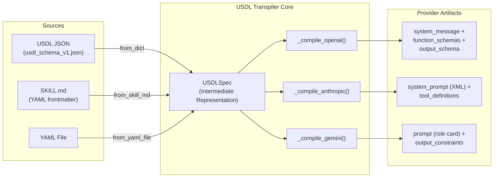
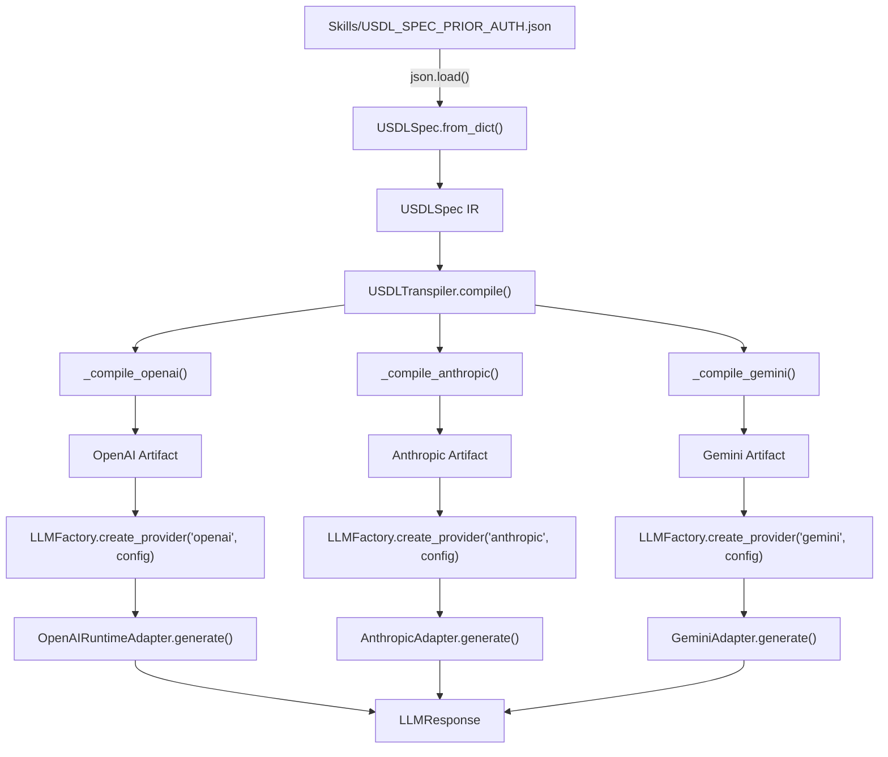

The **USDL Transpiler** is the compile-time bridge between declarative skill definitions and executable LLM prompts. It transforms a single, model-agnostic **Universal Skill Description Language (USDL)** specification into provider-optimized artifacts for Anthropic, OpenAI, and Gemini — eliminating the need to author and maintain separate prompt files for each LLM backend. Write a skill once in USDL; the transpiler emits the system prompts, function schemas, XML structures, and safety guardrails that each provider expects natively.

Sources: [usdl_transpiler.py](biokernel/optimizer/usdl_transpiler.py#L1-L22), [USDL_OVERVIEW.md](docs/USDL_OVERVIEW.md#L17-L28)

## Why a Transpiler?

Biomedical AI skills are complex: they carry input/output contracts, safety policies, audit requirements, and domain-specific instructions. Maintaining these across three fundamentally different LLM APIs is error-prone and leads to **drift** — the OpenAI version of a clinical skill subtly diverges from the Anthropic version, creating compliance risk. The transpiler enforces a **single source of truth**: the USDL spec. Every compiled artifact is derived, never hand-authored, so safety checks and audit policies travel identically to every provider.

| Pain Point | Without Transpiler | With Transpiler |
|---|---|---|
| Prompt format | Hand-write XML for Claude, JSON Schema for OpenAI, role cards for Gemini | Auto-generated from one spec |
| Safety policy sync | Copy-paste across providers; drift inevitable | Compiled into every artifact automatically |
| Tool schema format | `input_schema` for Claude, `parameters` for OpenAI, text descriptions for Gemini | Schema helpers emit correct dialect per provider |
| Adding a new skill | Write 3+ prompt variants | Write 1 USDL JSON; call `compile_all()` |
| Audit traceability | Manual | `audit_policy` embedded in every payload |

Sources: [USDL_OVERVIEW.md](docs/USDL_OVERVIEW.md#L35-L44), [usdl_transpiler.py](biokernel/optimizer/usdl_transpiler.py#L96-L116)

## Architecture: From Spec to Provider Artifact

The transpiler sits between the **USDL schema layer** and the **LLM provider adapter layer**. It consumes a `USDLSpec` (the canonical intermediate representation) and emits a dictionary of provider-specific payloads. The adapters then consume these payloads at runtime through the `LLMProvider` interface.



Sources: [usdl_transpiler.py](biokernel/optimizer/usdl_transpiler.py#L34-L93), [usdl_schema_v1.json](biokernel/schema/usdl_schema_v1.json#L1-L30)

## The USDLSpec Intermediate Representation

The `USDLSpec` dataclass is the transpiler's internal model — a normalized view of a biomedical skill that strips away format-specific noise (JSON vs YAML vs Markdown) and exposes only what the compilation passes need. Three factory methods parse different source formats into this same representation:

| Factory Method | Source Format | Key Behavior |
|---|---|---|
| `USDLSpec.from_dict()` | Parsed JSON/YAML dict | Direct field mapping; no inference |
| `USDLSpec.from_skill_md()` | SKILL.md with YAML frontmatter | Parses `---`-delimited frontmatter via PyYAML; infers safety checks by scanning body for keywords like "safety", "risk", "contraindication" |
| `USDLSpec.from_yaml_file()` | Standalone YAML file | Loads via `yaml.safe_load()`, unwraps `skill:` key if present, delegates to `from_dict()` |

The dataclass fields map directly to the transpilation concerns:

- **`name` / `description`** — Used in system prompt headers across all providers
- **`inputs` / `outputs`** — Lists of `FieldSpec` objects; compiled into JSON Schema (OpenAI), XML field definitions (Anthropic), or plain-text input/output blocks (Gemini)
- **`safety_checks`** — String list injected verbatim into every provider's output; never omitted
- **`audit_policy`** — Defaults to "Log decisions to event bus"; embedded in every compiled artifact
- **`instructions_body`** — The freeform instruction text that forms the core of the system prompt
- **`version` / `category`** — Metadata carried through for observability

Sources: [usdl_transpiler.py](biokernel/optimizer/usdl_transpiler.py#L34-L93), [USDL_SPEC_PRIOR_AUTH.json](Skills/USDL_SPEC_PRIOR_AUTH.json#L1-L40)

## Provider-Specific Compilation

The `USDLTranspiler.compile()` method dispatches to one of three private compilation methods based on the `Provider` enum. Each method produces a distinct artifact structure optimized for its target LLM's native strengths.

### OpenAI Compilation

The OpenAI path produces a **system message + function schemas + output schema** bundle. The system message is a Markdown-structured string combining the skill description, instructions body, and safety checks. Function schemas follow the OpenAI function calling format using the `parameters` key (not `input_schema`). The output schema is a standard JSON Schema object with `properties` and `required` arrays.

```python
# Result structure from _compile_openai()
{
    "provider": "openai",
    "system_message": "You are the 'Prior Authorization Agent' biomedical agent. ...",
    "function_schemas": [{
        "name": "prior_authorization_agent",
        "description": "Review prior authorization requests...",
        "parameters": {"type": "object", "properties": {...}, "required": [...]}
    }],
    "output_schema": {"type": "object", "properties": {...}, "required": [...]},
    "safety_checks": ["Never hallucinate policy references.", ...],
    "audit_policy": "Post determination + trace to event bus..."
}
```

### Anthropic Compilation

The Anthropic path renders a **fully XML-structured system prompt** that leverages Claude's strength at parsing tagged content. The `_render_xml_prompt()` method wraps every element — role, description, version, instructions, inputs, outputs, safety, audit — in semantic XML tags. Tool definitions use the `input_schema` key (matching Claude's API contract, distinct from OpenAI's `parameters`).

```xml
<system>
  <role>Prior Authorization Agent</role>
  <description>Review prior authorization requests...</description>
  <version>1.0.0</version>
  <instructions>...</instructions>
  <inputs>
    <input name='clinical_note' type='string' required='True'>...</input>
    <input name='procedure_code' type='string' required='True'>...</input>
  </inputs>
  <outputs>
    <output name='decision' type='string'>APPROVED or DENIED</output>
    <output name='rationale' type='string'>Clinical reasoning</output>
  </outputs>
  <safety>
    <policy>Never hallucinate policy references.</policy>
    <policy>Escalate unclear cases to human reviewers.</policy>
  </safety>
  <audit>Post determination + trace to event bus...</audit>
</system>
```

### Gemini Compilation

The Gemini path generates a **plain-text role card** with clear section separators — a format that plays to Gemini's strength at long-context reasoning and structured input parsing. Inputs and outputs are rendered as bulleted lists with type annotations. Safety checks are listed under a dedicated "Safety:" section.

```python
# Result structure from _compile_gemini()
{
    "provider": "gemini",
    "prompt": "Role: Prior Authorization Agent\nObjective: ...\n--- INSTRUCTIONS ---\n...\n---\nInputs:\n- clinical_note (string): ...\nExpected Outputs:\n- decision (string): ...\nSafety:\n- Never hallucinate policy references.",
    "output_constraints": ["decision", "rationale"],
    "audit_policy": "..."
}
```

Sources: [usdl_transpiler.py](biokernel/optimizer/usdl_transpiler.py#L127-L248), [USDL_OVERVIEW.md](docs/USDL_OVERVIEW.md#L20-L27)

## Schema Helpers and Key Differences

The transpiler's private schema helpers translate `FieldSpec` lists into the dialect each provider expects. The difference is subtle but critical: **OpenAI uses `parameters` while Anthropic uses `input_schema`** — both containing the same JSON Schema structure underneath.

| Aspect | OpenAI | Anthropic | Gemini |
|---|---|---|---|
| Tool schema key | `parameters` | `input_schema` | Not used (text-based) |
| Prompt structure | Markdown system message | XML-tagged system prompt | Plain-text role card |
| Output definition | `output_schema` (JSON Schema) | XML `<outputs>` tags | `output_constraints` (name list) |
| Safety injection | Appended to system message as `### Safety` section | Wrapped in `<safety><policy>` tags | Bulleted `Safety:` section |
| Thinking support | Not included (add via meta-prompter) | XML structure supports `<thinking>` blocks | "Think step-by-step" hint |

> [!TIP]
> The `_openai_functions()` and `_anthropic_tools()` methods produce nearly identical JSON Schema objects internally — the only difference is the top-level key name (`parameters` vs `input_schema`). If you extend the transpiler for a new provider, reuse `_json_schema()` for the schema body and only change the wrapper key.

Sources: [usdl_transpiler.py](biokernel/optimizer/usdl_transpiler.py#L218-L248), [anthropic_adapter.py](biokernel/adapters/anthropic_adapter.py#L274-L280)

## Compilation Workflow: End to End

The following diagram traces the full path from a USDL JSON source file through transpilation to runtime execution via the adapter layer:



Sources: [usdl_transpiler.py](biokernel/optimizer/usdl_transpiler.py#L96-L116), [factory.py](biokernel/adapters/factory.py#L61-L97), [USDL_OVERVIEW.md](docs/USDL_OVERVIEW.md#L30-L42)

## Using the Transpiler

### Programmatic API

The primary interface is `USDLTranspiler.compile(spec, provider)`, which returns a `Dict[str, Any]` containing the provider-specific artifact. Use `compile_all()` to generate artifacts for every provider simultaneously.

```python
from biokernel.optimizer.usdl_transpiler import USDLTranspiler, USDLSpec, Provider
import json

# Load from a USDL JSON file
spec = USDLSpec.from_dict(json.load(open("Skills/USDL_SPEC_PRIOR_AUTH.json")))

# Compile for a single provider
transpiler = USDLTranspiler()
openai_payload = transpiler.compile(spec, Provider.OPENAI)
anthropic_payload = transpiler.compile(spec, Provider.ANTHROPIC)
gemini_payload = transpiler.compile(spec, Provider.GEMINI)

# Compile for all providers at once
all_artifacts = transpiler.compile_all(spec)
# Returns: {"openai": {...}, "anthropic": {...}, "gemini": {...}}
```

### Loading from SKILL.md

The `from_skill_md()` class method parses Markdown files with YAML frontmatter — the standard skill authoring format in this platform. It extracts `name` and `description` from the frontmatter and treats the remaining body as `instructions_body`. Safety checks are inferred automatically by scanning the body for safety-critical keywords.

```python
with open("Skills/Genomics/single_cell_qc/SKILL.md") as f:
    spec = USDLSpec.from_skill_md(f.read())

artifact = transpiler.compile(spec, Provider.ANTHROPIC)
```

### CLI Usage

The transpiler includes a built-in CLI for quick artifact inspection. Pass `--file` with a YAML/JSON path and an optional provider name:

```bash
# Default: runs a demo with the built-in Prior Auth spec
python -m biokernel.optimizer.usdl_transpiler

# Compile a specific file for Anthropic
python -m biokernel.optimizer.usdl_transpiler --file Skills/USDL_SPEC_PRIOR_AUTH.json anthropic

# Compile for OpenAI
python -m biokernel.optimizer.usdl_transpiler --file my_skill.yaml openai
```

Sources: [usdl_transpiler.py](biokernel/optimizer/usdl_transpiler.py#L278-L326), [USDL_OVERVIEW.md](docs/USDL_OVERVIEW.md#L30-L42), [TUTORIAL_USDL_TRANSPILER.md](biokernel/optimizer/TUTORIAL_USDL_TRANSPILER.md#L28-L62)

## The Prompt Optimizer Companion

Alongside the structural transpiler, the `meta_prompter.py` module provides **runtime prompt optimization** — applying provider-specific prompt engineering best practices to any biomedical query. While the transpiler compiles *skill structure* (inputs, outputs, schemas), the meta-prompter optimizes *prompt content* (formatting, thinking cues, safety framing).

| Optimization Target | Claude Strategy | OpenAI Strategy | Gemini Strategy |
|---|---|---|---|
| Structure | XML tags (`<system>`, `<instructions>`, `<user_query>`) | Markdown sections (`### SYSTEM`, `### USER`) | Role card + separator lines (`====`) |
| Reasoning | "Think step-by-step" + XML framing | Concise system instruction + format hints | "Provide comprehensive, multi-faceted analysis" |
| Safety | `<safety_guidelines>` XML block | Inline `SAFETY:` block | Bulleted `Safety Requirements:` section |
| Evidence | "Cite sources with PMIDs or DOIs" | "Cite sources when possible" | "Include citations to primary literature" |

> [!TIP]
> The transpiler and meta-prompter operate at different layers and compose cleanly. Use the transpiler to build the *skill skeleton* (system prompt + schemas), then pass the user's actual query through the meta-prompter before sending it to the adapter. This separation ensures structural consistency (transpiler) and content optimization (meta-prompter) evolve independently.

Sources: [meta_prompter.py](biokernel/optimizer/meta_prompter.py#L1-L34), [meta_prompter.py](biokernel/optimizer/meta_prompter.py#L62-L165)

## USDL Schema v1: The Contract

The canonical JSON Schema at [usdl_schema_v1.json](biokernel/schema/usdl_schema_v1.json) defines the full contract for USDL specifications. Beyond the core fields that the transpiler consumes, the schema includes several forward-looking sections that future optimizer passes will leverage:

| Schema Section | Purpose | Transpiler Status |
|---|---|---|
| `skill.id` | Unique identifier in `domain.category.name` format | Carried as metadata |
| `skill.capabilities` | Named capability entries with inputs/outputs | Mapped to `FieldSpec` lists |
| `skill.prompts` | System prompt, user template, few-shot examples | Mapped to `instructions_body` |
| `skill.tools` | Python functions, API endpoints, MCP tools, shell commands | Not yet compiled (reserved for DAG engine) |
| `skill.dependencies` | Python packages, system deps, data, models | Not yet compiled (reserved for runtime) |
| `skill.platform_configs` | Per-provider flags (MCP server, GPT actions, Gemini extension) | Partially used via `compile()` |
| `skill.validation.test_cases` | Input/output assertion pairs | Not yet compiled (reserved for evaluator) |
| `skill.evals` | Automated eval cases with assertions (contains, regex, biomedical_entity) | Not yet compiled (reserved for evaluation framework) |
| `skill.optimization` | Target metrics and platform-specific hints | Partially used via meta-prompter |

Sources: [usdl_schema_v1.json](biokernel/schema/usdl_schema_v1.json#L1-L200), [usdl_schema_v1.json](biokernel/schema/usdl_schema_v1.json#L200-L318)

## Real-World Example: Prior Authorization Coworker

The repository includes a production-grade USDL spec at `Skills/USDL_SPEC_PRIOR_AUTH.json` — a **Prior Authorization Coworker** that evaluates medical necessity requests against payer policy. This spec demonstrates all transpiler features:

- **Two inputs**: `clinical_note` (unstructured text) and `procedure_code` (CPT/HCPCS code)
- **Three outputs**: `decision` (APPROVED/DENIED), `justification` (policy criteria array), `escalation_required` (boolean)
- **Three safety checks**: Quote payer policy verbatim, escalate on incomplete data, never invent patient data
- **Explicit audit policy**: Persist every response plus thinking trace to BioKernel AuditLog

When compiled through the transpiler, this single 40-line JSON produces three complete provider artifacts — each with the correct schema dialect, prompt structure, and embedded safety policies — ready for immediate use with the adapter layer.

Sources: [USDL_SPEC_PRIOR_AUTH.json](Skills/USDL_SPEC_PRIOR_AUTH.json#L1-L40), [usdl_transpiler.py](biokernel/optimizer/usdl_transpiler.py#L278-L314)

## What Comes Next

The transpiler is the first stage in the cross-provider pipeline. After compilation, the generated artifacts flow into the adapter layer for actual LLM invocation:

- **[LLM Provider Adapters](9-llm-provider-adapters)** — How each adapter (`AnthropicAdapter`, `OpenAIRuntimeAdapter`, `GeminiAdapter`) consumes transpiler output and translates it into provider API calls, including multi-turn agentic loops with tool execution
- **[Semantic Skill Router](5-semantic-skill-router)** — How incoming queries are matched to USDL specs before transpilation occurs
- **[DAG Workflow Engine](6-dag-workflow-engine)** — How the `skill.tools` definitions in USDL specs will be compiled into executable workflow graphs
- **[Biomedical Evaluation Framework](13-biomedical-evaluation-framework)** — How the `skill.evals` section enables automated testing of compiled skills across providers