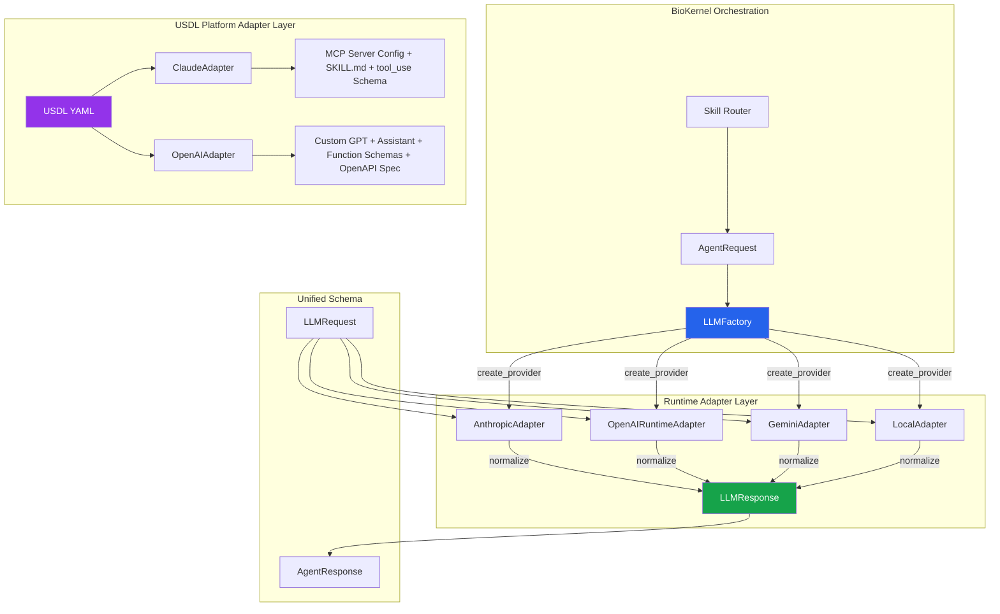

BioKernel's adapter layer is the **bridge between provider-agnostic skill logic and provider-specific API realities**. It exists in two distinct layers: a *Runtime Adapter Layer* that normalizes LLM inference calls into a unified `LLMRequest`/`LLMResponse` contract, and a *USDL Platform Adapter Layer* that transpiles skill definitions into provider-native deployment formats (Custom GPTs, MCP Servers, Assistants, OpenAPI specs). This dual-layer architecture is what makes the "write once, run on any provider" promise real — skills express intent once in USDL, and adapters handle both execution-time translation and deployment-time packaging.

Sources: [factory.py](/biokernel/adapters/factory.py#L1-L119), [llm_provider.py](/biokernel/interface/llm_provider.py#L1-L121), [claude_adapter.py](/biokernel/adapters/claude_adapter.py#L1-L50), [openai_adapter.py](/biokernel/adapters/openai_adapter.py#L1-L50)

## Architectural Overview

The adapter system follows a **Strategy + Factory + Registry** pattern. The `LLMProvider` abstract base class defines the contract; concrete adapters implement provider-specific translation; the `LLMFactory` manages registration, instantiation, and caching. Separately, the USDL adapters (`ClaudeAdapter`, `OpenAIAdapter`) operate at the skill-definition level, converting declarative USDL YAML into provider-native artifacts.



> [!TIP]
> The Runtime Adapter Layer and USDL Platform Adapter Layer serve fundamentally different lifecycle stages: runtime adapters are invoked per-request during skill execution, while USDL adapters run once during skill packaging/deployment. Don't confuse `AnthropicAdapter` (runtime inference) with `ClaudeAdapter` (USDL-to-Claude format transpilation).

Sources: [factory.py](/biokernel/adapters/factory.py#L30-L60), [runtime_adapter.py](/biokernel/adapters/runtime_adapter.py#L1-L92), [claude_adapter.py](/biokernel/adapters/claude_adapter.py#L24-L48), [openai_adapter.py](/biokernel/adapters/openai_adapter.py#L25-L51)

## The LLMProvider Contract

Every runtime adapter must implement the `LLMProvider` abstract base class. This contract is the **single source of truth** for what "being a provider" means inside BioKernel. It defines five core operations plus two convenience methods:

| Method | Purpose | Return Type |
|---|---|---|
| `initialize(config)` | Configure API keys, model selection, and validate connectivity | `bool` |
| `provider_name` | Canonical provider identifier (e.g., `"anthropic"`, `"openai"`) | `str` |
| `is_available` | Runtime health flag — `True` only after successful initialization | `bool` |
| `generate(request)` | Single-turn LLM inference with full schema normalization | `LLMResponse` |
| `generate_with_tools(request, tool_executor, max_iterations)` | Multi-turn agentic loop: generate → tool_call → execute → feed back | `LLMResponse` |
| `stream(request)` | Token-by-token streaming (falls back to `generate()` if unsupported) | `AsyncIterator[str]` |
| `check_health()` | Probe provider reachability and latency | `Dict[str, Any]` |

The contract enforces that all input and output flows through the unified `LLMRequest` and `LLMResponse` Pydantic models, meaning the orchestration layer never sees raw provider APIs — only the normalized schema.

Sources: [llm_provider.py](/biokernel/interface/llm_provider.py#L30-L121)

## Unified I/O Schema

The `LLMRequest` and `LLMResponse` models are the **interchange format** that makes provider switching transparent. Every adapter translates between its native API and these schemas.

**LLMRequest** carries the full specification of what the orchestration layer needs:

| Field | Type | Default | Purpose |
|---|---|---|---|
| `query` | `str` | *(required)* | Primary user prompt |
| `system_instruction` | `Optional[str]` | `None` | System-level directive |
| `messages` | `List[LLMMessage]` | `[]` | Multi-turn conversation history |
| `tools` | `Optional[List[ToolDefinition]]` | `None` | Available tools for function calling |
| `temperature` | `float` | `0.7` | Sampling randomness |
| `max_tokens` | `int` | `4096` | Maximum output length |
| `top_p` | `float` | `1.0` | Nucleus sampling threshold |
| `stop_sequences` | `Optional[List[str]]` | `None` | Custom stop triggers |
| `response_format` | `Optional[str]` | `None` | `"json"` for structured output |
| `stream` | `bool` | `False` | Enable streaming mode |
| `context` | `Dict[str, Any]` | `{}` | Arbitrary execution context |

**LLMResponse** normalizes what comes back, regardless of provider:

| Field | Type | Purpose |
|---|---|---|
| `text` | `str` | Generated text content |
| `tool_calls` | `Optional[List[ToolCall]]` | Tool invocations requested by the model |
| `finish_reason` | `FinishReason` | `STOP`, `LENGTH`, `TOOL_CALLS`, `CONTENT_FILTER`, `ERROR` |
| `usage` | `Dict[str, int]` | Token counts: `prompt_tokens`, `completion_tokens`, `total_tokens` |
| `latency_ms` | `float` | End-to-end latency measurement |
| `provider` | `str` | Which adapter served this response |
| `model` | `str` | Actual model identifier used |

Sources: [io_types.py](/biokernel/schema/io_types.py#L1-L130)

## LLMFactory: The Registry and Object Pool

The `LLMFactory` implements a **class-level registry** with lazy default registration and instance caching. It is the single entry point for the orchestration layer to obtain provider instances without coupling to concrete classes.

The factory's lifecycle works in three phases. **Registration** populates the `_registry` dict mapping canonical names to adapter classes — `register_defaults()` auto-registers the four built-in adapters (`anthropic`, `openai`, `gemini`, `local`), and `register_provider()` allows plugins to add custom adapters at runtime. **Creation** instantiates a provider, calls its `initialize()` method with provider-specific config, and optionally caches the instance for reuse. **Lookup** via `get_provider()` retrieves cached instances, while `list_providers()` reports availability status across all registered adapters.

```python
# Creating a provider through the factory
from biokernel.adapters.factory import LLMFactory

provider = LLMFactory.create_provider(
    "anthropic",
    {"api_key": "sk-ant-...", "model": "claude-sonnet-4-20250514"},
    cache=True
)

# Checking all registered providers
availability = LLMFactory.list_providers()
# {"anthropic": True, "openai": False, "gemini": False, "local": True}
```

> [!TIP]
> The `cache=True` default means calling `create_provider("anthropic", config)` twice returns the *same instance*. If you need a fresh provider (e.g., with different API keys for multi-tenant scenarios), pass `cache=False` or call `LLMFactory.reset()` to clear the pool.

Sources: [factory.py](/biokernel/adapters/factory.py#L30-L119)

## Runtime Adapter Deep Dive

### AnthropicAdapter

The `AnthropicAdapter` wraps the official `anthropic` Python SDK and provides **full-fidelity integration** with the Anthropic Messages API. It is the most feature-complete adapter in the system, supporting single-turn generation, multi-turn agentic tool-use loops, streaming, and the Claude-native content block model.

**Key translation patterns:**

| BioKernel Concept | Anthropic API Mapping |
|---|---|
| `LLMRequest.system_instruction` | `system` parameter (top-level, not in messages) |
| `ToolDefinition` | `{"name", "description", "input_schema"}` (Claude native format) |
| `ToolCall` | `content` block with `type: "tool_use"` |
| `ToolResult` | `{"type": "tool_result", "tool_use_id", "content"}` as user message |
| `FinishReason.STOP` | `stop_reason: "end_turn"` or `"stop_sequence"` |
| `FinishReason.TOOL_CALLS` | `stop_reason: "tool_use"` |

The `generate_with_tools()` method implements a full agentic loop: it sends the initial request, checks for `tool_use` content blocks, invokes the `tool_executor` for each, appends tool results as a user message, and loops until the model returns `end_turn` or the iteration limit is reached. The default model is `claude-sonnet-4-20250514`.

Sources: [anthropic_adapter.py](/biokernel/adapters/anthropic_adapter.py#L1-L297)

### OpenAIRuntimeAdapter

The `OpenAIRuntimeAdapter` wraps the `openai` Python SDK and targets the **Chat Completions API** with function calling. It supports JSON mode via `response_format`, translates tool definitions into OpenAI's function-calling envelope (`{"type": "function", "function": {...}}`), and handles the assistant/tool message flow required by the OpenAI conversation format.

**Key translation patterns:**

| BioKernel Concept | OpenAI API Mapping |
|---|---|
| `LLMRequest.system_instruction` | `{"role": "system", "content": ...}` as first message |
| `ToolDefinition` | `{"type": "function", "function": {"name", "description", "parameters"}}` |
| `ToolCall` | `choice.message.tool_calls[i].function` (JSON-parsed arguments) |
| `ToolResult` | `{"role": "tool", "tool_call_id", "content"}` message |
| `response_format="json"` | `response_format={"type": "json_object"}` |
| `FinishReason.STOP` | `finish_reason: "stop"` |

The agentic loop follows the same generate→tool_call→execute→feed-back pattern as the Anthropic adapter, but uses OpenAI's message format where the assistant message (including tool calls) is appended as-is via `model_dump()`, and tool results are appended as role=`tool` messages. The default model is `gpt-4o`.

Sources: [openai_runtime_adapter.py](/biokernel/adapters/openai_runtime_adapter.py#L1-L274)

### GeminiAdapter

The `GeminiAdapter` wraps the `google-generativeai` SDK and targets the **Gemini GenerativeModel API**. It supports single-turn generation with system instructions and a prompt-based approach to tool use. Because the Gemini SDK's native function calling API differs significantly from the agentic loop pattern, the adapter embeds tool descriptions directly into the prompt with structured output instructions (`TOOL_CALL: <name>(<args>)` and `FINAL_ANSWER: <answer>` markers).

**Key characteristics:**

- Default model: `gemini-2.0-flash`
- System instructions are applied by creating a new `GenerativeModel` instance with the `system_instruction` parameter
- Token usage is estimated via character-count heuristic (`len(text) // 4`) rather than exact API reporting
- The `generate_with_tools()` method delegates to `generate()` with an enhanced prompt — it does not perform a true multi-turn agentic loop

Sources: [gemini_adapter.py](/biokernel/adapters/gemini_adapter.py#L1-L165)

### LocalAdapter

The `LocalAdapter` provides connectivity to **self-hosted models** through two backends: Ollama (preferred, via the `ollama` Python SDK) and any OpenAI-compatible endpoint (vLLM, llama.cpp server, LM Studio) via `httpx`. Initialization probes connectivity by trying Ollama first (`ollama.list()`), then falling back to an HTTP GET to `{api_base}/api/tags`.

**Backend comparison:**

| Aspect | Ollama Backend | OpenAI-Compatible Backend |
|---|---|---|
| Connection test | `ollama.list()` | `GET {api_base}/api/tags` |
| Request format | `ollama.chat(model, messages, options)` | `POST {api_base}/v1/chat/completions` |
| Token reporting | `prompt_eval_count` + `eval_count` from response | `usage` from JSON response |
| Default model | `llama3.1:8b` | `llama3.1:8b` |
| Default base URL | `http://localhost:11434` | `http://localhost:11434` |

Tool use follows the same prompt-embedding strategy as the Gemini adapter — tool descriptions are injected into the query text since most local models have limited native function-calling support.

Sources: [local_adapter.py](/biokernel/adapters/local_adapter.py#L1-L206)

## RuntimeLLMAdapter: The Convenience Singleton

The `RuntimeLLMAdapter` provides a **backward-compatible synchronous interface** for code that expects a simple `complete(system, user_prompt, model)` call rather than the async `generate()` API. It acts as a facade over the factory, automatically selecting the best available provider in preference order: `anthropic → openai → gemini → local`.

The preference cascade reads API keys from environment variables (`ANTHROPIC_API_KEY`, `OPENAI_API_KEY`, `GOOGLE_API_KEY`) and initializes the first provider that reports `is_available == True`. A module-level singleton `llm = RuntimeLLMAdapter()` is exported for legacy imports. When called from an already-running event loop, it offloads to a `ThreadPoolExecutor` to avoid blocking.

```python
# Legacy synchronous usage
from biokernel.adapters.runtime_adapter import llm

result = llm.complete(
    system="You are a biomedical assistant.",
    user_prompt="Explain BRCA1 pathogenic variants."
)
```

Sources: [runtime_adapter.py](/biokernel/adapters/runtime_adapter.py#L1-L92)

## USDL Platform Adapters

While runtime adapters handle *inference*, the USDL platform adapters handle *deployment packaging*. They take a declarative USDL YAML skill definition and produce provider-native deployment artifacts.

### ClaudeAdapter (USDL → Claude)

The `ClaudeAdapter` converts USDL skill definitions into three Claude-specific formats plus a hooks configuration:

| Output Artifact | Format | Purpose |
|---|---|---|
| **SKILL.md** | Markdown | Claude Code skill definition with capabilities, inputs/outputs, system prompts, and examples |
| **MCP Server Config** | JSON | Model Context Protocol server with tools, resources, and prompts for Claude integration |
| **tool_use Schema** | JSON | Claude API `tool_use` format with `name`, `description`, and `input_schema` per capability |
| **Hooks Config** | JSON | Claude Code hooks for pre/post execution validation |

The adapter maps USDL types to JSON Schema types (e.g., `AnnData → string` representing a file path, `DataFrame → string` representing a JSON string), and converts each USDL capability into a Claude tool definition. The MCP server config includes a system prompt resource that can be loaded at runtime.

Sources: [claude_adapter.py](/biokernel/adapters/claude_adapter.py#L24-L327)

### OpenAIAdapter (USDL → OpenAI)

The `OpenAIAdapter` converts USDL skill definitions into four OpenAI-specific formats:

| Output Artifact | Format | Purpose |
|---|---|---|
| **Custom GPT Config** | JSON | GPT Builder configuration with instructions, conversation starters, and capabilities |
| **Assistant Config** | JSON | Assistants API format with tools (code_interpreter + function tools), instructions, and metadata |
| **Function Schemas** | JSON | Function calling definitions compatible with `tools` parameter |
| **OpenAPI Spec** | YAML | OpenAPI 3.0 specification for GPT Actions with security schemes |

The OpenAI adapter adds intelligent defaults: it enables `code_interpreter` when Python dependencies exist in the skill, generates conversation starters from prompt examples (falling back to generic biomedical prompts), and maps each capability to both a function schema and an OpenAPI POST endpoint. The OpenAPI spec includes `ApiKeyAuth` security by default.

Sources: [openai_adapter.py](/biokernel/adapters/openai_adapter.py#L25-L368)

## Adapter Capability Matrix

The following table summarizes feature support across all four runtime adapters:

| Feature | Anthropic | OpenAI | Gemini | Local |
|---|:---:|:---:|:---:|:---:|
| Single-turn generation | ✅ | ✅ | ✅ | ✅ |
| Multi-turn agentic loop | ✅ | ✅ | ⚠ Prompt-based | ⚠ Prompt-based |
| Native tool/function calling | ✅ | ✅ | ❌ | ❌ |
| Streaming | ✅ | ✅ | ❌ | ❌ |
| JSON mode | ❌ | ✅ | ❌ | ❌ |
| System instruction | ✅ | ✅ | ✅ | ✅ |
| Exact token usage | ✅ | ✅ | ❌ Estimated | ✅ (Ollama) |
| Health check | ✅ | ✅ | ✅ | ✅ |
| Async client | ✅ | ✅ | ✅ | ✅ (httpx) |
| Default model | claude-sonnet-4 | gpt-4o | gemini-2.0-flash | llama3.1:8b |

Sources: [anthropic_adapter.py](/biokernel/adapters/anthropic_adapter.py#L38-L55), [openai_runtime_adapter.py](/biokernel/adapters/openai_runtime_adapter.py#L33-L50), [gemini_adapter.py](/biokernel/adapters/gemini_adapter.py#L30-L46), [local_adapter.py](/biokernel/adapters/local_adapter.py#L32-L49)

## Configuration Reference

Provider behavior is configured through `biokernel/config.yaml` and environment variables. The factory reads this config at initialization time to set model names, API key sources, and default parameters.

```yaml
# biokernel/config.yaml
default_provider: "anthropic"  # anthropic | openai | gemini | local

providers:
  anthropic:
    model: "claude-sonnet-4-20250514"
    api_key_env: "ANTHROPIC_API_KEY"
    max_tokens: 4096
    temperature: 0.3

  openai:
    model: "gpt-4o"
    api_key_env: "OPENAI_API_KEY"
    max_tokens: 4096
    temperature: 0.3

  gemini:
    model: "gemini-2.0-flash"
    api_key_env: "GOOGLE_API_KEY"
    max_tokens: 4096
    temperature: 0.3

  local:
    model: "llama3.1:8b"
    api_base: "http://localhost:11434"
    max_tokens: 4096
    temperature: 0.3
```

Each adapter's `initialize()` method resolves the API key by checking `config.get("api_key")` first, then falling back to `os.getenv(config.get("api_key_env"))`. This two-tier resolution supports both direct key injection (for testing) and environment-variable-based configuration (for production).

Sources: [config.yaml](/biokernel/config.yaml#L1-L76), [anthropic_adapter.py](/biokernel/adapters/anthropic_adapter.py#L65-L83), [openai_runtime_adapter.py](/biokernel/adapters/openai_runtime_adapter.py#L52-L70)

## Extending with Custom Providers

The factory's `register_provider()` class method enables **runtime plugin registration** without modifying core code. Any class that implements the `LLMProvider` interface can be registered:

```python
from biokernel.adapters.factory import LLMFactory
from biokernel.interface.llm_provider import LLMProvider

class MyCustomProvider(LLMProvider):
    @property
    def provider_name(self) -> str:
        return "custom"

    @property
    def is_available(self) -> bool:
        return self._available

    def initialize(self, config):
        # Your setup logic
        self._available = True
        return True

    async def generate(self, request):
        # Your inference logic, returning LLMResponse
        ...

    async def generate_with_tools(self, request, tool_executor=None, max_iterations=10):
        # Your agentic loop logic, returning LLMResponse
        ...

# Register before any create_provider() call
LLMFactory.register_provider("custom", MyCustomProvider)
```

After registration, the custom provider is available through the same `LLMFactory.create_provider("custom", config)` interface used by all built-in adapters, and will appear in `LLMFactory.list_providers()` output.

Sources: [factory.py](/biokernel/adapters/factory.py#L38-L47), [llm_provider.py](/biokernel/interface/llm_provider.py#L30-L121)

## Provider Skill Coverage

Beyond the runtime adapters, BioKernel maintains curated operational skills for each provider under `Skills/AI_Providers/`. These skills capture provider-specific operational knowledge — SDK migration paths, deprecation timelines, rate-limit behavior, and cloud deployment tradeoffs:

| Skill Directory | Provider Focus |
|---|---|
| `OpenAI_Platform_Operations_2026/` | Responses API, model selection, migration workflows |
| `Anthropic_Claude_Operations_2026/` | Claude API, deprecation notes, tool-use patterns |
| `Google_Gemini_Operations_2026/` | Gemini model and GenAI SDK operations |
| `AWS_Bedrock_Operations_2026/` | Bedrock Converse API, Guardrails, AgentCore |
| `Azure_AI_Foundry_Operations_2026/` | Azure AI Foundry deployments, identity, safety |
| `Cohere_Platform_Operations_2026/` | Cohere rerank/embed/transcribe surfaces |
| `DeepSeek_API_Operations_2026/` | DeepSeek model integration |
| `Mistral_Platform_Operations_2026/` | Mistral platform operations |
| `XAI_Grok_Operations_2026/` | xAI Grok integration |
| `Frontier_OSS_Models_2026/` | Open-source model ecosystems and deployment |
| `Cloud_AI_Operations_AWS_Azure_2026/` | Cross-cloud deployment tradeoffs |

These skills are distinct from the runtime adapters — they provide **operational guidance** for developers working with specific provider APIs, while the adapters provide **programmatic abstraction** for the BioKernel engine.

Sources: [README.md](/Skills/AI_Providers/README.md#L1-L50)

## Navigation

The adapter layer sits between the [USDL Transpiler](8-usdl-transpiler) (which generates the USDL definitions that platform adapters consume) and the [Semantic Skill Router](5-semantic-skill-router) (which selects skills that runtime adapters execute). For configuration details of all provider settings, see [Configuration Reference](15-configuration-reference). To understand how tool-use flows through the agentic loop at the workflow level, see [DAG Workflow Engine](6-dag-workflow-engine).