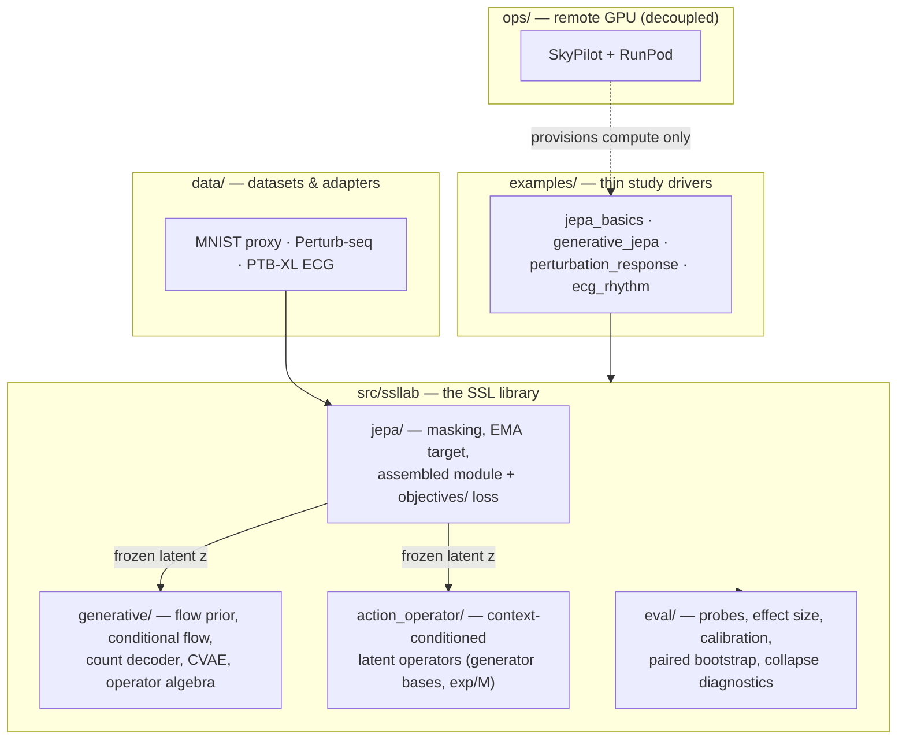

Welcome to **ssl-lab** — a research lab for self-supervised learning (SSL). This page is your starting map: what the repository is for, the ideas at its center, how the code is organized, and where to go next. Everything here is written for a first-time visitor; deeper pages in the catalog expand each section.

Sources: [README.md](README.md#L1-L8), [mkdocs.yml](mkdocs.yml#L1-L8)

## The Mission: Generative Data You Can Trust

ssl-lab develops methods for **generating biological data that can be trusted like measured data**. Generative models already produce convincing images and video; the goal here is the same capability for experiments. The flagship target is **single-cell perturbation data**: given a population of cells and a genetic perturbation — possibly a combination nobody has ever run in the lab — the model generates the perturbed population, including which genes move, by how much, and how much the response varies from cell to cell.

Crucially, "reliable" is **measured, not assumed**. Generated data are scored on the direction and size of predicted effects and on whether generated populations are calibrated — always against strong references such as a from-scratch model of the same task and a training-free baseline.

Sources: [README.md](README.md#L7-L15)

## The Method Line: JEPA at the Center

The core learner is **JEPA** (Joint-Embedding Predictive Architecture). Instead of reconstructing raw pixels or tokens, JEPA predicts the *embeddings* of masked regions from their context. In this codebase the JEPA module assembles three parts: a **student encoder** that sees only context tokens, an **EMA teacher** (an exponential-moving-average copy of the encoder) that encodes the full input and supplies targets, and a small **predictor** that learns to fill in the hidden positions. The training loss is prediction loss plus an anti-collapse regularizer (**VICReg** or **SIGReg**), and the module also exposes a pooled latent `z` — an unmasked, image-level representation that every downstream piece (decoders, priors, probes) consumes.

Sources: [src/ssllab/jepa/model.py](src/ssllab/jepa/model.py#L1-L14), [src/ssllab/jepa/model.py](src/ssllab/jepa/model.py#L30-L62)

## Two Research Directions

JEPA is a *representation learner* by default. ssl-lab pushes it past that in two complementary ways:

| Direction | Idea | Status |
|---|---|---|
| **1. Generative JEPA** — make the representation *sampleable* | Add a prior over the latent and a decoder back to data space. The conditional flow prior `v(z, t, c)` with classifier-free guidance is implemented and method-de-risked; the unconditional slice runs end to end. | Method built + de-risked; applications in progress |
| **2. Action operators** — make prediction *active* | Promote JEPA's fixed, blind "predict region *q*" query into a **learned operator the model chooses** — *sensing* (where to look) and *perturbing* (what an action does) — so the system can form and test hypotheses. | Tutorial corpus written; theory still developing |

The two directions are beginning to **converge**: the condition a generative model needs can itself be produced by an action operator. Flagship applications for Direction 1 include the single-cell perturbation study and digital phenotyping (e.g., diabetes monitoring as a generative personal world model).

Sources: [README.md](README.md#L36-L61), [docs/index.md](docs/index.md#L9-L24)

## Architecture at a Glance

The repository follows a strict layering discipline. Reusable primitives live in `src/ssllab`; each research direction is a subpackage; application logic lives only in thin `examples/` driver scripts; and cloud infrastructure is deliberately quarantined in a top-level `ops/` package that the SSL library never imports.



> [!TIP]
> The **frozen-encoder discipline** is the thread that ties the whole library together: the JEPA encoder is trained once, then everything generative (decoder, flow prior, count decoder) learns on top of its frozen latent `z`. This is why `src/ssllab/jepa/model.py` explicitly documents the pooled `embed` as "used downstream by the decoder, the flow prior, and the linear probe."

Sources: [README.md](README.md#L86-L119), [src/ssllab/jepa/model.py](src/ssllab/jepa/model.py#L12-L13), [ops/README.md](ops/README.md#L1-L10)

## Repository Layout

The project uses a **use-case-driven R&D convention**: intuition in `notebooks/`, reusable primitives in `src/`, thin driver scripts in `examples/`, and infrastructure at the root.

```
ssl-lab/
├── src/ssllab/            # the library (installed as `ssllab`)
│   ├── data/              # modality-agnostic adapters → token tensors
│   ├── models/            # TinyViT backbone, encoder/predictor/decoder
│   ├── jepa/              # masking, EMA target, the assembled JEPA module
│   ├── objectives/        # prediction loss + VICReg collapse regularizer
│   ├── generative/        # flow prior, count decoder, CVAE, operator algebra
│   ├── action_operator/   # latent operators: generator bases, exp(M)
│   ├── eval/              # probes, effect size, calibration, paired bootstrap
│   └── anatomy/           # shape traces for the architecture viewer
├── examples/              # one folder per applied study, numbered scripts
├── notebooks/             # intuition-first walk-throughs
├── ops/                   # SkyPilot + RunPod remote training (decoupled)
├── docs/                  # the tutorial corpus (rendered via mkdocs.yml)
├── data/                  # small local datasets
└── tests/                 # pytest suite (tests/ + ops/tests)
```

The package is lightweight by design: core dependencies are just `torch`, `torchvision`, `numpy`, `scipy`, `scikit-learn`, and `matplotlib`. Heavy extras (single-cell tooling, SkyPilot) are optional and installed only when a specific study needs them.

Sources: [README.md](README.md#L86-L119), [pyproject.toml](pyproject.toml#L6-L30)

## The Two Applied Studies

Two end-to-end studies have run so far, and each follows the lab's methodology: **pre-registered, arms compared within one study, uncertainty reported alongside every number**. Together they answer a narrower question — what JEPA pretraining buys over training the same architecture from scratch.

| | **Perturbation Response** (flagship) | **ECG Rhythm** |
|---|---|---|
| Dataset | Norman 2019 Perturb-seq (single-cell) | PTB-XL, 21,799 twelve-lead ECGs |
| Task | Generate the perturbed cell population for 20 held-out two-gene combinations never measured | Rhythm classification at nested label budgets |
| Pipeline | Cell JEPA pretraining → count decoder → conditional flow / action operator → effect-size eval | Span-masked pretraining → scratch / fine-tune / probe arms → paired patient-cluster bootstrap |
| Key finding | Generative stack graded on effect size and calibration against from-scratch and additive references | With labels for 5% of training patients, pretraining adds **+0.078 macro AUROC** — the advantage fades as labels grow |

The shared lesson: **pretraining pays off when labels are scarce**. Generated samples from the MNIST vertical slice and the ECG label-efficiency curve show the method in action:


Sources: [README.md](README.md#L63-L70)

## Getting Running: Setup and the Vertical Slice

Installation is a standard conda workflow: create the environment from `environment.yml`, activate it, and `pip install -e .`. The fastest way to feel the whole system is the **vertical slice** — five numbered scripts that walk from representation learning to generation:

1. `01_train_jepa_mnist.py` — learn the representation (prints collapse diagnostics each epoch)
2. `02_linear_probe.py` — confirm the frozen latent is semantically useful
3. `03_train_decoder.py` — learn to decode the frozen latent back to pixels
4. `04_train_flow_prior.py` — learn a sampleable prior over the frozen latent
5. `05_sample_and_decode.py` — sample `z ~ prior`, decode → `samples.png`

All artifacts are organized per experiment under `output/<experiment>/` (`checkpoints/`, `samples/`, `reports/`, `logs/`), and every script shares an `--experiment` name so parallel runs stay side by side.

Sources: [README.md](README.md#L121-L160)

## Remote GPU Ops (Optional Infrastructure)

Models too large for a laptop train on remote GPU pods. The infrastructure lives in the top-level `ops/` package: **SkyPilot orchestrates, RunPod is the provider**, and provider switching is a config value rather than hard-coded code. The workflow is a straight line — *compute check → provision pod → run job(s) → fetch results* — with dry-runs by default for safety. Architecturally, `ops` is **deliberately decoupled**: nothing in it imports JEPA, and `ssllab` never imports `ops`; it is used from the repo root without being installed.

> [!TIP]
> You can spot this decoupling in `pyproject.toml`: the pytest config adds `pythonpath = ["."]` and lists `ops/tests` alongside `tests`, so the root-level `ops` package works without installation — a clean library/infrastructure split you'll rarely see done this explicitly.

Sources: [ops/README.md](ops/README.md#L1-L25), [ops/README.md](ops/README.md#L27-L49), [pyproject.toml](pyproject.toml#L20-L39)

## Where to Go Next

A suggested reading path, ordered from hands-on to deep:

**Get Started track** (finish the basics first):
- [Quick Start](2-quick-start) — run the vertical slice yourself with copy-paste commands
- [Repository Layout and Conventions](3-repository-layout-and-conventions) — the `src/` vs `examples/` contract in detail

**Deep Dive track** (understand the machine):
- [Architecture Overview](4-architecture-overview) — how the modules compose
- [Research Directions: Generative and Active JEPA](5-research-directions-generative-and-active-jepa) — the two-line strategy in depth
- [JEPA Module Internals](6-jepa-module-internals) → [Masking Strategies: Random and Span](7-masking-strategies-random-and-span) → [Anti-Collapse: VICReg and SIGReg](8-anti-collapse-vicreg-and-sigreg) — the core, in dependency order

**Going generative**: [Flow-Matching Prior](9-flow-matching-prior) is the entry point of the Generative Stack, or jump straight to an applied pipeline with [Perturbation-Response Pipeline](16-perturbation-response-pipeline) or [ECG Rhythm Study](17-ecg-rhythm-study).

**Browsing by curiosity**: the [Tutorial Corpus and Reading Paths](25-tutorial-corpus-and-reading-paths) page indexes the full `docs/` essay series (Generative JEPA, Time-Series JEPA, Action Operators, Operator World Models), and the repository ships an intuition-first notebook at `notebooks/jepa_basics/01_jepa_intuition.ipynb` for a zero-setup feel of the ideas.
