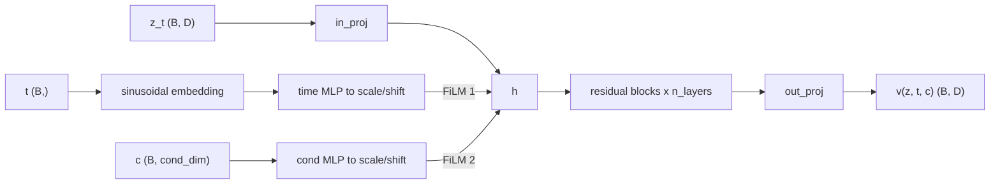
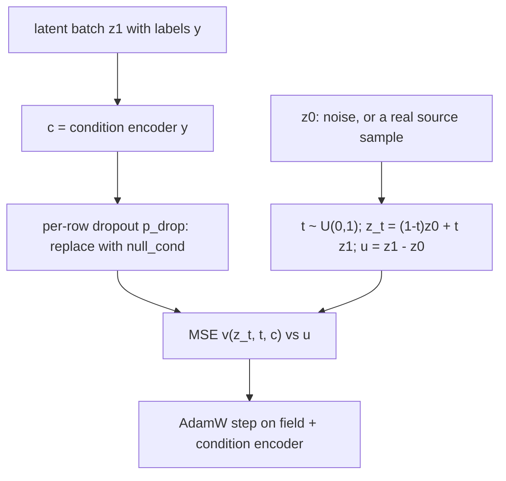
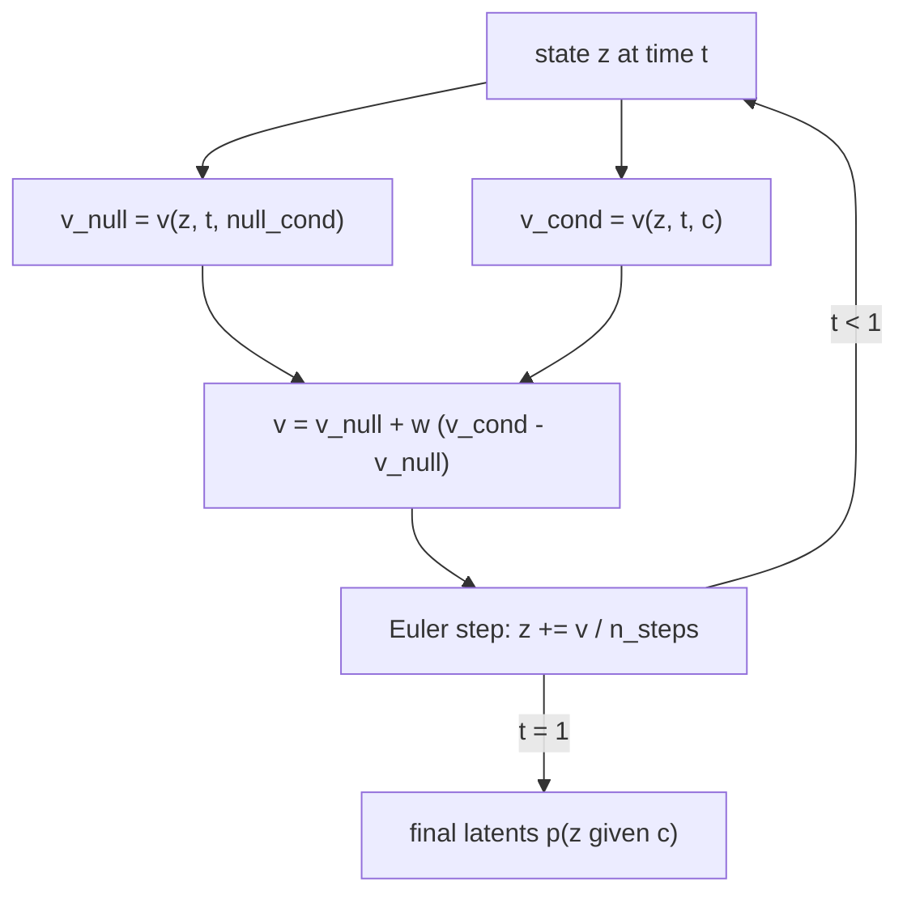
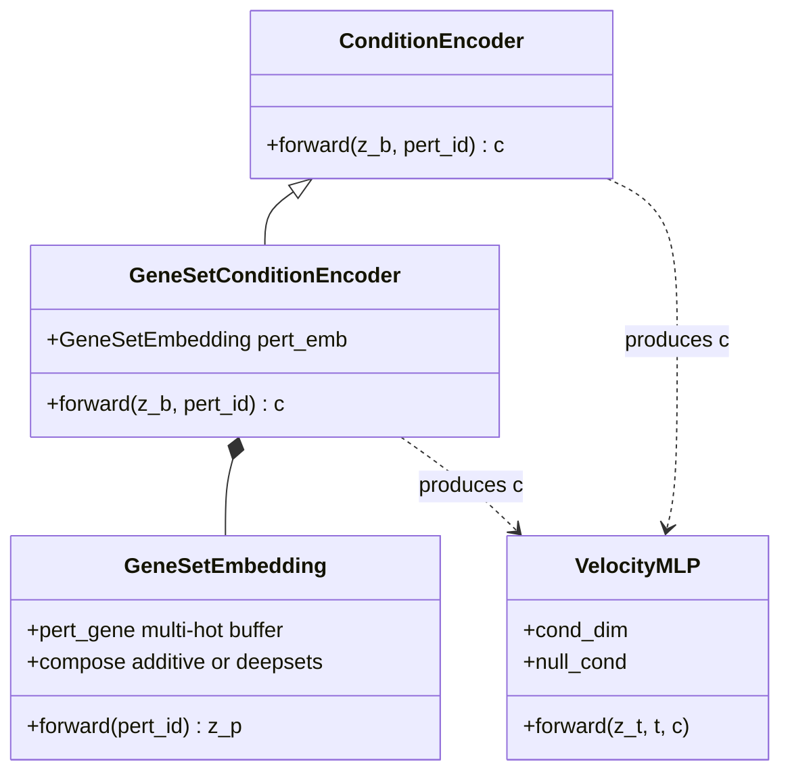
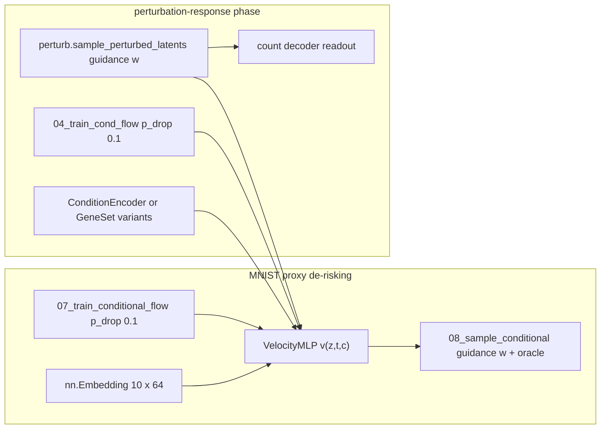

This page documents how the repository turns its unconditional flow-matching prior into a **conditional** generator `v(z, t, c)`, how **classifier-free guidance (CFG)** is trained and applied at sampling time, and how the identical machinery is reused across two very different phases — the MNIST proxy (`examples/generative_jepa/`) and the perturbation-response study (`examples/perturbation_response/`). The unifying design decision is deliberate separation: the velocity field is *modality-agnostic* and knows nothing about what a condition means, while small, swappable **condition encoders** define what `c` is. Sampling-side evaluation then measures **conditional fidelity** with an independent oracle rather than eyeballing samples.

Sources: [flow.py](src/ssllab/generative/flow.py#L1-L38), [07_train_conditional_flow.py](examples/generative_jepa/07_train_conditional_flow.py#L1-L22)

## From v(z,t) to v(z,t,c): One Field, Many Flows

The conditional machinery lives in one class, `VelocityMLP`, which treats conditioning as a *config-time* choice rather than a separate model. Constructing it with `cond_dim=0` reproduces the unconditional prior of [Flow-Matching Prior](9-flow-matching-prior) exactly (and `c` must then be `None`); constructing it with `cond_dim > 0` adds a condition branch. The contract is enforced loudly in `forward()`: if the presence of `c` disagrees with `cond_dim == 0`, a `ValueError` is raised — silently ignoring or hallucinating a condition is treated as a programming error, not a soft warning.

Sources: [flow.py](src/ssllab/generative/flow.py#L61-L109)

The injection mechanism is **FiLM** (feature-wise linear modulation), applied twice: time `t` is embedded sinusoidally and mapped to a `(scale, shift)` pair, and the condition `c` is passed through its own small MLP producing a second `(scale, shift)` pair applied *after* the time FiLM. This ordering matters conceptually — the condition modulates a representation already localized at time `t`, so each condition induces a genuinely different velocity field over the same interpolant path, rather than a global bias added on top.

| Configuration | `cond_dim` | Condition input | `null_cond` token | Contract in `forward()` |
|---|---|---|---|---|
| Unconditional prior | `0` | `c=None` only | not created | raises if `c` provided |
| Conditional field | `> 0` | `(B, cond_dim)` vector | learned `nn.Parameter`, init zeros | raises if `c is None` |

Sources: [flow.py](src/ssllab/generative/flow.py#L79-L92)

> [!TIP]
> The learned `null_cond` token is initialized to **zeros** and trained alongside the field — it is not a fixed sentinel. "Unconditional" in this codebase therefore means "conditioned on a learned no-condition token," which is exactly the shared anchor CFG extrapolates from at sampling time.

## Training the Conditional Field: CFM Loss with Condition Dropout

Training remains rectified-flow flow matching: draw `t ~ U(0,1)`, form the linear interpolant `z_t = (1−t)·z0 + t·z1` with target velocity `u_t = z1 − z0`, and regress `v_θ(z_t, t, c)` onto `u_t` with MSE. The conditional twist is entirely in one helper, `_apply_cond_dropout`: with per-sample probability `p_drop`, each row of the condition batch `c` is replaced by the broadcast learned `null_cond` token. The loss function `cfm_loss` accepts `c` and `p_drop` and no-ops the dropout when `p_drop <= 0`, so the same function trains both the unconditional and conditional fields. This is the classic CFG recipe (Ho & Salimans): one network learns `v(z,t,c)` and `v(z,t,∅)` simultaneously because the null-token rows are ordinary training examples.

Sources: [flow.py](src/ssllab/generative/flow.py#L112-L118), [flow.py](src/ssllab/generative/flow.py#L148-L175)

Both training scripts use the same default dropout rate. The MNIST proxy extracts frozen JEPA latents *with labels*, standardizes them, learns a plain `nn.Embedding(n_classes, cond_dim)` as the condition encoder, and trains field + embedding jointly with AdamW against `cfm_loss(prior, z1, c=c, p_drop=args.p_drop)` (default `--p-drop 0.1`). The checkpoint `prior_cond.pt` therefore bundles the field weights, the class-embedding table, and the standardization statistics needed to de-standardize at sampling.

Sources: [07_train_conditional_flow.py](examples/generative_jepa/07_train_conditional_flow.py#L84-L104), [07_train_conditional_flow.py](examples/generative_jepa/07_train_conditional_flow.py#L105-L120)

## Sampling with Guidance: The Euler ODE and the Velocity Blend

At sampling, `euler_sample` integrates `dz/dt = v(z, t, c)` from the source (`t=0`) to data (`t=1`) with `n_steps` explicit Euler updates. The guidance branch is three lines: when `c` is provided and `guidance != 1.0`, the null-token vector is expanded once outside the loop, and each step computes

`v = v_null + w · (v_cond − v_null)`

where `w = guidance`. This is CFG as **velocity extrapolation**: the conditional field's displacement *away from* the unconditional field is scaled, sharpening condition adherence (higher fidelity) at the cost of diversity — and, when `w > 1`, at the cost of pushing samples outside the training distribution's support. With `guidance = 1.0` (the default in both sampling scripts) the blend collapses algebraically to `v_cond`, so the code takes a single forward pass and the null token stays inert.

| `guidance` | Semantics | Forward passes per Euler step | Used by |
|---|---|---|---|
| `1.0` (default) | plain conditional sampling, null token inert | 1 | `08_sample_conditional.py`, `05_sample_perturbed.py` |
| `> 1.0` | extrapolate away from unconditional velocity, sharpen condition | 3 | sweepable via `--guidance 2.0` |
| `c=None` | unconditional prior, branch disabled entirely | 1 | [Flow-Matching Prior](9-flow-matching-prior) |

Sources: [flow.py](src/ssllab/generative/flow.py#L178-L213), [flow.py](src/ssllab/generative/flow.py#L203-L209)

> [!TIP]
> CFG is a **sampling-time** cost, not a training-time one: whenever `guidance != 1.0`, every Euler step performs three field evaluations (null, conditional, blend), tripling ODE integration cost. The `null` expansion is hoisted out of the step loop precisely so the per-step overhead is two extra forwards, nothing more.

## What the Condition Means: Swappable Condition Encoders

The velocity field consumes an abstract `(B, cond_dim)` vector; the *semantics* of `c` are defined by pluggable encoder modules. In the MNIST proxy the encoder is a bare `nn.Embedding` over digit classes. In the perturbation phase, `condition.py` provides a family of encoders that all emit the same width-`cond_dim` object: the base `ConditionEncoder` fuses a baseline-cell latent `z_b` with a per-perturbation table embedding `z_p`; `GeneSetEmbedding` replaces the per-perturbation slot with composition over **target genes**, so `e(A+B) = e(A) + e(B)` *exactly* under additive pooling and a held-out combination is embeddable from its trained parts (a `control` perturbation, targeting no genes, embeds to zero). `GeneSetConditionEncoder` is a drop-in for `ConditionEncoder` with the identical `forward(z_b, pert_id) -> c` signature.

| Condition encoder | Phase | Input | Key property |
|---|---|---|---|
| `nn.Embedding(n_classes, 64)` | MNIST proxy | digit label | proves the `v(z,t,c)` code path before bio data exists |
| `ConditionEncoder` | perturbation, `--cond-type table` | `(z_b, pert_id)` | in-distribution conditioning; one slot per perturbation |
| `GeneSetEmbedding` (control base) | perturbation, `--cond-type geneset` | `pert_id` via gene multi-hot | additive composition generalizes to unseen combos |
| `GeneSetConditionEncoder` | perturbation, `--cond-type geneset` + gaussian base | `(z_b, pert_id)` | drop-in signature, gene-compositional `z_p` |

The gene-compositional bridge is built by `build_pert_gene_matrix`, which parses `+`-joined perturbation names into a multi-hot target-gene matrix shared by singles and combos — the structure that makes held-out-combination prediction possible at all.

Sources: [condition.py](src/ssllab/generative/condition.py#L1-L13), [condition.py](src/ssllab/generative/condition.py#L23-L44), [condition.py](src/ssllab/generative/condition.py#L103-L161), [07_train_conditional_flow.py](examples/generative_jepa/07_train_conditional_flow.py#L96-L104)

## Measuring Whether Conditioning Worked: Conditional Fidelity

The sampling script answers a sharper question than "do the digits look plausible": *does the oracle agree the generated image is the class we asked for?* For each class `k`, the condition is fixed to that class's embedding row, `euler_sample` runs with `--guidance`, latents are de-standardized and decoded by the frozen `LatentDecoder`, and an **independent** frozen MNIST CNN oracle classifies the images. The resulting **conditional fidelity** is reported overall and per class against chance `1/n_classes` — a metric that separates "the conditioning steers generation" from "the samples are merely digits." Because `--guidance` is a command-line knob over the *same trained checkpoint*, the script doubles as a fidelity-vs-guidance sweep instrument, writing `conditional_eval.json` with the guidance value recorded alongside the scores.

Sources: [08_sample_conditional.py](examples/generative_jepa/08_sample_conditional.py#L1-L22), [08_sample_conditional.py](examples/generative_jepa/08_sample_conditional.py#L105-L119), [08_sample_conditional.py](examples/generative_jepa/08_sample_conditional.py#L121-L140)

The oracle-based design is a specific instance of the repository's broader position on weak instruments and independent graders — see [Evaluation Toolkit: Probes and Metrics](19-evaluation-toolkit-probes-and-metrics) for the general framing of why a frozen, independent scorer is required rather than reusing the decoder's own confidence.

## The Same Machinery in the Bio Phase

The perturbation-response Stage-B training script reuses the identical field and loss. `04_train_cond_flow.py` constructs the same `VelocityMLP(cond_dim=128)`, pairs it with a perturbation condition encoder, and calls the same `cfm_loss` with `--p-drop 0.1` — only the condition encoder and the data source change. The two loss lines encode the two source regimes: under the `gaussian` base, `cfm_loss(flow, z1, c=cond(z_b, pid), p_drop=args.p_drop)` maps noise to outcome with the fused condition; under the `control` base, `cfm_loss(flow, z1, c=cond(pid), p_drop=args.p_drop, z0=zb)` transports a *real* control-cell latent to the outcome, with the condition reduced to the perturbation embedding alone (the baseline is the starting state, not part of `c`). The coupling choice between `zb` and `z1` under the control base — including the OT pairing variant — is owned by [Latent Transport and Optimal-Transport Coupling](11-latent-transport-and-optimal-transport-coupling) and is only touched here as a flag.

Sources: [04_train_cond_flow.py](examples/perturbation_response/04_train_cond_flow.py#L148-L171), [04_train_cond_flow.py](examples/perturbation_response/04_train_cond_flow.py#L185-L194)

On the sampling side, `perturb.py` rehydrates whatever `(flow_base, cond_type)` combination was saved and routes through the same guided `euler_sample`: `sample_perturbed_latents` draws baselines from the stored control pool, then either transports them (`c=cond(pid), z0=z_b`) or starts from noise with the fused condition (`c=cond(z_b, pid)`), de-standardizing to encoder space at the end. The `--guidance` flag propagates unchanged from `05_sample_perturbed.py` into these calls, so guidance sweeps in the bio phase are the same three-forward-pass mechanism as on MNIST. Operator checkpoints bypass the flow entirely but expose the same bundle shape, so downstream graders cannot tell them apart — the comparison harness story belongs to [Perturbation-Response Pipeline](16-perturbation-response-pipeline).

Sources: [perturb.py](src/ssllab/generative/perturb.py#L147-L185), [05_sample_perturbed.py](examples/perturbation_response/05_sample_perturbed.py#L47-L58)

## Design Properties, Trade-offs, and Test Coverage

The conditional design buys generality cheaply: one velocity field, one loss, one sampler serve class conditioning, perturbation conditioning, noise→data and transport→data sources, and the `cond_dim=0` setting degrades to the original unconditional prior without any caller changes. The costs are the usual CFG ones — a 3× sampling cost when guidance is active, and the well-known train/inference mismatch at `w > 1`, where the extrapolated velocity no longer corresponds to any score the network was trained to regress, which is precisely why fidelity must be measured against the oracle rather than assumed. The gene-compositional condition adds a structural guarantee (exact additivity) instead of a learned hope of composition.

| Aspect | Strength | Weakness / guard needed |
|---|---|---|
| Single field, many conditions | one checkpoint, no classifier network needed | null-token quality depends on `p_drop` (both pipelines default `0.1`) |
| CFG velocity blending | training-free steering, sweepable post-hoc | 3 forward passes per Euler step when `w ≠ 1` |
| `guidance = 1` default | plain conditional semantics, zero overhead | no sharpening unless explicitly swept |
| Gene-set composition | `e(A+B) = e(A)+e(B)` exactly; unseen combos embeddable | additive pooling cannot express gene interactions (`deepsets` ablation exists) |
| Strict `c`/`cond_dim` contract | misuse fails loudly at first forward | encoder width must match checkpoint `cond_dim` |

Tests pin the load-bearing behaviors. `tests/test_condition.py` asserts the multi-hot construction, that additive composition is *exact* (`torch.allclose(e_ab, e_a + e_b)`), that a held-out combo like `A+C` synthesizes a real embedding from trained parts, and that `GeneSetConditionEncoder` preserves the `(z_b, pert_id) -> (B, cond_dim)` drop-in signature. `tests/test_flow_transport.py` pins the sampler's source contract — a zero-initialized field makes the ODE the identity, so integrated output must equal `z0` exactly, and `z0=None` keeps noise as the default start.

Sources: [tests/test_condition.py](tests/test_condition.py#L16-L52), [tests/test_flow_transport.py](tests/test_flow_transport.py#L18-L33)

## Where to Go Next

Conceptually upstream, [Flow-Matching Prior](9-flow-matching-prior) covers the unconditional field, interpolant, and sampler that this page makes conditional; downstream, [Latent Transport and Optimal-Transport Coupling](11-latent-transport-and-optimal-transport-coupling) develops the `control` source regime and OT pairing that appear here only as flags. The decoder that turns sampled latents into counts is documented in [Count Decoders and CVAE Baseline](12-count-decoders-and-cvae-baseline), and the full experimental arc that consumes this conditional flow — effect sizes, held-out combos, baselines — is [Perturbation-Response Pipeline](16-perturbation-response-pipeline). For the narrative-companion tutorials written in the Diátaxis style (Route C, the conditional-flow prior, and a dedicated classifier-free-guidance chapter), see the `docs/generative_jepa/` corpus listed under [Tutorial Corpus and Reading Paths](25-tutorial-corpus-and-reading-paths).
