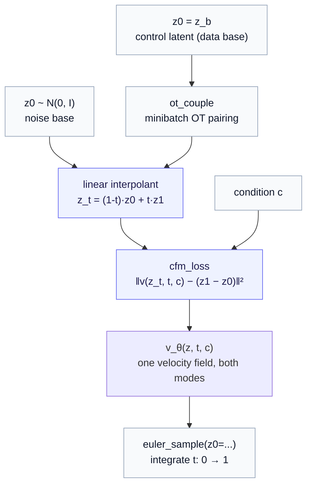
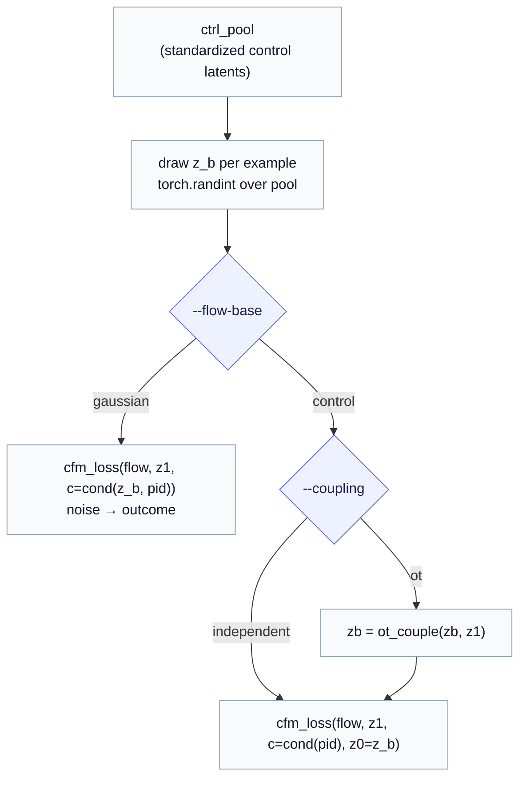
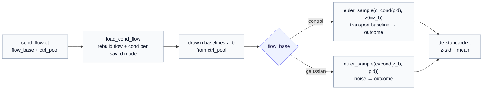

This page documents the **transport parameterization** of the repository's flow-matching stack: the machinery that lets a rectified-flow velocity field start from a *real latent population* instead of Gaussian noise, and the minibatch optimal-transport (OT) coupling that decides *which source latent travels to which target*. The implementation lives in a single module — [src/ssllab/generative/flow.py](src/ssllab/generative/flow.py#L1-L23) — and is exercised end-to-end by the perturbation-response Stage B script, its sampling counterpart, and a dedicated head-to-head ablation harness. This page assumes you have read [Flow-Matching Prior](9-flow-matching-prior) and [Conditional Flow and Classifier-Free Guidance](10-conditional-flow-and-classifier-free-guidance); here we change exactly one thing — the distribution that `z0` is drawn from — and trace its consequences through training, sampling, and evaluation.

## Why a Second Source: From Noise→Data to Distribution→Distribution

Start from first principles. Rectified flow regresses a target velocity `u_t = z1 - z0` along a linear interpolant `z_t = (1 - t)·z0 + t·z1`, and nothing in that objective requires `z0` to be noise. The module's own conventions state this explicitly: *either* source yields the same loss, the same sampler, and the same regression target `E[z1 − z0 | z_t, c]`, whose ODE "carries the source marginal onto the data marginal for *any* coupling of `(z0, z1)` with those marginals" ([flow.py](src/ssllab/generative/flow.py#L8-L23)). Choosing a real source population — the canonical example being **control-cell latents** — converts the model from a *generator* (sample an absolute state from noise) into a *transport map* (model the **displacement** between two real populations).

| | **Noise base** (`z0=None`) | **Data base** (`z0=zb`) |
|---|---|---|
| Source `z0` | `N(0, I)` | real samples (e.g. control-cell latents) |
| What the field models | sampling an absolute outcome | source→target displacement (the *effect*) |
| Condition semantics | typically fuses context + intervention | intervention alone (the source anchors the sample) |
| Sampling start | `torch.randn` | a drawn baseline latent, integrated to `t=1` |

The tests pin both modes symmetrically: with a zeroed velocity field, sampling from a real `z0` must return `z0` exactly (the identity ODE), while the default `z0=None` path keeps the noise→data behavior — backward compatibility is itself a test invariant ([test_flow_transport.py](tests/test_flow_transport.py#L18-L33)). The probability flow is identical in both cases; only the marginal being transported changes, which is why the whole feature fits into two optional keyword arguments rather than a second model class.

Sources: [flow.py](src/ssllab/generative/flow.py#L8-L23), [test_flow_transport.py](tests/test_flow_transport.py#L18-L33)

## The Coupling Is a Modeling Choice, Not an Observed Correspondence

The most subtle point in the module deserves its own section. When the source is a real population, there is usually *no ground-truth pairing* between a source latent and a target latent — the pairing is **a modeling choice**, and the docstring is precise about the epistemics: "`u_t` is a per-pair displacement only under that chosen coupling; what is identified is the population-level transport" ([flow.py](src/ssllab/generative/flow.py#L17-L23)). Two couplings are offered:

| Coupling | Mechanism | Effect on training |
|---|---|---|
| `independent` | draw a random control per target | valid but crossing paths; higher-variance target field |
| `ot` | exact minibatch OT assignment | straighter source→target paths; lower-variance regression target |

The OT solver is deliberately minimal — fourteen lines in [ot_couple](src/ssllab/generative/flow.py#L131-L145). It builds a `(B, B)` cost matrix of **squared Euclidean distances** via `torch.cdist(z1, z0)`, detaches it, and solves the exact assignment with `scipy.optimize.linear_sum_assignment` under `torch.no_grad()`, returning `z0[idx]`. Because the assignment problem admits only permutation solutions, `ot_couple` reorders — never resamples — the source batch; the test suite proves this directly by requiring every original row to appear exactly once in the output ([test_flow_transport.py](tests/test_flow_transport.py#L54-L58)), and by a two-point swap fixture where OT must un-swap the sources so each sits with its nearest target, with total cost guaranteed not to exceed the identity pairing ([test_flow_transport.py](tests/test_flow_transport.py#L43-L51)).

> [!TIP]
> Call `ot_couple` **before** `cfm_loss`, never inside it: the pairing runs under `torch.no_grad()` on a detached cost matrix, so it is treated as data, not as a differentiable operation. The intended pattern — visible in the Stage B training loop — is `zb = ot_couple(zb, z1)` followed by `cfm_loss(flow, z1, ..., z0=zb)`.

Sources: [flow.py](src/ssllab/generative/flow.py#L131-L145), [test_flow_transport.py](tests/test_flow_transport.py#L43-L58)

## API Surface: `z0` as a First-Class Parameter

The transport mode is exposed by threading an optional `z0` through the existing flow-matching API rather than introducing new entry points. `cfm_loss` accepts `z0: (B, D)` and defaults to `torch.randn_like(z1)` when omitted ([flow.py](src/ssllab/generative/flow.py#L148-L175)); `euler_sample` accepts `z0: (n, dim)` and starts the ODE integration from it instead of fresh noise ([flow.py](src/ssllab/generative/flow.py#L178-L214)).

| Function | Transport-relevant parameter | Default | Notes |
|---|---|---|---|
| `linear_interpolant(z0, z1, t)` | — | — | pure path algebra; endpoints exact at `t=0,1` (test-pinned) |
| `ot_couple(z0, z1)` | both batches | — | returns a permutation of `z0`; `no_grad`; scipy exact assignment |
| `cfm_loss(model, z1, c, p_drop, z0)` | `z0` | Gaussian noise | transport source for the training batch |
| `euler_sample(model, n, dim, ..., z0)` | `z0` | Gaussian noise | integration start; zero field ⇒ output equals `z0` |

Two hygiene details matter in practice. First, the package's `__init__` re-exports only the original four symbols and **not** `ot_couple`, so consumers import it from `ssllab.generative.flow` directly ([__init__.py](src/ssllab/generative/__init__.py#L3-L5)) — the Stage B script does exactly that ([04_train_cond_flow.py](examples/perturbation_response/04_train_cond_flow.py#L56)). Second, `cfm_loss` accepts a `z0` kwarg even when `c` is `None`, so unconditional distribution-to-distribution transport is equally expressible; the smoke test for this combination asserts a finite scalar loss ([test_flow_transport.py](tests/test_flow_transport.py#L36-L40)).

Sources: [flow.py](src/ssllab/generative/flow.py#L148-L175), [flow.py](src/ssllab/generative/flow.py#L178-L214), [__init__.py](src/ssllab/generative/__init__.py#L3-L5), [test_flow_transport.py](tests/test_flow_transport.py#L36-L40)

## Training-Side Wiring: `--flow-base` and `--coupling`

Stage B of the perturbation-response pipeline operationalizes both axes as two CLI flags on [04_train_cond_flow.py](examples/perturbation_response/04_train_cond_flow.py#L80-L86):

| Flag | Values | Semantics |
|---|---|---|
| `--flow-base` | `gaussian` (default) / `control` | noise→outcome prior vs. transport a control latent→outcome |
| `--coupling` | `independent` (default) / `ot` | control base only: random pairing vs. minibatch OT pairing |

The training loop makes the asymmetry between the two bases explicit. Every step draws a baseline batch `z_b` from the precomputed, standardized **control pool** `ctrl_pool = Zn[is_control.bool()]` ([04_train_cond_flow.py](examples/perturbation_response/04_train_cond_flow.py#L139-L147)). In `control` mode, the optional OT re-pairing happens first, and the field is trained as a pure transport with the condition reduced to the perturbation embedding alone: `cfm_loss(flow, z1, c=cond(pid), p_drop=..., z0=zb)` ([04_train_cond_flow.py](examples/perturbation_response/04_train_cond_flow.py#L185-L194)). In `gaussian` mode, `z_b` is *not* the ODE start — it is folded into the condition as `c=cond(zb, pid)`, and sampling starts from noise.

> [!TIP]
> The condition asymmetry is the load-bearing design decision: in `control` mode the baseline is consumed **positionally** (it is the ODE's start state), so feeding it to the condition encoder as well would be redundant — hence `cond(pid)` with `z_p` alone. This is also why the checkpoint must persist `ctrl_pool`: the sampler cannot reconstruct baselines it never sees at train time.

The checkpoint contract reflects this: `torch.save` records `flow_base`, and embeds the standardized `ctrl_pool` ("standardized control latents, for sampling z_b (source or baseline)") alongside the usual weights and standardization stats ([04_train_cond_flow.py](examples/perturbation_response/04_train_cond_flow.py#L210-L223)). The stage report additionally logs the `coupling` choice — but only when `flow_base == "control"`, encoding the flag's dependency in the metadata itself ([04_train_cond_flow.py](examples/perturbation_response/04_train_cond_flow.py#L224-L230)).

Sources: [04_train_cond_flow.py](examples/perturbation_response/04_train_cond_flow.py#L80-L86), [04_train_cond_flow.py](examples/perturbation_response/04_train_cond_flow.py#L139-L147), [04_train_cond_flow.py](examples/perturbation_response/04_train_cond_flow.py#L185-L194), [04_train_cond_flow.py](examples/perturbation_response/04_train_cond_flow.py#L210-L230)

## Sampling-Side Contract: Anchoring to a Real Baseline

Generation mirrors training through a saved-bundle contract. `load_cond_flow` rebuilds the velocity field and — branching on the persisted `flow_base` and `cond_type` — the correct condition module, returning a bundle that carries `ctrl_pool`, standardization stats, and the mode flags ([perturb.py](src/ssllab/generative/perturb.py#L55-L75)). Four condition-module cases are enumerated in `_build_condition`; for the `control` transport base the condition is the **perturbation embedding alone**, exactly matching the training-time asymmetry ([perturb.py](src/ssllab/generative/perturb.py#L27-L52)).

The sampler itself, `sample_perturbed_latents`, performs a three-way dispatch that treats the flow and the operator (see [Operator Algebra and Epistasis Tests](14-operator-algebra-and-epistasis-tests)) as interchangeable producers of the same object — a cloud of outcome latents ([perturb.py](src/ssllab/generative/perturb.py#L138-L169)):

1. **Draw baselines**: `z_b` is sampled from `bundle["ctrl_pool"]` with a caller-seeded generator ([perturb.py](src/ssllab/generative/perturb.py#L152-L154)).
2. **Branch on producer**: an `operator` bundle pushes the control cloud through its structured map; a `flow` bundle in `control` mode calls `euler_sample(..., c=cond(pid), z0=z_b)` — integration starts at a real baseline, anchored ("the sample is anchored to a real baseline"); `gaussian` mode calls without `z0` and conditions on the fused `cond(z_b, pid)`.
3. **De-standardize**: the returned latents are mapped back to encoder space via `z_std * std + mean`, so every downstream evaluator reads one consistent latent space ([perturb.py](src/ssllab/generative/perturb.py#L163-L169)).

Sources: [perturb.py](src/ssllab/generative/perturb.py#L27-L52), [perturb.py](src/ssllab/generative/perturb.py#L55-L75), [perturb.py](src/ssllab/generative/perturb.py#L138-L169)

## The Ablation Harness: Isolating the Base Choice

Because the base choice changes both the ODE's start marginal and the condition's contents, comparing modes naively would confound encoder and decoder differences with the transport reformulation. The entrypoint [run_flow_compare_pod.sh](examples/perturbation_response/run_flow_compare_pod.sh#L1-L13) eliminates exactly those confounds: it stages the **same Stage-A encoder** and the **same NB count decoder** via file mounts into two experiment directories, so "the only variable is `--flow-base`" — and since the decoder is condition-free, sharing it across arms is explicitly argued to be fair. Each arm runs Stage B training (geneset conditions, combo split) followed by the effect-size evaluation, writing separate `effect_size.json` reports under `output/norman_flow_{gaussian,control}/reports/` ([run_flow_compare_pod.sh](examples/perturbation_response/run_flow_compare_pod.sh#L34-L58)).

Note that this harness varies the *base* but keeps the coupling flag at its default (`independent`); the OT coupling is a stricter ablation you run by adding `--coupling ot` to the control arm. The metric surface this feeds — effect size against held-out combinations — is documented in [Evaluation Toolkit: Probes and Metrics](19-evaluation-toolkit-probes-and-metrics), and the full Stage A→C context is covered in [Perturbation-Response Pipeline](16-perturbation-response-pipeline).

Sources: [run_flow_compare_pod.sh](examples/perturbation_response/run_flow_compare_pod.sh#L1-L13), [run_flow_compare_pod.sh](examples/perturbation_response/run_flow_compare_pod.sh#L34-L58)

## Limits and Practical Guidance

The implementation's honesty is its best feature, and its stated limits should shape how you use it. Minibatch OT as implemented is the **assignment** variant of optimal transport — a permutation, not the general Kantorovich plan that splits mass — solved exactly per batch at worst-case cubic cost in the batch size ([flow.py](src/ssllab/generative/flow.py#L131-L145)). The resulting pairing is therefore *batch-local*: it straightens paths within each `256`-sample batch (the script default) and its bias relative to population-level OT shrinks as batch size grows. Three corollaries worth internalizing:

- **Do not over-read pairs.** Under either coupling, `(z0[i], z1[i])` is a modeling artifact, not an observed correspondence; only the population-level transport — the ODE's end-to-end marginal push — is identified ([flow.py](src/ssllab/generative/flow.py#L17-L23)).
- **Choose the base by what you want to model.** `control` base models the *displacement* (the effect) and anchors every sample to a real baseline; `gaussian` base models the absolute outcome distribution. The head-to-head harness exists precisely because this is an empirical question, not an axiom.
- **Mode is durable state.** `flow_base` and `ctrl_pool` are baked into the checkpoint, and the loader's condition-reconstruction branches on them ([perturb.py](src/ssllab/generative/perturb.py#L55-L75)) — you cannot swap bases post hoc; retrain Stage B under the other flag.

Where to go next depends on your goal. To understand what happens *after* the transported latent — the count decoder and its CVAE counterpart — continue to [Count Decoders and CVAE Baseline](12-count-decoders-and-cvae-baseline). To see the transport flow inside its full experimental campaign, read [Perturbation-Response Pipeline](16-perturbation-response-pipeline); for the remote-execution wrapper that runs comparisons like the one above, see [Remote GPU Ops: SkyPilot and RunPod](24-remote-gpu-ops-skypilot-and-runpod).
