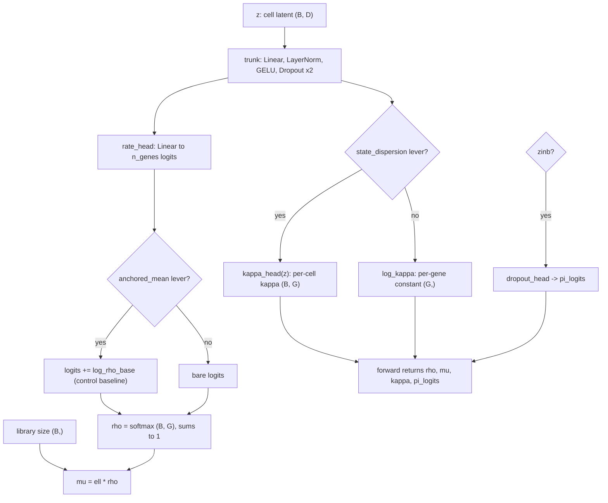
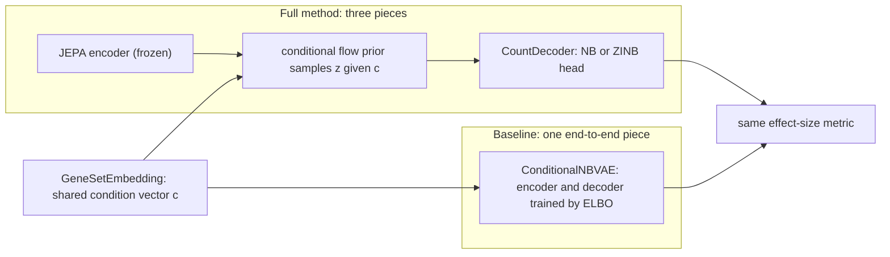

This page documents the two generative heads that turn latent space into *observable single-cell data*: the **NB/ZINB count decoder** (`ssllab.generative.count_decoder`) that maps a frozen JEPA cell latent to a distribution over gene counts, and the **conditional NB-VAE baseline** (`ssllab.generative.cvae`) that trains the same likelihood end-to-end with no JEPA pretraining and no flow prior. Both live under `examples/perturbation_response/` as stages C (03) and the control (08/09). The pair exists so that effect size — the number the whole perturbation-response pipeline reports — is measured on the correct probabilistic scale, and so that the full method's extra machinery (JEPA latent + conditional flow) can be judged against a plain, honest control.

Sources: [count_decoder.py](src/ssllab/generative/count_decoder.py#L1-L29), [cvae.py](src/ssllab/generative/cvae.py#L1-L17)

## Why Counts Need Their Own Likelihood

Single-cell RNA-seq counts are non-negative integers, heavily over-dispersed, and dropout-dominated — a Gaussian decoder trained with MSE is the wrong *measurement model*, because effect size lives in the data the model emits, not in the latent. The design principle here is that the decoder emits the **parameters of a count distribution** — a negative binomial (NB), optionally zero-inflated (ZINB) — and is trained by the count likelihood of real counts. The convention matches the docs exactly: `rho = softmax(net(z))` is a relative gene-rate profile summing to 1, `mu = library_size * rho` is the NB mean (library size enters as a *given* covariate, not a prediction), `kappa = softplus(per-gene param)` is the dispersion, and `x | z, ℓ ~ NB(mu, kappa)`.

Sources: [count_decoder.py](src/ssllab/generative/count_decoder.py#L1-L29), [03_train_count_decoder.py](examples/perturbation_response/03_train_count_decoder.py#L1-L17)

The NB form is not arbitrary: it is exactly what you get when each cell's true expression rate varies around μ according to a **Gamma distribution** and sequencing samples molecules from that rate as a **Poisson draw** — the Gamma-Poisson mixture. Its variance is μ + μ²/κ, noisier than Poisson's μ by an amount κ controls. The NLL is computed in log space with `torch.lgamma` because Γ overflows almost immediately in float32 (past an argument of ~35) and κ is a learned real number, so plain factorials do not apply; `lgamma` is differentiable in κ, and `lgamma(x+1) = log x!` has no parameters but keeps the value the exact NLL.

Sources: [count_decoder.py](src/ssllab/generative/count_decoder.py#L80-L122)

## Anatomy of the CountDecoder

`CountDecoder` is a small head, deliberately: a two-block MLP trunk (`Linear → LayerNorm → GELU → Dropout`, hidden 512×512) feeds three heads — a `rate_head` whose softmax yields `rho`, a dispersion source (per-gene constant `log_kappa` by default, or a per-cell `kappa_head(z)` under the B2 lever), and an optional `dropout_head` for ZINB's structural-zero gate. The forward pass returns the full parameter dict `{rho, mu, kappa[, pi_logits]}`, and every downstream consumer — training loss, sampling, expected counts — runs off that single contract.

Sources: [count_decoder.py](src/ssllab/generative/count_decoder.py#L145-L248)

Two readouts close the generative loop. `sample_counts` draws integer counts by the Gamma-Poisson mixture (`λ ~ Gamma(κ, κ/μ)`, then `x ~ Poisson(λ)`), masking with the dropout gate when ZINB is on; `expected_counts` returns the decoded mean μ, scaled by the non-dropout probability `1 − sigmoid(pi_logits)` in the ZINB case. The ZINB NLL itself handles the mixture explicitly: a zero can come from the dropout gate **or** from the NB producing a zero, and the loss branches with `torch.where` on that case split.

Sources: [count_decoder.py](src/ssllab/generative/count_decoder.py#L125-L142), [count_decoder.py](src/ssllab/generative/count_decoder.py#L285-L305)

## Two Levers Against Identifiability Traps

Beyond the default configuration, two opt-in flags — the "chapter-8 levers" — address known failure modes, each anchored to statistics estimated from the **control population only** in a pre-pass before training (`rate_sum`, count moments accumulated over `is_control` cells). The training script exposes them as `--anchored-mean` (B1), `--state-dispersion` (B2), and `--anchor-weight` (default 0.1).

Sources: [count_decoder.py](src/ssllab/generative/count_decoder.py#L17-L25), [03_train_count_decoder.py](examples/perturbation_response/03_train_count_decoder.py#L54-L63), [03_train_count_decoder.py](examples/perturbation_response/03_train_count_decoder.py#L88-L120)

| Lever | Flag | Mechanism | What it fixes |
|---|---|---|---|
| Default | — | bare softmax `rho`, per-gene constant `kappa` | — |
| **B1: anchored mean** | `--anchored-mean` | `rho = softmax(log_rho_base + delta(z))`, `delta` zero-initialized, baseline set to the control rate profile via `set_baseline_profile` | Decoder *starts* at "no effect" — the readout twin of near-identity operator init |
| **B2: state dispersion** | `--state-dispersion` | `kappa = softplus(kappa_head(z))` per cell/condition + moment-of-moments anchor in the loss | The coverage-at-1.00 symptom from one constant dispersion per gene |

Sources: [count_decoder.py](src/ssllab/generative/count_decoder.py#L206-L248), [test_count_decoder.py](tests/test_count_decoder.py#L64-L105)

> [!TIP]
> The B2 lever's danger is identifiability: a per-cell κ head is flexible enough to **silently absorb the biological variance the latent distribution should own**, mistaking signal for measurement noise. The `loss` method therefore adds `anchor_weight · mean_g (log κ_g − log κ_target_g)²`, where κ_target comes from `moment_dispersion` — the method-of-moments inversion `κ = μ²/(var − μ)`, which recovers κ exactly from NB moments and clamps toward near-Poisson (large κ) wherever `var ≤ mu` signals no genuine over-dispersion.

Sources: [count_decoder.py](src/ssllab/generative/count_decoder.py#L259-L283), [count_decoder.py](src/ssllab/generative/count_decoder.py#L220-L232)

## Library Size and Normalization: The Round-11 Conventions

Two module-level constant tuples pin the conventions that every consumer of these models shares, with defaults changed in **round 11 of the results ledger**. The library size is the total the NB likelihood multiplies the rate profile by; the normalization is how sampled counts are converted back to log1p-CP10K for evaluation. Older checkpoints and published reports are reproduced by passing `all`/`depth` explicitly.

Sources: [count_decoder.py](src/ssllab/generative/count_decoder.py#L37-L53), [03_train_count_decoder.py](examples/perturbation_response/03_train_count_decoder.py#L61-L63)

| Axis | Option | Definition | Status |
|---|---|---|---|
| Library size | `all` | total UMI over *every* measured gene (`batch["libsize"]`) | convention through round 10 |
| Library size | `hvg` | total over the *modeled* genes (`batch["counts"].sum(1)`) | **default** — the only scale on which a softmax `rho` summing to 1 can match observed counts |
| Normalization | `depth` | divide by the sampling depth `batch["libsize"]` | behavior of every published population metric |
| Normalization | `data` | divide each sampled cell by its own total over modeled genes | **default** — matches how measured expression was normalized |

The reason `all` was retired is quantified in the module docstring: under `all` the likelihood is fit with means about **3.2× the observed counts** — the `all` convention compresses the decoder's rate profile, and `depth` normalization misstates a population's spread.

Sources: [count_decoder.py](src/ssllab/generative/count_decoder.py#L37-L53), [count_decoder.py](src/ssllab/generative/count_decoder.py#L62-L77)

## The Conditional NB-VAE: The Control That Anchors the Comparison

`ConditionalNBVAE` is the from-scratch generative baseline — **no JEPA pretraining, no flow prior** — and its existence is what makes the flow's effect-size number interpretable: if the full method (JEPA latent + conditional flow + NB decoder) does not beat this, its extra machinery is not earning its keep. The design is CPA/scVI-flavored but kept deliberately plain: an MLP encoder maps log1p-CP10K features to a Gaussian posterior `q(z|x) = N(mu, sigma)` against prior `N(0, I)`, a reparameterized `z` is concatenated with the perturbation condition `c` and decoded to `rho = softmax(rate_head(h))`, and reconstruction uses the *same* `nb_nll` as the count decoder. Crucially, `c` comes from the **same `GeneSetEmbedding` the flow uses**, so the comparison isolates the generative machinery rather than the perturbation encoding.

Sources: [cvae.py](src/ssllab/generative/cvae.py#L1-L17), [cvae.py](src/ssllab/generative/cvae.py#L121-L130), [08_train_cvae_baseline.py](examples/perturbation_response/08_train_cvae_baseline.py#L1-L17)

The shared condition is compositional by construction: `build_pert_gene_matrix` maps each perturbation name (a `+`-joined set of target genes, with `"control"` targeting nothing) to a multi-hot row over a gene vocabulary, and `GeneSetEmbedding` pools per-gene embeddings — `compose="additive"` gives `z_p(A+B) = e(A) + e(B)` *exactly*, while `compose="deepsets"` is a permutation-invariant refinement that can model interactions. Because pooling is over gene slots, never a per-perturbation slot, a **held-out combo is embedded from already-trained parts** — which is why the baseline can be evaluated on the combo split at all.

Sources: [condition.py](src/ssllab/generative/condition.py#L23-L44), [condition.py](src/ssllab/generative/condition.py#L48-L61)

## Two Encoder Modes: Condition-Blind vs Textbook

The `encoder_cond` flag selects what the posterior sees, and the module docstring is explicit about the trade. The **default is condition-blind** `q(z|x)`: the encoder reads expression only, and `c` reaches the model through the decoder alone. This follows CPA's basal-state reading — `z` is the cell's state *apart from* the perturbation — but without CPA's adversarial classifier that strips perturbation information out of `z`. The textbook alternative `q(z|x,c)` concatenates the condition into the encoder input (verified by the test asserting `enc[0].in_features == n_genes + cond_dim`); both are valid ELBOs — leaving `c` out only restricts the variational family — and **generation is identical in both modes**, so the flag changes what training teaches the decoder, never the sampling path.

Sources: [cvae.py](src/ssllab/generative/cvae.py#L19-L40), [test_cvae.py](tests/test_cvae.py#L31-L46)

> [!TIP]
> Because the observed `x` already contains the perturbation's effect, part of it can **leak into `z`** under the condition-blind encoder; at generation `z` is drawn from the prior and carries none of it, so leakage *attenuates* the predicted effect. The KL term discourages the leak (condition information is free to the decoder while information in `z` costs KL), but nothing forbids it — this is a known, bounded bias of the baseline, not a bug.

Sources: [cvae.py](src/ssllab/generative/cvae.py#L20-L28)

## Production Guards: Numerics, Clipping, Determinism

Three guards in the code exist because their absence produced real failures. The posterior log-variance is **clamped to [−10, 10]** — an unbounded `exp(logvar)` and the KL term blew up to NaN around epoch 16 in an earlier run once the encoder grew. Training clips gradients to a max norm of 5.0, labeled in-script as "VAE stability". And generation draws noise **on CPU with a seeded `torch.Generator` before moving to device**, because a CUDA tensor cannot take a CPU generator and this keeps sampling deterministic across devices. Checkpoint loading is equally defensive: `from_checkpoint` rebuilds in eval mode, and checkpoints written before `encoder_cond` existed default to the condition-blind encoder they were actually trained with.

Sources: [cvae.py](src/ssllab/generative/cvae.py#L109-L112), [08_train_cvae_baseline.py](examples/perturbation_response/08_train_cvae_baseline.py#L96-L104), [cvae.py](src/ssllab/generative/cvae.py#L137-L143), [cvae.py](src/ssllab/generative/cvae.py#L87-L91)

## Training and Evaluation: Two Scripts, One Metric

The two arms differ structurally. **Stage C (03)** freezes the JEPA encoder, embeds tokens with `torch.no_grad()`, and fits `CountDecoder` on frozen latents by NB/ZINB NLL — default split `cells` (the in-distribution effect-size test), control pre-pass first. **The baseline (08)** trains `ConditionalNBVAE` end-to-end by the ELBO — default split `combo` (the held-out-combo generalization test, where the compositional embedding matters). At evaluation, **09** loads the baseline and scores it with the *same* `run_effect_size_eval` the flow arm uses — Pearson Δ-correlation on top-DE genes — so its number sits directly beside the flow's; the shared `library_size_of` helper keeps the likelihood scale consistent across both arms.

Sources: [03_train_count_decoder.py](examples/perturbation_response/03_train_count_decoder.py#L1-L17), [03_train_count_decoder.py](examples/perturbation_response/03_train_count_decoder.py#L122-L141), [08_train_cvae_baseline.py](examples/perturbation_response/08_train_cvae_baseline.py#L1-L17), [09_eval_cvae_baseline.py](examples/perturbation_response/09_eval_cvae_baseline.py#L1-L14)

| Dimension | CountDecoder (Stage C) | ConditionalNBVAE (baseline) |
|---|---|---|
| Latent source | frozen JEPA encoder embeddings | self-learned `q(z\|x)` posterior |
| Prior | none (z is given data) | `N(0, I)` + KL term |
| Conditioning | none (z already contextual) | shared `GeneSetEmbedding` `c` |
| Trained by | NB/ZINB NLL on frozen latents | ELBO = `nb_nll + β·KL` |
| Split default | `cells` (in-distribution) | `combo` (held-out combos) |
| Checkpoint | `count_decoder.pt` + report `stage_c_decoder` | `cvae_baseline.pt` + report `baseline_cvae` |
| Extra controls | ZINB gate, B1/B2 levers, κ anchor | `β` (beta-VAE), `encoder_cond`, grad-clip |

Sources: [03_train_count_decoder.py](examples/perturbation_response/03_train_count_decoder.py#L143-L153), [08_train_cvae_baseline.py](examples/perturbation_response/08_train_cvae_baseline.py#L110-L124)

## Verified Behavioral Contracts

Both modules are pinned by tests that encode their semantic guarantees rather than smoke checks. The NB NLL is asserted to **match scipy's `nbinom.logpmf`** (parameterized as `n = kappa`, `p = kappa/(kappa+mu)`) to 1e-6; forward invariants check `rho` sums to 1 and `mu = ℓ·rho`; the B1 anchor is asserted to decode *exactly* the control baseline at init regardless of `z` while keeping `log_rho_base` learnable; the method-of-moments inversion is checked to recover κ exactly from NB moments; and state-dict keys are asserted to track configuration (`log_rho_base` and `kappa_head.weight` present, `log_kappa` absent — while the default decoder keeps `log_kappa` for backward compatibility).

Sources: [test_count_decoder.py](tests/test_count_decoder.py#L11-L60), [test_count_decoder.py](tests/test_count_decoder.py#L64-L157)

On the CVAE side, the tests pin the encoder modes (`in_features == n_genes` blind; `n_genes + cond_dim` conditional, with `encode(x)` raising `ValueError` when the condition is required), loss finiteness with exactly `{recon, kl}` parts in both modes, and a checkpoint round-trip in which a rebuilt model reproduces `generate_expression` bit-for-bit under the same seeded generator — the determinism guarantee in testable form. Old checkpoints lacking the `encoder_cond` key load as condition-blind, matching training history.

Sources: [test_cvae.py](tests/test_cvae.py#L31-L80)

## Where This Fits and What to Read Next

These two artifacts are the measurement instruments at the end of the generative stack: the flow machinery from the previous pages produces *where cells should be* in latent space, and the count decoder converts that into *what a sequencer would have read*. To go deeper on the pieces upstream and downstream:

- How the conditional prior that samples `z` before decoding works: [Conditional Flow and Classifier-Free Guidance](10-conditional-flow-and-classifier-free-guidance), building on the [Flow-Matching Prior](9-flow-matching-prior) and [Latent Transport and Optimal-Transport Coupling](11-latent-transport-and-optimal-transport-coupling)
- How both arms are run end-to-end in the full study: [Perturbation-Response Pipeline](16-perturbation-response-pipeline)
- How the shared effect-size metric and calibration machinery are defined: [Evaluation Toolkit: Probes and Metrics](19-evaluation-toolkit-probes-and-metrics) and [Paired Bootstrap and Simultaneous Inference](20-paired-bootstrap-and-simultaneous-inference)
- What happens when encoder and decoder are *not* frozen relative to each other: [Co-Adaptation of Encoder and Decoder](18-co-adaptation-of-encoder-and-decoder)