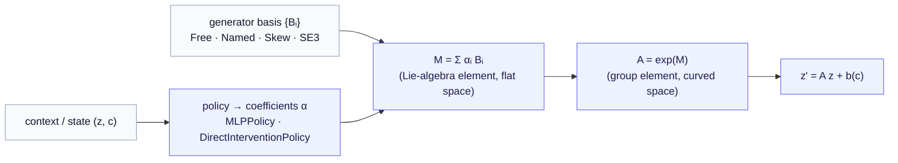
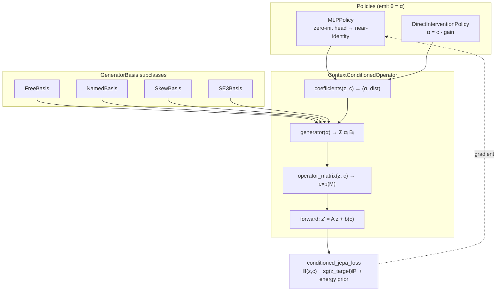

Every action-conditioned operator in ssl-lab is built by the same three-step recipe: a **generator basis** supplies structured matrices $\{B_1,\dots,B_m\}$, a **policy** emits coefficients $\alpha$ for the current context, and the matrix exponential lifts the flat combination $M = \sum_i \alpha_i B_i$ into a curved group element $A = \exp(M)$. This page explains why that recipe is a Lie-group construction, how the four shipped bases span the expressiveness ↔ structure dial, and how the same machinery turns operator composition into a measurable quantity — the Lie bracket — that the next stage of the pipeline correlates with epistasis. Code lives in two homes: `src/ssllab/action_operator/context_operator.py` (bases, policies, the conditioned operator) and `src/ssllab/generative/operator_algebra.py` (per-gene generators composed in the group).

Sources: [context_operator.py](src/ssllab/action_operator/context_operator.py#L1-L33), [operator_algebra.py](src/ssllab/generative/operator_algebra.py#L1-L28)

## Why the operator is built as exp(M), not as a matrix directly

The formalism's core object map is one line: $f_{\theta(c_t)}(z) = \exp(M_\theta)\, z + b_\theta$ with $M_\theta = \sum_i \alpha_i B_i$, where $\{B_i\}$ is the generator basis and $\alpha = \theta$ is emitted by a context policy $\pi_\psi(z, c_t)$. The module docstring names the basis as "the main design decision: it sets what kind of operator $\exp(M_\theta)$ is allowed to be." The exponential buys three properties for free, each a theorem rather than an engineering choice: for *any* matrix $M$, $\exp(M)$ is invertible with inverse $\exp(-M)$; $\exp(0) = I$ gives a sane "do almost nothing" starting point; and generators live in a flat vector space (addable, scalable, averageable) while operators live on a curved manifold where most matrices are invalid. A network emits points in the flat space; the exponential guarantees they land somewhere legal.

Sources: [context_operator.py](src/ssllab/action_operator/context_operator.py#L9-L33), [02-operator-gallery.md](docs/action_operator/02-operator-gallery.md#L10-L45)

Reading the generator's eigenvalues predicts the operator's behavior without computing anything: a real eigenvalue part $a > 0$ amplifies its direction each step (the "decompensation flag"), an imaginary part $b$ spins at frequency $b$. The two pure cases anchor the vocabulary — **skew-symmetric** generators ($M^\top = -M$) exponentiate to rotations (norm-preserving), **symmetric** generators to pure stretches — and every generator is a blend of both. The code exposes this directly: `ContextConditionedOperator.eigenvalues(z, c)` returns eigenvalues of the *generator* $M$, not of $A$, so a positive real part is readable as locally growing dynamics.

Sources: [02-operator-gallery.md](docs/action_operator/02-operator-gallery.md#L43-L60), [context_operator.py](src/ssllab/action_operator/context_operator.py#L287-L291)

## The four bases: one dial from freedom to rigid structure

Rather than letting a policy fill all $D^2$ entries, the framework fixes a small basis and emits only coefficients — that is where the inductive bias lives. Four `GeneratorBasis` subclasses span the dial, and each sits in a *different Lie group*, which is why the class is named as it is: the basis determines the algebra $\mathfrak{g}$, and $\exp$ maps it into the group $G$.

| Basis | $\{B_i\}$ concretely | Code mechanism | Group | Guarantee | Where it fits |
|---|---|---|---|---|---|
| `FreeBasis` | $m$ learnable dense matrices | `nn.Parameter`, `randn * 0.1` | $GL(D)$ | invertible only | phenotyping default; model discovers its own latent "modes of motion" |
| `NamedBasis` | one learnable matrix per labeled intervention | `nn.Parameter`, named list | $GL(D)$ | invertible + **interpretable** | $\alpha_i$ reads as "how much of intervention $i$ happened" |
| `SkewBasis` | skew-symmetric matrices ($B^\top = -B$) | fixed canonical buffer *or* $R - R^\top$ symmetrization | $SO(D)$ | **orthogonal**, norm-preserving | cyclic / circadian dynamics; cannot blow up |
| `SE3Basis` | the 6 fixed generators of $\mathfrak{se}(3)$: 3 rotations + 3 translations | registered buffer, never learned | $SE(3)$ | **rigid motion**, $R \in SO(3)$, homogeneous $4\times4$ | protein residue frames |

Sources: [context_operator.py](src/ssllab/action_operator/context_operator.py#L36-L143), [04-generator-bases-and-the-operator-in-code.md](docs/operator_world_models/04-generator-bases-and-the-operator-in-code.md#L20-L45)

Two implementation details deserve attention. `SkewBasis` offers two modes: with `num_generators=None` it installs the *full canonical $\mathfrak{so}(D)$ basis* $\{E_{ij} - E_{ji} : i < j\}$ (dimension $D(D-1)/2$) as a fixed buffer; otherwise it learns a subset but applies the projection $B = R - R^\top$ on every forward pass, so skew-symmetry is **structural, never a penalty**. `SE3Basis` is the opposite pole — the generators are *given* by physics, not learned — which is what makes the protein-frame and behavioral use cases literally the same forward pass with a different basis argument.

Sources: [context_operator.py](src/ssllab/action_operator/context_operator.py#L90-L143), [04-generator-bases-and-the-operator-in-code.md](docs/operator_world_models/04-generator-bases-and-the-operator-in-code.md#L58-L75)

The full data path through the operator:

Swap $B_i$ from a free learnable set to the fixed $\mathfrak{se}(3)$ generators and the *same* forward pass produces a rigid 3D motion instead of a learned behavioral flow — the "one piece of code, different algebra" payoff.

Sources: [04-generator-bases-and-the-operator-in-code.md](docs/operator_world_models/04-generator-bases-and-the-operator-in-code.md#L58-L90)

> [!TIP]
> The near-identity prior does **not** live in the basis. `FreeBasis` is initialized at scale $O(1)$ on purpose — "Basis is O(1); near-identity init comes from alpha=0 at the policy head, not from shrinking the basis" — because shrinking $B_i$ would deform the algebra's geometry while leaving the guarantee unenforced. The zero-initialized policy head is the single point where "start as identity" is implemented.

## Policies: two ways to emit θ

`MLPPolicy` maps $(z, c)$ through a two-layer SiLU trunk to a per-generator head. Its $\mu$ head is **zero-initialized**, so at training start $\alpha = 0 \Rightarrow M = 0 \Rightarrow A = I$: the operator begins by doing nothing and departs from identity only as far as the data demands. In stochastic mode it emits a diagonal Gaussian with reparameterized sampling (so gradients flow to $\psi$ — the "differentiable one-step optimization suffices" regime, with `log_prob`/`entropy` left exposed for a later actor–critic loop); in deterministic mode the same Normal class is used with zero variance so `.rsample()` and `.mean` coincide.

Sources: [context_operator.py](src/ssllab/action_operator/context_operator.py#L146-L224)

`DirectInterventionPolicy` skips the network entirely: $\alpha = c \odot \gamma$ with an optional learnable per-generator gain $\gamma$ initialized to one. Paired with `NamedBasis` it makes the quantified intervention log *be* the coefficient vector — $M = \sum_i c_i B_i$ where $c_i$ is hours of sleep, a stress index, a med flag. This is the configuration where the generator basis turns into interpretable readout: inspecting $\mathrm{eig}(B_i)$ tells you what each named intervention does to the latent. It asserts `c_dim == num_generators` at construction.

Sources: [context_operator.py](src/ssllab/action_operator/context_operator.py#L227-L243), [04-generator-bases-and-the-operator-in-code.md](docs/operator_world_models/04-generator-bases-and-the-operator-in-code.md#L30-L45)

## ContextConditionedOperator: anatomy of the forward pass

The class that ties basis and policy together exposes its algebra piecewise so each claim is individually inspectable:

The heart is three lines: `generator()` contracts coefficients against the basis tensor with `einsum("...m,mij->...ij", alpha, B)`; `operator_matrix()` applies `torch.matrix_exp`; `forward()` matmuls the result into $z$ and optionally adds a zero-initialized bias head (off by default — SE(3) carries translation inside $A$ and needs none). `compose(A_first, A_second)` returns `A_second @ A_first` — matrix multiplication, right-to-left, with a docstring noting these operators do not commute in general.

Sources: [context_operator.py](src/ssllab/action_operator/context_operator.py#L249-L317), [04-generator-bases-and-the-operator-in-code.md](docs/operator_world_models/04-generator-bases-and-the-operator-in-code.md#L76-L90)

Beyond the forward pass, two inspection methods make the theory observable in running code. `energy(z, c)` returns $\lVert M \rVert_F^2$ averaged over the batch — the **least-action penalty** that keeps the operator near identity. `conditioned_jepa_loss` is the single edit to the standard JEPA objective: latent L2 against the target with the stop-gradient applied *inside the loss* (`z_target.detach()`), so no gradient reaches the target encoder — the same anti-collapse discipline as the core [JEPA Module Internals](6-jepa-module-internals) pipeline, now with $g_\phi(z, q)$ replaced by $f_{\theta(c)}(z)$.

Sources: [context_operator.py](src/ssllab/action_operator/context_operator.py#L293-L331), [04-generator-bases-and-the-operator-in-code.md](docs/operator_world_models/04-generator-bases-and-the-operator-in-code.md#L84-L92)

## The Lie structure: why the bracket, not the product, is the native operation

Generators live in a **Lie algebra**: a vector space closed under the commutator $[A, B] = AB - BA$ but *not* under plain matrix multiplication. The skew-symmetric family makes this vivid in one line each:

$$[A,B]^\top = (AB - BA)^\top = B^\top A^\top - A^\top B^\top = BA - AB = -[A,B] \quad \text{(still skew ✓)}$$
$$(AB)^\top = B^\top A^\top = (-B)(-A) = BA \neq -AB \quad \text{(not skew ✗)}$$

The bracket of two rotation generators is a rotation generator; their product has fallen out of the algebra. Multiplication **destroys the structure** that made the generator meaningful; the commutator **preserves** it. That is why every correction term in operator composition is built from brackets and nothing else.

Sources: [03-the-algebra-of-composition.md](docs/action_operator/03-the-algebra-of-composition.md#L96-L120)

The consequence for composition is the Baker–Campbell–Hausdorff (BCH) series: $\log(e^A e^B) = A + B + \tfrac{1}{2}[A,B] + \tfrac{1}{12}([A,[A,B]] + [B,[B,A]]) - \cdots$ — a correction series in which *every* term is a nested commutator. If $[A,B] = 0$ all corrections vanish and $\exp(A)\exp(B) = \exp(A+B)$ exactly; if not, the leading departure is $\tfrac{1}{2}[A,B]$. Near the identity — which is precisely where zero-initialized, least-action-penalized operators live — this equivalence is tight, and it is the claim the code relies on: **non-commutativity is the departure from additive composition**, not an analogy for it.

Sources: [03-the-algebra-of-composition.md](docs/action_operator/03-the-algebra-of-composition.md#L40-L75), [operator_algebra.py](src/ssllab/generative/operator_algebra.py#L14-L21)

The framework is equally explicit about the anticommutator $\{A, B\} = AB + BA$, the swap-*even* half of the product. It is not a Lie object (the anticommutator of two skew matrices is symmetric — ejected from the algebra), it does not vanish when operators commute ($\{A, A\} = 2A^2 \neq 0$), and it never appears in BCH, so it cannot arise from composing operators. It measures magnitude/overlap interference — the cross-term of $(A+B)^2$ — not order. Keeping the two apart is not tidiness: a simultaneous two-intervention experiment is swap-invariant, so the odd sign of $[A,B]$ is unobservable from it and only the bracket's *magnitude* can be estimated.

Sources: [03-the-algebra-of-composition.md](docs/action_operator/03-the-algebra-of-composition.md#L122-L185)

| | commutator $[A,B]$ | anticommutator $\{A,B\}$ |
|---|---|---|
| under swap $A \leftrightarrow B$ | odd (flips sign) | even (unchanged) |
| zero when they commute? | **yes**, by definition | no ($\{A,A\} = 2A^2$) |
| stays in the Lie algebra? | yes — closed | no — it is a Jordan product |
| appears in BCH? | yes — it *is* BCH | never |
| what it measures | order, direction, non-additivity | magnitude, overlap, interference |
| visible to a simultaneous experiment? | magnitude only | yes, fully |

## Composition in the group: NamedGeneratorOperator

`src/ssllab/generative/operator_algebra.py` applies the algebra to gene perturbations. Each single gene $g$ owns one dense generator $M_g$ (zero-initialized, the *only* parameters — no policy network, no basis), and a combination composes **in the group** via the symmetric Strang product:

$$A_{A+B} = \exp\!\left(\tfrac{M_A}{2}\right)\,\exp(M_B)\,\exp\!\left(\tfrac{M_A}{2}\right)$$

read against a canonical gene ordering (ascending index of the sorted vocabulary) so composition is deterministic regardless of how a pair name was written. Control composes to $I$; a single to $\exp(M_g)$; more than two genes raises `NotImplementedError` rather than silently mis-composing. The critical property is generalization without parameters: a held-out combination like `A+C` is a *fixed algebraic function* of $M_A$ and $M_C$ — generators trained through other data — with the interaction supplied by their non-commutativity rather than by a black-box map on an additive embedding.

Sources: [operator_algebra.py](src/ssllab/generative/operator_algebra.py#L30-L85), [tests/test_operator_algebra.py](tests/test_operator_algebra.py#L1-L12)

The algebra methods then become scientific instruments. `bracket(gene_a, gene_b)` computes $[M_A, M_B]$; `bracket_norm(pert_id)` returns $\lVert[M_A, M_B]\rVert_F$ for two-gene perturbations — the model-side quantity correlated against empirical genetic interaction in `15_empirical_epistasis.py`. `action_energy` pays the Frobenius penalty on *every* generator a perturbation targets, so composing two genes costs both and each single stays near identity unless its own and its partners' data demand otherwise. `pushforward` transports a control cloud through one shared operator ($z\, A^\top$), encoding the assumption that the operator belongs to the *intervention*, not the cell.

Sources: [operator_algebra.py](src/ssllab/generative/operator_algebra.py#L88-L131)

This is a deliberate structural correction to the earlier Stage A operator, and the contrast clarifies what "having the algebra" means:

| | Stage A (`operator_perturb`) | Stage B (`operator_algebra`) |
|---|---|---|
| composition site | additive gene-set embedding | group product (Strang) |
| `exp` usage | once, on one generator | per gene, composed |
| pair interaction | extra fitted capacity | the bracket $[M_A, M_B]$, zero new parameters |
| commuting limit | undefined | collapses to $\exp(M_A + M_B)$: provably no epistasis |
| held-out pairs | black-box map on embedding | composed from trained single-gene generators |

Sources: [operator_algebra.py](src/ssllab/generative/operator_algebra.py#L1-L13), [16_train_operator_algebra.py](examples/perturbation_response/16_train_operator_algebra.py#L1-L11)

> [!TIP]
> The near-identity regime is a *scope condition*, and the pipeline polices it. `16_train_operator_algebra.py` carries a `--max-generator-norm` acceptance gate (default 3.0): if the median $\lVert M_g \rVert_F$ exceeds it, the run records that the least-action prior failed, the BCH series may not have converged, and the bracket is only a magnitude proxy — so the epistasis claim cannot be tested from that run. An experiment that ignores this gate would report "no epistasis" for generators large enough that additivity fails for reasons BCH does not govern.

## The guarantees are verified, not asserted

Both modules pin their structural claims in executable checks, so a refactor cannot silently break the thesis. `context_operator.py`'s `_smoke()` runs six numerical verifications, and `tests/test_operator_algebra.py` pins the algebra's load-bearing properties with `A+C` held out of training:

| Claim | Check | Tolerance | Location |
|---|---|---|---|
| Free basis invertible, inverse $= \exp(-M)$ | $A\, A^{-1} = I$ | $10^{-4}$ | `_smoke` (1) |
| Zero-init policy → $A = I$ | $f(z, c) = z$ | $10^{-5}$ | `_smoke` (1) |
| Skew basis → orthogonal | $\max\lvert A^\top A - I\rvert$, norm preservation | $10^{-4}$ | `_smoke` (2) |
| Flow property | $\exp(7M) = (\exp M)^7$ | $10^{-3}$ | `_smoke` (3) |
| SE(3) → rigid transform | $R^\top R = I$, $\det R = 1$, bottom row $[0,0,0,1]$ | $10^{-5}$ | `_smoke` (4) |
| Loss backpropagates | finite loss, nonzero grads to policy *and* basis | finiteness | `_smoke` (5) |
| Zero-init → identity everywhere (singles, pairs, control) | $A_p = I$ for all perturbations | $10^{-6}$ | `test_zero_init_is_identity_everywhere` |
| Commuting ⇒ additive | $A_{A+B} = \exp(M_A + M_B)$ | $10^{-5}$ | `test_commuting_generators_compose_additively` |
| Non-commuting ⇒ non-additive | $A_{A+B} \neq \exp(M_A + M_B)$ | $10^{-3}$ | `test_noncommuting_generators_are_not_additive` |
| Bracket antisymmetry | $[A,B] = -[B,A]$; singles have no bracket | $10^{-6}$ | `test_bracket_norm_matches_and_is_antisymmetric` |
| Held-out composition | $A_{A+C}$ equals Strang product of trained singles | $10^{-6}$ | `test_heldout_pair_composes_from_trained_singles` |

Sources: [context_operator.py](src/ssllab/action_operator/context_operator.py#L344-L421), [tests/test_operator_algebra.py](tests/test_operator_algebra.py#L36-L96)

Training closes the loop through the composed structure: cells are unpaired, so each step pushes a control cloud through a perturbation's operator and matches the marginals with an energy distance (reused from Stage A rather than forked). Because a combination flows through the *composed* operator, its gradient reaches **both** single-gene generators — a single's generator is pinned not only by its own cells but by every combination it participates in, which is what shapes the bracket from real pair data. Held-out combinations are never trained; they are composed at eval time.

Sources: [16_train_operator_algebra.py](examples/perturbation_response/16_train_operator_algebra.py#L13-L19), [operator_algebra.py](src/ssllab/generative/operator_algebra.py#L1-L28)

## What is deliberately left open, and where to go next

The conditioned-operator module leaves two interfaces as stubs, on purpose: the encoders $E_\xi / E_{\bar\xi}$ (their design branches on research-validation versus on-device-product goals) and the reinforcement-learning attachment (the stochastic policy exposes `log_prob`/`entropy`, but only the reparameterized one-step path is wired, matching the predictive-loss-only regime). The operator is agnostic to both choices.

Sources: [context_operator.py](src/ssllab/action_operator/context_operator.py#L209-L210), [04-generator-bases-and-the-operator-in-code.md](docs/operator_world_models/04-generator-bases-and-the-operator-in-code.md#L107-L120)

- **Next in this track:** [Operator Algebra and Epistasis Tests](14-operator-algebra-and-epistasis-tests) — how `bracket_norm` is correlated against empirical epistasis, and how the commutator/anticommutator split maps onto sequential versus simultaneous experiments.
- **The same operator as a world model:** [Operator World Models Series](15-operator-world-models-series) — rollout via $\exp(kM)$, action-conditioned dynamics, and the two-domain (behavioral / protein) synthesis.
- **The applied pipeline:** [Perturbation-Response Pipeline](16-perturbation-response-pipeline) — the full Stage A → Stage B experimental arc in which these modules run.