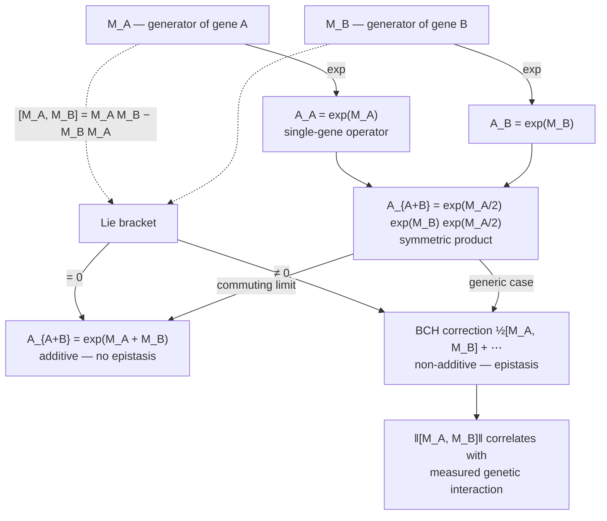
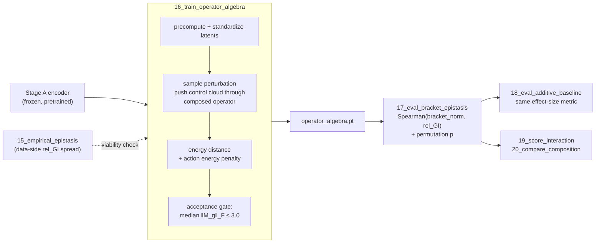

This page covers the layer of the action-operator stack where a latent operator stops being a single learned transformation and becomes a member of a **group with structure**: generators, their composition law, and the commutator as the quantitative currency of interaction. It spans three artifacts that must be read together — the mathematical note `docs/action_operator/03-the-algebra-of-composition.md`, the implementation `src/ssllab/generative/operator_algebra.py` with its property suite `tests/test_operator_algebra.py`, and the epistasis measurement battery in `examples/perturbation_response/` (scripts 15–18 and their comparisons). The prerequisite is [Generator Bases and Lie-Group Operators](13-generator-bases-and-lie-group-operators); the general, policy-driven context operator from that page remains relevant here only as a contrast case.

The core claim this page documents is a single sentence with a precise formal content: **a pair of interventions is epistatic if and only if their single-intervention generators fail to commute**, and the strength of the interaction is governed by ‖[M_A, M_B]‖. Everything below — the symmetric composition product, the property tests, the empirical-epistasis target, and the correlation endpoint — exists to make that sentence testable rather than rhetorical.

## Why an Algebra Was Needed: The Additive-Composition Failure

The predecessor design (`ssllab.generative.operator_perturb`, round 3 of the perturbation study) applied `exp` exactly once, to a single generator built from an additive gene-set embedding — the same object the NB-VAE baseline consumes. The module docstring is blunt about the consequence: that model "tied the flow" because it composed two genes in the *embedding*, never in the *operator algebra*; the matrix exponential was a reparameterization, not a capability. A model with one shared generator cannot express an order-dependent gap between "A then B" and "B then A," and therefore has no internal quantity that could track interaction even in principle.

Sources: [operator_algebra.py](src/ssllab/generative/operator_algebra.py#L1-L11), [16_train_operator_algebra.py](examples/perturbation_response/16_train_operator_algebra.py#L1-L8)

The algebra variant removes the shared bottleneck. Each single gene `g` owns its own dense generator `M_g` (a `D × D` matrix), and a combination composes **in the group** via the symmetric (Strang) product:

$$A_{A+B} = \exp(M_A/2)\,\exp(M_B)\,\exp(M_A/2)$$

The generators are the *only* parameters — there is no policy network and no basis. A held-out combination composes from single-gene generators the model actually trained, with the interaction supplied by their non-commutativity rather than by a black-box map on an embedding. That is precisely the property that makes combination generalization structural instead of statistical.

Sources: [operator_algebra.py](src/ssllab/generative/operator_algebra.py#L43-L60)

## The Bracket Is the Epistasis: The Formal Core

The theory note builds the claim in four steps, each of which maps onto a test or an eval script. Composition of operators is matrix multiplication (written right-to-left: "A first, then B" is `BA`). The **commutator** `[A, B] = AB − BA` measures the gap between the two orderings, and `[A, B] = 0` exactly when order is irrelevant. The exponential-map theorem then gives the bridge to additivity: when `[A,B] = 0`, the binomial theorem collects `exp(A)exp(B)` into `exp(A+B)`, so composition collapses to generator addition — a no-interaction model. The Baker–Campbell–Hausdorff formula shows what remains when they do not commute: `log(exp A exp B) = A + B + ½[A,B] + ⋯`, an infinite correction series in which *every* term is a nested commutator, with `½[A,B]` the leading departure from additivity.

Sources: [03-the-algebra-of-composition.md](docs/action_operator/03-the-algebra-of-composition.md#L28-L88), [03-the-algebra-of-composition.md](docs/action_operator/03-the-algebra-of-composition.md#L92-L118)

One structural fact from §5 of the note decides which objects are allowed in this algebra at all: Lie algebras are closed under the bracket but **not** under plain multiplication (the product of two skew-symmetric rotation generators is not skew), so BCH can contain only brackets — and the **anticommutator** `{A,B} = AB + BA`, the swap-even half of the product, never appears in it. The note's comparison table is worth internalizing because the epistasis battery later leans on it: the commutator is swap-odd, vanishes when its arguments commute, and measures *order and direction*; the anticommutator is swap-even, equals `2A²` for a self-pair (so it is zero exactly when nothing interesting is happening), and measures *magnitude and overlap* — an interference term.

Sources: [03-the-algebra-of-composition.md](docs/action_operator/03-the-algebra-of-composition.md#L120-L190)

A subtlety that shapes the entire experimental design: the Norman et al. perturbations are delivered with **both guides simultaneously**, so the observable carries no order. The bracket's leading term `½[M_A, M_B]` is swap-odd, hence invisible to a simultaneous experiment as a sign — only its magnitude survives. The symmetric product is chosen deliberately because it cancels the odd first-order term exactly, leaving an even double-commutator contribution whose size scales with ‖[M_A, M_B]‖. Ordered composition — the odd part, path-dependence of a *plan* — becomes observable only in a temporal world model, which is the subject of [Operator World Models Series](15-operator-world-models-series).

Sources: [operator_algebra.py](src/ssllab/generative/operator_algebra.py#L14-L26), [03-the-algebra-of-composition.md](docs/action_operator/03-the-algebra-of-composition.md#L170-L190)

> [!TIP]
> The symmetric Strang split (`exp(M_A/2) exp(M_B) exp(M_A/2)`) is not a numerical-stability trick here — it is a **symmetry-matching device**. Halving the first generator makes the product invariant under `A ↔ B` up to the even double-commutator, so the estimator cannot hallucinate an order-sign from order-free data.

## Implementation Anatomy: `NamedGeneratorOperator`

The module condenses the algebra into one class. `build_pert_gene_matrix` supplies a multi-hot `(n_perts, n_genes)` matrix whose rows mark the genes each perturbation targets; because the gene vocabulary is sorted, ascending column order is the **canonical ordering** the symmetric product reads against — composition is deterministic regardless of how a pair name was written (`"A+B"` vs `"B+A"` yield identical operators). Generators are zero-initialized so every operator starts at the identity: the perturbation begins by doing nothing, and the least-action penalty keeps departures small unless data demand them.

Sources: [operator_algebra.py](src/ssllab/generative/operator_algebra.py#L43-L73)

| Method | Returns | Role in the thesis |
|---|---|---|
| `target_genes(pert_id)` | generator indices, ascending | canonical gene order for deterministic composition |
| `operator(pert_id)` | `A_p`, `(D, D)` | control → `I`; single → `exp(M_g)`; pair → symmetric Strang product; **raises** for >2 genes rather than silently mis-composing |
| `pushforward(z, pert_id)` | `(n, D)` cloud | transports control latents; one operator shared by every cell (intervention-level, not cell-level) |
| `bracket(g_a, g_b)` | `[M_A, M_B]`, `(D, D)` | the Lie bracket itself |
| `bracket_norm(pert_id)` | `‖[M_A, M_B]‖_F` scalar | **model-side quantity** of the round's primary endpoint; 0 for singles/control |
| `action_energy(pert_id)` | scalar | Frobenius penalty summed over the genes a perturbation targets — a pair pays for *both* genes |
| `operator_matrix(pert_id)` | `A_p` under `no_grad` | inspection: eigenvalues, departure from identity |

Sources: [operator_algebra.py](src/ssllab/generative/operator_algebra.py#L75-L131)

Two design contrasts are worth fixing precisely. Against the NB-VAE baseline: it has no generators, hence no bracket, hence *no version of the epistasis claim to make* — it can fit pair interactions only as free parameters on an additive embedding, which is exactly what the held-out split is designed to expose. Against the general `ContextConditionedOperator` of the previous page: that class exposes a `compose` static method whose docstring already warns that `A_second @ A_first` ordering matters ("BCH / [M1, M2]"), but its coefficients are emitted by a policy network per input; here the coefficients *are* the gene multi-hot vector, which is what turns the algebra from a modeling choice into an identification constraint.

Sources: [operator_algebra.py](src/ssllab/generative/operator_algebra.py#L14-L19), [context_operator.py](src/ssllab/action_operator/context_operator.py#L313-L317), [condition.py](src/ssllab/generative/condition.py#L1-L1)

## The Executable Thesis: Property Tests as Proof Obligations

`tests/test_operator_algebra.py` is written as a pinned contract — its own docstring says each test exists so "a refactor cannot silently break the thesis." The suite demonstrates the whole argument on synthetic generators: **commuting generators** are constructed as scalar multiples of one matrix (`M_B = 2.3·M_A`, forcing `[M_A, M_B] ≈ 0`), and the test asserts the composed pair operator collapses to `exp(M_A + M_B)`; **generic non-commuting** generators are shown to depart from additivity with bracket norm above threshold. These are not incidental unit tests — they are the theorem §3 of the composition note, instantiated in code.

Sources: [test_operator_algebra.py](tests/test_operator_algebra.py#L1-L13), [test_operator_algebra.py](tests/test_operator_algebra.py#L47-L71)

| Test | Property pinned | Why it is load-bearing |
|---|---|---|
| `test_zero_init_is_identity_everywhere` | every `A_p = I` at init, all seven perturbation names | near-identity prior is structural, not a penalty artifact |
| `test_single_gene_is_matrix_exp` | `A_A = exp(M_A)` exactly | the exponential is the lift from algebra to group |
| `test_commuting_generators_compose_additively` | bracket ≈ 0 ⇒ `A_{A+B} = exp(M_A+M_B)` | commuting ⇒ no epistasis (the ⇐ direction of the theorem) |
| `test_noncommuting_generators_are_not_additive` | bracket > 10⁻³ ⇒ composition departs from additive | non-commutativity *is* the departure from additivity |
| `test_bracket_norm_matches_and_is_antisymmetric` | `[A,B] = −[B,A]`; singles have zero bracket | the bracket's symmetry contract used by the eval scripts |
| `test_heldout_pair_composes_from_trained_singles` | unseen `A+C` equals `exp(M_A/2)exp(M_C)exp(M_A/2)` | **the generalization property**: no combo-specific parameter exists anywhere |
| `test_control_and_action_energy` | control energy 0; a pair pays for both genes | the least-action prior is per-gene, not per-perturbation |

Sources: [test_operator_algebra.py](tests/test_operator_algebra.py#L33-L104)

The held-out test deserves emphasis because it is the architectural heart of the round: setting the two single-gene generators *determines* the held-out combo's operator, since `A_{A+C}` is a fixed algebraic function of `M_A` and `M_C`. There is no mechanism by which the model could have memorized the pair — the parameter count for combinations is literally zero.

Sources: [test_operator_algebra.py](tests/test_operator_algebra.py#L82-L91)

## The Data-Side Target: Empirical Epistasis and Its Two Flavors

A model-side quantity is only meaningful against a data-side quantity that actually **varies**. `15_empirical_epistasis.py` computes the standard model-free definition of genetic interaction entirely from the cached count matrix — no model involved: `Δ(X)` is a perturbation's cell-mean minus the control mean; the additive prediction is `Δ(A) + Δ(B)`; the residual `Δ(A+B) − additive` is the epistasis; `GI = ‖residual‖` on the combo's top-DE genes. The combo's cells come from the held-out split; the two singles come from the training side. The script's stated verdict condition is a viability check performed *before* any model is trained: if `rel_GI` does not span a real range across the twenty held-out pairs, the bracket would have nothing to predict and the round "would be dead before a line of the model is written."

Sources: [15_empirical_epistasis.py](examples/perturbation_response/15_empirical_epistasis.py#L1-L56)

`GI` alone is unsigned — a norm can say the additive model is wrong but never whether the pair did *more* or *less* than the sum of its singles, which is the synergy/buffering distinction a geneticist actually cares about. The script therefore fits a least-squares scale `λ` stretching the additive prediction onto the truth and splits the residual orthogonally: `true = λ·add + perp` with `perp ⊥ add`, giving `GI² = (λ−1)²‖add‖² + ‖perp‖²`. The magnitude term (`λ > 1` super-additive synergy, `λ < 1` sub-additive buffering, with a `--scale-tol` of 0.1) is what a *symmetric, quadratic* object like an anticommutator would predict; the direction term `‖perp‖` is the commutator's natural target. Reporting only `GI` conflates the two flavors the algebra treats differently.

Sources: [15_empirical_epistasis.py](examples/perturbation_response/15_empirical_epistasis.py#L128-L170)

| Metric | Definition | Reading |
|---|---|---|
| `GI` | `‖Δ(A+B) − (Δ(A)+Δ(B))‖` on top-DE genes | absolute (unsigned) epistasis |
| `rel_GI` | `GI / ‖Δ(A+B)‖` | epistasis as a fraction of the effect; the correlation target |
| `scale (λ)` | least-squares fit of `add` onto `true` | >1 synergy, <1 buffering, ≈1 magnitude-ok |
| `GI_mag` | `|λ−1|·‖add‖` | right shape, wrong size — anticommutator-flavored |
| `GI_dir` | `‖perp‖` | genes moved the additive model did not — commutator-flavored |
| `add_r` / `add_cos` | Pearson / cosine of `true` vs `add` | `1.0` = perfectly additive |
| `perp_share` | `GI_dir² / GI²` | how much of the interaction is directional |

Sources: [15_empirical_epistasis.py](examples/perturbation_response/15_empirical_epistasis.py#L56-L100)

## The Epistasis Test Battery: Scripts, Gates, and Endpoints

The round is orchestrated as a four-stage battery plus comparisons, each stage emitting a report into the experiment directory. The dependency structure is strict: stage 15 is a viability precondition, stage 16 produces the only artifact (a checkpoint of generators), stage 17 joins the two sides per pair, and stage 18 supplies the reference a learned score must beat.

Sources: [16_train_operator_algebra.py](examples/perturbation_response/16_train_operator_algebra.py#L17-L75), [15_empirical_epistasis.py](examples/perturbation_response/15_empirical_epistasis.py#L58-L95)

Training (stage 16) is identical in spirit to round 3 — cells are unpaired, so each step pushes a control cloud through a perturbation's operator and matches the perturbed marginal with an energy distance — but one gradient property is new and decisive: an observed *combination* now flows through the **composed** operator, so its gradient reaches **both** single-gene generators. A single's generator is therefore pinned not only by its own cells but by every combination it participates in, which is how real pair data shapes the bracket. Held-out combinations are never trained; they are composed at eval time.

Sources: [16_train_operator_algebra.py](examples/perturbation_response/16_train_operator_algebra.py#L1-L16), [16_train_operator_algebra.py](examples/perturbation_response/16_train_operator_algebra.py#L128-L130)

The endpoint (stage 17) is a rank correlation with a significance discipline: per pair it reads `bracket = ‖[M_A, M_B]‖_F` off the trained generators and joins it to the model-free `rel_GI` from the cache, reporting **two** Spearman correlations because they answer different questions. In-sample (training combos): did the mechanism engage at all — a null here is fatal, since those combos shaped the generators directly. Out-of-sample (held-out combos): the actual claim, and one that "needs no comparison to the NB-VAE" — a positive, permutation-significant correlation (one-sided, 10,000 resamples via the same permutation machinery family documented in [Paired Bootstrap and Simultaneous Inference](20-paired-bootstrap-and-simultaneous-inference)) is the round's prize.

Sources: [17_eval_bracket_epistasis.py](examples/perturbation_response/17_eval_bracket_epistasis.py#L1-L33), [17_eval_bracket_epistasis.py](examples/perturbation_response/17_eval_bracket_epistasis.py#L71-L89)

Stage 18 scores the **additive model** `Δ(A+B) = Δ(A) + Δ(B)` as a *competitor*, not a diagnostic — a deliberate division of labor from stage 15, which builds the same additive prediction only to measure how far each pair departs from it. The additive baseline needs no training, is deterministic (no seeds, combo split only, since that is the only split where the question makes sense: all singles on the training side, twenty held-out combos scored), and is graded through the shared `run_effect_size_eval` seam so its number sits directly beside the flow's and the NB-VAE's in the cross-arm comparison. An exploratory block (single alone; one average effect for every pair; two random singles added) reports, without verdicts, how much of the score depends on knowing the pair at all.

Sources: [18_eval_additive_baseline.py](examples/perturbation_response/18_eval_additive_baseline.py#L1-L31), [18_eval_additive_baseline.py](examples/perturbation_response/18_eval_additive_baseline.py#L66-L95)

| Script | Question answered | Output artifact |
|---|---|---|
| `15_empirical_epistasis.py` | does `rel_GI` vary enough across pairs for the thesis to be testable? | `reports/epistasis.json` |
| `16_train_operator_algebra.py` | can per-gene generators fit unpaired clouds under the least-action prior? | `checkpoints/operator_algebra.pt` |
| `17_eval_bracket_epistasis.py` | does `‖[M_A,M_B]‖` predict measured epistasis, in and out of sample? | `reports/bracket_epistasis.json` |
| `18_eval_additive_baseline.py` | what must a learned score beat? | `reports/effect_size_additive.json` |

Sources: [16_train_operator_algebra.py](examples/perturbation_response/16_train_operator_algebra.py#L53-L75), [17_eval_bracket_epistasis.py](examples/perturbation_response/17_eval_bracket_epistasis.py#L56-L68)

> [!TIP]
> The training script carries an **acceptance gate** most readers will scroll past: `--max-generator-norm 3.0`. If the median generator norm exceeds it, the near-identity prior has failed — the bracket degenerates into a magnitude proxy and, by the run's own pre-registered standard, the result *cannot test the claim*. This is epistasis testing with the same discipline as the hypothesis ledgers in [Results Ledger and Pre-Registration](22-results-ledger-and-pre-registration): the run is disqualified before its numbers can mislead.

## Failure Modes This Design Pre-Commits To

The battery is structured around three specific ways the thesis can die, each detectable at a defined stage rather than after publication. First, **no spread**: if every held-out pair is near-additive, stage 15 reports a tight `rel_GI` cluster and the round stops — a cheap death by design. Second, **prior failure**: if the action penalty cannot hold generators near identity, stage 16's gate fires and the bracket correlation, even if positive, is uninterpretable. Third, **engagement without generalization**: a strong in-sample correlation with a null out-of-sample one means the bracket learned interaction only where it was trained on it — the exact distinction the two-correlation report in stage 17 makes unavoidable. These map directly onto the methodology vocabulary of [Experimental Methodology Series](21-experimental-methodology-series) and the ceiling analysis of [Evaluation Toolkit: Probes and Metrics](19-evaluation-toolkit-probes-and-metrics).

Sources: [15_empirical_epistasis.py](examples/perturbation_response/15_empirical_epistasis.py#L44-L56), [16_train_operator_algebra.py](examples/perturbation_response/16_train_operator_algebra.py#L66-L71), [17_eval_bracket_epistasis.py](examples/perturbation_response/17_eval_bracket_epistasis.py#L14-L23)

## Where This Goes Next

Within the catalog, this page sits mid-arc in the Action Operators section. The natural progression: backward to [Generator Bases and Lie-Group Operators](13-generator-bases-and-lie-group-operators) for the basis/policy machinery this module deliberately strips away; forward to [Operator World Models Series](15-operator-world-models-series), where ordered composition — the swap-odd bracket half that simultaneous perturbation experiments structurally cannot see — becomes observable in temporal rollouts; and sideways to [Perturbation-Response Pipeline](16-perturbation-response-pipeline) for the Stage-A/Stage-B context in which this battery runs, and [Co-Adaptation of Encoder and Decoder](18-co-adaptation-of-encoder-and-decoder) for what happens when the frozen-encoder assumption behind stage 16 is relaxed.
