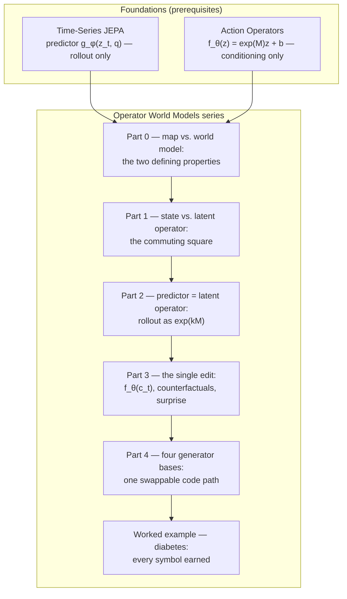
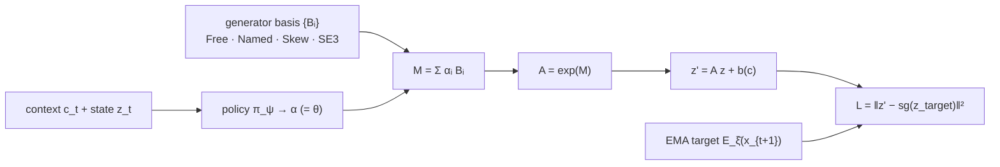

This page is the entry point to the repository's capstone tutorial corpus: `docs/operator_world_models/`, a five-part conceptual sequence plus a notation reference and a fully worked example. The series fuses the repo's two foundation threads — the Time-Series JEPA tutorial (a predictor that says *what comes next* in latent space) and the Action Operators foundation (an operator that transforms a latent under a chosen action) — into a single object: **a world model you can act on**. Its runnable counterpart is one module, `src/ssllab/action_operator/context_operator.py`, whose entire forward pass is `f_θ(c_t)(z) = exp(M_θ) z + b_θ`. In the catalog this sits directly after [Operator Algebra and Epistasis Tests](14-operator-algebra-and-epistasis-tests) and before the applied studies.

Sources: [index.md](docs/operator_world_models/index.md#L1-L7), [context_operator.py](src/ssllab/action_operator/context_operator.py#L1-L33)

## Position in the Corpus

The series assumes two prerequisites and builds a third thing from them. From the Time-Series JEPA series it takes the temporal predictor — encode recent history into a latent `z_t = E_ξ(x_≤t)`, predict the next latent, train against a slow EMA target encoder in latent space. From the Action Operators foundation it takes the operator formalism — an action read as a *function that transforms state*, configured by parameters `θ`. Neither foundation is a world model alone; the series' equation in words is: **world model = Time-Series JEPA's rollout plus the action operator's conditioning**. Within the catalog, the operator foundations are covered by [Generator Bases and Lie-Group Operators](13-generator-bases-and-lie-group-operators), and the general architecture context by [Architecture Overview](4-architecture-overview).

Sources: [index.md](docs/operator_world_models/index.md#L9-L14), [00-what-is-a-world-model.md](docs/operator_world_models/00-what-is-a-world-model.md#L47-L57)

## The Arc in Three Moves

The series tells one story in three movements, from passive prediction to actionable dynamics. First, **JEPA watches**: hide part of the data, predict its embedding from context — passive, label-free. Second, **JEPA as a world model**: reinterpret "predict the masked region" as "predict the next timestep," so the predictor becomes a dynamics operator on a latent trajectory `z_t → z_{t+1}`, and the prediction-vs-reality gap becomes a **surprise** signal. Third, **JEPA you can act on**: the vanilla temporal query knows only *when* (how far ahead), never *what acted*; conditioning the operator on the intervention `c_t` yields `f_θ(c_t)`, which unlocks counterfactual rollout and composition.

Sources: [index.md](docs/operator_world_models/index.md#L9-L14), [00-what-is-a-world-model.md](docs/operator_world_models/00-what-is-a-world-model.md#L27-L57)

## Part 0 — What Is a World Model?

Part 0 draws the distinction that does all the work: a representation learner gives you a **map** (where things are in latent space); a world model adds **how the state evolves**. Two properties separate a world model from an ordinary next-step predictor. **Rollout** — apply the one-step map, feed its output back in, iterate; the model imagines trajectories many steps ahead without living through them. **Action-conditioning** — vary the action and get a different trajectory for each, which is what makes "what if I did A?" computable. Part 0 also scopes the term: an action operator on a JEPA latent spans non-temporal arenas too (I-JEPA spatial attention, static in-silico perturbations), but the series builds on the temporal arena because that is where every piece is at its clearest.

| foundation | supplies | missing |
|---|---|---|
| Time-Series JEPA | rollout (the temporal predictor, iterated) | action-conditioning — its query says only *when* |
| Action operator | action-conditioning (trajectories per action) | — (it is the missing property) |

Sources: [00-what-is-a-world-model.md](docs/operator_world_models/00-what-is-a-world-model.md#L11-L57), [00-what-is-a-world-model.md](docs/operator_world_models/00-what-is-a-world-model.md#L59-L94)

## Part 1 — State Operators and Latent Operators

Part 1 is the keystone: one transformation, two spaces. The **state operator** `Ô_θ` acts on the real system state `s` (a person's physiology, a protein's coordinates) — the physically meaningful object, usually inaccessible and nonlinear. The **latent operator** `f_θ` acts on the encoded latent `z = E(s)` — the object you actually compute with. They are tied by the **commuting square**, `E(Ô_θ(s)) = f_θ(E(s))`, which in practice is enforced as the **equivariance loss** `‖E(Ô_θ(s)) − f_θ(E(s))‖²` — exactly the shape of JEPA's own loss, which is why a JEPA encoder can double as the bridge. The Koopman framing legitimizes the parameterization `f_θ(z) = exp(M_θ) z + b_θ`: **the encoder's job is not to compress but to find coordinates in which the physical operator becomes a clean linear latent operator**. JEPA's payoff is that you never instantiate `Ô_θ` and never need a decoder — you predict `f_θ(E(s))` and compare against `E(s')`.

Sources: [01-state-and-latent-operators.md](docs/operator_world_models/01-state-and-latent-operators.md#L14-L70), [01-state-and-latent-operators.md](docs/operator_world_models/01-state-and-latent-operators.md#L82-L112)

### Two Poles of One Dial

The two running application domains are the *same construction* with the expressiveness↔structure dial set to opposite extremes. Digital phenotyping sits at the **learned pole**: no one can write down what "a week of more sleep" does to a behavioral latent, so `M_θ` is free or organized by named interventions, and equivariance is discovered. Protein ML sits at the **given pole**: the relevant transformations are rigid motions, so the SE(3) structure is imposed as a hard symmetry with correctness guaranteed by construction. What differs is only the generator basis that builds `M_θ`.

| | state operator `Ô_θ` | latent operator `f_θ` | equivariance source |
|---|---|---|---|
| Behavioral (phenotyping) | real intervention on true state — inaccessible, nonlinear | `exp(M_θ) z + b_θ`, `M_θ` **learned** | learned from encoded streams |
| Protein (3D) | literal rigid motion `x ↦ Rx + t` — exactly known | SE(3) operator on residue frames | demanded as hard SE(3)-equivariance |
| Image (I-JEPA) | "shift attention to region p" | predictor conditioned on position | learned via the predictor |

Sources: [01-state-and-latent-operators.md](docs/operator_world_models/01-state-and-latent-operators.md#L114-L135), [index.md](docs/operator_world_models/index.md#L16-L40)

## Part 2 — JEPA as a Temporal World Model

Part 2 makes one recognition and exercises one property. The recognition: **the temporal predictor and the latent operator are the same object** — "advance the latent under query q" has exactly the type signature of `f_θ`. Read against the operator formalism, the vanilla predictor is complete in two axes and lacking in two: the map exists but is **unstructured** (no committed algebraic shape), and the query exists but carries **only the time offset** `Δt`, set by a fixed schedule. The property exercised is rollout: iterating the operator composes it, and for the structured operator a k-step rollout collapses to one matrix, `f^k(z) = exp(kM_θ) z` — the series' rhythm example shows a weekly cycle closing exactly because `7 × 51.4° = 360°` in a single matrix multiply.

| action operator | Time-Series JEPA counterpart | status in vanilla model |
|---|---|---|
| latent operator `f_θ` | predictor `g_φ(z_t, ·)` | present, but **unstructured** |
| operator parameter `θ` | query / offset `q_Δt` | present, but carries only *when* |
| policy choosing `θ` | the offset schedule | **fixed, not learned** |
| predicted next state | `ẑ_{t+1}` | present |

Part 2 also states the **anchoring caveat** that shapes everything downstream: during training every prediction is checked against a real EMA-target encoding, but during genuine inference rollout the anchor is gone and small errors compound. The model therefore needs an internal trust signal — the surprise residual — which the vanilla model cannot yet interpret cleanly.

Sources: [02-jepa-as-a-temporal-world-model.md](docs/operator_world_models/02-jepa-as-a-temporal-world-model.md#L27-L70), [02-jepa-as-a-temporal-world-model.md](docs/operator_world_models/02-jepa-as-a-temporal-world-model.md#L74-L98)

## Part 3 — Conditioning JEPA on Actions

Part 3 is the single edit that makes the world model actionable: replace the bare query with an operator configured by the intervention, `g_φ(z_t, q_Δt) → f_θ(c_t)(z_t)`, where `c_t` is the recorded context (hours slept, medication taken; a mutation, a ligand) and a policy `π_ψ` reads state and context to emit `θ`. Everything else about training is unchanged — same EMA target, same latent L2, same stop-gradient. The edit fixes the **averaging defect**: unconditioned, one operator must straddle the good-night and bad-night futures and be wrong on every instance; conditioned, it produces the right answer per case. Three payoffs follow: **counterfactual rollout** (hold today fixed, swap the action, re-roll), **composable interventions** (repeating one intervention scales its generator, `f^7 = exp(7M)`; ordering effects are governed by the commutator `[M₁, M₂]` via Baker–Campbell–Hausdorff), and a **sharpened surprise signal** where the residual measures only what known actions fail to explain.

Sources: [03-conditioning-jepa-on-actions.md](docs/operator_world_models/03-conditioning-jepa-on-actions.md#L14-L58), [03-conditioning-jepa-on-actions.md](docs/operator_world_models/03-conditioning-jepa-on-actions.md#L60-L105)

Part 3 is also careful about its limits on two fronts. It stays **self-supervised**: the policy is trained by the predictive loss with gradients flowing through a reparameterized one-step path — no reward, no critic (the RL attachment is explicitly deferred). And it states the structural risk honestly: if the policy and operator are too expressive, the model can **explain away** a genuine decline as an intervention effect, flattening the very surprise signal you built. The mitigation is structural — keep `Θ` deliberately small and structured, which is why the basis choice in Part 4 is load-bearing rather than cosmetic.

Sources: [03-conditioning-jepa-on-actions.md](docs/operator_world_models/03-conditioning-jepa-on-actions.md#L107-L135)

## Part 4 — Generator Bases and the Operator in Code

Part 4 lands the dial in code. Since `exp(M)` is always invertible, `exp(0) = I` gives a near-identity start, and `M` lives in a flat vector space, the one remaining design decision is *which matrices M is allowed to be* — and that is fixed by choosing a generator basis `{B_i}` with `M_θ = Σ α_i B_i`. The behavioral pole (Free/Named) and the protein pole (SE(3)) are the **same operator class with a different basis argument**.

| basis | `{B_i}` concretely | `exp(Σ αᵢ Bᵢ)` guarantees | where it fits |
|---|---|---|---|
| **Free / GL(D)** | learnable dense matrices, no constraint | invertible only | phenotyping default; model discovers its own modes |
| **Named** | one learnable matrix per labeled intervention | invertible, **interpretable**; `α` can *be* `c` | quantified intervention logs |
| **Skew / SO(D)** | skew-symmetric (`Bᵀ = −B`) | **orthogonal** — norm-preserving rotation | circadian / cyclic dynamics, cannot blow up |
| **SE(3)** | 6 fixed generators: 3 rotation + 3 translation | **rigid motion** (4×4 homogeneous) | protein residue frames |

Sources: [04-generator-bases-and-the-operator-in-code.md](docs/operator_world_models/04-generator-bases-and-the-operator-in-code.md#L12-L52), [04-generator-bases-and-the-operator-in-code.md](docs/operator_world_models/04-generator-bases-and-the-operator-in-code.md#L54-L72)

### The Runnable Module: `context_operator.py`

The module maps the formalism one-to-one. `GeneratorBasis` has the four subclasses above, each returning `{B_i}` as an `(m, D, D)` tensor — `SkewBasis` returns `R − Rᵀ` (always skew), `SE3Basis` returns the six fixed generators as a buffer. Policies split two ways: `MLPPolicy` emits `α` from `(z, c)` with a zero-initialized head, and `DirectInterventionPolicy` passes `α = c` through an optional learnable gain, so the quantified intervention log *is* the coefficient vector. `ContextConditionedOperator` ties basis and policy together and exposes the inspection surface the series' claims rest on.

| component | role | key lines |
|---|---|---|
| `FreeBasis` / `NamedBasis` / `SkewBasis` / `SE3Basis` | the `(m, D, D)` basis `{B_i}` — the dial | [context_operator.py](src/ssllab/action_operator/context_operator.py#L50-L165) |
| `MLPPolicy` | `π_ψ(z, c) → α`; deterministic (Dirac) or diagonal-Gaussian, reparameterized | [context_operator.py](src/ssllab/action_operator/context_operator.py#L170-L211) |
| `DirectInterventionPolicy` | `α = c · gain`, requires `c_dim == num_generators` | [context_operator.py](src/ssllab/action_operator/context_operator.py#L212-L227) |
| `ContextConditionedOperator` | forward `z' = exp(M)z + b(c)`; `eigenvalues()`, `energy()`, `compose()` | [context_operator.py](src/ssllab/action_operator/context_operator.py#L231-L315) |
| `conditioned_jepa_loss` / `ema_update` | Part 3's loss verbatim (`z_target.detach()` = stop-grad); EMA target update | [context_operator.py](src/ssllab/action_operator/context_operator.py#L313-L327) |
| `_smoke()` | numerical verification of every structural guarantee | [context_operator.py](src/ssllab/action_operator/context_operator.py#L330-L426) |

> [!TIP]
> The structural guarantees are **architectural, not penalized**: invertibility, orthogonality, and rigidity follow from the basis choice plus the matrix exponential, never from a loss term — and the zero-initialized policy head means `α = 0 → M = 0 → A = I`, so every operator starts as "do nothing" and departs from identity only as far as the data demands.

> [!TIP]
> `eigenvalues(z, c)` returns eigenvalues of the *generator* `M`, not of `A` — this is deliberate: a positive real part in any mode of `M` flags locally growing dynamics, which is exactly the "decompensation" read of Part 3 and the worked example. Likewise, the stop-gradient lives inside `conditioned_jepa_loss` via `z_target.detach()`, keeping anti-collapse out of the operator class.

The guarantees are verified, not asserted: the module's smoke test checks skew-basis orthogonality (`AᵀA = I` to ~1e-7), the flow property (`exp(7M) = (exp M)^7` to ~1e-6 — "a week really is one clean matrix"), SE(3) rigidity (`RᵀR = I`, `det R = 1`, bottom row `[0,0,0,1]`), near-identity init, and that the conditioned loss backpropagates into both policy and basis. Two pieces are deliberately left open: the encoders `E_ξ / E_ξ̄` (research artifact vs. on-device product push them in different directions) and the actor–critic attachment (the stochastic policy exposes `log_prob`/`entropy`, but only the predictive one-step path is wired).

Sources: [04-generator-bases-and-the-operator-in-code.md](docs/operator_world_models/04-generator-bases-and-the-operator-in-code.md#L74-L130), [context_operator.py](src/ssllab/action_operator/context_operator.py#L330-L426)

## The Worked Example: A Personal World Model for Diabetes

The closing chapter threads every symbol through one person — Maya, type 2 diabetes, instrumented with CGM, insulin, carbs, exercise, sleep, weight, and an EHR stream of timestamped medical codes (SNOMED diagnoses, RXNORM prescriptions, LOINC labs — the modality most people would not think to feed a glucose model; all data illustrative and synthetic, with the PH caveat stated up front). Diabetes sits at the **learned pole**, so the **named-intervention basis** makes the formalism operational: one learned generator per logged intervention, and the coefficients read straight off the daily log, `α = c_t`:

`M_θ(c_t) = n_insulin·B_insulin + n_carbs·B_carbs + n_exercise·B_exercise + n_metformin·B_metformin`

| generator | learned eigenvalues (illustrative) | what it does to the latent |
|---|---|---|
| `B_metformin` | −0.12, −0.20 | both axes decay toward target — mean-reverting drug |
| `B_exercise` | −0.15, −0.10 | inward pull, strongest on elevation |
| `B_insulin` | −0.30, −0.05 | sharp downward pull on elevation — fast, but risky |
| `B_carbs` | +0.18, +0.05 | **push outward** — the one destabilizing generator |

The headline result is a three-plan counterfactual: fixing today's latent `(0.85, 0.55)` and rolling two weeks under each regimen yields **status quo → TIR ≈ 58%**, **+ daily 30-min walk → TIR ≈ 71%** (no added hypo risk), **intensify insulin → TIR ≈ 67% with elevated hypoglycemia risk** — numbers no passive dashboard can produce. And the eigenvalue read catches **decompensation**: if the elevation-axis eigenvalue of Maya's effective daily operator drifts from −0.05 to +0.04 with her regimen unchanged, `e^{+0.04} ≈ 1.04 > 1` means a slow runaway the logged interventions do not explain — the sharpened surprise signal doing clinical work.

Sources: [05-worked-example-diabetes.md](docs/operator_world_models/05-worked-example-diabetes.md#L14-L175), [05-worked-example-diabetes.md](docs/operator_world_models/05-worked-example-diabetes.md#L197-L265)

## Notation Reference

`notation.md` is a standalone glossary grouping every symbol by role — representation (`E`, `E_ξ`, `E_ξ̄`, `τ`, `sg`), operators (`Ô_θ` vs `f_θ`, `Θ`), construction (`B_i`, `α`, `M_θ`, `A_θ = exp(M_θ)`, `b_θ`), conditioning (`c_t`, `π_ψ`, `Δ(Θ)`, `g_φ`, `q_Δt`), and energy/spectrum (`E(Ô) = ‖M‖²_F`, `Re(λ_i)`) — each with a "read as" column. It flags the one deliberate overload: `E` does double duty as encoder and energy functional, disambiguated by argument. The general policy `π_ψ(z_t, c_t)` exists even though the log can *be* `α`, because real interventions interact with state — 30 g of carbs does something different at `(0.85, 0.55)` than at baseline.

Sources: [notation.md](docs/operator_world_models/notation.md#L1-L62), [05-worked-example-diabetes.md](docs/operator_world_models/05-worked-example-diabetes.md#L267-L290)

## Reading Order and Prerequisites

**Prerequisites — read first:** the Time-Series JEPA series (`docs/time_series_jepa/`) and the Action Operators foundation (`docs/action_operator/`, whose catalog counterpart is [Generator Bases and Lie-Group Operators](13-generator-bases-and-lie-group-operators)). Then read the series in order; keep the notation reference open in a second tab and read the worked example alongside the parts.

| part | file | what you get |
|---|---|---|
| 0 — What is a world model? | [00](docs/operator_world_models/00-what-is-a-world-model.md) | map vs. world model; rollout + action-conditioning — **start here** |
| 1 — State and latent operators | [01](docs/operator_world_models/01-state-and-latent-operators.md) | `Ô_θ` vs `f_θ`, the commuting square, Koopman — the keystone |
| 2 — JEPA as a temporal world model | [02](docs/operator_world_models/02-jepa-as-a-temporal-world-model.md) | predictor as query operator; rollout as `exp(kM)`; anchoring caveat |
| 3 — Conditioning JEPA on actions | [03](docs/operator_world_models/03-conditioning-jepa-on-actions.md) | `f_θ(c_t)`; counterfactual rollout; sharpened surprise |
| 4 — Generator bases and the operator in code | [04](docs/operator_world_models/04-generator-bases-and-the-operator-in-code.md) | the four bases; the runnable module |
| Worked example | [05](docs/operator_world_models/05-worked-example-diabetes.md) | every symbol earned on one person's data |

Sources: [index.md](docs/operator_world_models/index.md#L42-L57), [notation.md](docs/operator_world_models/notation.md#L83-L85)

## Where to Go Next in the Catalog

The series is conceptual; the applied counterpart lives downstream. [Perturbation-Response Pipeline](16-perturbation-response-pipeline) shows the operator machinery doing real experimental work (cell-state encoders, conditional flow, effect-size evaluation), and [Operator Algebra and Epistasis Tests](14-operator-algebra-and-epistasis-tests) develops the non-commuting composition this series' commutator discussion points to — with the load-bearing properties pinned in `tests/test_operator_algebra.py` (zero-init is identity, commuting generators compose additively, the bracket is what differs). For how to evaluate anything you build on this construction, see [Experimental Methodology Series](21-experimental-methodology-series) and [Evaluation Toolkit: Probes and Metrics](19-evaluation-toolkit-probes-and-metrics); for the full corpus map, see [Tutorial Corpus and Reading Paths](25-tutorial-corpus-and-reading-paths).
