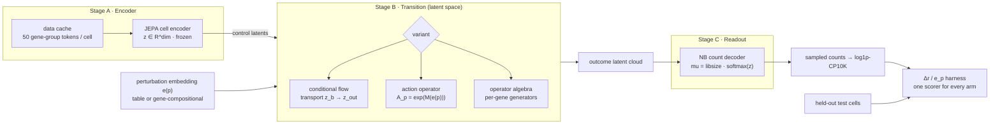

This page documents the single-cell genetic perturbation study in `examples/perturbation_response/` — the biological application of the ssl-lab generative-JEPA toolkit. The pipeline takes the Norman et al. 2019 Perturb-seq dataset, learns a cell representation with an unlabeled JEPA encoder, transports latents from control cells to perturbed populations with a conditional generative model, reads latents back out as gene counts, and grades every arm on a single pre-committed benchmark: effect-size correlation on held-out two-gene perturbations. It is also the repository's worked example for its experimental methodology — the study's negative results are documented as carefully as its wins.

Sources: [README.md](examples/perturbation_response/README.md#L1-L13), [index.md](docs/experimental-method/index.md#L7-L13)

## The Problem Shape: Predicting a Response, Not a State

A genetic perturbation switches a gene on or off inside a cell, and the cell's gene-expression profile shifts in response. The shift is not the same in every cell — genetically identical cells respond differently — so the modeling target is a *distribution* of outcomes, not a point estimate. The benchmark is the scGen/CPA/GEARS lineage test set: K562 cells under CRISPR activation, with both single-gene and two-gene perturbations. Models train on single-gene perturbations and some pairs, then must predict twenty held-out two-gene combinations they have never seen. The combinatorial split is the headline test, because it asks whether a model has learned something about how perturbations compose.

Sources: [README.md](examples/perturbation_response/README.md#L3-L13)

## The Three-Stage Architecture

The method has three stages, each trained separately so that its contribution can be measured on its own:

1. **Stage A — the encoder.** A JEPA encoder is pretrained on cells with no labels at all: it masks some gene groups in a cell and learns to predict their embeddings from the rest. After pretraining it is frozen and maps every cell to a latent vector.
2. **Stage B — the transition.** A conditional generative model in that latent space turns a perturbation into a cloud of outcome latents. The main version is a conditional flow that transports control-cell latents toward the perturbed population; variants replace the flow with a learned linear operator or a per-gene operator algebra.
3. **Stage C — the readout.** A negative-binomial count decoder turns each latent back into gene counts, because effect size is measured on genes, not on latents.

Before reading the diagram: the arrows into Stage B carry two distinct objects — a *source* latent (either noise or a real control cell) and a *perturbation embedding* `e(p)`. The "cloud" on the output side is the population, which is what the distributional metrics grade; a summary statistic of it feeds the effect-size metric.



The comparison spine is two references. The first is a from-scratch conditional NB-VAE conditioned on the same perturbation embedding — no JEPA, no flow — which is the strongest learned baseline. The second is a training-free additive reference: the sum of the two single-gene effects, Δ(A) + Δ(B), which requires no model at all and has led on effect size since round 7.

Sources: [README.md](examples/perturbation_response/README.md#L5-L13)

## The Data Contract: Cells as Token Sequences

The data adapter is the biological sibling of the MNIST adapter, and its job is stated in one line: turn a cell's HVG vector `(n_hvg,)` into gene-group tokens `(n_tokens, token_dim)`, so the *same* `build_jepa(token_dim=..., n_tokens=...)` trains on cells with no architectural change. Where MNIST splits an image into spatial patches, here a cell's 5,000 highly-variable genes are split into a fixed random partition of 50 groups (`DEFAULT_N_HVG = 5000`, `DEFAULT_N_TOKENS = 50`, hence `token_dim = 100`). The partition is deterministic in its seed, so the processing script and every training run agree on which gene sits in which group.

Sources: [perturbseq.py](src/ssllab/data/perturbseq.py#L1-L32), [perturbseq.py](src/ssllab/data/perturbseq.py#L47-L62), [perturbseq.py](src/ssllab/data/perturbseq.py#L72-L99)

The module is deliberately light — torch, numpy, and json only. All heavy single-cell processing (acquiring Norman 2019, QC, HVG selection via scanpy's `seurat_v3` on raw counts, normalization, differential expression) lives in the one-time script `00_process_norman.py`, which imports `anndata`/`scanpy`/`pertpy` lazily inside the functions that need them. The cache it writes is what every later stage consumes:

| Cache file | Role |
|---|---|
| `tokens_meta.npz` | train-time fast path: `hvg_X`, raw `counts`, `libsize`, `pert_id`, `is_control`, `ctrl_group`, split codes, `gene_ids`, `pert_names` |
| `splits.json` | perturbation-level splits — `combo` holds out unseen pairs, `cells` is an in-distribution sanity split |
| `de_genes.json` | top differentially expressed genes per perturbation — the set every metric scores |
| `manifest.json` | provenance and every processing setting, including the token-partition seed |
| `processed.h5ad` | canonical AnnData, for inspection and re-derivation — not read at train time |

Sources: [README.md](examples/perturbation_response/README.md#L130-L149), [perturbseq.py](src/ssllab/data/perturbseq.py#L14-L32), [00_process_norman.py](examples/perturbation_response/00_process_norman.py#L98-L108)

The cache lives in the project-neutral data lake, not in the repository: `link_dataset('scrna/perturb_seq/norman2019')` from `ops.datasets` maps the nested lake path to a flat local alias, `data/norman2019`. The batch a loader yields is a dict, not a bare `(x, y)`: perturbation modeling needs the covariates — raw counts for the NB decoder, library size, the perturbation label, and the control grouping for baseline pairing. It also carries a `control_sampler` that draws baseline cells from the matched control pool each step.

Sources: [README.md](examples/perturbation_response/README.md#L151-L184)

> [!TIP]
> Two panels are lossy by design, and both bind the whole pipeline: the 5,000-gene HVG panel is the model's entire input vocabulary (a perturbation whose response lives outside the panel is invisible downstream), and the fixed gene partition is what makes the encoder's positional table and the `--smoke` end-to-end check mean anything. Change either and every cached artifact must be rebuilt.

## Stage B: One Contract, Three Implementations

The transition is where the pipeline's design space lives, and the code enforces that it stays swappable. Every Stage B checkpoint loads into the same bundle shape and exposes the same operation — produce a cloud of outcome latents for a perturbation — so every downstream evaluator grades all arms through an identical harness. The loader inspects `(flow_base, cond_type)` from the checkpoint and rebuilds the condition module to match: a `control` transport base conditions on the perturbation embedding alone, while a `gaussian` prior fuses the baseline latent and the perturbation.

Sources: [perturb.py](src/ssllab/generative/perturb.py#L1-L52), [perturb.py](src/ssllab/generative/perturb.py#L78-L99)

The conditional flow is a rectified flow over the frozen latents: the interpolant is `z_t = (1-t)·z0 + t·z1`, the target velocity `u_t = z1 − z0`, and training regresses a `VelocityMLP` field onto it by an Euler-integrable ODE. The field is conditioned through FiLM injection alongside a sinusoidal time embedding, with a learned null-condition token enabling classifier-free guidance. The decisive design choice is the source `z0`: a Gaussian noise base generates outcomes from noise, while a `control` base transports a real control-cell latent and therefore models the *displacement* — the effect — directly. A settled ablation: transporting from a real control beats generating from noise (+0.036, significant); optimal-transport coupling of the pairs makes things worse (−0.021, significant) even though it lowers the training loss.

| Stage B variant | Mechanism | Conditioning | Status |
|---|---|---|---|
| Flow, gaussian base | noise → outcome ODE | `cond(z_b, pert_id)` | superseded by control base |
| Flow, control base | transport control latent → outcome | `cond(pert_id)` only | the main method |
| Action operator | `A_p = exp(M(e(p)))`, linear pushforward of control latents | gene-compositional `e(p)` | drop-in, same harness |
| Operator algebra | one generator per gene; pairs compose inside the group | gene vocabulary | refuted for epistasis prediction |
| Conditional NB-VAE | encoder + decoder trained from scratch | perturbation-conditioned | strongest learned baseline |

Sources: [flow.py](src/ssllab/generative/flow.py#L1-L38), [flow.py](src/ssllab/generative/flow.py#L61-L109), [04_train_cond_flow.py](examples/perturbation_response/04_train_cond_flow.py#L80-L91), [README.md](examples/perturbation_response/README.md#L47)

The operator variants deserve one paragraph of honesty, because they define what a drop-in replacement means here. `load_operator` and `load_operator_algebra` produce the identical `kind == "operator"` bundle the flow uses: the operator exposes `pushforward(z_ctrl, pert_id)` and reuses the sampling code unchanged. The algebra variant additionally carries a gene vocabulary so the bracket-epistasis eval can compute `‖[M_A, M_B]‖` per pair. The hypothesis — that operator non-commutativity predicts genetic interaction — failed every test it was given, and the refutation is pre-registered in the script's docstring before any run.

Sources: [perturb.py](src/ssllab/generative/perturb.py#L78-L120), [README.md](examples/perturbation_response/README.md#L44), [README.md](examples/perturbation_response/README.md#L112-L113)

## Stage C: Where Effect Size Is Recovered

The count decoder exists because effect size is measured on genes, and single-cell counts are non-negative integers, over-dispersed, and dropout-dominated — a Gaussian/MSE decoder is the wrong measurement model. The decoder instead emits the parameters of a negative-binomial distribution: `rho = softmax(net(z))` is a relative gene-rate profile summing to 1, `mu = library_size · rho` is the NB mean with library size as a given covariate, and `kappa = softplus(per-gene param)` is the dispersion. Training minimizes the NB negative log-likelihood of real counts.

Sources: [count_decoder.py](src/ssllab/generative/count_decoder.py#L1-L29)

The decoder is also where the study's most consequential bug lived. Round 11 of the results ledger found that the NB likelihood was counting each cell's library size over *all* measured genes rather than the 5,000 the decoder models — a factor of about 3.2 mismatch between the likelihood's means and the observed counts, compressing every model's rate profile. The correction is now the default: `LIBRARY_SIZES` offers `all` versus `hvg`, and `DEFAULT_LIBRARY_SIZE = "hvg"`; symmetrically, sampled counts are converted back to log1p-CP10K by dividing each sampled cell by its own total over modeled genes (`DEFAULT_NORMALIZATION = "data"`) rather than by the sampling depth. Fixing one convention lifted *every* model, not just the method — which is exactly why single-sourced scoring code matters.

Sources: [count_decoder.py](src/ssllab/generative/count_decoder.py#L37-L77), [README.md](examples/perturbation_response/README.md#L34)

## The Evaluation Harness: One Scorer for Every Arm

The benchmark function scores the **change** an intervention causes, not the absolute state. For a perturbation, the effect is its differential expression `Δ = mean(perturbed) − mean(control)` in log1p-CP10K; a model is graded on Pearson correlation between its predicted Δ and the true Δ over that perturbation's top-20 differentially expressed genes. The harness is deliberately predictor-agnostic: `run_effect_size_eval` takes a callable `predict_fn(pid, name) → pred_mean`, holds the truth as the mean over the perturbation's test cells, and returns per-perturbation correlations plus a summary. The flow eval (06), the NB-VAE baseline (09), and any future predictor call the same function, so a Δr difference is always an apples-to-apples statement.

Sources: [effect_size.py](src/ssllab/eval/effect_size.py#L1-L44), [effect_size.py](src/ssllab/eval/effect_size.py#L57-L90)

Beyond Δr, the harness family covers the other axes the study committed to: `10_eval_calibration.py` scores the distributional axis (spread correlation, interval coverage, Wasserstein and energy distance), `19_score_interaction.py` scores the *size* of the predicted change — the size-aware error `e_p`, where predicting no change scores 1 — and its departure from additivity. Verdicts on whether any difference is real come from `12_compare_arms.py`, a joint bootstrap with simultaneous intervals over the whole family of comparisons, so contrasts that share arms are resampled jointly rather than independently.

Sources: [README.md](examples/perturbation_response/README.md#L84-L107)

> [!TIP]
> The scoreboard numbers are re-read, not frozen: every Δr and e_p in the current README is under round 11's corrected likelihood conventions and averaged over three seeds. Older checkpoints reproduce the published numbers only when `library_size=all` and `normalization=depth` are passed explicitly — the defaults are the corrected conventions, not the original ones.

## Script Taxonomy: Build, Score, Diagnose, Decide, Vary

The scripts are numbered `00` to `27` in the order they were written, which is not the order anyone runs them in. The README organizes them by the kind of work they do — a taxonomy worth internalizing before touching the directory:

| Kind | Scripts | Trains? | Where |
|---|---|---|---|
| **Build** an artifact | `00`, `01`, `03`, `04`, `08`, `13`, `16` | yes (only these) | GPU pod, except `00` |
| **Score** on the benchmark | `05`, `06`, `09`, `18`, `10`, `19` | no | CPU, minutes |
| **Diagnose** where loss lives | `00a`, `00b`, `00c`, `02`, `11`, `14`, `15` | no | CPU, minutes |
| **Decide** if a difference is real | `12`, `17`, `20`–`27` | no | CPU, seconds |
| **Vary** one lever at a time | `run_*_pod.sh` wrappers | reuses artifacts | GPU pod |

Sources: [README.md](examples/perturbation_response/README.md#L68-L129)

Three of the diagnose scripts changed the direction of the project and are worth reading as instruments rather than utilities. `02_probe_cell_encoder.py` judges the frozen encoder with a linear probe; `11_diagnose_variance.py` attributes predicted spread to the latent distribution versus the decoder; and `14_ceiling_analysis.py` replaces Stage B with an oracle — real held-out cells pushed through encoder and decoder — to establish the best any transition could do with a given representation. That ceiling diagnostic is what proved the transition was never the bottleneck (a perfect-by-construction Stage B reached only 0.679 through the then-current decoder) and located the loss in the readout.

Sources: [README.md](examples/perturbation_response/README.md#L95-L106), [README.md](examples/perturbation_response/README.md#L42-L43)

## Co-Adaptation and What the Ledger Found

Every round before 12 froze the encoder, which is what made a difference between two arms attributable to the one thing that changed. Co-adaptation relaxes that freeze one stage at a time, and its Phase 1 trainer has three modes sharing one recipe: `dec` re-trains only a fresh decoder (the control), `joint` trains encoder and decoder together on the NB reconstruction loss with a smaller encoder learning rate, and `joint_anchor` adds the JEPA masked-prediction objective with an EMA teacher at a weight fixed by rule — the weight that equalizes the two loss terms at the scale of a *trained* readout, measured before any update. The anchor keeps an objective satisfied during fine-tuning; it does not penalize distance from the original encoder, and how far the representation actually moves is measured separately by CKA.

Sources: [coadapt.py](src/ssllab/coadapt.py#L1-L56), [README.md](examples/perturbation_response/README.md#L192-L199)

The findings, with Δr meaning effect-size correlation on the twenty held-out combinations and `e_p` the size-aware error:

| Arm | Δr | e_p | Reading |
|---|---|---|---|
| Additive reference, Δ(A)+Δ(B) | **0.961** | **0.289** | training-free; leads since round 7 |
| Conditional NB-VAE, conditioned encoder | 0.939 | 0.455 | strongest learned model |
| Flow on random-start joint encoder+decoder | 0.921 | 0.461 | best full pipeline, round 13 |
| Flow on JEPA encoder fine-tuned with decoder | 0.900 | 0.472 | round 12 |
| NB-VAE, condition-blind encoder | 0.880 | 0.609 | the rounds-1–5 baseline, re-read |
| Action operator on frozen JEPA | 0.848 | 0.579 | round 3, re-read |
| Flow on frozen JEPA | 0.837 | 0.591 | the method as first built |
| Readout ceiling (oracle, diagnostic) | 0.865 / 0.936 / 0.948–0.961 | — | frozen / round-12 / round-13 encoders |

Three findings lead the ledger. Round 11's library-size fix lifted every model by correcting one convention. Round 12's joint training raised the readout ceiling from 0.865 to 0.936 and a retrained flow to 0.900. Round 13 then ran the same joint training from random weights and reached 0.948–0.961 on the ceiling and 0.909–0.921 on the full pipeline — so the JEPA pretraining is *not shown to contribute*, and the honest scoreboard says so. Meanwhile, no learned model has beaten additivity on mean effects, and on the size of the change additivity is far ahead (0.289 versus 1.05 for the conditioned NB-VAE under `e_p`).

Sources: [README.md](examples/perturbation_response/README.md#L15-L47)

## Running the Pipeline

The order of operations is strict and follows the dependency graph: cache → encoder → decoder and flow on frozen latents → evaluation; the NB-VAE baseline needs only the cache. A first pass fits entirely in a terminal:

```bash
pip install -e ".[perturb]"
# tiny synthetic smoke run — verifies the whole pipeline, no network, seconds
python examples/perturbation_response/00_process_norman.py --smoke
# real run: pertpy auto-fetch, 5000-gene HVG panel (multi-GB, CPU)
python examples/perturbation_response/00_process_norman.py --source pertpy --n-hvg 5000

export DATA_LAKE_ROOT=~/work/data
python -c "from ops.datasets import link_dataset; link_dataset('scrna/perturb_seq/norman2019')"
```

Training happens on a RunPod GPU pod driven from `examples/ops/`: provision the pod, stage the cache and reused checkpoints to the persistent volume once, launch a `run_*_pod.sh` wrapper, bring outputs back — and evaluate locally, on CPU, where the scoring scripts are fast and cheap by design. Each wrapper reuses every artifact it can and retrains only the stage under test; the decoder and operator wrappers additionally run a preflight that verifies staged inputs and stops within seconds, naming whatever is missing.

Sources: [README.md](examples/perturbation_response/README.md#L130-L147), [README.md](examples/perturbation_response/README.md#L186-L190), [README.md](examples/perturbation_response/README.md#L113-L115)

## Where This Fits in the Catalog

Every component here has a deeper page: the transition field's mechanics are in [Flow-Matching Prior](9-flow-matching-prior) and [Conditional Flow and Classifier-Free Guidance](10-conditional-flow-and-classifier-free-guidance); the Stage C readout and from-scratch baseline in [Count Decoders and CVAE Baseline](12-count-decoders-and-cvae-baseline); the operator family in [Generator Bases and Lie-Group Operators](13-generator-bases-and-lie-group-operators) and [Operator Algebra and Epistasis Tests](14-operator-algebra-and-epistasis-tests). The joint-training mechanics cross over into [Co-Adaptation of Encoder and Decoder](18-co-adaptation-of-encoder-and-decoder), the probes and ceilings into [Evaluation Toolkit: Probes and Metrics](19-evaluation-toolkit-probes-and-metrics), the bootstrap verdicts into [Paired Bootstrap and Simultaneous Inference](20-paired-bootstrap-and-simultaneous-inference), and the round-by-round protocol discipline into [Results Ledger and Pre-Registration](22-results-ledger-and-pre-registration). For the underlying abstractions, see [Modality-Agnostic Data Adapters](23-modality-agnostic-data-adapters) and [Remote GPU Ops: SkyPilot and RunPod](24-remote-gpu-ops-skypilot-and-runpod).

A recommended reading path through this study: the in-repo data primer (`examples/perturbation_response/docs/reading-perturb-seq/`), then the conditional-flow + JEPA method series up to its results chapter, then the results ledger — and the general methodology it fed, [Experimental Methodology Series](21-experimental-methodology-series), which is best read as the study's post-mortem turned into a discipline.
