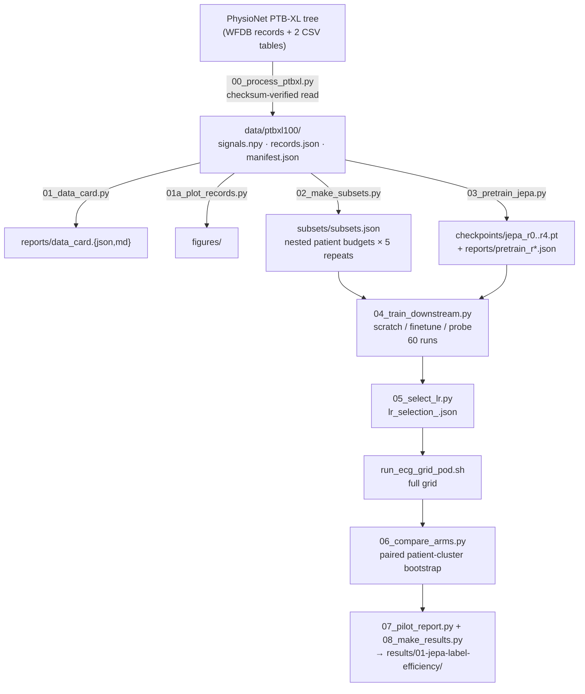
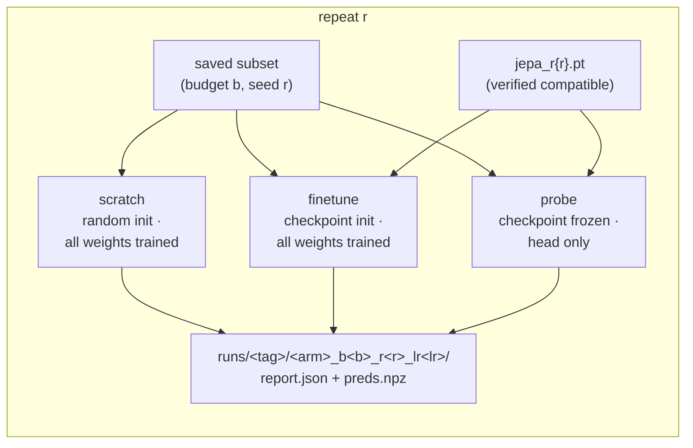

This page documents the ECG rhythm study — the first runnable instance of the time-series JEPA line on a real physiological signal. The study asks one controlled question: **does span-masked JEPA pretraining make a fixed encoder more useful for cardiac rhythm classification when only a limited number of labelled patients are available?** Everything here — ten numbered scripts, a frozen protocol, an amendment mechanism, and a results ledger — exists to make that answer trustworthy rather than merely impressive.

## The Question and the Experimental Contract

The comparison is engineered so its answer can be trusted. The same encoder architecture is trained from scratch and from pretraining; labelled patient subsets are identical across methods; test patients stay fixed; and variation across training repeats is reported separately from patient-bootstrap uncertainty. These four decisions form the experimental contract of study v1, and every script in the folder enforces a piece of it.

The substrate is [PTB-XL v1.0.3](https://physionet.org/content/ptb-xl/1.0.3/) (Wagner et al. 2020, *Scientific Data*; PhysioNet, CC BY 4.0): 21,799 ten-second, 12-lead clinical ECGs from 18,869 patients, with a native 500 Hz copy and an official 100 Hz copy. Patient-confined stratified folds ship with the dataset, so patient leakage across splits is prevented by construction rather than by discipline.

Sources: [README.md](examples/ecg_rhythm/README.md#L1-L11), [ptbxl.py](src/ssllab/data/ptbxl.py#L28-L30)

## Pipeline at a Glance

The study is organized as a numbered pipeline where each stage consumes the verified artifacts of the previous one. Before reading the diagram: solid boxes are files written to disk, arrows are labelled with the producing script, and the two shared artifacts — the saved subsets and the per-repeat JEPA checkpoints — feed every downstream run.



The status table from the study's README reflects a completed v1: data through comparison are done, with calibration, robustness, external shift, and attribution explicitly deferred to later work.

| Stage | Script | Artifact |
|---|---|---|
| Data layer | `00_process_ptbxl.py` | `data/ptbxl100/` cache |
| Data card | `01_data_card.py` | `data_card.{json,md}` |
| Real-record plots | `01a_plot_records.py` | `figures/` |
| Labelled-patient subsets | `02_make_subsets.py` | `subsets/subsets.json` |
| Span-masked JEPA pretraining | `03_pretrain_jepa.py` | `jepa_r{0..4}.pt` |
| Downstream arms | `04_train_downstream.py` | 60 run directories |
| Learning-rate selection | `05_select_lr.py` | `lr_selection_<tag>.json` |
| Paired bootstrap comparison | `06_compare_arms.py` | test-split interval tables |
| Pilot report | `07_pilot_report.py` | runtime and grid estimates |
| Results page | `08_make_results.py` | `results/01-jepa-label-efficiency/` |

Sources: [README.md](examples/ecg_rhythm/README.md#L13-L27), [_study.py](examples/ecg_rhythm/_study.py#L1-L5)

## Stage 0 — The Cache: Verification at Ingest

`00_process_ptbxl.py` reads the PhysioNet tree using only the standard library and numpy — WFDB signals are parsed by the small `ssllab.data.wfdb16` reader, which **verifies every record's per-lead checksum** during the build. That choice moves integrity checking to ingest time, so training code never re-pays it.

The cache has three files, and the loader treats them as a unit. `signals.npy` is an `int16` tensor of shape `(21799, 12, 1000)` in microvolts, opened memory-mapped; `records.json` carries per-record identity (`ecg_id`, `patient_id`, `strat_fold`), demographics, quality flags, and parsed `scp_codes`; `manifest.json` records provenance, lead order, sampling rate, the rhythm vocabulary, and the label rules. Two more checks run during the build: every record must have identical geometry and lead order to the first record, and the gains must be exactly 1000/mV with baseline 0 — a record that deviates stops the build instead of silently entering the cache. A `--smoke` mode generates a tiny synthetic PhysioNet-shaped tree and runs it through the identical code path, which is how the pipeline is exercised without a network.

| File | Contents |
|---|---|
| `signals.npy` | `int16 (21799, 12, 1000)`, microvolts, memory-mapped |
| `records.json` | per record: `ecg_id`, `patient_id`, `strat_fold`, age, sex, quality flags, `scp_codes` |
| `manifest.json` | provenance, leads, sampling rate, rhythm vocabulary, label rules |

Sources: [00_process_ptbxl.py](examples/ecg_rhythm/00_process_ptbxl.py#L1-L20), [README.md](examples/ecg_rhythm/README.md#L29-L58), [ptbxl.py](src/ssllab/data/ptbxl.py#L238-L291)

## Label Semantics: Present, Unknown, and the Two AF Rules

Label semantics are fixed once, in `ssllab.data.ptbxl`, so that every script agrees. A rhythm statement is **present** when its code appears in a record's `scp_codes`, whatever its stored likelihood — PTB-XL writes likelihood 0 for many rhythm statements, where 0 means "not graded", not "absent". A record with **no rhythm statement at all is unknown** for every rhythm task: it is excluded, never counted as a negative. This is the quiet correctness decision that most naive PTB-XL pipelines get wrong.

The binary AF pilot runs under two rules that trade precision for coverage. Both exclude unknown records and use AFIB as positivity; they differ only on atrial flutter.

| | `af_primary` | `af_sensitivity` |
|---|---|---|
| Unknown-rhythm records | excluded | excluded |
| AFLT records (incl. AFIB+AFLT) | **excluded** | kept |
| Flutter-only records | removed from cohort | counted as **negatives** |
| Rationale | remove ambiguous AF/flutter boundary | keep more patients, accept noisier negatives |

The "non-AF" side is documented as a **clinical population**, not a healthy-control group: it includes other arrhythmias, paced rhythms, and sinus records with diagnoses such as MI or conduction disease.

Sources: [ptbxl.py](src/ssllab/data/ptbxl.py#L7-L37), [ptbxl.py](src/ssllab/data/ptbxl.py#L81-L92), [README.md](examples/ecg_rhythm/README.md#L76-L85)

## Patient-Level Budgets and Token Geometry

Label budgets simulate scarce annotation, and their unit is the **patient**, not the record. One seeded permutation of *all* training patients is drawn, and a budget of k percent takes the first ⌈k/100 · n⌉ patients of that permutation — which makes budgets **nested**: the 5% patients are part of the 10% set, which is part of the 25% set. Because the permutation ignores the task, the same patients carry labels across tasks and methods for a given seed, so subset noise is *shared* between the arms being compared rather than confounding their difference.

At load time, each record `(C, L)` becomes time-patch tokens `(N, C·P)`: with the study geometry of 250 ms patches over 10 seconds, a batch carries tokens of shape `(B, 40, 300)` — 40 tokens × 12 leads × 25 samples — or `(B, 40, 25)` for single-lead input. The loader refuses a geometry whose sampling rate does not match the cache: a 100 Hz model is never fed 500 Hz input. Each loader attaches a `.meta` dict (geometry, leads, task, label names, budget, record counts), and each batch is a dict with `tokens`, `signal`, `row`, `patient_id` and, unless `task="none"`, `labels`.

| `task` | Cohort | Labels |
|---|---|---|
| `af_primary` / `af_sensitivity` | binary AF pilot under the chosen rule | 1 sigmoid |
| `rhythm` | all rhythm-annotated records | one sigmoid per rhythm statement |
| `none` | every record (pretraining) | none |

Sources: [ptbxl.py](src/ssllab/data/ptbxl.py#L104-L119), [ptbxl.py](src/ssllab/data/ptbxl.py#L421-L479), [README.md](examples/ecg_rhythm/README.md#L87-L107)

## The Frozen Protocol

Study v1 was written to `configs/study_v1.json` **before any model was evaluated**, and that file stays byte-identical. The core labels (SR, AFIB, STACH, SARRH, SBRAD) were chosen from patient-level class support counted by the data card — and are never revised from model performance. A label with zero positive patients in a given run's subset is masked out of that run's loss and reported as unsupported, rather than silently distorting the macro average.

The protocol's key settings:

| Field | Value |
|---|---|
| Budgets | 5, 10, 25, 100% of all 15,023 training patients |
| Repeats | 5; each redraws subset, downstream seed, and pretraining |
| Per-repeat seeds | `budget_seed = r`, `train_seed = 100 + r`, `pretrain_seed = r` |
| Encoder | embed 128, depth 4, 4 heads |
| Pretraining | 100 epochs, batch 128, lr 5e-4, span masking (2 × 1 s), reg 0.04, train folds only |
| Downstream | mean pool → linear 12 outputs, BCE, AdamW wd 0.05, cosine, 4000 steps, patience 10 evals |
| LR grid (frozen) | `[3e-4, 1e-3]`, selected on validation at repeat 0, budget 10% |
| AF operating point | threshold = highest with validation sensitivity ≥ 0.90, applied unchanged to test |

> [!TIP]
> The three seeds per repeat are deliberately independent dimensions: `budget_seed` redraws *who carries labels*, `train_seed` redraws *stochasticity of downstream training*, and `pretrain_seed` redraws *the pretrained encoder itself*. Because a repeat's checkpoint is reused across that repeat's budgets and by both pretrained arms, the pretraining variance is not hidden inside the downstream runs — it is attributable.

Sources: [study_v1.json](examples/ecg_rhythm/configs/study_v1.json#L7-L62), [study_v1.json](examples/ecg_rhythm/configs/study_v1.json#L63-L74), [_study.py](examples/ecg_rhythm/_study.py#L215-L217)

## Amendments Without Rewriting History

After the pilot, two validation-informed amendments widened the shared learning-rate grid — without touching the frozen base file. The mechanism in `_study.py` is small but strict: an amendment file names its `base` config and the base's hash, which is **verified on load**; it may only change fields listed in `AMENDABLE` (currently only `downstream.lr_grid`); and it may declare an earlier amendment `supersedes`, itself checked by hash. The loaded study dict carries both `_base_sha256` (the frozen protocol) and `_sha256` (base plus amendment).

Every artifact records what it depends on through **relevant hashes**. Three dependency kinds are defined — `subsets`, `pretrain`, and `run` — and each hashes only the protocol sections that matter to it. Crucially, the run hash *excludes* `lr_grid` and `lr_selection`: how a rate was chosen does not change how a run trains once its learning rate is given. `check_compatible` then compares an artifact's recorded hash against the current protocol and **stops the process on any unexplained incompatibility**, printing the exact reason; older artifacts made before relevant hashes existed are accepted only when the amendment provably leaves their relevant settings identical.

| Kind | Hashed sections | Reuse rule |
|---|---|---|
| `subsets` | data, labels, budgets, denominator, repeats | identical relevant hash, or pinned sha256 |
| `pretrain` | data, encoder, pretrain, repeats | plus report shows full epochs, not smoke |
| `run` | all of the above + downstream **minus** `lr_grid`, `lr_selection` | skip only when complete and compatible |

Amendment 2 demonstrates the full machinery: it pins the saved subsets and the repeat-0 pretraining checkpoint by sha256 (byte-identical reuse), declares the 12 amendment-1 runs reusable after per-run compatibility checks, and adds exactly one new rate (`new_rates: [1e-2]`). It also carries a **stop rule**: if any arm selects 1e-2, the edge is reported and the grid is not extended again, and a diverged run is recorded as diverged and never selectable.

> [!TIP]
> The design invariant worth stealing for any experiment codebase: *two protocols with the same relevant hash produce interchangeable artifacts of that kind*. Reuse decisions become hash comparisons instead of human judgment calls, and "why did you reuse this checkpoint?" is answered by a string the artifact itself recorded at creation time.

Sources: [_study.py](examples/ecg_rhythm/_study.py#L13-L15), [_study.py](examples/ecg_rhythm/_study.py#L34-L62), [_study.py](examples/ecg_rhythm/_study.py#L65-L114), [study_v1_amend2.json](examples/ecg_rhythm/configs/study_v1_amend2.json#L1-L42)

## Stage 3 — Pretraining: Span-Masked JEPA on 12-Lead Signals

Pretraining is **inductive**: it sees training-fold recordings only (folds 1–8, all of them, unknown-rhythm records included, labels unused). Validation and test never enter pretraining. One run per repeat, seeded by `pretrain_seed = r`, produces a checkpoint that is reused across that repeat's budgets and by both pretrained arms — so the finetune and probe arms differ only in whether the encoder's weights keep training.

Each step hides `n_spans` (2) contiguous spans of `span_s` (1 second — four 250 ms tokens each) and trains the student to predict the **EMA teacher's** embeddings at those positions, with collapse tracked continuously: every 10 epochs, feature std and effective rank are computed on a fixed sample of 2048 training recordings and logged into the run history.

The run is deliberately **not resumable**: the checkpoint stores the student encoder and predictor only — no EMA teacher, optimiser state, step counter, or RNG state. Instead of half-resumable state, the scripts guarantee something simpler and safer: the checkpoint and report are written atomically at the end via `os.replace`, and the report is the completion marker, written last. An interrupted run leaves no checkpoint that could be mistaken for a finished one, and `pretrain_complete` combines the existence check with compatibility (relevant hash, epoch count, non-smoke flag) before any later script will accept it.

Sources: [03_pretrain_jepa.py](examples/ecg_rhythm/03_pretrain_jepa.py#L1-L30), [03_pretrain_jepa.py](examples/ecg_rhythm/03_pretrain_jepa.py#L69-L87), [03_pretrain_jepa.py](examples/ecg_rhythm/03_pretrain_jepa.py#L109-L140), [_study.py](examples/ecg_rhythm/_study.py#L125-L147)

## Stage 4 — Three Arms, One Head

Each downstream run instantiates one arm over the saved subset for its (repeat, budget). All three arms share the encoder architecture, the head (mean pool → linear, 12 outputs), the loss, the optimiser, and the step budget — the *only* intended difference is where the encoder's weights start and whether they move.



| Arm | Encoder init | Weights trained | Role |
|---|---|---|---|
| `scratch` | random (`train_seed`) | all | **primary baseline** |
| `finetune` | repeat's JEPA checkpoint | all | **primary comparison** |
| `probe` | repeat's JEPA checkpoint | frozen | secondary readout: representation quality alone |

Model selection is validation-only: every 100 steps the validation core macro AUROC is computed, and the best complete evaluation is kept; test predictions are written only with `--eval-test`, so the pilot never produces them. Two guards round out the script. `--shuffle-labels` permutes whole label vectors across training recordings — prevalence and co-occurrence preserved, signal link broken — as a sanity check that should land near 0.5 AUROC, explicitly documented as *not* a proof that no leakage exists. And a non-finite loss or non-finite validation prediction marks the run **diverged**: it is reported as such and can never be selected by the LR search.

Sources: [04_train_downstream.py](examples/ecg_rhythm/04_train_downstream.py#L1-L44), [04_train_downstream.py](examples/ecg_rhythm/04_train_downstream.py#L100-L135), [04_train_downstream.py](examples/ecg_rhythm/04_train_downstream.py#L137-L200)

## Learning-Rate Selection: Pilot, Amendment 1, Amendment 2

Because scratch must not be under-tuned — the central question is pretraining *versus* scratch — the LR grid was widened twice, and each widening is itself documented. A pilot (repeat 0, validation only, kept untouched as the record) first checked the pipeline and measured runtime. Amendment 1 widened the frozen grid from `{3e-4, 1e-3}` to `{1e-4, 3e-4, 1e-3, 3e-3}`; under it, scratch selected 3e-3 — the top edge — with validation core macro AUROC rising monotonically from 0.7603 to 0.7686 across the grid. Amendment 2 added `1e-2` and made the grid final, reusing the twelve amendment-1 runs after per-run compatibility checks so only three new runs were needed.

Selection is deliberately austere: per arm, on validation, at repeat 0 and budget 10% only, then frozen for everything else. That keeps the tuning channel separate from the measurement channel — a pattern the methodology series generalises.

Sources: [study_v1_amend2.json](examples/ecg_rhythm/configs/study_v1_amend2.json#L17-L28), [README.md](examples/ecg_rhythm/README.md#L109-L113)

## Stage 6 — Comparing Arms Honestly

The headline metric is **core macro AUROC at recording level** on the full eligible rhythm cohort of test fold 10. Differences between arms are quantified with a **paired patient-cluster bootstrap** of 2000 resamples: patients — not recordings — are resampled, and the same patient resample is applied to both arms of a pair, because recordings within a patient are correlated and independent resampling would understate uncertainty. The bootstrap runs per repeat and for the repeat mean, while repeat-to-repeat spread is reported separately rather than being folded into the interval.

The AF operating point gets its own seam. The AFIB output of the main multi-label model is evaluated on the primary AF cohort with a threshold rule fixed in the protocol — the highest threshold achieving validation sensitivity ≥ 0.90 — applied to test unchanged. No calibration is performed in study v1; it is evaluated separately, later.

Sources: [study_v1.json](examples/ecg_rhythm/configs/study_v1.json#L63-L74), [README.md](examples/ecg_rhythm/README.md#L115-L124)

## The v1 Result

Span-masked JEPA pretraining helps most when labels are scarce. With labels for 5% of training patients, the fine-tuned pretrained encoder beats the same encoder trained from scratch by **+0.078 core macro AUROC**, with a 95% interval over test patients of **+0.064 to +0.091**, and all five repeats agree in direction. The advantage shrinks as the label budget grows toward the full 15,023 training patients — the classic label-efficiency signature, now measured with paired uncertainty rather than asserted from single runs. Full figures, metrics, and narrative live in the generated results page under `results/01-jepa-label-efficiency/`.

Sources: [README.md](examples/ecg_rhythm/README.md#L9-L11), [README.md](examples/ecg_rhythm/README.md#L25-L26)

## Running the Study

The data is open access; the AWS open-data mirror is much faster than the PhysioNet zip, and the downloaded tree is checksum-verified against PhysioNet's `SHA256SUMS.txt`. The smoke path builds a synthetic tree and exercises the identical code path in seconds, no network needed:

```bash
export DATA_LAKE_ROOT=~/work/data
aws s3 sync --no-sign-request s3://physionet-open/ptb-xl/1.0.3/ $DATA_LAKE_ROOT/ecg/ptbxl/raw/1.0.3/
python examples/ecg_rhythm/00_process_ptbxl.py --fs 100 --out-dir $DATA_LAKE_ROOT/ecg/ptbxl/cache100
python -c "from ops.datasets import link_dataset; link_dataset('ecg/ptbxl/cache100', link_name='ptbxl100')"
python examples/ecg_rhythm/00_process_ptbxl.py --smoke   # synthetic tree, same code path
```

The executed study ran on a remote pod, staged once and then driven by the shell entrypoints; comparison and result generation run locally. Note the staging detail: `ops_stage_data.py` names the staged copy after the *symlink target*, so the pod-side `mv cache100 ptbxl100` aligns names before the grid scripts run.

```bash
python examples/ops/ops_stage_data.py data/ptbxl100                                   # once, onto the pod's volume
python examples/ops/ops_run_pipeline.py --execute --cluster <c> -- bash examples/ecg_rhythm/run_ecg_lrsearch_pod.sh
python examples/ops/ops_run_pipeline.py --execute --cluster <c> -- bash examples/ecg_rhythm/run_ecg_grid_pod.sh
python examples/ecg_rhythm/06_compare_arms.py --tag main --split test                 # bootstrap, locally
python examples/ecg_rhythm/08_make_results.py                                         # figures, metrics, results page
```

Sources: [README.md](examples/ecg_rhythm/README.md#L29-L48), [README.md](examples/ecg_rhythm/README.md#L126-L135)

## Where to Go Next

The ECG study is one application of a shared stack, and each of its seams is documented as a general capability. The masking scheme used here is dissected in [Masking Strategies: Random and Span](7-masking-strategies-random-and-span); the loader pattern follows the conventions of [Modality-Agnostic Data Adapters](23-modality-agnostic-data-adapters); the remote execution layer is covered in [Remote GPU Ops: SkyPilot and RunPod](24-remote-gpu-ops-skypilot-and-rupod-n/a). For the statistics, [Paired Bootstrap and Simultaneous Inference](20-paired-bootstrap-and-simultaneous-inference) formalises the resampling scheme, [Evaluation Toolkit: Probes and Metrics](19-evaluation-toolkit-probes-and-metrics) covers the probe and AUROC machinery, and the amendment discipline practiced here is the concrete case of [Results Ledger and Pre-Registration](22-results-ledger-and-pre-registration). To see the same pipeline applied to single-cell perturbation data, continue to [Perturbation-Response Pipeline](16-perturbation-response-pipeline).
