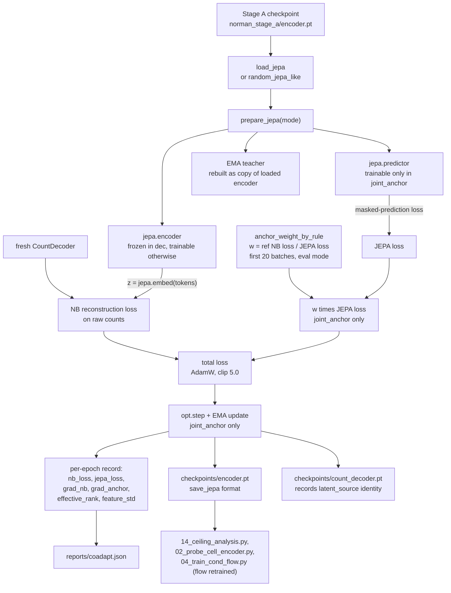
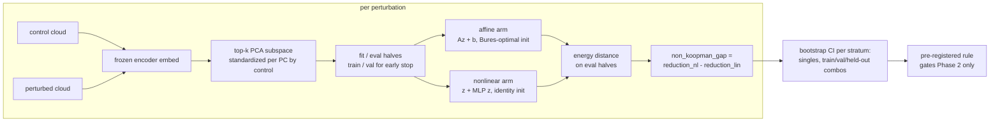
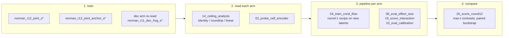

This page documents the **co-adaptation sub-program**: the experiment in which the perturbation-response stack stops treating the JEPA encoder as a frozen feature extractor and instead lets the encoder and the count decoder shape each other during training. The machinery lives in one library module (`ssllab.coadapt`), one training entry-point script (`co-adaptation/02_coadapt_decoder.py`), one diagnostic script (`co-adaptation/01_koopman_linearity_probe.py`), two remote-run pipelines, and a test suite that pins down exactly what each mode trains. The module docstring frames the question precisely: every earlier round trained the negative-binomial decoder on a frozen encoder, and the ceiling analysis showed a linear readout recovers more of the perturbation effect from the same frozen latents than the trained decoder does — so Phase 1 asks whether letting the two networks train together recovers what the decoder loses. Critically, **the transition stage (the conditional flow) is never co-trained**, which is what keeps the result attributable.

Sources: [coadapt.py](src/ssllab/coadapt.py#L1-L63), [02_coadapt_decoder.py](examples/perturbation_response/co-adaptation/02_coadapt_decoder.py#L1-L53)

## Why Unfreeze: Two Measurements of the Frozen Encoder

By the end of round 4 the frozen encoder had been measured against two independent requirements, and it split the verdict. It **retained the signal**: a linear ridge readout of the frozen latents scores Δr = 0.852, above the original NB-VAE baseline (0.766) and just below the conditioned NB-VAE (0.858). But it did **not keep the signal in small motions**: fitting the latent response with operator generators demanded norms around 12.4 — a large rotation, not the near-identity motion the operator design assumed. Together with the ceiling's estimate that a large slice of Δr was lost between the linear readout and the trained decoder reading the same latents, this motivated unfreezing: co-training might recover what reconstruction alone loses. One boundary note for interpreting the premise: round 10 later found the headline decoder gap (0.173) only under the convention that reads every predicted change against the *measured* control mean, and Phase 1 was placed on hold pending the corrected-likelihood protocol that round 12 then ran under.

Sources: [README.md](examples/perturbation_response/co-adaptation/README.md#L19-L31), [coadapt.py](src/ssllab/coadapt.py#L1-L63), [26_score_round12.py](examples/perturbation_response/26_score_round12.py#L1-L33)

## The Program in Three Phases

Each phase unfreezes one more stage, so each result stays as attributable as the design allows:

| Script | Phase | Trained jointly with the encoder | Status |
|---|---|---|---|
| `01_koopman_linearity_probe.py` | Phase 0 — diagnostic | nothing; encoder stays frozen | done (verdict: inconclusive by rule, affine in substance) |
| `02_coadapt_decoder.py` | Phase 1 | the NB count decoder, transition frozen | built; executed as round 12 (and round 13 for the random-init control) |
| `03_coadapt_operator.py` | Phase 2 | the operator, under a Koopman objective | planned, lower priority |

Phase 0 exists to turn the program's central premise into a number before any engineering goes into the delicate Phase 2; its pre-registered decision rule **gates Phase 2 only** — Phase 1 runs regardless because it attacks the largest already-measured loss. The narrative companion lives in the sub-program's `docs/` series, with round-by-round numbers in the results ledger ([Results Ledger and Pre-Registration](22-results-ledger-and-pre-registration)).

Sources: [README.md](examples/perturbation_response/co-adaptation/README.md#L32-L44), [docs/index.md](examples/perturbation_response/co-adaptation/docs/index.md#L1-L17)

## One Trainer, Three Modes

The module's design is deliberately minimal: **one recipe, one optimizer, one training loop**, and the only difference between experimental arms is *what is allowed to train*. This is expressed by a single `mode` string on `CoadaptConfig` and enforced by `prepare_jepa`, which unfreezes exactly the right parameter groups after `load_jepa` returns everything frozen:

| Mode | Encoder | Predictor | Decoder | Learning rates | Role |
|---|---|---|---|---|---|
| `dec` | frozen | frozen (unused) | trains | decoder `lr=1e-3` | control: today's decoder recipe, re-seeded under identical optimizer settings |
| `joint` | trains (`encoder_lr=1e-4`) | frozen (unused) | trains | decoder `1e-3`, encoder `1e-4` | does co-training recover the decoder gap? |
| `joint_anchor` | trains (`encoder_lr=1e-4`) | trains (`encoder_lr=1e-4`) | trains | as `joint` | `joint` while maintaining the JEPA predictive objective with a fixed anchor weight |

The shared `CoadaptConfig` defaults are the round-10 recipe: `epochs=30`, `lr=1e-3` (the decoder's Stage C value), `encoder_lr=1e-4` (smaller because the encoder starts pretrained), `clip=5.0` gradient clipping over *all* trainable parameters in every mode, `anchor_batches=20`, and `library_size="hvg"`. The constructor validates the mode against `MODES` and rejects non-positive learning rates or clips, so a misconfigured run fails before consuming compute.

Sources: [coadapt.py](src/ssllab/coadapt.py#L84-L100), [coadapt.py](src/ssllab/coadapt.py#L103-L119)

Two checkpoint-handling decisions deserve explicit attention. First, `load_jepa` rebuilds the EMA teacher as an **exact copy of the loaded encoder** — the teacher was never saved in Stage A checkpoints, so under `joint_anchor` the teacher follows the changing student from this new starting point. The module docstring is careful about what this means: the anchor keeps an *objective* satisfied (the masked-prediction loss, with the same EMA mechanics as Stage A); it does **not** penalize distance from the original encoder — that would be a different experiment, and how far the representation actually moves is measured separately (linear CKA against the original encoder). Second, **there is no resume**: saved encoder and decoder are exports, not training checkpoints (no optimizer, teacher, schedule, or RNG state), so an interrupted run restarts from scratch.

> [!TIP]
> The teacher-rebuild subtlety is easy to miss: `load_jepa` constructs `EMA(jepa.encoder, ...)` so the teacher copies the *loaded* weights, and `prepare_jepa` does the same after unfreezing. If you extend the trainer with an objective that reads the teacher (anything that resumes the masked-prediction loss), a stale teacher would silently train the student toward random-init targets.

Sources: [coadapt.py](src/ssllab/coadapt.py#L1-L63), [checkpoint.py](src/ssllab/checkpoint.py#L19-L41)

## The System at a Glance

The following diagram shows how the pieces interact across a Phase 1 run — from the Stage A checkpoint through the joint training loop to the artifacts downstream scripts consume:

Everything the trainer emits is in a format downstream scripts already read: the encoder round-trips through `save_jepa`/`load_jepa`, the decoder checkpoint carries `latent_dim`, `n_genes`, the library-size convention, and a `latent_source` identity block (encoder path, md5, width, and the encoder's `space_key`), and `reports/coadapt.json` holds the config, the anchor rule with its measured means, and the per-epoch history.

Sources: [coadapt.py](src/ssllab/coadapt.py#L149-L238), [02_coadapt_decoder.py](examples/perturbation_response/co-adaptation/02_coadapt_decoder.py#L100-L204), [checkpoint.py](src/ssllab/checkpoint.py#L13-L21)

## The Anchor Rule: Weighting Two Objectives by Measurement

`joint_anchor` adds the JEPA loss to the NB reconstruction loss with a weight that is **fixed by a rule, not tuned**: `w = mean NB loss of a reference trained decoder / mean JEPA loss`, both measured in eval mode without gradients, before any parameter update, on the first `anchor_batches` (default 20) training batches. The rule's rationale is scale calibration — equal loss values then mean the two terms contribute comparably *at the scale the reconstruction loss will settle at*. A freshly initialized decoder's loss is more than twice a trained one's, so measuring with it would overweight the anchor for most of training; hence `--ref-decoder` must point at an already-trained decoder (round 12 uses `norman_r11_dec_hvg_s0`), and the script refuses to start if the reference was trained with a different `--library-size` convention. A floor guard (`MIN_JEPA_LOSS = 1e-6`) aborts the run if the mean JEPA loss is too small, since the ratio would explode.

Sources: [coadapt.py](src/ssllab/coadapt.py#L125-L147), [26_score_round12.py](examples/perturbation_response/26_score_round12.py#L24-L33), [02_coadapt_decoder.py](examples/perturbation_response/co-adaptation/02_coadapt_decoder.py#L100-L204)

Because equal losses do not imply equal *influence* on the encoder, the trainer also instruments the balance directly: on the first batch of each epoch it computes the encoder-gradient norm contributed by each term (`grad_nb`, and `grad_anchor` under the anchor) using `torch.autograd.grad(..., retain_graph=True)` so the measurement never touches `.grad` and the graph survives for the real backward pass. These norms land in the per-epoch history and are read as round-12 secondaries, letting you check whether the nominal weight balance translated into gradient balance.

> [!TIP]
> When reproducing the anchor rule, the measurement must happen with the loaded encoder before the first update and with a decoder trained under the *same* library-size convention — the script enforces both (eval-mode, no-grad measurement; `SystemExit` on a library-size mismatch). The test suite additionally asserts that running the rule changes no parameters, which is the property that makes the pre-registered weight trustworthy.

Sources: [coadapt.py](src/ssllab/coadapt.py#L149-L238), [test_coadapt.py](tests/test_coadapt.py#L42-L66)

## Training-Loop Instrumentation

Each epoch produces one record with a fixed schema, so arms are comparable without parsing logs:

| Field | Present in | Meaning |
|---|---|---|
| `nb_loss`, `loss` | all modes | mean NB reconstruction loss and mean total loss |
| `jepa_loss` | `joint_anchor` | mean JEPA predictive loss (popped from the record in other modes) |
| `grad_nb`, `grad_anchor` | joint modes | encoder-gradient norm per term, epoch's first batch, before clipping |
| `effective_rank`, `feature_std` | all modes | collapse diagnostics on up to 4,096 cell vectors, detached |

The diagnostics come from `ssllab.eval.collapse`: `feature_std` is the mean per-dimension standard deviation (near zero ⇒ collapse), and `effective_rank` is the entropy of normalized singular values of the centered embedding matrix — a healthy encoder uses many directions, a collapsed one uses ~1. The module docstring is explicit about why these are recorded *during* training while the task-relevant checks run *after*: reconstruction discourages complete information loss, but it does not guarantee the optimizer keeps every useful direction or the perturbation information the benchmark needs — the linear readout and perturbation probe run on the saved encoder via `14_ceiling_analysis.py` and `02_probe_cell_encoder.py`.

Sources: [coadapt.py](src/ssllab/coadapt.py#L149-L238), [collapse.py](src/ssllab/eval/collapse.py#L1-L40)

## Inputs Beyond the Checkpoint: Latents, Library Size, Random Init

The trainer supports two variations that broaden what Phase 1 can compare. Under `--latents <store>` (mode `dec` only), the decoder trains on a precomputed embedding store (`ssllab.embeddings.PrecomputedSource`) instead of the JEPA encoder's vectors: each batch's cell vectors are looked up by cache row, the store's dataset fingerprint is verified against the cache, no encoder is loaded or saved, and the decoder's width becomes the store's dimension. This is how a decoder can be trained on another encoder's embeddings — for example Geneformer's cell embeddings — for a like-for-like stack comparison. Second, `--library-size hvg` (the default since round 11) computes the NB likelihood's total over the modeled genes; `all` reproduces earlier runs.

Sources: [02_coadapt_decoder.py](examples/perturbation_response/co-adaptation/02_coadapt_decoder.py#L1-L53), [02_coadapt_decoder.py](examples/perturbation_response/co-adaptation/02_coadapt_decoder.py#L58-L98)

For the attribution question "does JEPA pretraining itself contribute?", `--init random` (mode `joint` only) starts the encoder from freshly initialized weights of the same architecture via `random_jepa_like`, which reads only the checkpoint's config and builds with the same constructor `load_jepa` calls.

> [!TIP]
> The RNG-parity trick in `random_jepa_like` is what makes the control clean: it consumes the global random-number generator exactly as `load_jepa` does before loading weights, so after the same `set_seed` everything drawn afterwards — the decoder's initialization, shuffling — is identical between a pretrained start and a random one. The test suite verifies this draw-for-draw, meaning the *only* difference between `--init pretrained` and `--init random` at a fixed seed is the encoder's starting weights.

Sources: [checkpoint.py](src/ssllab/checkpoint.py#L43-L64), [test_coadapt.py](tests/test_coadapt.py#L126-L146)

## Phase 0: The Premise as a Number

Before reshaping the encoder so perturbations act linearly, Phase 0 checks whether they already do. The Koopman-linearity probe works entirely in latent space — no decoder, no Δr, because the ceiling analysis showed the transition stage has too little headroom for Δr to distinguish a linear latent transition from a nonlinear one. The instrument, per perturbation:

Three design choices make the verdict honest. **Energy distance, not per-pair error**, because sequencing is destructive — there is no "same cell before and after", so both arms are graded by matching marginals, the project's standing objective. **A PCA subspace (default 20 components)**, because a free 256×256 affine over a few-hundred-cell cloud overfits noise directions; a linear projection preserves the affine-vs-nonlinear question in the directions that carry the response, and the retained variance fraction is reported. **An asymmetric initialization**: the affine arm starts at the closed-form second-moment-optimal (Bures/Gaussian-OT) map with covariance shrinkage so it cannot underfit, while the nonlinear arm is a residual MLP whose final layer is zero-initialized (it starts as the identity), is weight-decayed, and is capacity-swept (hidden widths 8/32/128) so any measured gap must be real structure rather than "the biggest MLP won". An acceptance gate (`--null-tol`, default 0.05) checks that the gap shown on a synthetic exactly-affine cloud is small enough for the artifact subtraction to be trustworthy.

Sources: [01_koopman_linearity_probe.py](examples/perturbation_response/co-adaptation/01_koopman_linearity_probe.py#L1-L68)

The headline result, run on the frozen `norman_stage_a` encoder (20 principal components, three seeds, acceptance gate passed):

| Stratum | Perturbations | Calibrated nonlinear gap, median | 95% interval |
|---|---|---|---|
| **single-gene** (primary) | 103 | **0.015** | **[0.003, 0.032]** |
| training combinations | 76 | 0.004 | [−0.002, 0.012] |
| validation combinations | 18 | 0.010 | [−0.003, 0.028] |
| held-out combinations | 15 | 0.010 | [−0.011, 0.023] |

By the pre-registered rule the verdict is **inconclusive**: the singles interval excludes zero, so the advantage is detectable, but the median is far below the 0.10 that would justify Phase 2. In substance, the response is **close to affine** — among the half of singles with the largest responses the median gap is 0.005, and the scattered large values come from perturbations that barely move the cloud. This reconciles round 4: the response is a large *but affine* transformation, so what failed was the near-identity assumption, not linearity. Noted limits: twenty components cover 17% of latent variance, and unpaired data shows distributions rather than individual cells.

Sources: [README.md](examples/perturbation_response/co-adaptation/README.md#L46-L73)

## Phase 1 in the Field: The Round-12 Protocol

Round 12 executed Phase 1 under the corrected (round-11) likelihood, with the stakes restated in the pre-registered protocol: the stack's readout ceiling is 0.865 in Δ-correlation, below the conditioned NB-VAE's generative 0.939; the flow transition has about 0.03 of headroom under that ceiling; and about **0.135 is lost by the frozen encoder and the decoder reading real cells** — the quantity co-training attacks. The remote pipeline runs three seeds of `joint` and `joint_anchor`, re-reads round 11's `dec` arm as the control, then gives **every** arm the same readout treatment:

The **primary endpoint** is the readout-ceiling Δ-correlation (roundtrip) under the measured control, on the 20 held-out pairs, top 20 genes — a single max-t family of two contrasts (`joint − dec`, `joint_anchor − dec`), joint paired bootstrap over pairs (10,000 resamples, seed 0), with a pass rule of estimate ≥ +0.02 and a simultaneous interval wholly above 0. The pipeline script enforces hard **gates before anything is read**: the dec-arm ceiling must reproduce round 11's roundtrip to 1e-4, every identity arm must score 1.000, recomputed Δr must match stored reports to 1e-6, and every joint-arm report must record its mode and corrected library size; plus md5 preflight checks (the `de_genes.json` hash and the Stage A encoder's `38f51067` prefix). Secondaries include the linear readout of each encoder, full-pipeline Δr, transition headroom, population quality and calibration, representation diagnostics (effective rank, feature spread, the perturbation probe, and linear **CKA** against the original encoder to measure how far the representation actually moved), and the training diagnostics above.

Sources: [26_score_round12.py](examples/perturbation_response/26_score_round12.py#L1-L33), [26_score_round12.py](examples/perturbation_response/26_score_round12.py#L35-L49), [26_score_round12.py](examples/perturbation_response/26_score_round12.py#L54-L79), [run_coadapt_pod.sh](examples/perturbation_response/co-adaptation/run_coadapt_pod.sh#L1-L46)

## Round 13: Does Pretraining Contribute?

Round 13 closes the loop opened by `--init random`. Three arms, three seeds each, all `--mode joint` with the corrected likelihood: round 12's pretrained `joint` (re-read, not retrained), `random_lr4` (random init at round 12's encoder learning rate of 1e-4), and `random_lr3` (random init at the decoder's 1e-3). Each random encoder gets its own readout ceiling, perturbation probe, and a transport flow retrained with round 1's recipe, read out through its own decoder; `27_score_round13.py` then compares the arms. The pipeline also demonstrates the project's smoke-first discipline: the entire round is executed at tiny settings (seed 0, one epoch, 2,000 cells) in a separate output directory built from copies of the real inputs, the comparison is run in smoke mode, and **any failure stops the round before full compute is spent**.

Sources: [run_round13_pod.sh](examples/perturbation_response/co-adaptation/run_round13_pod.sh#L1-L31), [02_coadapt_decoder.py](examples/perturbation_response/co-adaptation/02_coadapt_decoder.py#L1-L53)

## What the Tests Pin Down

The test suite is small and fast (tiny synthetic cache, CPU, seconds) but covers the exact properties the experimental claims depend on:

| Test | Property pinned down |
|---|---|
| `test_load_jepa_teacher_is_a_copy_of_the_loaded_encoder` | a loaded JEPA's teacher equals the encoder; every parameter frozen |
| `test_each_mode_trains_what_it_says` (3 modes) | decoder always trains; encoder unchanged iff `dec`; predictor unchanged iff not `joint_anchor`; `grad_nb` recorded iff joint; running the anchor rule changes nothing |
| `test_anchor_mode_requires_a_weight` | `joint_anchor` without a fixed weight raises; invalid modes rejected |
| `test_trained_encoder_round_trips_through_save_and_load` | co-adapted encoder produces identical embeddings after save/load |
| `test_library_size_of…` / `test_depth_normalization…` / `test_hvg_library_size_trains…` | the likelihood's library-size conventions and the published depth-normalization formula |
| `test_cvae_records_library_size_and_normalizations` | checkpoints record the normalization convention; defaults since round 11 |
| `test_random_start_is_fresh_and_draws_like_a_pretrained_load` | `random_jepa_like` uses fresh constructor weights but identical RNG consumption |

The parametrized mode test is the load-bearing one: it converts the module's central contract — "the arms differ only in what trains" — from a docstring claim into an executable assertion, which is precisely what makes the `joint − dec` contrast interpretable.

Sources: [test_coadapt.py](tests/test_coadapt.py#L35-L40), [test_coadapt.py](tests/test_coadapt.py#L42-L66), [test_coadapt.py](tests/test_coadapt.py#L68-L87), [test_coadapt.py](tests/test_coadapt.py#L91-L146)

## Where This Fits and What to Read Next

Two disciplines connect this page to the rest of the catalog. First, **the boundary of attribution**: the conditional flow is never co-trained, so any co-adaptation gain can be credited to the encoder–decoder pair alone; each moved encoder gets its own flow retrained afterward with the unchanged round-1 recipe ([Flow-Matching Prior](9-flow-matching-prior), [Conditional Flow and Classifier-Free Guidance](10-conditional-flow-and-classifier-free-guidance)). Second, **ceiling invalidation**: every co-adapted encoder makes the old ceiling obsolete, because the ceiling is conditional on the frozen encoder — so a new ceiling, oracle, and linear readout are re-measured for each co-adapted encoder ([Evaluation Toolkit: Probes and Metrics](19-evaluation-toolkit-probes-and-metrics)).

Suggested reading path: the decoder being co-trained is documented in [Count Decoders and CVAE Baseline](12-count-decoders-and-cvae-baseline); the simultaneous-inference machinery behind the round-12 verdict is [Paired Bootstrap and Simultaneous Inference](20-paired-bootstrap-and-simultaneous-inference); the pre-registration protocol format is [Results Ledger and Pre-Registration](22-results-ledger-and-pre-registration); and Phase 2's operator context — the Koopman objective and the near-identity prior that Phase 0's result deprioritized — begins at [Generator Bases and Lie-Group Operators](13-generator-bases-and-lie-group-operators) and continues in [Operator Algebra and Epistasis Tests](14-operator-algebra-and-epistasis-tests). For the encoder-side mechanics the co-trainer relies on (EMA teacher, anti-collapse regularization), see [JEPA Module Internals](6-jepa-module-internals) and [Anti-Collapse: VICReg and SIGReg](8-anti-collapse-vicreg-and-sigreg).
