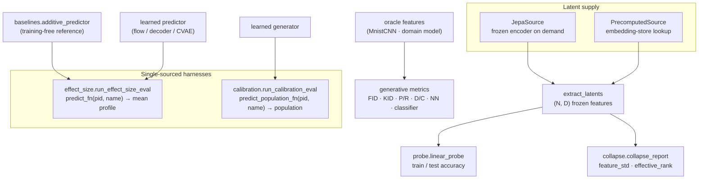
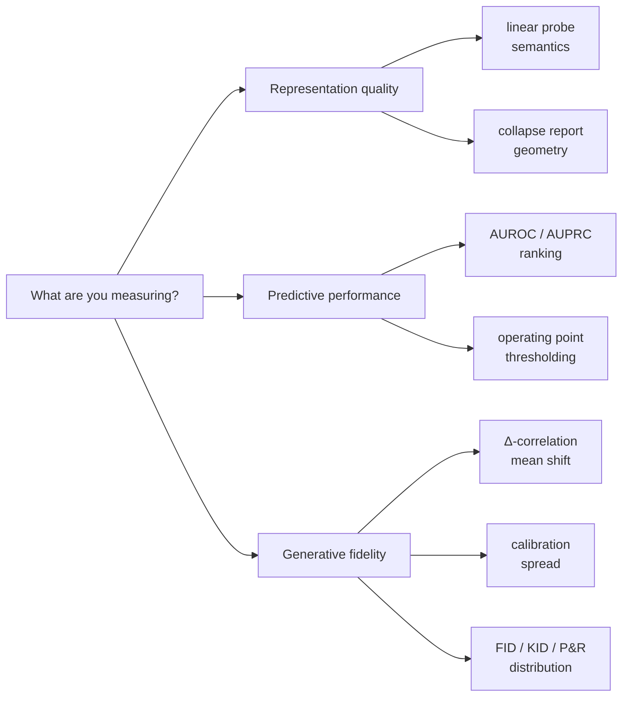

Every claim this repository makes about a self-supervised representation — that it is semantically useful, that it has not collapsed, that a generated population matches the real one — passes through one small package: `src/ssllab/eval`. This page documents that toolkit as an integrated system: the instruments, the call contracts that make them reusable across methods, and the conventions that make numbers comparable across experiments. It covers probes, collapse diagnostics, classification metrics, effect-size and calibration harnesses, generative-sample metrics with an independent oracle, and training-free baselines. The statistical machinery for *uncertainty over differences* (paired bootstrap) and the research-methodology essays are deliberately out of scope here — they have dedicated pages downstream in this section.

Sources: [probe.py](/src/ssllab/eval/probe.py#L1-L6), [\_\_init\_\_.py](/src/ssllab/eval/__init__.py#L1-L28)

## The Architecture: One Seam, Many Instruments

The toolkit is organized around a single architectural idea: **separate what produces a prediction from what grades it**. Every harness in `ssllab.eval` accepts a plain callable — a *scoring seam* — so a conditional flow, an NB-VAE baseline, and a hand-written additive reference are all fed through the identical grader and return identical shapes of output. The module inventory below maps each file to the question it answers; note that the harnesses (`effect_size`, `calibration`) never import a model, and the models never import each other.



| Module | Instrument | Question it answers | Input contract |
|---|---|---|---|
| `probe.py` | `linear_probe` | Is the frozen latent semantically useful? | `(z_train, y_train, z_test, y_test)` |
| `collapse.py` | `collapse_report` | Has the representation collapsed? | embedding batch `(M, D)` |
| `classification.py` | `per_label_metrics`, `macro_auroc`, `operating_point` | Are scores ranked well, and where do we cut? | binary labels `(n, K)`, scores `(n, K)` |
| `effect_size.py` | `run_effect_size_eval` | Does predicted Δ match true Δ? | `predict_fn(pid, name)` + eval split |
| `calibration.py` | `run_calibration_eval` | Does predicted *spread* match true spread? | `predict_population_fn(pid, name)` + eval split |
| `generative.py` | `fid`, `kid`, `precision_recall`, … | Are generated samples a faithful distribution? | feature vectors `(N, D)` or probs `(N, C)` |
| `oracle_mnist.py` | `MnistCNN` | An honest, independent feature space for grading samples | images |
| `baselines.py` | `additive_predictor` | What would a biologist write down with no model? | training cells only |
| `viz.py` | `save_image_grid` | A quick visual artifact of generated samples | image batch in `[0, 1]` |

Sources: [effect_size.py](/src/ssllab/eval/effect_size.py#L52-L111), [calibration.py](/src/ssllab/eval/calibration.py#L72-L140), [generative.py](/src/ssllab/eval/generative.py#L1-L16), [\_\_init\_\_.py](/src/ssllab/eval/__init__.py#L1-L28), [viz.py](/src/ssllab/eval/viz.py#L1-L18)

## Probing Frozen Representations: The Linear Probe

The linear probe is the headline instrument of self-supervised learning: freeze the encoder, fit a logistic regression on its embeddings, and report test accuracy. Well-above-chance accuracy means the encoder learned label-aligned structure without ever seeing a label — `probe.py` states this explicitly in its opening lines. The function is deliberately minimal: scikit-learn `LogisticRegression` with two knobs (`max_iter`, `C`), torch-or-numpy inputs, and a two-number return `{"train_acc", "test_acc"}`. The chance rate is *your* job to compute — 1/10 for MNIST digits, `1 / n_perturbations` for perturbation labels — and both example scripts log it alongside the probe score so the number is never read unanchored.

Sources: [probe.py](/src/ssllab/eval/probe.py#L1-L44), [02\_linear\_probe.py](/examples/jepa_basics/02_linear_probe.py#L62-L64), [02\_probe\_cell\_encoder.py](/examples/perturbation_response/02_probe_cell_encoder.py#L89-L98)

The canonical usage flow is three calls in `examples/jepa_basics/02_linear_probe.py`: load the frozen encoder from a checkpoint, extract pooled latents for the train/test loaders via `extract_latents`, then hand the four tensors to `linear_probe` and write the result into an experiment report. The same three-step pattern recurs in `examples/perturbation_response/02_probe_cell_encoder.py`, which probes whether cell latents linearly separate perturbation identities — explicitly framed as the *encoder-quality gate* before any generative stage, and as a representation check, not the effect-size benchmark that comes later.

Sources: [02\_linear\_probe.py](/examples/jepa_basics/02_linear_probe.py#L42-L77), [02\_probe\_cell\_encoder.py](/examples/perturbation_response/02_probe_cell_encoder.py#L1-L27)

## Latent Provenance: Sources, Stores, and Space Keys

Probes and generative harnesses both need "the vector of these dataset rows," however it is produced. The `embeddings` package formalizes this as a `LatentSource` interface with `encode(rows) -> (len(rows), dim)` plus an `identity()` dict that scripts embed into their reports — so every number can say which vectors it was computed on. Two implementations exist: `JepaSource` runs the frozen encoder on demand, and `PrecomputedSource` looks rows up in an embedding store written by any encoder.

| Source | `space_key` basis | `encode` behavior |
|---|---|---|
| `JepaSource` | MD5 over the online encoder's `state_dict` (names + tensor bytes), not the checkpoint file | runs `encode_rows` per call |
| `PrecomputedSource` | the store manifest's `space_key`; `open()` also verifies a dataset fingerprint | row lookup; a missing row raises |

> [!TIP]
> The `space_key` hashes *parameters*, not file bytes, so a re-saved checkpoint (as decoder-only co-adaptation runs produce) keeps its key — and because two different encoders can share a width (the project's JEPA and Geneformer V1 are both 256-d), `check_same_space` refuses to pair a flow and decoder trained in different latent spaces. Without that guard the mismatch would run silently and every downstream score would be meaningless.

When a wide embedding must be compared at equal width, `embeddings.project` fits a PCA on **training rows only** and writes the projection as a store of its own, recording the explained-variance share in the manifest — another number worth reporting, since it says how much of the wide embedding's spread survives the projection.

Sources: [source.py](/src/ssllab/embeddings/source.py#L1-L20), [source.py](/src/ssllab/embeddings/source.py#L31-L39), [source.py](/src/ssllab/embeddings/source.py#L121-L137), [project.py](/src/ssllab/embeddings/project.py#L1-L18), [project.py](/src/ssllab/embeddings/project.py#L49-L88)

## Collapse Diagnostics: The Cheap Signals

The failure mode a JEPA must avoid is *collapse* — every input mapping to nearly the same embedding — and `collapse.py` watches for it with two cheap signals computed straight off a batch of embeddings. **Feature std** is the mean per-dimension standard deviation; near zero means collapse. **Effective rank** is more interesting: it exponentiates the entropy of the centered matrix's normalized singular values, giving a soft rank in `[1, D]` — a healthy encoder spreads its energy across many directions and scores well above 1, while a collapsed one uses roughly one. The module notes that `svdvals` runs on CPU even on MPS devices, keeping this a tiny always-on diagnostic rather than a profiling chore.

```python
rep = collapse_report(Ztr)
# {"feature_std": ..., "effective_rank": ..., "embed_dim": ...}
```

In practice the probe and the collapse report are issued together as a single gate: `02_probe_cell_encoder.py` logs probe accuracy *and* effective rank in one line, with the comment that effective rank "must stay well above 1". This pairing matters because the two instruments fail in opposite directions — a probe can look fine on a partially collapsed representation that still preserves the label-relevant axis, while a high effective rank says nothing about semantics.

Sources: [collapse.py](/src/ssllab/eval/collapse.py#L1-L10), [collapse.py](/src/ssllab/eval/collapse.py#L18-L44), [02\_probe\_cell\_encoder.py](/examples/perturbation_response/02_probe_cell_encoder.py#L89-L98)

## Classification Metrics: AUROC, AUPRC, and Operating Points

For multi-label scoring tasks (the ECG rhythm study is the primary consumer), `classification.py` opens with a short conventions block that governs everything downstream: only the *order* of scores matters for AUROC/AUPRC, and an undefined metric is returned as NaN with a `defined=False` flag — **never dropped silently**, so a macro average over a fixed label set can be flagged incomplete. `per_label_metrics` returns AUROC, AUPRC, prevalence, and the positive count per label; `macro_auroc` averages over an explicitly given label index set and returns `(value, complete)`, refusing to shrink the set when one label has no positives or negatives on the evaluation side.

Sources: [classification.py](/src/ssllab/eval/classification.py#L1-L12), [classification.py](/src/ssllab/eval/classification.py#L27-L50)

> [!TIP]
> When you later bootstrap a *difference* between two methods over these metrics, those NaN conventions become load-bearing: undefined resamples are dropped and counted in `n_valid` rather than quietly zeroed, so an incomplete label set degrades your confidence interval's validity instead of faking a tighter one.

Beyond ranking metrics, the module provides threshold discipline for clinical-style operating points. `threshold_at_sensitivity` finds the *highest* (hence most specific) threshold meeting a sensitivity target, and its docstring carries the rule the whole system follows: **fit on validation, apply unchanged to test**. `operating_point` then converts a threshold into the full confusion picture — TP/FN/FP/TN counts plus sensitivity, specificity, PPV, NPV, and F1, each NaN-safe. The paired patient-cluster bootstrap that shares this module — how a difference between methods acquires a confidence interval — is documented separately in [Paired Bootstrap and Simultaneous Inference](20-paired-bootstrap-and-simultaneous-inference).

Sources: [classification.py](/src/ssllab/eval/classification.py#L55-L86)

## Effect Size: Grading the Change, Not the State

`effect_size.py` encodes the discipline from the project's design-space essays: score the **change** an intervention causes, not the absolute state. For a perturbation, the effect is its differential expression Δ = mean(perturbed) − mean(control), and a model is graded by Pearson correlation between its predicted Δ and the true Δ restricted to the **top differentially-expressed genes** — the genes the perturbation actually moved. This is the metric scGen / CPA / scPPDM report, so reproducing it makes the project's numbers comparable to published work.

Sources: [effect_size.py](/src/ssllab/eval/effect_size.py#L1-L10), [effect_size.py](/src/ssllab/eval/effect_size.py#L27-L41)

The harness is where the toolkit's architecture pays off. `run_effect_size_eval` takes a `predict_fn(pid, name) -> (G,)` callable plus the evaluation arrays, walks every evaluable perturbation, guards against tiny test sets (`min_test_cells`, default 20), and returns `(per_pert, summary)` with mean/median correlation and a perturbation count. The docstring states the point of the seam directly: it is used by the flow eval, the NB-VAE baseline, *and any future predictor*, so every method is graded identically. An optional `profiles` dict captures each perturbation's predicted mean profile so later metrics (magnitude, interaction) can be computed from exactly the predictions this score used — and the harness also logs best/worst perturbations for quick triage. NaN handling here is explicit rather than silent: `summarize` drops NaN correlations as a documented step.

Sources: [effect_size.py](/src/ssllab/eval/effect_size.py#L43-L62), [effect_size.py](/src/ssllab/eval/effect_size.py#L63-L111)

## Calibration: Grading the Spread, Not Just the Mean

Two models can produce identical mean predictions while disagreeing completely about *how much a perturbed population varies, and which genes vary* — and that is exactly where a full distribution over latents should beat a cruder generator. `calibration.py` is the instrument that decides whether the generative machinery earns its keep once the means tie, and it grades four complementary reads on each perturbation's top-DE genes, comparing a generated population against held-out real cells.

| Metric | What it compares | Healthy reading |
|---|---|---|
| `spread_r` | Pearson between predicted and true per-gene stds | → 1: model knows *which* genes vary |
| `coverage` | fraction of true cells inside the predicted central interval | ≈ nominal `hi − lo` (0.8 default); below = over-confident, above = under-confident |
| `mean_wasserstein` | per-gene 1-Wasserstein, averaged | lower |
| `energy` | multivariate 2-sample energy distance `2·E‖P−Q‖ − E‖P−P'‖ − E‖Q−Q'‖` | lower; 0 iff identical joint distributions |

The first three reads are per-gene marginals; `energy_distance` is the one that sees the *joint* distribution, so it is sensitive to gene-gene correlations and multimodality — structure a rich latent flow can capture but marginals cannot. `run_calibration_eval` mirrors the effect-size harness exactly (same callable seam, same `min_test_cells` guard, same `(per_pert, summary)` return shape) and anchors its summary with `nominal_coverage = hi − lo` so the coverage number is always read against its own target.

Sources: [calibration.py](/src/ssllab/eval/calibration.py#L1-L15), [calibration.py](/src/ssllab/eval/calibration.py#L29-L69), [calibration.py](/src/ssllab/eval/calibration.py#L72-L140)

## Generative Sample Metrics: Feature Space, Not Pixel Space

`generative.py` implements intrinsic sample-evaluation metrics with one hard rule stated in its docstring: every function operates on **feature vectors `(N, D)` or class probabilities `(N, C)` — never on raw images**. The same code therefore evaluates MNIST samples (features from a small CNN oracle) or DNA/protein samples (features from a domain encoder). The metric families:

| Family | Functions | Input | Question answered |
|---|---|---|---|
| Distributional distance | `fid`, `kid` | `(N, D)` features | Do Gaussian moments / polynomial-kernel MMD match? KID is more reliable at small N |
| Fidelity vs diversity | `precision_recall` (Kynkäänniemi 2019), `density_coverage` (Naeem 2020) | `(N, D)` features | Is the generated manifold inside the real one (precision/density), and vice versa (recall/coverage)? |
| Memorization | `nn_distance_stats` | query vs reference features | Tiny NN distances to train ⇒ copied data; compare against a real-test baseline |
| Classifier oracle | `classifier_metrics` | `(N, C)` probs | Confidence, normalized coverage entropy, classes covered — a mode-collapse readout |

Sources: [generative.py](/src/ssllab/eval/generative.py#L1-L16), [generative.py](/src/ssllab/eval/generative.py#L33-L71), [generative.py](/src/ssllab/eval/generative.py#L86-L143), [generative.py](/src/ssllab/eval/generative.py#L148-L172)

The feature space these metrics run in is supplied by an **independent oracle**, and `oracle_mnist.py` explains why independence is non-negotiable: evaluating a generator with its own encoder is circular, because the decoder was trained to satisfy that encoder. `MnistCNN` is a small Conv-Conv-FC classifier exposing two methods — `features()` returning the 128-d penultimate layer, and `proba()` returning class probabilities — and the module states the portability contract for other modalities: swap this oracle for a domain model (the docstring suggests a splice predictor or ESM) exposing the same `features`/`proba` API, while the metrics themselves stay untouched. `train_oracle` / `load_or_train_oracle` handle training-from-scratch and caching so scripts never silently probe with a half-trained grader.

Sources: [oracle_mnist.py](/src/ssllab/eval/oracle_mnist.py#L1-L12), [oracle_mnist.py](/src/ssllab/eval/oracle_mnist.py#L26-L99)

## Training-Free Baselines: The Additive Reference

A learned model's score means little until it sits beside the obvious answer a biologist would write down without any model. For a two-gene combination that answer is the **additive model** of genetic interaction — assume the interventions don't interact, so Δ(A+B) = Δ(A) + Δ(B), with each single-gene Δ estimated from *training-side* cells only, so the predictor never sees a held-out cell. The module notes that published work finds this hard to beat on Norman-style combination benchmarks, which is precisely why it exists as a graded peer rather than a footnote.

Sources: [baselines.py](/src/ssllab/eval/baselines.py#L1-L19)

`additive_predictor` returns a `predict_fn(pid, name)` closure in exactly the seam's shape, so it drops straight into `run_effect_size_eval` alongside the learned models. Because it produces a mean profile rather than a population, it has no calibration score — a documented limitation, not an oversight. One design detail is worth copying in your own baselines: if a gene in a combination has no matching single perturbation or no training cells, the call *raises* rather than dropping the term, because silently scoring a different model than the one you named is the kind of bug that survives for months.

Sources: [baselines.py](/src/ssllab/eval/baselines.py#L30-L71)

## Conventions That Make Scores Comparable

Across every module, the same five conventions recur. They are the reason a number written by `06_eval_samples.py` and a number written by `09_eval_cvae_baseline.py` (or their ECG-side counterparts) can be placed in one table and compared.



| Convention | Mechanism | Enforced in |
|---|---|---|
| Undefined ≠ zero | NaN + `defined` / `complete` flags, explicit drop in `summarize` | `classification`, `effect_size` |
| One grader, many models | `predict_fn` / `predict_population_fn` callable seams | `effect_size`, `calibration` |
| Split hygiene | probe on the `cells` split; additive reads `is_train` only; PCA fit on fit rows | `02_probe_cell_encoder`, `baselines`, `embeddings.project` |
| Fit on validation, apply to test | documented threshold contract | `classification.threshold_at_sensitivity` |
| Provenance per number | `identity()` / `space_key` recorded in checkpoints and reports; `check_same_space` | `embeddings.source` |
| Oracle independence | generator never grades with its own encoder | `oracle_mnist` + `generative` |

The split-hygiene row deserves one concrete example: pretraining uses the `combo` split so held-out combinations never leak, while the cell-encoder probe runs on the `cells` split — random per-cell hold-out — because a multiclass probe over perturbation labels is only well-posed when the same perturbation vocabulary appears on both sides. The example script documents this as two independent, intentional choices, not an oversight.

Sources: [02\_probe\_cell\_encoder.py](/examples/perturbation_response/02_probe_cell_encoder.py#L18-L22), [classification.py](/src/ssllab/eval/classification.py#L1-L12), [effect_size.py](/src/ssllab/eval/effect_size.py#L43-L50), [baselines.py](/src/ssllab/eval/baselines.py#L8-L18), [source.py](/src/ssllab/embeddings/source.py#L53-L137)

## Where the Toolkit Ends and Inference Begins

The toolkit produces point estimates — one probe accuracy, one mean Δ-correlation, one FID. It deliberately stops before answering the question every verdict eventually faces: *is the difference between two methods real, or noise?* That question is answered downstream by the paired patient-cluster bootstrap and simultaneous-inference machinery, and the broader discipline of turning differences into verdicts is the subject of the methodology series. The applied pages show the toolkit in deployment: the perturbation-response pipeline wires the effect-size and calibration harnesses into its rounds, the ECG study consumes the per-label metrics, and the co-adaptation work exercises the space-key provenance guarantees.

Sources: [classification.py](/src/ssllab/eval/classification.py#L88-L167), [effect_size.py](/src/ssllab/eval/effect_size.py#L52-L57)

## Next Steps

Natural reading order from here, following the Evaluation and Methodology section:

1. **[Paired Bootstrap and Simultaneous Inference](20-paired-bootstrap-and-simultaneous-inference)** — how the metrics above acquire confidence intervals when you compare two methods on the same patients.
2. **[Experimental Methodology Series](21-experimental-methodology-series)** — the reasoning behind weak instruments, ceilings, and failure modes the toolkit's design assumes.
3. **[Results Ledger and Pre-Registration](22-results-ledger-and-pre-registration)** — where these numbers get recorded so they can be trusted later.

To see the instruments in a full experimental arc first, read the applied studies: [Perturbation-Response Pipeline](16-perturbation-response-pipeline), [ECG Rhythm Study](17-ecg-rhythm-study), and [Co-Adaptation of Encoder and Decoder](18-co-adaptation-of-encoder-and-decoder).
