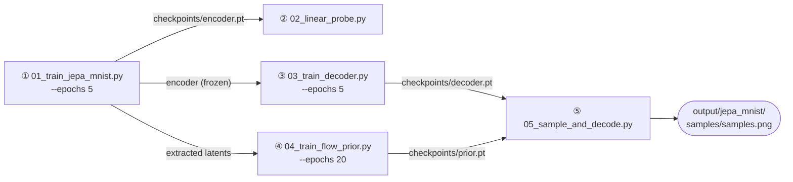
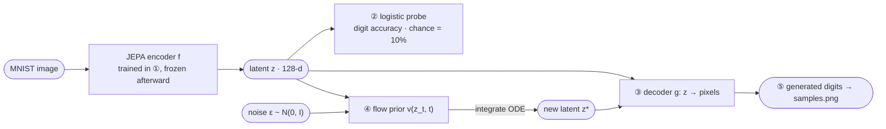

This page takes you from a fresh clone of **ssl-lab** to your first trained model and your first *generated* samples — five commands, one CPU, no labels required for pretraining. By the end you will have (1) a self-supervised **JEPA encoder** trained on MNIST patches, (2) proof that its frozen latent is semantically useful via a **linear probe**, and (3) a grid of **newly generated digits** produced by a flow-matching prior feeding a latent decoder. Everything below runs comfortably on CPU: the environment is explicitly tuned so that CPU is the local default for development and small proof-of-concept runs, with GPUs reserved for larger training.

Sources: [README.md](README.md#L121-L127), [environment.yml](environment.yml#L7-L8)

**Prerequisite reading:** if you have not yet read [Overview](1-overview), skim it first — it explains *why* this lab exists (trustworthy generative models for biological data) and what JEPA is. This page answers only *how to run it*.

## Prerequisites and Environment Setup

Install the pinned conda environment, then install the `ssllab` package in editable mode. All quick-start scripts insert `src/` into `sys.path` themselves, but `pip install -e .` also wires the package (and the test suite) up properly.

```bash
mamba env create -f environment.yml    # or: conda env create -f environment.yml
conda activate ssllab
pip install -e .
```

| Requirement | Version / Value | Notes |
|---|---|---|
| Python | ≥3.10, <3.13 | enforced by both `environment.yml` and `pyproject.toml` |
| PyTorch | ≥2.1 | CPU build is sufficient for this page |
| torchvision | ≥0.16 | MNIST data loading |
| numpy / scipy / scikit-learn / matplotlib | latest | probes, metrics, plotting |
| Hardware | CPU default | GPU (CUDA/MPS) only needed for larger runs |

There are also **optional extras** you do *not* need today, listed so you recognize them later: `dev` (pytest), `perturb` (heavy single-cell processing: anndata, scanpy, pertpy), `ops` (PyYAML for remote compute checks), and `remote` (SkyPilot itself for launching GPU pods). None of them are imported by the quick-start path.

Sources: [README.md](README.md#L121-L127), [environment.yml](environment.yml#L9-L20), [pyproject.toml](pyproject.toml#L10-L30)

## Sanity-Check the Installation

Before training anything, run the smoke tests. They execute in seconds on CPU and assert that the pieces **wire together correctly** — tensor shapes round-trip through the patchifier, the JEPA loss is finite and produces gradients, the EMA teacher actually updates, the flow model trains and samples, and the decoder outputs the right image shape. As the module docstring states, they check plumbing, *not* learning quality.

```bash
pytest -q
```

The test config is pre-wired in `pyproject.toml`: it points at both `tests/` and `ops/tests/` and adds the repo root to `pythonpath` so the top-level `ops` package resolves without installation.

Sources: [test_smoke.py](tests/test_smoke.py#L1-L4), [pyproject.toml](pyproject.toml#L32-L38)

## Repository Map for This Tour

You will touch exactly three areas of the repository: the reusable library in `src/ssllab/` (imported by the scripts, never edited by you), the numbered driver scripts in `examples/` (the commands you run), and `notebooks/` (optional intuition-building). The project follows a deliberate convention: **reusable primitives in `src/`, thin driver scripts in `examples/`, intuition in `notebooks/`**.

```
ssl-lab/
├── src/ssllab/          # library: models/, jepa/, generative/, eval/, data/, utils/
├── examples/
│   ├── jepa_basics/     # 01 train JEPA · 02 linear probe        ← steps 1–2 here
│   └── generative_jepa/ # 03 decoder · 04 flow prior · 05 sample ← steps 3–5 here
├── notebooks/jepa_basics/01_jepa_intuition.ipynb                 ← optional detour
├── tests/               # pytest -q smoke suite
└── output/jepa_mnist/   # created by your runs (checkpoints/, samples/, reports/, logs/)
```

The full annotated layout — including the perturbation-response and ECG pipelines you will meet later — is documented in the project README and unpacked page by page in [Repository Layout and Conventions](3-repository-layout-and-conventions).

Sources: [README.md](README.md#L86-L119)

## The Path You Will Walk: Five Commands, One Story

The vertical slice tells a single story in five numbered milestones. **Step 1 learns a representation** (predicting masked-patch *embeddings* from context — no labels). **Step 2 verifies it** with a frozen-encoder linear probe. **Step 3 learns to map the frozen latent back to pixels.** **Step 4 learns a sampleable probability distribution over the latent.** **Step 5 draws new latents from that distribution and decodes them into images.** Each script consumes the previous script's checkpoint automatically, because they all read from the same experiment directory.



Read the diagram left to right: the encoder checkpoint produced in step ① is the *only* upstream dependency of steps ②–④, and steps ③+④ both feed step ⑤. Nothing needs a GPU, nothing needs manual file copying — artifacts flow through the `output/<experiment>/` convention.

| # | Command | Milestone | Produces |
|---|---|---|---|
| 1 | `python examples/jepa_basics/01_train_jepa_mnist.py --epochs 5` | Learn the representation | `checkpoints/encoder.pt`, `reports/jepa_train.json` |
| 2 | `python examples/jepa_basics/02_linear_probe.py` | Verify the frozen latent is useful | `reports/probe.json` |
| 3 | `python examples/generative_jepa/03_train_decoder.py --epochs 5` | Decode latent → pixels | `checkpoints/decoder.pt`, `samples/recon.png` |
| 4 | `python examples/generative_jepa/04_train_flow_prior.py --epochs 20` | Sampleable prior over the latent | `checkpoints/prior.pt` |
| 5 | `python examples/generative_jepa/05_sample_and_decode.py` | Generate | `samples/samples.png` |

Sources: [README.md](README.md#L129-L146), [01_train_jepa_mnist.py](examples/jepa_basics/01_train_jepa_mnist.py#L9-L18), [03_train_decoder.py](examples/generative_jepa/03_train_decoder.py#L14-L17)

## How the Pieces Fit Together

One concept before the walkthrough: a **latent** (or embedding) is a vector — here 128-dimensional — that summarizes an input. JEPA trains by predicting the embeddings of *masked* patches from the *context* patches, never touching raw pixels. That latent then becomes the hub of everything downstream: the probe reads it, the decoder maps it back to pixels, and the flow prior learns its distribution so new latents can be sampled.



Note the single arrow *into* the frozen encoder and four arrows *out of* the latent `z`: the encoder is trained exactly once (step ①), and every later stage treats it as read-only. This two-stage design — representation first, generative machinery second — is the lab's core method line, scaled up to biological data in later pages.

Sources: [01_train_jepa_mnist.py](examples/jepa_basics/01_train_jepa_mnist.py#L1-L7), [04_train_flow_prior.py](examples/generative_jepa/04_train_flow_prior.py#L1-L6), [05_sample_and_decode.py](examples/generative_jepa/05_sample_and_decode.py#L1-L5)

## Step 1 — Train the JEPA Encoder (No Labels)

```bash
python examples/jepa_basics/01_train_jepa_mnist.py --epochs 5
```

The script patchifies MNIST images into token tensors, trains the encoder to predict **target-patch embeddings** from **context-patch embeddings** with an EMA target encoder supplying targets, and prints **collapse diagnostics every epoch**: loss, `eff_rank` (effective rank of the latent), and `feat_std` (feature standard deviation). It then saves the encoder (config + weights) and a JSON report. For a ~minute-scale smoke run, use the documented quick-smoke variant: `--epochs 1 --limit 2000`.

What a healthy run logs, epoch after epoch:

| Signal | Healthy signature | Failure signature |
|---|---|---|
| `feat_std` | ~0.70–0.77 in the reference run, stable trend | drifting toward 0 → **complete collapse** (all inputs map to one point) |
| `eff_rank` | rising over training; reference run climbed 74 → ~104 of 128 dims | stuck near 1 → **dimensional collapse** (variance crammed into a few axes) |

These two metrics exist precisely because JEPA has a trivial cheat available: collapse the latent space and the loss goes to zero while nothing is learned. The full math and interpretation are in `examples/jepa_basics/docs/representation-diagnostics.md`; the anti-collapse mechanisms themselves (VICReg, EMA) are covered in [Anti-Collapse: VICReg and SIGReg](8-anti-collapse-vicreg-and-sigreg).

Sources: [01_train_jepa_mnist.py](examples/jepa_basics/01_train_jepa_mnist.py#L1-L19), [01_train_jepa_mnist.py](examples/jepa_basics/01_train_jepa_mnist.py#L45-L60), [representation-diagnostics.md](examples/jepa_basics/docs/representation-diagnostics.md#L14-L31), [representation-diagnostics.md](examples/jepa_basics/docs/representation-diagnostics.md#L49-L55)

## Step 2 — Probe the Frozen Representation

```bash
python examples/jepa_basics/02_linear_probe.py
```

The script loads the encoder from the experiment's checkpoints, **freezes it**, pools latents for 10,000 train / 5,000 test images (the defaults), and fits a logistic-regression probe on top. Since MNIST has ten digit classes, **chance accuracy is 10%** — the log line prints both train and test accuracy against that floor. In the project's reference run the probe reached 98% train / 95.3% test: structure learned with zero labels. The result is written to `reports/probe.json`. This probe is your first taste of the lab's evaluation philosophy — always score against a floor (chance) and a reference — which scales up in [Evaluation Toolkit: Probes and Metrics](19-evaluation-toolkit-probes-and-metrics).

Sources: [02_linear_probe.py](examples/jepa_basics/02_linear_probe.py#L1-L12), [02_linear_probe.py](examples/jepa_basics/02_linear_probe.py#L36-L47), [representation-diagnostics.md](examples/jepa_basics/docs/representation-diagnostics.md#L92-L100)

## Steps 3–5 — Turn the Encoder into a Generator

Three short scripts complete the loop. **Step 3** trains a decoder `g: z → image` with a Bernoulli reconstruction loss while the encoder stays frozen, and saves a before/after grid (`recon.png`: originals on top, reconstructions below). **Step 4** extracts the training set's latents once, standardizes them, and fits a rectified-flow velocity field `v(z_t, t)` so that integrating an ODE from Gaussian noise lands on the data-latent distribution. **Step 5** draws `z ~ prior` by Euler-integrating that ODE (default 100 steps), undoes the standardization, decodes, and writes `samples.png` — a grid of 64 digits by default (`--n 64 --steps 100` to vary).

> [!TIP]
> **Blurry or soft reconstructions in step 3 are expected, not a bug.** JEPA latents are *not trained to be decodable* — the encoder never saw a reconstruction loss — so its latents carry semantic but not pixel-exact information, and reconstructions come out averaged. This is the instructive property that motivates the lab's later co-adaptation research (see [Co-Adaptation of Encoder and Decoder](18-co-adaptation-of-encoder-and-decoder)).

Sources: [03_train_decoder.py](examples/generative_jepa/03_train_decoder.py#L1-L18), [04_train_flow_prior.py](examples/generative_jepa/04_train_flow_prior.py#L1-L16), [05_sample_and_decode.py](examples/generative_jepa/05_sample_and_decode.py#L1-L15)

## The Control Panel: Key CLI Options

Every script exposes the same shape of interface; these are the flags a beginner actually needs. All scripts share `--experiment` (default `jepa_mnist`) and `--device auto` (picks CUDA/MPS/CPU), and all training scripts default to seed 42 for reproducibility.

| Flag | Script(s) | Default | Effect |
|---|---|---|---|
| `--epochs` | 01, 03, 04 | 5 / 5 / 20 | training duration; README's recommended quick-start values are in the table above |
| `--limit` | 01, 03, 04 | none | cap training examples/latents for smoke runs (e.g. `--epochs 1 --limit 2000`) |
| `--reg-coef` | 01 | 0.0 | VICReg collapse-regularizer weight; 0 disables; usage shows `0.04` |
| `--experiment` | all | `jepa_mnist` | output namespace `output/<name>/`; a new name isolates a new run |
| `--data-dir` | 01–04 | `data` | where MNIST is downloaded/looked up |
| `--n`, `--steps` | 05 | 64 / 100 | number of generated digits; ODE integration steps |
| `--encoder` / `--prior` / `--decoder` | 02–05 | auto | override a checkpoint path instead of using the experiment's |

Sources: [01_train_jepa_mnist.py](examples/jepa_basics/01_train_jepa_mnist.py#L45-L61), [03_train_decoder.py](examples/generative_jepa/03_train_decoder.py#L45-L57), [04_train_flow_prior.py](examples/generative_jepa/04_train_flow_prior.py#L43-L56), [05_sample_and_decode.py](examples/generative_jepa/05_sample_and_decode.py#L40-L48)

## Where Your Results Live

All artifacts land under one self-explanatory hierarchy keyed by the experiment name — never a flat `output/` dir. The layout is created idempotently by a small helper every script calls.

```
output/jepa_mnist/
  checkpoints/   encoder.pt  decoder.pt  prior.pt      # model weights
  samples/       samples.png  recon.png                # image grids
  reports/       jepa_train.json  probe.json           # metrics as JSON
  logs/          train.log
```

> [!TIP]
> **The `--experiment` name is the coupling mechanism of the whole pipeline.** It is deliberately a stable name, not a timestamp, so script 03 finds the encoder script 01 wrote — pass a *new* name to run a variant side-by-side without clobbering anything. On a GPU pod the identical tree is written on the network volume and rsynced back, so the structure you learn here transfers unchanged.

Sources: [README.md](README.md#L148-L160), [experiment.py](src/ssllab/experiment.py#L1-L16)

## Troubleshooting

| Symptom | Likely cause | Fix |
|---|---|---|
| `eff_rank` ≈ 1 or `feat_std` → 0 during step 1 | representation collapse | rerun with `--reg-coef 0.04` (the documented usage example) |
| probe accuracy near 10% (chance) in step 2 | encoder checkpoint missing or from a failed run | confirm step 1 completed for the same `--experiment`; or pass `--encoder` explicitly |
| decoder reconstructions very soft in step 3 | expected behavior, not an error | see the tip above; sample quality is judged in step 5 and by dedicated metrics |
| "CUDA not available" warnings | no GPU locally | harmless: `--device auto` falls back to CPU, the supported local default for this scale |
| MNIST download fails | restricted network | pre-download to `--data-dir` (default `data`) and rerun |
| steps 3–5 can't find files | scripts 01–04 ran under a different `--experiment` | keep one experiment name across the chain, or pass explicit `--encoder/--decoder/--prior` paths |

Sources: [01_train_jepa_mnist.py](examples/jepa_basics/01_train_jepa_mnist.py#L10-L13), [03_train_decoder.py](examples/generative_jepa/03_train_decoder.py#L4-L7), [02_linear_probe.py](examples/jepa_basics/02_linear_probe.py#L38-L43), [environment.yml](environment.yml#L7-L8)

## Optional Detour: Build Intuition in a Notebook

If you would rather *see* the machinery than run it, open `notebooks/jepa_basics/01_jepa_intuition.ipynb`. It is an explicit companion to the training script and visualizes the four ideas this page exercised: **masking** (context vs. target patches), **prediction in latent space** (never pixels, targets from an EMA teacher), **collapse** (watching effective rank / feature std), and **sampling** (prior + decoder turning the representation learner into a generator). Run scripts for training, notebook for pictures.

Sources: [01_jepa_intuition.ipynb](notebooks/jepa_basics/01_jepa_intuition.ipynb#L7-L20)

## Where to Go Next

You have completed the minimal loop: *represent → verify → generate*. The catalog picks up exactly where each of the five scripts left off.

- **Immediately next:** [Repository Layout and Conventions](3-repository-layout-and-conventions) — the `src/` vs `examples/` vs `notebooks/` convention you just experienced, formalized.
- **To understand what you trained:** [JEPA Module Internals](6-jepa-module-internals), then [Masking Strategies: Random and Span](7-masking-strategies-random-and-span) and [Anti-Collapse: VICReg and SIGReg](8-anti-collapse-vicreg-and-sigreg) — the `eff_rank`/`feat_std` story from step 1, explained mechanically.
- **To understand what you sampled:** [Flow-Matching Prior](9-flow-matching-prior) — the `v(z_t, t)` velocity field behind step 4.
- **To harden your evaluation habits:** [Evaluation Toolkit: Probes and Metrics](19-evaluation-toolkit-probes-and-metrics) — the probe from step 2 in its full form.
- **When your model outgrows your laptop:** [Remote GPU Ops: SkyPilot and RunPod](24-remote-gpu-ops-skypilot-and-runpod) — the same five commands, provisioned onto a GPU pod.
- **For the full curated reading order across all tutorial series:** [Tutorial Corpus and Reading Paths](25-tutorial-corpus-and-reading-paths).

Full math rendering of every deep-dive page is available at the documentation site: <https://pleiadian53.github.io/ssl-lab/>.
