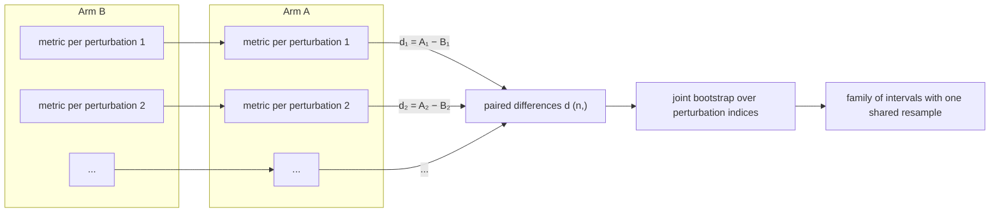
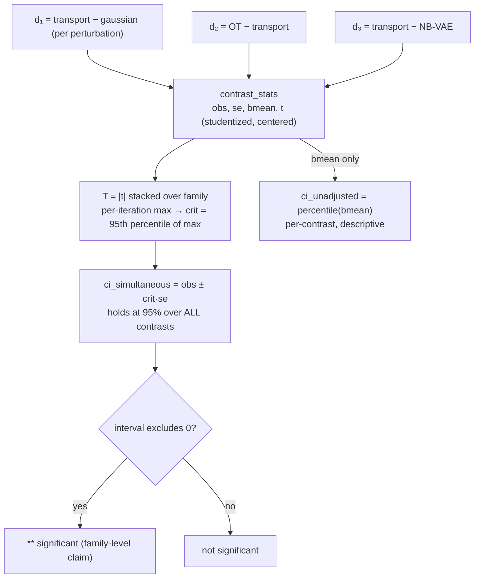
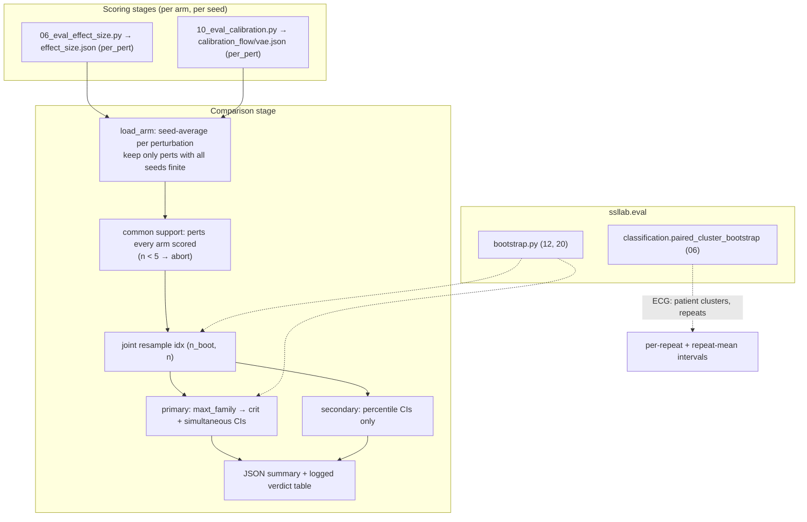

This page documents the machinery behind every "A beats B" claim in ssl-lab: a **joint paired bootstrap** that resamples the evaluation units once and reuses that resample across an entire family of contrasts, then controls multiplicity with **max-t simultaneous intervals**. It exists as a library (`ssllab.eval.bootstrap`) and a cluster-bootstrap sibling (`ssllab.eval.classification`), consumed by the arm-comparison scripts in both the perturbation-response and ECG pipelines. The design goal is precise: intervals that are valid *simultaneously* over a family of claims, with verdicts permitted only on a pre-committed primary endpoint.

## The Unit of Analysis: Why Pairing Comes First

Every comparison in this repository is anchored to a deliberate choice of statistical unit. In the perturbation-response pipeline, the unit is the **held-out perturbation** — not the cell, not the gene, not the training seed. Each arm produces one number per perturbation (seed-averaged first), yielding a vector of ~20 values per arm; that vector, not a scalar, is the only sample available. A contrast such as `transport - gaussian` is then a **paired difference** computed over the same perturbations for both arms, which cancels per-perturbation difficulty (some perturbations are simply hard for everyone) and isolates the between-arm signal [12_compare_arms.py](examples/perturbation_response/12_compare_arms.py#L5-L15). The ECG study makes the identical move one level up: the unit is the **patient**, and both arms are scored on the same patient resample with all of each patient's recordings kept together [classification.py](src/ssllab/eval/classification.py#L9-L12).

The pairing is what makes the resampling below meaningful: because both arms are evaluated on identical units, one resample of units serves every contrast at once, and the dependence between contrasts is preserved by construction rather than modeled after the fact.

Sources: [12_compare_arms.py](examples/perturbation_response/12_compare_arms.py#L5-L15), [classification.py](src/ssllab/eval/classification.py#L9-L12)

## One Resample for Everything

The contrasts in a typical comparison are **not independent**: `transport - gaussian` and `transport - vae` share an arm, and every contrast is computed on the same perturbation set. Bootstrapping each contrast in a separate call discards this dependence and forces a Bonferroni correction — which assumes independence — to be needlessly conservative [12_compare_arms.py](examples/perturbation_response/12_compare_arms.py#L10-L15). The library's answer is a single index matrix drawn once and shared by every contrast:

- `resample_indices(n, n_boot, seed)` returns an `(n_boot, n)` integer matrix of bootstrap indices, drawn from one seeded RNG and intended to be passed to *every* contrast and metric in the family [bootstrap.py](src/ssllab/eval/bootstrap.py#L26-L28).
- In the CLI consumer, the same discipline appears inline: `idx = rng.integers(0, n, size=(args.n_boot, n))` is computed once before any contrast is evaluated, with the comment "THE joint resample: one set of indices, reused for every contrast and metric" [12_compare_arms.py](examples/perturbation_response/12_compare_arms.py#L144-L146).

The composition ablation demonstrates the intended library reuse pattern: it imports exactly `maxt_family, percentile_interval, resample_indices` and obtains the same arithmetic as script 12 without duplicating it [20_compare_composition.py](examples/perturbation_response/20_compare_composition.py#L97-L101). This is the module's stated purpose — the procedure of `12_compare_arms.py` extracted as library functions so other comparisons use identical arithmetic [bootstrap.py](src/ssllab/eval/bootstrap.py#L1-L7).

> [!TIP]
> One shared RNG seed (default `seed=0`) makes the entire inference run reproducible: re-running script 12 or 20 with the same inputs regenerates the identical index matrix, so every interval in the family — and the critical value derived from it — is bit-for-bit reproducible.

Sources: [12_compare_arms.py](examples/perturbation_response/12_compare_arms.py#L10-L15), [bootstrap.py](src/ssllab/eval/bootstrap.py#L26-L28), [20_compare_composition.py](examples/perturbation_response/20_compare_composition.py#L97-L101)

## Max-t Simultaneous Intervals: The Arithmetic

For each contrast with paired differences `d` (one value per perturbation), `contrast_stats` computes four quantities [bootstrap.py](src/ssllab/eval/bootstrap.py#L31-L43):

1. `obs` — the observed mean difference.
2. `se` — its standard error, `std(d, ddof=1) / √n`.
3. `bmean` — bootstrap means: the differences are indexed by the shared `idx` matrix, giving an `(n_boot, n)` array whose row means are the bootstrap distribution of the contrast.
4. `t` — the **centered studentized statistic** per bootstrap iteration: `(bmean − obs) / bse`, guarded against division by near-zero standard errors (`bse > 1e-12`, else `t = 0`).

The multiplicity control then happens in `maxt_family`. Given a dict mapping contrast names to their per-perturbation differences and the shared index matrix, it stacks the absolute studentized statistics of all contrasts into a `(n_contrasts, n_boot)` matrix and takes, per bootstrap iteration, the **maximum |t| across the whole family**; the critical value `crit` is the `(1 − α)` percentile of that max distribution [bootstrap.py](src/ssllab/eval/bootstrap.py#L52-L54). Each contrast then receives two intervals:

| Interval | Formula | Validity | Verdict role |
|---|---|---|---|
| `ci_unadjusted` | percentile interval of `bmean` at `α/2`, `1−α/2` | per-contrast only | descriptive |
| `ci_simultaneous` | `obs ± crit · se` | **simultaneously over the family** | the only significance claim |

Because the same resample produced every contrast's studentized distribution, the max over the family captures the joint sampling behavior — contrasts sharing an arm move together in the bootstrap world exactly as they do in the real one. A contrast is called significant only if its simultaneous interval excludes zero [12_compare_arms.py](examples/perturbation_response/12_compare_arms.py#L178-L192). The script logs the critical value next to the familiar unadjusted benchmark (1.96), making the price of family-wide error control explicit [12_compare_arms.py](examples/perturbation_response/12_compare_arms.py#L174-L175).

Sources: [bootstrap.py](src/ssllab/eval/bootstrap.py#L31-L43), [bootstrap.py](src/ssllab/eval/bootstrap.py#L46-L62), [12_compare_arms.py](examples/perturbation_response/12_compare_arms.py#L159-L192)

## Primary and Secondary: Where Verdicts Are Allowed

Multiplicity is handled not only statistically but **procedurally**. With several contrasts times several metrics, testing each at α = 0.05 guarantees false positives under the global null, so the protocol splits metrics into two tiers [12_compare_arms.py](examples/perturbation_response/12_compare_arms.py#L17-L27):

- **Primary** — exactly one metric, pre-committed via `--primary` (default `delta_r`, the effect-size Δ-correlation). Its contrast family receives max-t simultaneous intervals, and the `**` marker on a row is the *only* significance claim the script makes [12_compare_arms.py](examples/perturbation_response/12_compare_arms.py#L159-L192).
- **Secondary / exploratory** — every other metric (the calibration family: `spread_r`, `coverage`, `wasserstein`, `energy`, with `LOWER_IS_BETTER` flags for direction) is reported with plain percentile CIs and **no verdict**, because a difference discovered on a secondary endpoint after the fact is a hypothesis, not a result — it needs confirmation on fresh held-out data or it does not get claimed [12_compare_arms.py](examples/perturbation_response/12_compare_arms.py#L64-L65), [12_compare_arms.py](examples/perturbation_response/12_compare_arms.py#L194-L212).

The composition ablation applies the same discipline with a two-contrast primary family (`flow_ds - flow_add`, `vae_ds - vae_add`) and a decision rule expressed directly on the simultaneous interval: DeepSets improves on its additive predecessor if the interval lies wholly below 0, is worse if wholly above 0, otherwise inconclusive [20_compare_composition.py](examples/perturbation_response/20_compare_composition.py#L112-L117), [20_compare_composition.py](examples/perturbation_response/20_compare_composition.py#L150-L155). It additionally hardens the protocol: the primary verdict stands only if at least 18 of the expected 20 pairs survive missing-value filtering (`MIN_PAIRS = 18`), otherwise the primary is reported as not evaluable [20_compare_composition.py](examples/perturbation_response/20_compare_composition.py#L170-L179).

Sources: [12_compare_arms.py](examples/perturbation_response/12_compare_arms.py#L17-L27), [12_compare_arms.py](examples/perturbation_response/12_compare_arms.py#L194-L212), [20_compare_composition.py](examples/perturbation_response/20_compare_composition.py#L150-L155)

## API Reference

The inference toolkit is intentionally small — four library functions plus one cluster-bootstrap workhorse:

| Function | Location | Signature (essentials) | Returns |
|---|---|---|---|
| `resample_indices` | [bootstrap.py](src/ssllab/eval/bootstrap.py#L26-L28) | `(n, n_boot=10000, seed=0)` | `(n_boot, n)` shared index matrix |
| `contrast_stats` | [bootstrap.py](src/ssllab/eval/bootstrap.py#L31-L43) | `(d: (n,), idx)` | `(obs, se, bmean, t)` tuple |
| `maxt_family` | [bootstrap.py](src/ssllab/eval/bootstrap.py#L46-L62) | `(diffs: dict[str, (n,)], idx, alpha=0.05)` | `{"critical_value", "contrasts": {name: {diff, se, ci_unadjusted, ci_simultaneous}}}` |
| `percentile_interval` | [bootstrap.py](src/ssllab/eval/bootstrap.py#L65-L70) | `(values: (n,), idx, alpha=0.05)` | `{"mean", "ci"}` on the shared resample |
| `paired_cluster_bootstrap` | [classification.py](src/ssllab/eval/classification.py#L117-L161) | `(metric, y, scores_a, scores_b, clusters, n_boot=2000, seed=0, alpha=0.05, repeats=False)` | `BootstrapResult` |
| `macro_auroc_metric` | [classification.py](src/ssllab/eval/classification.py#L164-L166) | `(label_idx)` closure | `metric(y_subset, s_subset)` adapter returning NaN if a label is undefined |

`BootstrapResult` carries `estimate` (the metric difference on the original sample), `ci_low`/`ci_high` (percentile interval), `n_boot`, `n_valid` (resamples where the metric was defined for *both* methods), and the raw `samples` array [classification.py](src/ssllab/eval/classification.py#L100-L107). The `metric` callable must return a float and may return NaN; undefined resamples are dropped and counted rather than silently averaged [classification.py](src/ssllab/eval/classification.py#L136-L137).

Sources: [bootstrap.py](src/ssllab/eval/bootstrap.py#L26-L70), [classification.py](src/ssllab/eval/classification.py#L100-L161)

## Two Bootstrap Variants: Perturbation-Unit vs Patient-Cluster

The repository runs two sibling implementations of the same philosophy — pair the arms, resample the units once — differing in unit structure and output shape:

| Dimension | Perturbation-unit bootstrap | Patient-cluster bootstrap |
|---|---|---|
| Unit | held-out perturbation (one scalar per arm) | patient (a cluster of recordings) |
| Implementation | `ssllab.eval.bootstrap` (vectorized, all contrasts at once) | `ssllab.eval.classification.paired_cluster_bootstrap` (per-contrast loop) |
| Resample mechanics | index matrix `(n_boot, n)` via `d[idx]` fancy indexing | `_cluster_index` groups recording indices by patient; each iteration resamples whole clusters via `np.concatenate([groups[g] for g in pick])` [classification.py](src/ssllab/eval/classification.py#L110-L114), [classification.py](src/ssllab/eval/classification.py#L152-L158) |
| Multiplicity | max-t over the contrast family | per-pair percentile intervals (one primary pair family of three) |
| Repeats handling | seeds averaged per unit *before* the bootstrap | two modes: per-repeat bootstraps, and `repeats=True` where the statistic is the mean over repeats scored on the **same** patient resample [classification.py](src/ssllab/eval/classification.py#L131-L134) |
| Undefined resamples | studentized t guarded to 0 at near-zero SE | dropped from the percentile computation, counted in `n_valid` |
| Primary consumer | `12_compare_arms.py`, `20_compare_composition.py` | `06_compare_arms.py` |

The cluster variant exists because ECG recordings from the same patient are not independent draws — resampling patients with replacement, keeping all their recordings, is the only resampling that reflects how the test set was sampled [classification.py](src/ssllab/eval/classification.py#L9-L12). In `06_compare_arms.py`, each (pair, budget) task produces three layers: per-repeat paired bootstraps (seeded `1000 + r` for reproducibility), a repeat-mean bootstrap where every repeat is scored on the same patient resample (seed 999, `repeats=True`), and — kept deliberately separate — the raw repeat-to-repeat spread of per-repeat differences, which measures training variability without pretending it is test-set uncertainty [06_compare_arms.py](examples/ecg_rhythm/06_compare_arms.py#L57-L72).

> [!TIP]
> The seed conventions (`1000 + r` per repeat, 999 for the repeat mean, 0 for the perturbation bootstrap) are not cosmetic — they let a rerun reproduce any single layer of the comparison independently, which is essential when a 250-line comparison script is debugged one layer at a time.

Sources: [classification.py](src/ssllab/eval/classification.py#L110-L161), [06_compare_arms.py](examples/ecg_rhythm/06_compare_arms.py#L57-L72)

## Pipeline Integration: From Reports to Verdict

The comparison scripts never recompute metrics; they consume the per-perturbation (or per-recording) reports written by earlier pipeline stages and operate purely on aggregation and resampling. This is the module interaction structure:

The aggregation order is strict and documented: load each arm's reports, seed-average per perturbation, keep a perturbation only if *every* requested seed produced a finite value [12_compare_arms.py](examples/perturbation_response/12_compare_arms.py#L82-L105), intersect across arms and metrics to find the common support [12_compare_arms.py](examples/perturbation_response/12_compare_arms.py#L130-L142), then resample once and evaluate the primary family and secondaries on that one resample [12_compare_arms.py](examples/perturbation_response/12_compare_arms.py#L144-L157). The output JSON records everything needed for audit: `n_perturbations`, `n_boot`, `alpha`, the primary metric name, `maxt_critical_value`, the perturbation list, and per-contrast intervals with a `significant_simultaneous` boolean [12_compare_arms.py](examples/perturbation_response/12_compare_arms.py#L164-L166), [12_compare_arms.py](examples/perturbation_response/12_compare_arms.py#L186-L191).

Sources: [12_compare_arms.py](examples/perturbation_response/12_compare_arms.py#L82-L105), [12_compare_arms.py](examples/perturbation_response/12_compare_arms.py#L130-L157), [12_compare_arms.py](examples/perturbation_response/12_compare_arms.py#L186-L191)

## What the Intervals Cover — and What They Deliberately Do Not

The module is unusual in how explicitly it states the limits of its own output. Three caveats are stated in both the library docstring and the consumer's final log block, and none are hidden:

- **Test-set uncertainty only.** Seeds are averaged per perturbation *before* the bootstrap, so the intervals describe uncertainty from the finite set of held-out perturbations, not from training randomness. With three seeds, seed variance cannot be estimated well enough to propagate, so the intervals are conditional on the seed-averaged model and understate total uncertainty — "stated, not hidden" [12_compare_arms.py](examples/perturbation_response/12_compare_arms.py#L29-L32), [12_compare_arms.py](examples/perturbation_response/12_compare_arms.py#L214-L217).
- **Units are not strictly i.i.d.** Perturbations share genes (the ECG analogue: patients share demographics), so the exchangeability assumption the bootstrap relies on is approximate — if anything, this makes the reported CIs too narrow [12_compare_arms.py](examples/perturbation_response/12_compare_arms.py#L216-L217), [bootstrap.py](src/ssllab/eval/bootstrap.py#L17-L18).
- **Minimum sample guards.** Fewer than 5 shared perturbations aborts script 12 outright [12_compare_arms.py](examples/perturbation_response/12_compare_arms.py#L138-L139); the composition ablation demotes the primary to "not evaluable" below 18 of 20 pairs [20_compare_composition.py](examples/perturbation_response/20_compare_composition.py#L170-L179).

For the ECG study, the split discipline adds one more boundary: with `--split val` only the machinery is exercised — "numbers on validation are not results" — and the AF operating point is fitted on validation by a pre-declared threshold rule, then applied unchanged to test [06_compare_arms.py](examples/ecg_rhythm/06_compare_arms.py#L15-L19). Together these rules implement a single epistemic stance: an interval is a statement about a specific, finite, named sampling frame, and a verdict is a claim made once, on the primary endpoint, with family-level error control.

Sources: [12_compare_arms.py](examples/perturbation_response/12_compare_arms.py#L29-L32), [12_compare_arms.py](examples/perturbation_response/12_compare_arms.py#L214-L217), [bootstrap.py](src/ssllab/eval/bootstrap.py#L17-L18), [06_compare_arms.py](examples/ecg_rhythm/06_compare_arms.py#L15-L19)

## Where This Fits in the Evaluation Stack

This page sits between metric computation and experimental protocol. Upstream, the metrics that feed the bootstrap — Δ-correlation on top-DE genes, calibration spreads, macro AUROC — are defined in [Evaluation Toolkit: Probes and Metrics](19-evaluation-toolkit-probes-and-metrics); the metric that is usually chosen as primary (`delta_r`) is the effect-size correlation documented there. Downstream, the procedural half of this page — pre-committing the primary, treating secondary findings as hypotheses, logging caveats in machine-readable JSON — connects directly to the discipline described in [Experimental Methodology Series](21-experimental-methodology-series) and to the audit trail maintained per [Results Ledger and Pre-Registration](22-results-ledger-and-pre-registration). If you want to see the machinery exercised end-to-end on a real benchmark, the arm-comparison entry points are `12_compare_arms.py` (four model arms, three contrasts), `20_compare_composition.py` (the composition ablation with an evaluable-primary guard), and `06_compare_arms.py` (the ECG study's patient-clustered comparison across finetune / probe / scratch).
