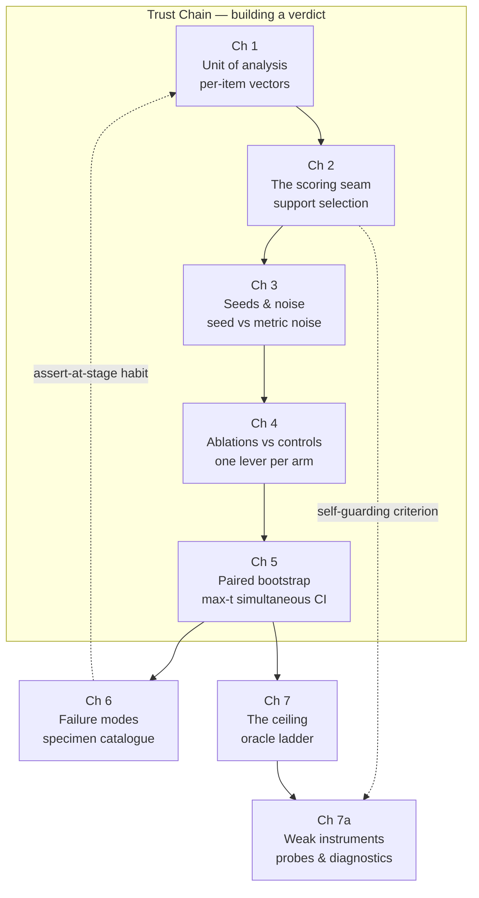
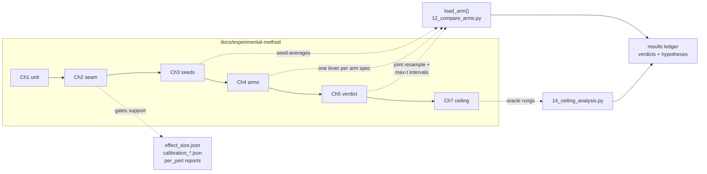

This page documents the repository's **Experimental Methodology Series** — an eight-chapter treatise living in `docs/experimental-method/` that teaches how to run experiments you can trust. Its scope is deliberately narrow and deliberately deep: not modeling ideas, but the *scaffolding* around them — how to measure, how to compare, and how to know when a number is telling you something. Every principle is illustrated on one real, mostly losing project (a generative-JEPA system for single-cell perturbation response), because a loss forces the question *is this real, or did I measure it wrong?* — and that project answered "measured it wrong" more than once. This page sits in the **Evaluation and Methodology** cluster, alongside the practical companions [Evaluation Toolkit: Probes and Metrics](19-evaluation-toolkit-probes-and-metrics) and [Paired Bootstrap and Simultaneous Inference](20-paired-bootstrap-and-simultaneous-inference).

Sources: [index.md](docs/experimental-method/index.md#L1-L8)

## The Series Architecture at a Glance

The series is structured as a narrative arc, not a reference manual. Chapters 1–5 build a **trust chain** (measure → locate → denoise → design → verdict), Chapter 6 is a catalogue of the ways the chain breaks, and Chapters 7/7a turn trusted measurement into a *decision instrument* for research direction. The two defining habits of the whole series are stated in its index: **make every stage assert something about its own output before the next stage consumes it**, and **before you improve a component, measure whether it can matter**.

Sources: [index.md](docs/experimental-method/index.md#L16-L27), [01-what-are-you-measuring.md](docs/experimental-method/01-what-are-you-measuring.md#L1-L148), [07-the-ceiling.md](docs/experimental-method/07-the-ceiling.md#L1-L12)

| Chapter | File | Core claim | One-line countermeasure |
|---|---|---|---|
| 1 | `01-what-are-you-measuring.md` | The *shape* of a metric (unit of analysis) decides whether statistics are possible | Emit per-item vectors; pre-commit one primary endpoint |
| 2 | `02-the-scoring-seam.md` | Support selection code is upstream of every check and can silently define what your benchmark can see | Rank by test statistics; gate the seam with assertions |
| 3 | `03-seeds-and-noise.md` | Seed noise and metric noise are different quantities with different fixes | 3-seed sweep minimum; check the ruler before buying compute |
| 4 | `04-ablations-and-controls.md` | Ablations isolate, controls calibrate — never read one as the other | One lever per arm; design stages for separability |
| 5 | `05-from-difference-to-verdict.md` | A difference is not a verdict; dependent contrasts need joint resampling | Paired bootstrap; max-$t$ simultaneous intervals |
| 6 | `06-failure-modes.md` | Broken measurements don't announce themselves; broken ideas do | Catalogue of five specimen failures with countermeasures |
| 7 | `07-the-ceiling.md` | Before improving a stage, replace it with an oracle and measure the ceiling | Build a ladder of oracles; commit to decision rules in advance |
| 7a | `07a-probes-and-weak-instruments.md` | The most informative diagnostic is the weakest one that can answer the question | Choose instruments by what they are *structurally unable to fake* |

Sources: [index.md](docs/experimental-method/index.md#L16-L27)

## The Worked Example as the Series' Spine

Every chapter is grounded in a single project: making a JEPA representation *generative* for gene perturbation prediction and trying to beat the established conditional generators (the CPA/scPPDM lineage) at their own game. The project structure is a three-stage pipeline — **Stage A** (frozen self-supervised JEPA encoder), **Stage B** (generative model over frozen latents: conditional flow or action operator), **Stage C** (count decoder) — and the test set is twenty held-out two-gene perturbation combinations. The design made the project a superior teaching vehicle: a win hides your methodology because nobody audits a result they like, while this project's central early result turned out to be an artifact of two lines of gene-selection code.

Sources: [index.md](docs/experimental-method/index.md#L10-L14), [03-seeds-and-noise.md](docs/experimental-method/03-seeds-and-noise.md#L92-L98)

The full method writeup lives in the example tree at `examples/perturbation_response/docs/conditional-flow-jepa/index.md`, with a running scoreboard in its results ledger; the pipeline itself is documented on [Perturbation-Response Pipeline](16-perturbation-response-pipeline). The series and the code are tightly coupled: Chapter 5 names its implementation script explicitly as `12_compare_arms.py`, which loads each arm's per-item reports, seed-averages them, intersects arms onto a common support, and runs the joint bootstrap.

Sources: [index.md](docs/experimental-method/index.md#L31-L35), [05-from-difference-to-verdict.md](docs/experimental-method/05-from-difference-to-verdict.md#L186-L189), [12_compare_arms.py](examples/perturbation_response/12_compare_arms.py#L1-L52)

## Chapters 1–2: What You Measure and Where the Seam Is

**Chapter 1** argues that a metric has a *shape*, not just a value, and that the load-bearing question is **what is one observation?** An aggregate score is a sample of size $n=1$ — unbootstrappable, unrepairable after the fact. The fix is structural: define the metric per item and emit a vector (`{"per_item": scores, "mean": ...}`), so the aggregate becomes a summary of the vector rather than a substitute for it. The worked example's unit is the perturbation (n = 20), never the cell, the gene, or the seed — the classic **pseudoreplication** trap, since the numerous thing (thousands of cells) lives *inside* the exchangeable thing (perturbations). The chapter then demands a **single primary endpoint declared before you look**, with arithmetic as the argument: ~20 available tests at α = 0.05 means you *expect one* false finding under the global null — and it will look exactly like the real ones.

Sources: [01-what-are-you-measuring.md](docs/experimental-method/01-what-are-you-measuring.md#L4-L8), [01-what-are-you-measuring.md](docs/experimental-method/01-what-are-you-measuring.md#L40-L48)

The chapter closes with the project's own cautionary tale: the flow beat the VAE baseline on joint energy distance (3.578 vs 3.962), on the metric its architecture was justified by — announced as a finding, then withdrawn when the bootstrap interval $[-0.960, +0.172]$ crossed zero. Secondary, post-hoc, found on a metric changed mid-project: every rule of the chapter violated at once. Its final habit: **write down, next to your primary metric, the thing it cannot see** — for the effect-size correlation, that is spread, shape, modality, and cross-gene structure, which is precisely why the calibration metrics exist.

Sources: [01-what-are-you-measuring.md](docs/experimental-method/01-what-are-you-measuring.md#L104-L128), [01-what-are-you-measuring.md](docs/experimental-method/01-what-are-you-measuring.md#L131-L148)

**Chapter 2** — flagged by the series as its most important chapter — names the **scoring seam**: the support (subset of items/features) every metric is computed on, chosen by criterion code that nobody audits because it looks like plumbing. Its general law: *a metric computed on the wrong support does not fail loudly; it returns a well-formed, stable, plausible, meaningless number.* The project's seam was a gene list ranked by $\log_2$ fold change, whose pseudocount-guarded ratio explodes exactly on silent genes — selecting, with high reliability, genes detected in **0% of cells**. Consequences cascaded through the entire scoreboard: coverage forced to exactly 1.00 for every model at every seed, per-gene spread correlation driven by floating-point noise, and the effect-size correlation degenerated into a constant (every perturbation's true $\Delta$ reduced to the same fixed vector $-\bar{x}^{\text{ctrl}}_g$), producing the false headline that the elaborate method *tied* its baseline.

Sources: [02-the-scoring-seam.md](docs/experimental-method/02-the-scoring-seam.md#L9-L16), [02-the-scoring-seam.md](docs/experimental-method/02-the-scoring-seam.md#L76-L89)

The fix is stated as a design principle, not a heuristic: **rank by a test statistic, not an effect ratio.** The Wilcoxon rank-sum $z$-statistic is **self-guarding** — built from rank orderings, it is *structurally unreachable* by the two-stray-transcripts pathology, with no pseudocount and no filter to remember. Selection quality transformed (mean expression 0.0006 → 2.40; detection 0% → 83%; significance 0% → 100%) and the arms stopped tying. On top of the ranking sit detection/significance filters and an assertion that refuses to write its cache on an invalid support — guards that almost never fire, which is the point: a guard that never fires is a **tripwire** converting future silent failures into loud ones. The chapter generalizes the seam to other fields (LLM benchmark subsets, RL episode filters, forecasting windowing, IR gold sets) and prescribes the practice: find the line of code that chooses your support, ask what its criterion *maximizes*, inspect the selected items directly, then gate it.

Sources: [02-the-scoring-seam.md](docs/experimental-method/02-the-scoring-seam.md#L120-L146), [02-the-scoring-seam.md](docs/experimental-method/02-the-scoring-seam.md#L160-L195)

> [!TIP]
> The fold-change failure and the fix share one property worth carrying everywhere: the winning criterion has the null hypothesis built into its denominator. When evaluating any selection rule, ask whether its failure mode is *structurally impossible* or merely *usually filtered* — the second kind survives until someone copies the two lines without the filter.

## Chapters 3–4: Noise You Can Measure, Designs You Can Attribute

**Chapter 3** decomposes what a seed actually controls (weight initialization, minibatch order, stochastic regularization, and — the one that bites generative work — sampling at generation time), then introduces the **seed sweep** as the non-optional minimum: three seeds per configuration, recording individual scores because they *are* the noise floor. Its rule: **any claimed improvement smaller than the noise floor is not a claim, it is a coin flip.** But the chapter's central insight inverts the diagnosis: when the scoring seam was fixed, the Gaussian flow's three seeds went from spanning 0.061 to spanning 0.012 — same models, same seeds, only the scoring changed. **Most of what had been attributed to seed noise was measurement noise**, and a better-conditioned metric bought statistical power for free, retroactively, at zero GPU-hours.

Sources: [03-seeds-and-noise.md](docs/experimental-method/03-seeds-and-noise.md#L18-L27), [03-seeds-and-noise.md](docs/experimental-method/03-seeds-and-noise.md#L52-L68)

The chapter is honest about its own hole: the sweep re-seeds Stages B and C but not the frozen Stage A encoder, so reported seed noise excludes encoder-initialization variance; and the from-scratch NB-VAE baseline trains end-to-end, so its seed perturbs everything — which is exactly why the baseline got its own three-seed sweep before its win ($\bar{s} = 0.766$ vs 0.648, a gap ~10× either noise floor) could be declared. The diagnostic question when the noise floor looks bad is not "how many more seeds can I afford?" but **"is this variance coming from the model, or from the ruler?"** — only one of those fixes is expensive.

Sources: [03-seeds-and-noise.md](docs/experimental-method/03-seeds-and-noise.md#L70-L98), [03-seeds-and-noise.md](docs/experimental-method/03-seeds-and-noise.md#L100-L115)

**Chapter 4** draws the series' sharpest conceptual line: **ablations isolate, controls calibrate.** An ablation changes exactly one lever (flow source: Gaussian vs real control latent; minibatch coupling: independent vs OT; decoder flags; operator-vs-flow). The NB-VAE control changes *every* lever simultaneously — different encoder, prior, decoder, all trained end-to-end — so it cannot attribute the 0.118 gap, but it answers a different question: *does all this machinery beat a simple, honest alternative?* Reading the control as an ablation ("the gap is the JEPA encoder's fault") is the specific failure mode the chapter exists to prevent. The project also confesses its own two-lever arm (stochastic coefficients + per-condition residual bundled together), which regressed and produced a coherent mechanism story the experiment **cannot test** — recorded in the ledger as a hypothesis, not a finding.

Sources: [04-ablations-and-controls.md](docs/experimental-method/04-ablations-and-controls.md#L18-L27), [04-ablations-and-controls.md](docs/experimental-method/04-ablations-and-controls.md#L63-L80)

The chapter's structural contribution is why ablations are cheap here: given the frozen latents, **Stage B and Stage C are conditionally independent** — no training signal crosses the boundary — so *an experiment retrains only the stage it changes*. A decoder ablation with four variants reuses cached encoder latents and flow samples; an operator-vs-flow comparison shares a byte-identical evaluation pipeline. The general research argument: separability is not engineering hygiene, it is what makes a monolithic end-to-end system *harder to learn from*, because every question costs a full retrain. The chapter closes with the fair-comparison checklist (same evaluator code, same test split including Stage A's pretraining data, shared seeds, same control reference, and — the most-violated rule — **the baseline gets the same conditioning information**; the VAE was deliberately given the identical compositional gene-set embedding rather than one-hot conditioning it could not generalize with) and the instruction: *build the strongest, fairest baseline you can, and want it to be strong.*

Sources: [04-ablations-and-controls.md](docs/experimental-method/04-ablations-and-controls.md#L82-L121), [04-ablations-and-controls.md](docs/experimental-method/04-ablations-and-controls.md#L123-L174)

## Chapter 5: From a Difference to a Verdict

This chapter specifies the statistical machinery, implemented one-to-one in `12_compare_arms.py`: form per-item differences $d_i = A_i - B_i$, resample item indices with replacement $R = 10{,}000$ times, and read 95% intervals from the replicate distribution. **Pairing is not optional** on a small test set: items differ enormously in intrinsic difficulty, and differencing cancels hardness out of $d_i$, whereas comparing unpaired intervals lets between-item variance swamp a between-arm effect one or two orders of magnitude smaller. Seeds are averaged per perturbation *before* the test — a stated, not hidden, limitation: intervals capture test-set uncertainty, not training randomness, because three draws cannot support a seed-variance estimate worth propagating.

Sources: [05-from-difference-to-verdict.md](docs/experimental-method/05-from-difference-to-verdict.md#L13-L30), [05-from-difference-to-verdict.md](docs/experimental-method/05-from-difference-to-verdict.md#L70-L78), [12_compare_arms.py](examples/perturbation_response/12_compare_arms.py#L9-L25)

The multiplicity arithmetic is done explicitly: ~4 contrasts × 5 metrics ≈ 20 tests, so under the global null you *expect one false positive*. Bonferroni is rejected for a structural reason — the contrasts share arms (transport appears in two of them) and share items, so they are positively dependent and Bonferroni's independence assumption over-corrects. The fix is a **joint bootstrap**: resample item indices once per iteration and evaluate every contrast on that same resample, preserving the dependence structure by construction. Max-$t$ **simultaneous intervals** then bootstrap the family-wide studentized maximum $M^{(r)} = \max_c |t_c^{(r)}|$, yielding one critical value ($q \approx 2.95$ vs the unadjusted 1.96) whose intervals hold at 95% *simultaneously* across the family.

Sources: [05-from-difference-to-verdict.md](docs/experimental-method/05-from-difference-to-verdict.md#L86-L110), [12_compare_arms.py](examples/perturbation_response/12_compare_arms.py#L60-L75)

The verdicts table shows the method earning its keep: transport − Gaussian $+0.036$ $[+0.019, +0.052]$ **significant**; OT − transport $-0.021$ $[-0.039, -0.002]$ **significant** (the clever coupling *hurts*); transport − NB-VAE $-0.118$ $[-0.228, -0.008]$ **significant** (the baseline wins); operator − transport $-0.003$ $[-0.030, +0.024]$ an honest null reported with an informative interval. Secondary endpoints get intervals, **no verdicts** — the rule enforced in code, born from the retracted joint-energy finding of Chapter 1. The chapter also audits itself: the bootstrap assumes i.i.d. items, and the twenty held-out combinations *share genes*, so effective sample size is below twenty and the intervals understate true uncertainty. The moral: **the machinery is not there to help you argue for your findings; it is there to stop you from believing your own favourite result** — it earns its keep on the day it takes something away from you. The deeper implementation walkthrough lives on [Paired Bootstrap and Simultaneous Inference](20-paired-bootstrap-and-simultaneous-inference).

Sources: [05-from-difference-to-verdict.md](docs/experimental-method/05-from-difference-to-verdict.md#L115-L131), [05-from-difference-to-verdict.md](docs/experimental-method/05-from-difference-to-verdict.md#L166-L189)

## Chapter 6: A Catalogue of Ways an Experiment Lies

Five specimen failures, all real, none of which crashed anything — every pipeline ran to completion and produced plausible, stable, wrong numbers. They are presented with general form and countermeasure:

| # | Failure | Instance | Countermeasure |
|---|---|---|---|
| 1 | Better training loss, worse model | OT coupling: flow-matching loss 1.96 → 1.48, effect score *significantly worse* $[-0.039, -0.002]$; repeated with a dispersion anchor and the stochastic operator — **three times** | Report target metric alongside loss, same table, every arm; treat divergence as a finding |
| 2 | The two-lever arm | Stochastic coefficients + residual displacement bundled; result uninterpretable three ways | One lever per arm, always; a bundle is a demo, label it as one |
| 3 | The silently clobbering fetch | Blanket `rsync` overwrote seven locally-correct reports with stale remote ones | Hash artifacts inside results; fetch selectively; make sync direction explicit |
| 4 | The meaningless silence | Dead-looking log stream over a healthy job; "pod left running" printed on failure | Check the authoritative source (job queue), never the wrapper |
| 5 | Pseudoreplication | Thousands of cells per perturbation tempting an $n$ four orders of magnitude too large | Fix the unit at the top of the analysis script; no code path to any other level |

Sources: [06-failure-modes.md](docs/experimental-method/06-failure-modes.md#L9-L16), [06-failure-modes.md](docs/experimental-method/06-failure-modes.md#L63-L90)

Failure 1 deserves emphasis because it is the signature: the training objective is a **proxy** — differentiable, stable, and correlated with the goal, and each of those properties is why it is not the goal. The sharpest version: *a loss that improves while the target metric does not is not noise — it is information that the gap between your proxy and your goal is real and load-bearing.* The chapter's unifying countermeasure is the series' opening habit: in every case a stage received input it should have rejected and processed it happily, so **make each stage the last place its own bugs can hide** — the feature-selection stage now refuses to write its cache if the selected features are not actually detected in the data. Discovered anywhere downstream, the number is already wearing a suit.

Sources: [06-failure-modes.md](docs/experimental-method/06-failure-modes.md#L17-L35), [06-failure-modes.md](docs/experimental-method/06-failure-modes.md#L108-L124)

## Chapters 7 and 7a: The Ceiling and the Instruments That Find It

Chapter 7 is the constructive turn. Three rounds of transition-model improvement (0.612 → 0.648 → 0.645) never asked the deciding question: **given this encoder and this decoder, what is the best score *any* transition could achieve?** The answer, measured without training anything, was 0.679 — meaning the stage under three months of active development held at most 0.031 of headroom. The method is **oracle substitution**: replace a stage's output with the ground truth it was trying to produce (the skyline twin of a baseline), and build a **ladder**, not a single rung, so the loss decomposes by stage.

Sources: [07-the-ceiling.md](docs/experimental-method/07-the-ceiling.md#L14-L27), [07-the-ceiling.md](docs/experimental-method/07-the-ceiling.md#L40-L52)

The project's four-rung ladder and its loss budget:

| Rung | Score | What it measures |
|---|---|---|
| Identity (metric fed the truth itself) | 1.000 | Harness sanity gate — must be perfect |
| Roundtrip (real latents → real decoder) | 0.679 | **The ceiling** for this decoder |
| Latent-mean (real latents, collapsed to mean) | 0.706 | Spread does not help a mean-comparing metric |
| Linear readout (real latents → plain linear map) | 0.852 | The representation, read out linearly |

| Step | From | To | Lost | Reading |
|---|---|---|---|---|
| Encoder (under a *linear* readout) | 1.000 | 0.852 | 0.148 | what a linear map cannot recover |
| Decoder | 0.852 | 0.679 | 0.173 | ~6× the transition's loss — the real bottleneck |
| Transition | 0.679 | 0.648 | 0.031 | the stage everyone was improving — saturated |

Sources: [07-the-ceiling.md](docs/experimental-method/07-the-ceiling.md#L40-L72)

Three readings changed the project: the transition is **saturated**; the readout is where the score is actually lost; and — the rung nobody was built to find — a *linear* readout of the frozen representation (0.852) sat above the baseline that had been beating the method (0.766), relocating the problem entirely. The chapter's subtleties keep it honest: a ceiling is not a result, it is specific to what you held fixed, it inherits its reference, and every rung is cheap because **it trains nothing** — substitution plus a forward pass. The recipe transfers universally (gold-context for RAG retrievers, hand-written correct plans for agents, privileged state in RL, true future covariates in forecasting).

Sources: [07-the-ceiling.md](docs/experimental-method/07-the-ceiling.md#L62-L96), [07-the-ceiling.md](docs/experimental-method/07-the-ceiling.md#L98-L116)

Companion **7a** reveals that the ceiling's linear arm and the pipeline's long-standing encoder probe (`02_probe_cell_encoder.py`) are the same instrument — the **linear evaluation protocol** from representation learning — wearing two heads: logistic regression asks *which* perturbation (identity), ridge regression asks *what it did* (quantity). Its selection rule unifies the whole series' diagnostic philosophy: **a diagnostic is only informative if it is structurally unable to give you a good answer for the wrong reason**, which is the same property Chapter 2 called *self-guarding* and Chapter 7's oracle embodies (a perfect stage cannot score better than perfect). Hence the corollary: **the most informative instrument is usually the weakest one that can still answer the question** — a linear probe's weakness makes its claim a *lower bound* on accessible signal, and a flexible probe would confound representation quality with probe capacity. The chapter then organizes the full toolbox by question — representation quality (linear/k-NN/nonlinear probes, effective rank via eigenvalue entropy, CKA/RSA), bottleneck location (oracle ladder, ablations), generator health (posterior collapse via per-dimension KL, prior-vs-aggregate-posterior mismatch, reconstruction-generation gap, two-sample energy distance, the total-variance split $\mathrm{Var}[x_g] = \sigma^2_{\text{dec}} + \sigma^2_{\text{bio}}$ computed in `11_diagnose_variance.py`, calibration/coverage), and training sanity (target metric beside the loss, init-time no-op assertions, shuffled-label permutation nulls).

Sources: [07a-probes-and-weak-instruments.md](docs/experimental-method/07a-probes-and-weak-instruments.md#L6-L32), [07a-probes-and-weak-instruments.md](docs/experimental-method/07a-probes-and-weak-instruments.md#L84-L129)

> [!TIP]
> When you adopt the oracle-ladder practice, gate it with the identity rung and pre-commit the decision rule (what counts as "saturated" numerically) *before* reading the ceiling — otherwise the ceiling becomes decoration for the direction you had already chosen, which is exactly the failure Chapter 5 exists to prevent.

## How the Series Maps to Code

The series is not abstract: each chapter's discipline is enforced by a script in the perturbation-response example. The relationship between the methodology and its enforcement points:

Sources: [05-from-difference-to-verdict.md](docs/experimental-method/05-from-difference-to-verdict.md#L186-L189), [12_compare_arms.py](examples/perturbation_response/12_compare_arms.py#L98-L120), [07-the-ceiling.md](docs/experimental-method/07-the-ceiling.md#L36-L39)

The comparison script's design encodes the chapters directly: `load_arm()` seed-averages per perturbation and counts a perturbation only if *every* requested seed produced it; a `--primary` flag names the one pre-committed metric whose contrasts get max-$t$ intervals; every other metric is reported with a plain CI and no verdict; and arm specs declare `label=experiment_pattern:kind:seeds`, making the one-lever-per-arm contract explicit at the CLI. NaN values are dropped, and secondary metrics carry a `LOWER_IS_BETTER` registry — every rule from Chapters 1, 3, and 5 is visible as a line of code.

Sources: [12_compare_arms.py](examples/perturbation_response/12_compare_arms.py#L56-L120)

The disciplines transfer beyond this example: the ECG study applies the same arm-comparison and seed-sweep structure (see [ECG Rhythm Study](17-ecg-rhythm-study)), the encoder/decoder separation analysis extends Chapter 4's separability argument (see [Co-Adaptation of Encoder and Decoder](18-co-adaptation-of-encoder-and-decoder)), and pre-registration plus verdict recording operationalize Chapters 1 and 5 (see [Results Ledger and Pre-Registration](22-results-ledger-and-pre-registration)).

Sources: [03-seeds-and-noise.md](docs/experimental-method/03-seeds-and-noise.md#L100-L115), [04-ablations-and-controls.md](docs/experimental-method/04-ablations-and-controls.md#L123-L140)

## The Two Habits, and Where to Go Next

Everything above compresses into two instincts pointed in opposite directions. **Backward-facing trust**: make every stage assert something about its own output before the next stage consumes it — not because assertions catch bugs, but because the alternative is discovering the bug at the metric, where it is wearing a suit. **Forward-facing direction**: before you improve a component, measure whether it can matter — the oracle ladder costs an afternoon and redirects months. Together they define what the series means by an experiment you can trust: a measurement whose support you have audited, whose noise floor you have measured, whose arms differ by one lever, and whose verdicts were pre-committed to a single primary endpoint.

Sources: [index.md](docs/experimental-method/index.md#L29-L33), [06-failure-modes.md](docs/experimental-method/06-failure-modes.md#L108-L124), [07-the-ceiling.md](docs/experimental-method/07-the-ceiling.md#L98-L112)

For readers continuing through the catalog: the statistical mechanics summarized here are implemented and expanded step-by-step on [Paired Bootstrap and Simultaneous Inference](20-paired-bootstrap-and-simultaneous-inference); the probe family of Chapter 7a connects to [Evaluation Toolkit: Probes and Metrics](19-evaluation-toolkit-probes-and-metrics); the ledger discipline that stores verdicts and demoted hypotheses is detailed in [Results Ledger and Pre-Registration](22-results-ledger-and-pre-registration); and for placement of this series among the repo's other tutorial threads, see [Tutorial Corpus and Reading Paths](25-tutorial-corpus-and-reading-paths).
