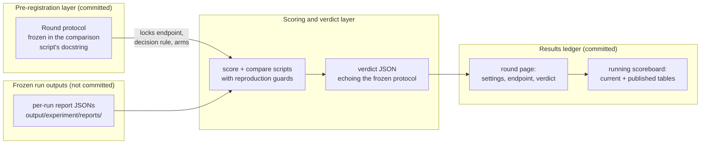
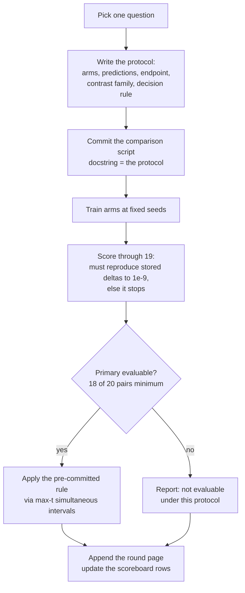

Every experimental result in ssl-lab passes through two artifacts before it is allowed to influence a decision: a **pre-registered protocol** that fixes the question, the endpoint and the decision rule before any number exists, and an **append-only results ledger** that records what was asked, what was found, and what was later superseded. This page documents both mechanisms as they are actually implemented in this repository — the per-round ledger under `examples/perturbation_response/docs/results/`, the per-setting results folder under `examples/ecg_rhythm/results/`, and the comparison scripts whose docstrings *are* the pre-registration. It assumes familiarity with the evaluation endpoints described in [Evaluation Toolkit: Probes and Metrics](19-evaluation-toolkit-probes-and-metrics) and the statistics behind verdicts in [Paired Bootstrap and Simultaneous Inference](20-paired-bootstrap-and-simultaneous-inference); the underlying experimental philosophy is developed separately in [Experimental Methodology Series](21-experimental-methodology-series).

Sources: [index.md](examples/perturbation_response/docs/results/index.md#L1-L31), [results/README.md](examples/ecg_rhythm/results/README.md#L1-L3)

## The Problem the Ledger Solves

The motivating failure is documented, not hypothetical. The `04-decide` workflow records a retraction in this project: a flow "win" on joint energy distance was announced on a single seed, discovered after changing the metric, on a secondary endpoint — and on three seeds the simultaneous interval came out $[-0.960, +0.172]$, crossing zero. Every ingredient of a garden-of-forking-paths false positive was present, and the only structural defense is committing to the endpoint and the decision rule *before* looking. That is why the discipline here is described as "mostly about what you commit to before you look": the ledger then becomes the durable, append-only memory in which every round's pre-committed question and its honest answer are permanently paired.

Sources: [04-decide.md](examples/perturbation_response/docs/workflows/04-decide.md#L1-L3), [04-decide.md](examples/perturbation_response/docs/workflows/04-decide.md#L44-L56)

The ledger is also what makes negative results useful. The perturbation-response study refuted its own headline hypothesis (the operator-algebra bracket), watched its baseline rise twice, and re-read every published number under corrected conventions — and all of that history remains readable in one place rather than being reconstructed from git archaeology. The ledger's own intro states the contract plainly: *"a living, append-only record of every experimental round on this method… so that progress against the baseline can be read in one place."*

Sources: [index.md](examples/perturbation_response/docs/results/index.md#L1-L31), [04-decide.md](examples/perturbation_response/docs/workflows/04-decide.md#L58-L63)

## Architecture: How Pre-Registration Flows into the Ledger

The two mechanisms form a pipeline with a deliberate trust boundary between it. Protocols are frozen in version control *before* runs are scored; run outputs stay uncommitted; the only committed numbers are ones that a script can re-derive from the frozen outputs. The diagram below shows how a claim travels from pre-commitment to the permanent record:

Two properties of this architecture do most of the work. First, the protocol lives in a *script docstring*, so pre-registration inherits version control for free — the commit timestamp is the registration timestamp, and any later edit to the protocol is a visible diff. Second, scoring scripts refuse to produce numbers that cannot be tied to stored reports, which closes the gap between "what was planned" and "what was actually graded."

Sources: [results-ledger.md](examples/perturbation_response/docs/conditional-flow-jepa/results-ledger.md#L1-L11), [index.md](examples/perturbation_response/docs/results/index.md#L186-L212)

> [!TIP]
> The docstring-as-protocol pattern works because Python docstrings are data: the protocol text travels with the code that implements it, and `git log` on that one file gives you the complete registration history without any external system.

## Inside the Perturbation-Response Ledger

The ledger index at `examples/perturbation_response/docs/results/index.md` is organized as five blocks, each with a distinct job. The round table is the entry point — one row per round, numbered in the order runs happened, with 7b marked as a companion ablation and the re-baseline explicitly noted as "not a round: it tests nothing."

| Component | Location | What it holds |
|---|---|---|
| The rounds | table at top of index | question → answer → link, one row per round |
| The standing verdict | narrative section | the two questions the study keeps apart, and each round's contribution to them |
| The two rules | short section | how comparisons are allowed to be made |
| The running scoreboard | two tables | current conventions and published pre-correction numbers |
| Shared settings | bullet list | data, split, endpoints, frozen component md5s, seed policy, statistics, pre-registration, compute |
| Open / retired | closing section | what is still live and which levers are permanently closed |

Sources: [index.md](examples/perturbation_response/docs/results/index.md#L1-L31), [index.md](examples/perturbation_response/docs/results/index.md#L33-L75)

**The round page is the unit of record.** Each page follows a fixed anatomy, visible in round 1: a one-paragraph *What was tested*, an *Experimental settings* section with an arm table (exact training flags, experiment names like `norman_sweep_control_s{0,1,2}`, grading settings and compute), the *Primary endpoint* with max-$t$ simultaneous intervals over the pre-declared contrast family, *Secondary endpoints* reported as intervals with no verdicts, and a closing *Verdict*. Round 1's page, for instance, declares the three-contrast family up front, reports the critical value (2.95 against the unadjusted 1.96), and concludes "the flow loses to the VAE" — a negative result recorded as carefully as a positive one would be.

Sources: [round-01-head-to-head.md](examples/perturbation_response/docs/results/round-01-head-to-head.md#L1-L9), [round-01-head-to-head.md](examples/perturbation_response/docs/results/round-01-head-to-head.md#L11-L33), [round-01-head-to-head.md](examples/perturbation_response/docs/results/round-01-head-to-head.md#L45-L50)

**The two rules govern every claim in the ledger.** First, *compare within a round*: rounds are not run under identical conditions, so a difference is meaningful only against the other arms of its own round, with two references carried across rounds (the strongest learned baseline and, since round 7, the additive reference). Second, *one primary endpoint per round, everything else exploratory*: significance is claimed on exactly one pre-named metric, and rounds whose questions correlation cannot answer (4, 5, 7b, 8, 9) each named a different primary endpoint on their own page. A difference found on a secondary endpoint after the fact is a hypothesis, not a result.

Sources: [index.md](examples/perturbation_response/docs/results/index.md#L108-L124), [04-decide.md](examples/perturbation_response/docs/workflows/04-decide.md#L44-L56)

**Supersession is explicit, never silent.** The scoreboard keeps two tables side by side: *Current, under the corrected conventions* (since round 11 fixed the count decoder's library size) and *Published, before round 11's correction*, kept verbatim "because the round pages cite them," with the current table declared the superseding one. Alongside, the shared-settings block pins the frozen artifacts by md5 (`norman_stage_a` at `38f51067`, the count decoder at `52a44337`) so every scoreboard row traces to identifiable inputs.

Sources: [index.md](examples/perturbation_response/docs/results/index.md#L126-L185), [index.md](examples/perturbation_response/docs/results/index.md#L186-L212)

> [!TIP]
> Notice what the two-table scoreboard buys you: no published number is ever rewritten in place. When a convention correction lands, old numbers survive in a clearly labeled table and every round page's citation stays valid — supersession is a new row, not an edit.

## Pre-Registration in Code: The Docstring Protocol

The ledger's shared-settings section states the mechanism in one sentence: *"Each round fixes its endpoint and decision rule before scoring. Since round 7b the protocol is the docstring of the round's comparison script, committed before any number is scored, and the scoring script stops unless it reproduces each run's stored Δr."* Concretely, every round from 7b onward has exactly one comparison script — `20_compare_composition.py` through `27_score_round13.py` — whose module docstring is that round's complete protocol, and the repository README describes them as "one script per round from 7b on, whose docstring is that round's protocol, frozen before any run."

Sources: [index.md](examples/perturbation_response/docs/results/index.md#L186-L212), [README.md](examples/perturbation_response/README.md#L150-L168)

`20_compare_composition.py` is the reference example. Its docstring opens with the header **"PROTOCOL (fixed in writing before any DeepSets run was scored)"** and then walks through every decision in order — each section closing one degree of freedom before data can contaminate it:

| Protocol section | What it locks down |
|---|---|
| Arms | four runs (`flow_add`, `flow_ds`, `vae_add`, `vae_ds`), three seeds each, differing *only* in `--compose deepsets` |
| Predictions | generated by script 19 exactly as 06/09 generate them: 200 cells per pair, generation seed 0, 100 Euler steps, guidance 1 |
| Pairs and genes | the 20 held-out combinations; each pair's top-20 DE genes; log1p-CP10K space |
| Primary endpoint | `log r_p`, the pair's log error relative to the additive reference — with lower-is-better stated |
| Primary family | exactly two contrasts (`flow_ds − flow_add`, `vae_ds − vae_add`), simultaneous over the family |
| Decision rule | improve if the interval lies wholly below 0; worse if wholly above; otherwise inconclusive — and "if neither family improves, the additive composition stays the default" |
| Zero handling, aggregation, missing values | numeric floors, the seed-then-pair averaging order, and the evaluability threshold |
| Beside the primary | an explicit list of descriptive-only metrics, "intervals only, no verdict" |

Sources: [20_compare_composition.py](examples/perturbation_response/20_compare_composition.py#L1-L85), [20_compare_composition.py](examples/perturbation_response/20_compare_composition.py#L35-L52), [20_compare_composition.py](examples/perturbation_response/20_compare_composition.py#L70-L79)

The protocol is not merely prose — its load-bearing constants are mirrored in code, so the script cannot drift from its own registration. `CONTRASTS`, `PRIMARY`, and `SECONDARY` are module-level constants; `MIN_PAIRS = 18` encodes the docstring's rule that "the primary verdict stands only if at least 18 of the 20 pairs remain; otherwise the primary is reported as not evaluable under this protocol"; and the `verdict()` function mechanically maps interval position to one of the three pre-committed outcomes. The output JSON opens by echoing `"protocol": "composition ablation, frozen before scoring"`, binding each verdict file to its registration.

Sources: [20_compare_composition.py](examples/perturbation_response/20_compare_composition.py#L106-L117), [20_compare_composition.py](examples/perturbation_response/20_compare_composition.py#L150-L155), [20_compare_composition.py](examples/perturbation_response/20_compare_composition.py#L167-L168)

## Reproduction Guards: Numbers That Must Re-Derive

The second half of the pre-registration contract is enforcement at scoring time. `19_score_interaction.py` — the script that produces the per-pair predictions every round comparison reads — states its guard in the docstring: pair profiles are generated through the same function, in the same order, with the same generator seed as the standing benchmark (06/09), and *"if the run already has a Δ-correlation report, the recomputed per-pair values must match it to 1e-9, or the script stops: a mismatch means the predictions are not the ones the benchmark scored."* Single-gene predictions for the internal metrics are generated *after* the pairs with a separate generator seeded `seed + 1`, so generating them cannot perturb the pair profiles that the primary endpoint reads.

Sources: [19_score_interaction.py](examples/perturbation_response/19_score_interaction.py#L1-L52), [19_score_interaction.py](examples/perturbation_response/19_score_interaction.py#L22-L31)

The guards are layered so that a mismatch can surface at any stage: scoring refuses to re-derive different numbers, comparison scripts refuse missing inputs (`raise SystemExit` naming the absent report and telling you to run 19 first), the primary verdict refuses to be issued from a degraded pair set, and descriptive claims are structurally separated from verdicts in the output JSON. The ECG study implements the same guarantee from the other direction: `08_make_results.py` *generates* every committed number from the frozen run outputs, so "no number on the page is transcribed by hand," and the curated `metrics/summary.json` embeds provenance hashes for the study, its subsets, pretraining and run outputs, plus the full protocol amendment chain (`study_v1.json` → `amend1` → `amend2`, with `in_force` naming the binding version).

| Guard | Where | What it protects | Failure behavior |
|---|---|---|---|
| 1e-9 reproduction check | `19_score_interaction.py` | predictions match those the benchmark scored | script stops |
| Input existence check | compare scripts (`load_arm`) | comparisons read real, complete reports | `SystemExit` naming the missing file |
| Evaluability threshold (`MIN_PAIRS = 18`) | compare scripts | verdicts are not issued from a degraded pair set | primary reported "not evaluable under this protocol" |
| Verdict function | compare scripts | the decision rule cannot be reinterpreted post hoc | mechanical: below-0 / above-0 / inconclusive |
| Regeneration from frozen outputs | `08_make_results.py` (ECG) | no hand-transcribed numbers in committed results | numbers are built, not typed |
| Provenance hashes | `metrics/summary.json` (ECG) | results trace to exact study/protocol versions | recorded, checked at build time |

Sources: [19_score_interaction.py](examples/perturbation_response/19_score_interaction.py#L39-L42), [20_compare_composition.py](examples/perturbation_response/20_compare_composition.py#L131-L147), [08_make_results.py](examples/ecg_rhythm/08_make_results.py#L1-L19), [summary.json](examples/ecg_rhythm/results/01-jepa-label-efficiency/metrics/summary.json#L1-L18)

## The Decision Discipline Around the Ledger

The ledger records verdicts; the *decide* workflow defines how they may be reached. Beyond the pre-committed primary endpoint, three practices are codified in `docs/workflows/04-decide.md`. **Write the decision rule down first**: the operator-algebra round pre-committed that "a null on the in-sample arm kills the idea and we skip the three-seed confirmation," so when the null arrived, following it was "bookkeeping rather than a judgement call made while staring at a difference." **Say the seed count**: one seed is directional; a claim needs seed averaging and a simultaneous interval excluding zero — which is exactly the rule the retracted energy-distance claim violated. And **read nulls honestly**, using `17_eval_bracket_epistasis.py`'s deliberate in-sample (91 training combinations, where power lives) versus held-out (20 combinations, underpowered by construction) split, so an uninformative null is distinguishable from a fatal one.

Sources: [04-decide.md](examples/perturbation_response/docs/workflows/04-decide.md#L29-L42), [04-decide.md](examples/perturbation_response/docs/workflows/04-decide.md#L44-L56), [04-decide.md](examples/perturbation_response/docs/workflows/04-decide.md#L58-L63)

The verdict computation itself is shared infrastructure rather than per-round ad hoc code: `12_compare_arms.py` reads per-perturbation vectors out of existing reports, pairs them (removing the shared difficulty of hard perturbations), resamples the whole contrast family *jointly* to preserve correlations between contrasts sharing an arm, and reports max-$t$ simultaneous intervals. The full statistical machinery — why pairing, why joint resampling, why max-$t$ — is documented in [Paired Bootstrap and Simultaneous Inference](20-paired-bootstrap-and-simultaneous-inference); the ledger's contribution is that the contrast family itself was fixed before the data existed.

Sources: [04-decide.md](examples/perturbation_response/docs/workflows/04-decide.md#L5-L27)

## The Same Pattern in the ECG Study

The ECG rhythm package runs the identical discipline at folder granularity. Its `results/` directory is a committed ledger where "methods are developed one controlled setting at a time, and each setting gets its own folder," following the naming convention `NN-<approach>-<question>`. The index states the same pre-registration rule — "each setting asks one question. It fixes its protocol before any model is scored" — and the same commit policy: raw run outputs stay under `output/` and are not committed; what is committed is the interpretation, figures and curated metrics, regenerated from the frozen outputs.

Sources: [results/README.md](examples/ecg_rhythm/results/README.md#L1-L3), [results/README.md](examples/ecg_rhythm/results/README.md#L26-L36)

The setting page (01, JEPA label efficiency) shows the ECG flavor of a round page: a status table linking the protocol JSONs (`configs/study_v1.json` with two numbered amendments), a verbatim blockquote of the question, and the note that the five core labels "were chosen before any model was evaluated." Its shared-settings block mirrors the perturbation ledger's — fixed data version, patient-level splits, the prediction task, and an uncertainty policy ("reported two ways and the two are never merged") — plus an explicit contamination warning: setting 01 examined test fold 10, so later settings should make every choice on validation alone.

Sources: [01-jepa-label-efficiency/README.md](examples/ecg_rhythm/results/01-jepa-label-efficiency/README.md#L1-L10), [01-jepa-label-efficiency/README.md](examples/ecg_rhythm/results/01-jepa-label-efficiency/README.md#L41-L49), [results/README.md](examples/ecg_rhythm/results/README.md#L12-L24)

## Adding a Round: The Lifecycle

For a practitioner, a new round is a sequence with exactly one ordering constraint that matters: the protocol commit must precede scoring. Everything else serves that constraint.

The final step follows the ledger's own conventions: the round page restates the settings the round shares plus its own deviations, records the primary endpoint result and secondaries as intervals-only, and appends its row to the scoreboard — under current conventions, with any superseded convention change handled by the two-table rule rather than by editing history.

Sources: [20_compare_composition.py](examples/perturbation_response/20_compare_composition.py#L170-L177), [20_compare_composition.py](examples/perturbation_response/20_compare_composition.py#L199-L203), [round-01-head-to-head.md](examples/perturbation_response/docs/results/round-01-head-to-head.md#L11-L26)

## Where This Fits in the Toolkit

This page sits at the end of the Evaluation and Methodology group, where the mechanics (probes and metrics, bootstrap statistics, methodology) meet the record-keeping that makes results durable. A productive reading path from here: the statistics behind every ledger interval in [Paired Bootstrap and Simultaneous Inference](20-paired-bootstrap-and-simultaneous-inference), the fuller methodological treatment in [Experimental Methodology Series](21-experimental-methodology-series), the data plumbing these ledgers sit on in [Modality-Agnostic Data Adapters](23-modality-agnostic-data-adapters), and the two studies that exercise the pattern end-to-end in [Perturbation-Response Pipeline](16-perturbation-response-pipeline) and [ECG Rhythm Study](17-ecg-rhythm-study). For how the ledger's compute notes connect to infrastructure, see [Remote GPU Ops: SkyPilot and RunPod](24-remote-gpu-ops-skypilot-and-runpod); for where these conventions live in the tree, see [Repository Layout and Conventions](3-repository-layout-and-conventions).
