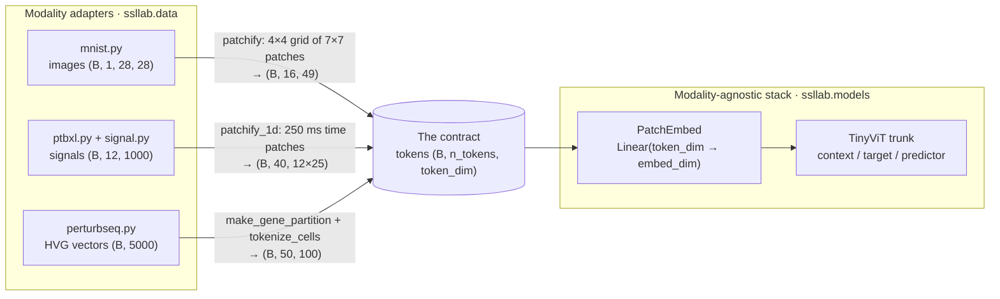
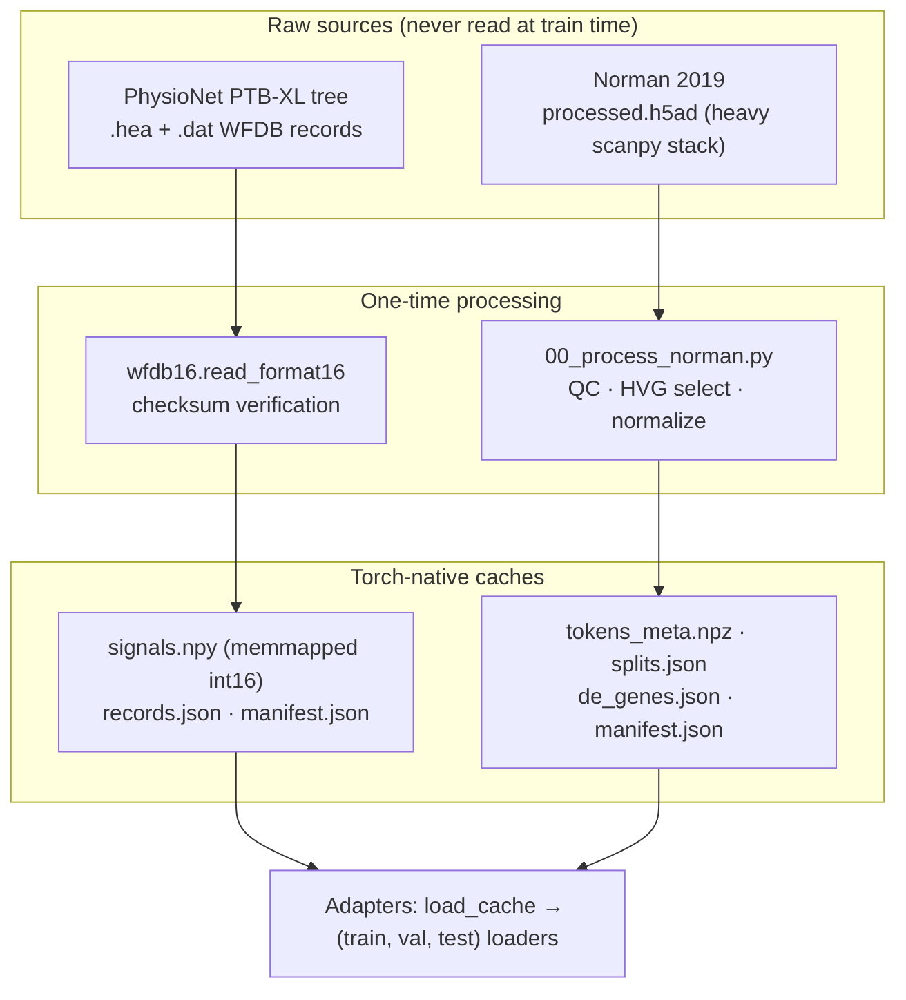

Every deep-learning codebase has a moment where modality-specific assumptions leak into the model: an image reshape buried in a training loop, a lead count hard-coded into an encoder, a gene vocabulary welded to a forward pass. `ssllab` draws a hard line against this with its data adapter layer in `src/ssllab/data/`. The rule is simple and enforced everywhere: **each modality adapter's sole job is to emit token tensors of shape `(B, n_tokens, token_dim)`**, and nothing downstream knows or cares where those tokens came from. This page explains the contract, the three adapters that fulfill it, and the supporting machinery — physical-time geometry, cache discipline, and storage dedup — that keeps the seam clean.

Sources: [__init__.py](/src/ssllab/data/__init__.py#L1-L2), [vit.py](/src/ssllab/models/vit.py#L1-L6)

## The One Contract: `(B, n_tokens, token_dim)`

The entire architecture rests on a single shape agreement, stated in the package docstring and honored by every module. Images, multi-lead signals, and gene-count vectors all collapse into the same three-dimensional token tensor before they ever reach a model. The downstream backbone — `TinyViT` — is explicit about this: *"Everything here operates on token tensors `(B, N, token_dim)` plus integer position indices `(B, N)` — there is nothing image-specific."* Its first layer, `PatchEmbed`, is just a linear projection from `token_dim` to the model dimension, which is why the same trunk serves the context encoder, the EMA target encoder, and the predictor alike.

What changes between modalities is *only* the adapter; what stays fixed is the token geometry that `build_jepa(token_dim=..., n_tokens=...)` consumes. The MNIST docstring states the forward-compatibility promise directly: *"A future modality (gene-count vectors, DNA windows) provides a sibling adapter that emits the same `(B, n_tokens, token_dim)` shape; nothing downstream changes"* — and `perturbseq.py` is the proof, since it trains the same JEPA encoder on cells with no architectural change.

Sources: [vit.py](/src/ssllab/models/vit.py#L1-L18), [mnist.py](/src/ssllab/data/mnist.py#L1-L15), [perturbseq.py](/src/ssllab/data/perturbseq.py#L7-L9), [__init__.py](/src/ssllab/data/__init__.py#L1-L59)

## Three Adapters, One Shape

Each adapter pairs a *tokenizer* (modality → tokens) with a *loader factory* (cache → `DataLoader`s). The differences are confined to how the token axis is partitioned and what covariates ride alongside the tokens in the batch.

| | MNIST (image) | PTB-XL (ECG signal) | Perturb-seq (single-cell) |
|---|---|---|---|
| Native input | `(B, 1, 28, 28)` in [0, 1] | `(B, C, L)`, 10 s × 12 leads, int16 µV | `(B, n_hvg)`, 5 000 HVG features |
| Tokenization | spatial `patchify`, 7×7 patches | temporal `patchify_1d`, 250 ms patches | seeded random `make_gene_partition` |
| Output tokens | `(B, 16, 49)` | `(B, N, C·P)` | `(B, 50, 100)` |
| Layout inside a token | pixels, row-major patch grid | **lead-major** sample windows | gene indices from one permutation |
| Normalization | `ToTensor` scaling | `zscore_per_lead` per record | done upstream (`log1p_cpm`) in the cache |
| Batch type | `(x, y)` tuple | dict: `tokens`, `signal`, `row`, `patient_id`, `labels` | dict: `tokens`, `features`, `counts`, `libsize`, `pert_id`, `is_control`, `ctrl_group`, `row` |
| Extra loader attrs | — | `.meta` (geometry, labels, budgets) | `.meta` + `.control_sampler` |

The batch-shape difference is deliberate, not sloppy. MNIST's classic `(x, y)` tuple suffices because images carry no covariates. The bio adapter's docstring justifies its dict batches: *"perturbation modeling needs the covariates (raw counts for an NB decoder, library size, the perturbation label, the control grouping for baseline pairing), not just an image and a class."* The ECG adapter follows the same dict convention for the same reason — labels, patient identity, and the raw signal (for reconstruction heads) must travel with the tokens.

Sources: [mnist.py](/src/ssllab/data/mnist.py#L16-L97), [signal.py](/src/ssllab/data/signal.py#L101-L116), [perturbseq.py](/src/ssllab/data/perturbseq.py#L38-L41), [ptbxl.py](/src/ssllab/data/ptbxl.py#L501-L565), [perturbseq.py](/src/ssllab/data/perturbseq.py#L23-L25)

## Patching: The Only Modality-Specific Step

**Where the modalities differ, they differ in exactly one place: how a flat token axis is carved out of the raw signal.**

For images, `patchify` reshapes `(B, 1, H, W)` through a permute into `(B, gh·gw, patch·patch)` — 16 patches of 49 pixels each — and validates divisibility loudly rather than rounding (`unpatchify` is the exact inverse for decoder outputs). For signals, `patchify_1d` performs the same reshape along time: `(B, C, L) → (B, N, C·P)`, with the token layout **lead-major** — the first `P` values of a token are lead 0's samples for that window, the next `P` are lead 1's, and so on, a convention the docstring pins down so that inverse transforms and consumers agree.

For cells, there is no spatial or temporal structure to exploit, so `make_gene_partition` invents one: a **deterministic random partition** of the HVG indices into `n_tokens` groups, drawn from a seeded permutation of gene indices. Three implementation details matter. First, it is deterministic in `seed`, so the processing script and training-time loaders agree on the partition — the loader *asserts* equality with the cache's recorded `partition_seed` and raises on mismatch. Second, when `n_hvg` is not divisible by `n_tokens`, the final positions are padded with a `-1` sentinel, which `tokenize_cells` replaces with `pad_value` during the gather. Third, `detokenize_cells` inverts the gather assuming the partition is a permutation, restoring the original `(B, n_hvg)` vector.

Sources: [mnist.py](/src/ssllab/data/mnist.py#L24-L57), [signal.py](/src/ssllab/data/signal.py#L101-L113), [perturbseq.py](/src/ssllab/data/perturbseq.py#L88-L141), [perturbseq.py](/src/ssllab/data/perturbseq.py#L475-L482)

> [!TIP]
> The gene partition is the single knob that silently changes what the model *can* learn: HVG index `j` names the same gene in every cell and split only because selection happens once over all cells, which is what lets the encoder's learned positional table mean anything. Changing `partition_seed` or `n_tokens` without rebuilding the cache is caught at load time — do not bypass that assertion.

## Physical-Time Geometry for Signals

Signal configuration never speaks in samples — it speaks in **Hz and seconds**. `SignalGeometry` is a frozen dataclass holding `fs`, `duration_s`, `patch_s`, and optional `span_s` (masked-span targets for SSL), and every integer quantity is *derived*: `n_samples = fs·duration_s`, `patch_len = fs·patch_s`, `n_tokens = duration_s/patch_s`. The derived values go through `_whole`, which refuses any ratio that is not a whole positive number within a `1e-6` tolerance — *"a ratio that is not a whole number is refused rather than rounded"*. Because geometry is declared in physical time, the same configuration reads correctly at any sampling rate, and `describe()` emits a flat dict for manifests and run reports.

Two supporting pieces complete the signal path. `zscore_per_lead` standardizes each lead of each record over its own time axis, with a flat-lead guard: a disconnected electrode whose standard deviation falls below `eps` maps to zeros instead of dividing by ~0. And `SignalBatcher` is the training fast path — it holds selected recordings as one device-resident `int16` tensor and builds each batch with a single gather, per-lead z-score, and patchify, with no per-item Python work. It deliberately coexists with `DataLoader` rather than replacing it: the batcher is the speed path, the DataLoader remains the general-purpose interface.

Sources: [signal.py](/src/ssllab/data/signal.py#L1-L21), [signal.py](/src/ssllab/data/signal.py#L28-L86), [signal.py](/src/ssllab/data/signal.py#L89-L98), [signal.py](/src/ssllab/data/signal.py#L119-L172)

## Loader Semantics: Splits, Budgets, and Attachments

Both heavy adapters return `(train, val, test)` loaders whose split logic is *deterministic and documented in code*. For PTB-XL, splits follow the dataset's `strat_fold` (1–8 train, 9 val, 10 test), which confines each patient to one fold; label budgets are **patient-level and nested** — one seeded permutation of all training patients, where a budget of `k` percent takes the first `ceil(k/100·n)` patients and *every record* of a chosen patient. Because the permutation does not depend on the task, the same patients carry labels across tasks and methods for a given seed — a property the paired-comparison methodology downstream depends on. For Perturb-seq, the `split` parameter selects between `"combo"` (perturbation-level holdout of unseen 2-gene combinations, the headline generalization test) and `"cells"` (random per-cell sanity split).

Each returned loader carries dynamically attached attributes rather than a wrapper class: `.meta` is a plain dict bundling the geometry, vocabulary, split counts, and cache fingerprint, and the perturb-seq loaders additionally attach `.control_sampler`, a `ControlSampler` over the full cell pool for baseline pairing. This keeps the return type `(DataLoader, DataLoader, DataLoader)` — anything that already consumes loaders needs no new plumbing.

Sources: [ptbxl.py](/src/ssllab/data/ptbxl.py#L24-L35), [ptbxl.py](/src/ssllab/data/ptbxl.py#L137-L146), [ptbxl.py](/src/ssllab/data/ptbxl.py#L530-L560), [perturbseq.py](/src/ssllab/data/perturbseq.py#L441-L545)

## Cache Discipline: Provenance, Fingerprints, Fail-Loudly Checks

The heavy adapters never touch raw files at train time. Instead, a one-time processing step (e.g. `examples/perturbation_response/00_process_norman.py` for the biology, `build_cache_from_raw` for PTB-XL) writes a torch-native cache that the adapter reads. This split is stated as a design goal: keeping anndata/scanpy out of `ssllab.data.perturbseq` means *"pytest and training never import the heavy stack"* — the module is deliberately torch + numpy + json only.

Integrity is enforced at four distinct layers, each catching a different failure mode:

| Mechanism | Layer | What it catches | Where |
|---|---|---|---|
| WFDB first-sample + 16-bit checksum | raw read | truncated downloads, mis-parsed interleave | [wfdb16.py](/src/ssllab/data/wfdb16.py#L86-L115) |
| `artifact_version` check | cache load | caches built by older code silently loading | [ptbxl.py](/src/ssllab/data/ptbxl.py#L238-L248) |
| `cache_fingerprint` (MD5 over cell ordering, labels, splits, libsizes) | downstream stores | embeddings computed on one cache looked up by another's row numbers | [perturbseq.py](/src/ssllab/data/perturbseq.py#L231-L261) |
| Partition-seed + geometry-vs-cache assertions | loader construction | training on a token geometry the cache disagrees with | [perturbseq.py](/src/ssllab/data/perturbseq.py#L472-L482), [ptbxl.py](/src/ssllab/data/ptbxl.py#L523-L529) |

The fingerprint deserves attention: `cache_fingerprint_from_dir` reads only the three arrays it hashes from the npz (about 1 MB rather than the 4.4 GB of expression matrices), so embedding-store producers can verify row alignment cheaply. The manifest system runs in the other direction too — PTB-XL's `build_cache_from_raw` records the source URL, license, zip SHA-256, label rules, and every derived knob, so any result is traceable to its exact data construction. The synthetic-tree writer (`write_toy_raw_tree`) rounds out the design: smoke tests exercise the *real* reader against tiny PTB-XL-shaped fixtures rather than mocks.

Sources: [perturbseq.py](/src/ssllab/data/perturbseq.py#L14-L37), [ptbxl.py](/src/ssllab/data/ptbxl.py#L259-L374), [perturbseq.py](/src/ssllab/data/perturbseq.py#L243-L261), [wfdb16.py](/src/ssllab/data/wfdb16.py#L1-L15), [ptbxl.py](/src/ssllab/data/ptbxl.py#L398-L449)

## Storage: The Data-Lake Layer

Below the adapters sits a purely physical concern: datasets themselves are not tracked in git, and large shared datasets should never be duplicated across projects. `ops/datasets.py` implements **storage dedup by symlink**: keep one project-neutral copy of a large dataset in a "data lake" (located via the `DATA_LAKE_ROOT` env var, with the legacy `SSLLAB_DATA_ROOT` still honored), then link only what a project uses into its local `data/` directory. The lake follows a `<modality>/<sub-topic>/<dataset>` layout (e.g. `scrna/perturb_seq/norman2019`), while the local link defaults to a **flat alias** — the basename — so project code refers to `data/norman2019`, never a deep lake path.

`link_dataset` is idempotent (re-linking refreshes the symlink), refuses to replace a real directory with a link, and links only the named dataset — never the whole tree — so the dependency on shared storage stays explicit and minimal. Local-only data like MNIST needs none of this: torchvision auto-downloads it into `data/` on first use of `get_mnist_dataloaders`.

Sources: [ops/datasets.py](/ops/datasets.py#L1-L49), [ops/datasets.py](/ops/datasets.py#L52-L102), [data/README.md](/data/README.md#L1-L26)

## Adding a New Modality: The Checklist

The MNIST docstring doubles as a template for future adapters, and the existing three give a concrete recipe. A new modality requires exactly one sibling module in `src/ssllab/data/` that:

1. **Tokenizes** the native representation into `(B, n_tokens, token_dim)` — spatially (like `patchify`), temporally (like `patchify_1d` with `SignalGeometry`), or by a deterministic partition (like `make_gene_partition`).
2. **Reads from a torch-native cache** with a manifest recording provenance and every knob, and validates `artifact_version` on load.
3. **Raises on disagreement** — geometry mismatches, seed mismatches, non-whole ratios — instead of silently coercing.
4. **Exports through `ssllab.data.__init__`**, alongside the tokenizer and its inverse, so models consume only what the package surface exposes.

If your modality carries covariates a downstream head needs (counts for an NB decoder, demographic labels), emit dict batches like the two heavy adapters do; if it is a plain `(x, y)` problem, the MNIST tuple form remains valid. Nothing in `ssllab.models` changes either way — that is the contract's entire point.

Sources: [mnist.py](/src/ssllab/data/mnist.py#L7-L15), [signal.py](/src/ssllab/data/signal.py#L75-L86), [__init__.py](/src/ssllab/data/__init__.py#L20-L59)

## Where to Go Next

The adapters sit at the boundary between raw data and everything else in this repository, so the natural continuation depends on which direction you are heading. For how the consuming side works, start with [JEPA Module Internals](6-jepa-module-internals) to see the token tensors enter the encoder, and [Architecture Overview](4-architecture-overview) for the full-module map. To watch the adapters operating end-to-end in a real study, the [Perturbation-Response Pipeline](16-perturbation-response-pipeline) page covers the perturb-seq path (including its one-time processing script), and the [ECG Rhythm Study](17-ecg-rhythm-study) covers the PTB-XL path from cache building through label budgets. Finally, since caches and data lakes are often provisioned on remote machines, [Remote GPU Ops: SkyPilot and RunPod](24-remote-gpu-ops-skypilot-and-runpod) explains the ops layer that stages data where training runs — and [Tutorial Corpus and Reading Paths](25-tutorial-corpus-and-reading-paths) can help you sequence the whole corpus.

Sources: [vit.py](/src/ssllab/models/vit.py#L1-L6), [ptbxl.py](/src/ssllab/data/ptbxl.py#L1-L36), [perturbseq.py](/src/ssllab/data/perturbseq.py#L1-L37)

> [!TIP]
> When debugging a shape error deep in the model stack, trace it back to the adapter boundary first: `dl.meta["token_dim"]` (PTB-XL) or `dl.meta["n_tokens"]` (Perturb-seq) tells you the geometry the loader negotiated with the cache, which is almost always where an inconsistency originates — not in the transformer.