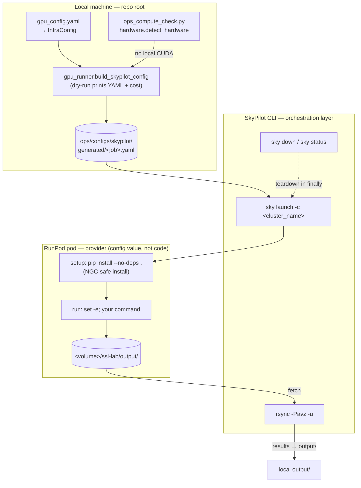
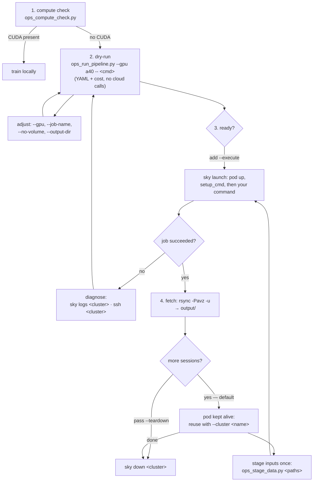
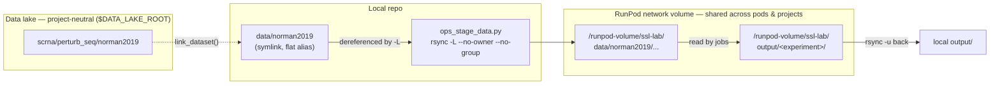

Every serious model in ssl-lab eventually outgrows the machine you are sitting at, so the repository ships a small, self-contained remote-training infrastructure at the repo root: the `ops/` package, orchestrated by SkyPilot against RunPod as the cloud provider. This page explains the architecture, walks through the provision → run → fetch workflow, and documents the configuration surface, the safety rails, and the data-staging model. It covers the `ops/` package, the four driver scripts in `examples/ops/`, and the pod entrypoint shell scripts used by the applied studies.

Sources: [README.md](ops/README.md#L1-L14), [README.md](README.md#L148-L160)

## A Deliberately Decoupled Package

The first architectural decision to understand is what `ops` is *not*. It is deliberately decoupled from the SSL library: nothing in `ops/` imports JEPA, and `ssllab` never imports `ops`. Cloud provisioning is treated as scaffolding for practically useful models — necessary to train them, but not part of self-supervised learning itself. This is why `ops/` sits as a top-level package next to `src/` rather than inside `src/ssllab/`, and why it is never installed: Python finds it because the repository root is on the import path (each driver inserts the repo root into `sys.path` itself, and `pyproject.toml` sets `pythonpath = ["."]` for pytest).

Sources: [README.md](ops/README.md#L1-L11), [ops_run_pipeline.py](examples/ops/ops_run_pipeline.py#L36-L40), [pyproject.toml](pyproject.toml#L33-L39)

Dependency footprint is split across two optional extras. The `ops` extra pulls in only PyYAML — enough for the compute check and for dry runs, which make zero cloud calls. The `remote` extra adds `skypilot[runpod]>=0.7`, required only when you actually launch pods. This split is load-bearing for the design: every read-only code path (config assembly, YAML generation, cost estimation) works without SkyPilot installed at all, because `gpu_runner.py` imports `sky` lazily inside the `launch` function rather than at module top level.

Sources: [pyproject.toml](pyproject.toml#L25-L27), [README.md](ops/README.md#L16-L22), [gpu_runner.py](ops/gpu_runner.py#L1-L9), [gpu_runner.py](ops/gpu_runner.py#L259-L272)

## Architecture: SkyPilot Orchestrates, RunPod Provides

The second decision is the layering between orchestration and provider. `ops` never calls the RunPod API. It emits provider-neutral SkyPilot task configs in which the provider appears only as the value `cloud: runpod` — a config line, not a hard-coded client. Switching providers is therefore a one-line config change, and every artifact `ops` produces (the generated YAML in `ops/configs/skypilot/generated/`) is inspectable and versionable before any money is spent.

To read the diagram below: the local machine assembles an `InfraConfig` from `gpu_config.yaml`, builds a SkyPilot task dict, writes it as YAML, and hands it to the `sky` CLI. SkyPilot translates the config into a RunPod pod running an NGC PyTorch container, runs the setup and run scripts, and `ops` then rsyncs results back — with teardown handled in a `finally` block so no code path can leave a pod billing unnoticed.

Sources: [gpu_runner.py](ops/gpu_runner.py#L1-L9), [README.md](ops/README.md#L13-L14), [gpu_config.yaml](ops/configs/gpu_config.yaml#L1-L5), [gpu_runner.py](ops/gpu_runner.py#L335-L346)

The module interaction is intentionally lean — three small modules plus thin drivers. `hardware.py` answers "what am I on?", `gpu_runner.py` owns the config-to-launch spine, and `datasets.py` handles storage dedup locally. There is no per-model pip registry or task-specific feasibility logic in the infra layer; those belong to individual experiments.

Sources: [gpu_runner.py](ops/gpu_runner.py#L10-L12), [hardware.py](ops/hardware.py#L1-L7), [datasets.py](datasets.py#L1-L10)

## Step 0 — The Compute Check

The workflow begins with a pre-flight question: what hardware am I on, and do I need to pay for a pod? `ops_compute_check.py` runs `hardware.detect_hardware`, which probes PyTorch (if importable) to classify the backend as `cuda`, `mps`, or `cpu`, and reports GPU name, VRAM, CPU count, system RAM, and free disk. It is dependency-light by design and carries no task-specific feasibility estimators — deciding whether a *specific* experiment fits is the experiment's job, not the infra's.

Sources: [hardware.py](ops/hardware.py#L1-L7), [ops_compute_check.py](examples/ops/ops_compute_check.py#L1-L12), [hardware.py](ops/hardware.py#L28-L41)

The report ends in a plain-language verdict. A CUDA machine is told it can train locally; anything else is told smoke tests are fine but real training needs a pod, with the exact provisioning command printed. The `--json` flag emits the same report machine-readably, which is how scripts can branch on hardware without parsing formatted text.

Sources: [hardware.py](ops/hardware.py#L79-L101), [ops_compute_check.py](examples/ops/ops_compute_check.py#L38-L45)

## Configuration as Data: InfraConfig and the GPU Catalog

All defaults live in one YAML file, `ops/configs/gpu_config.yaml`, loaded into the `InfraConfig` dataclass. Two fields define project identity: `project` (the folder this project owns on a shared pod volume) and `job_prefix` (the start of every derived job name). Config values can reference the project's volume folder via the `{project_dir}` placeholder, which `InfraConfig.from_yaml` substitutes on load — so porting `ops` to another project means editing two lines, and every downstream path (pip cache, output directory, staged data) follows automatically.

Sources: [gpu_config.yaml](ops/configs/gpu_config.yaml#L7-L13), [gpu_runner.py](ops/gpu_runner.py#L78-L96), [gpu_runner.py](ops/gpu_runner.py#L114-L117)

The GPU catalog, `GPU_SPECS`, maps short CLI names to SkyPilot accelerator strings, VRAM, and indicative hourly rates. These rates are RunPod community-cloud ballparks intended for cost *estimates* only; the code comments and the README both instruct you to verify against live pricing before relying on them. Unknown GPU names are rejected by `apply_overrides` with a helpful choices list, enforced by tests.

| CLI key | SkyPilot accelerator | VRAM | Indicative $/hr |
|---|---|---|---|
| `l4` | `L4:1` | 24 GB | 0.43 |
| `rtx4090` | `RTX4090:1` | 24 GB | 0.69 |
| `rtx5090` | `RTX5090:1` | 32 GB | 0.89 |
| `a40` (default) | `A40:1` | 48 GB | 0.63 |
| `a100` | `A100:1` | 80 GB | 1.19 |
| `h100` | `H100:1` | 80 GB | 2.49 |

Sources: [gpu_runner.py](ops/gpu_runner.py#L22-L45), [gpu_runner.py](ops/gpu_runner.py#L120-L128), [test_config.py](ops/tests/test_config.py#L21-L27)

The remaining config fields describe how the project installs itself on the pod and where data and results flow:

| Field | Default | Meaning |
|---|---|---|
| `cloud` | `runpod` | Provider string passed to SkyPilot; swapping providers is a config edit |
| `docker_image` | `nvcr.io/nvidia/pytorch:25.02-py3` | NGC PyTorch container with optimized CUDA torch |
| `use_volume` / `volume_name` / `volume_mount` | `true` / `"AI lab extension"` / `/runpod-volume` | RunPod network volume; the pod auto-places in the volume's datacenter |
| `workdir` | `.` | Repo root uploaded to the pod |
| `data_path` | `data` | Local input dir; where `link_dataset` symlinks land and staging uploads from |
| `setup_cmd` | `pip install --no-deps .` + light deps | Runs once before the job (see the NGC note below) |
| `output_remote` | `{project_dir}/output` | Where the job writes on the pod — persistent across pod lifecycles |
| `output_local` | `output` | Where rsync fetches results locally |

Sources: [gpu_config.yaml](ops/configs/gpu_config.yaml#L12-L39), [gpu_config.yaml](ops/configs/gpu_config.yaml#L56-L62)

One detail of `setup_cmd` is worth its own explanation because it encodes two hard-won lessons. First, NGC images ship an optimized torch/torchvision; a plain `pip install -e .` would resolve `torch>=2.1` from PyPI and silently overwrite the CUDA builds — hence `pip install --no-deps .` plus only the small non-torch runtime deps. Second, the NGC image's setuptools produces a broken `src`-layout *editable* finder that fails to expose subpackages, so the install must be non-editable (`.`, not `-e .`) so the full tree is copied.

Sources: [gpu_config.yaml](ops/configs/gpu_config.yaml#L40-L54), [test_config.py](ops/tests/test_config.py#L57-L58)

## The Job Pipeline: Build → Dry-Run → Launch → Fetch

`build_skypilot_config` assembles the SkyPilot task dict: job name, workdir, resources (accelerator, cloud, docker image), the `setup` block, and a `run` block that wraps your command in `set -e` so a failing job cannot be masked by trailing echoes, then appends the result-fetch hint. When `use_volume` is set, the config gains a `volumes` key mapping the mount point to the named volume. Every generated task is written to `ops/configs/skypilot/generated/<job>.yaml`, with multi-line scripts rendered as readable YAML literal blocks.

Sources: [gpu_runner.py](ops/gpu_runner.py#L176-L206), [gpu_runner.py](ops/gpu_runner.py#L53-L70)

Job names are derived deterministically from the command: the first `.py` argument's stem, with a leading numeric milestone prefix (`01_`, `02_`, …) stripped, joined to the `job_prefix` — so `python examples/jepa_basics/01_train_jepa_mnist.py` becomes `ssl-train-jepa-mnist`. This determinism is what makes pod reuse possible: the cluster name doubles as the rsync host and teardown target.

Sources: [gpu_runner.py](ops/gpu_runner.py#L168-L181), [test_config.py](ops/tests/test_config.py#L32-L34), [gpu_runner.py](ops/gpu_runner.py#L293-L307)

The dry-run path is the safety valve: `print_dry_run` writes the YAML, prints the full task, and prints the GPU, cloud, and cost estimate — with no cloud calls and no SkyPilot requirement. It also prints the exact command that would launch for real, so the dry run doubles as documentation of the next action.

Sources: [gpu_runner.py](ops/gpu_runner.py#L221-L251)

The live `launch` function wraps the whole lifecycle and embeds three deliberate safety mechanisms. The cluster gets a deterministic name (`-c <job_name>`) so the rsync host and teardown target are unambiguous rather than guessed from SkyPilot's auto-generated names. On failure, the code asks `sky status` whether the pod actually came up before deciding what to report — a live pod is surfaced for inspection (`sky logs`, `ssh`) and torn down, while a never-provisioned cluster is explicitly reported as "nothing to tear down," so failures never read like successes.

> [!TIP]
> The results fetch is `rsync -Pavz -u` — the `-u` (update) flag is load-bearing, not a nicety. It skips files newer on the receiver, so a stale pod (an out-of-date cache on the volume) can never overwrite correct local results with wrong ones. The code comment notes this failure mode has actually happened, and records the reasoning: a result that changes when you re-run the same command is the hardest kind of bug to notice, so the fetch must never be able to move a result backwards.

Sources: [gpu_runner.py](ops/gpu_runner.py#L287-L322), [gpu_runner.py](ops/gpu_runner.py#L323-L334)

Finally, teardown runs in a `try/finally`: a failed job or failed rsync still triggers `sky down` unless you passed teardown-off, so no error path leaves a pod billing silently. When the pod is intentionally kept alive, the code prints the SSH entry point and the exact teardown command for later.

Sources: [gpu_runner.py](ops/gpu_runner.py#L335-L346)

The complete workflow as a how-to flowchart:

Sources: [README.md](ops/README.md#L24-L53), [ops_run_pipeline.py](examples/ops/ops_run_pipeline.py#L73-L96)

## The Four Driver CLIs

The `examples/ops/` directory holds thin drivers — each puts the repo root on the import path itself, so `ops` needs no installation, only its dependencies. Note the deliberate **asymmetric defaults**: `ops_run_pipeline.py` is dry-run by default (`--execute` to launch) because its unit of work is one job and mistakes are cheap to prevent; `ops_provision_cluster.py` provisions for real by default (`--dry-run` to preview) because its whole purpose is bringing up a pod.

| Script | Purpose | Default behavior | Escape hatch |
|---|---|---|---|
| `ops_compute_check.py` | Detect backend, VRAM, RAM, disk; decide local vs pod | Human report | `--json` |
| `ops_run_pipeline.py` | One job: build config, launch, fetch results | **Dry-run**; pod kept alive after run | `--execute` to launch; `--teardown` to release |
| `ops_provision_cluster.py` | Long-running pod for interactive/iterative work | **Provisions for real** (A40) | `--dry-run`; `--status`, `--down NAME`, `--down-all` |
| `ops_stage_data.py` | rsync datasets/checkpoints onto a running pod's volume | Transfers for real | `--dry-run` previews; auto-detects the single UP cluster |

Sources: [README.md](examples/ops/README.md#L1-L29), [ops_run_pipeline.py](examples/ops/ops_run_pipeline.py#L44-L68), [ops_provision_cluster.py](examples/ops/ops_provision_cluster.py#L1-L28)

The `--` convention in `ops_run_pipeline.py` is worth noting: everything after the first literal `--` is joined into the pod command string, keeping runner flags and job flags cleanly separated. CLI overrides merge onto the YAML config via `apply_overrides`, and only non-`None` values are applied, so unspecified flags inherit file defaults rather than clobbering them.

Sources: [ops_run_pipeline.py](examples/ops/ops_run_pipeline.py#L44-L51), [gpu_runner.py](ops/gpu_runner.py#L120-L128)

## Long-Lived Pods, Shared Volumes, and Data Staging

For iterative work, `ops_provision_cluster.py` builds a *keepalive* task — a SkyPilot task whose run block is just an echo — provisioned under a fixed name like `ssl-workspace`. You then point subsequent jobs at it with `ops_run_pipeline.py --execute --cluster ssl-workspace --no-teardown -- <cmd>`, avoiding re-provisioning costs for every session. Management actions (`--status`, `--down`, `--down-all`) map directly onto `sky status`, `sky down`, and `sky down --all`.

Sources: [gpu_runner.py](ops/gpu_runner.py#L354-L382), [ops_provision_cluster.py](examples/ops/ops_provision_cluster.py#L44-L56)

Storage follows a two-tier model that mirrors the codebase's separation of project-local and project-neutral data. Locally, small project data (like MNIST) lives as real files in `data/`, while large shared datasets live once in a project-neutral **data lake** (the directory named by `$DATA_LAKE_ROOT`; the legacy `$SSLLAB_DATA_ROOT` is still honored). `ops.datasets.link_dataset` symlinks just the datasets you actually reuse into `data/` — a nested lake path like `scrna/perturb_seq/norman2019` produces a *flat* local alias `data/norman2019`, so project code refers to datasets by short names while the dependency on the lake stays explicit and per-dataset.

Sources: [datasets.py](ops/datasets.py#L1-L32), [datasets.py](ops/datasets.py#L58-L102), [README.md](ops/README.md#L55-L66), [ops_stage_data.py](examples/ops/ops_stage_data.py#L1-L33)

On the pod side, `ops_stage_data.py` uploads local paths to the network volume under the project namespace, mirroring the repo-relative layout (`/runpod-volume/ssl-lab/<path>`). Two rsync flags encode RunPod-specific constraints: `-L` dereferences symlinks, so a lake-linked dataset copies real files rather than a dangling symlink; and `--no-owner --no-group` because RunPod volumes disallow `chown`. Path resolution deliberately does *not* follow symlinks when computing the destination, so `data/norman2019/foundation` stages to `data/norman2019/foundation` on the volume rather than losing the alias.

> [!TIP]
> The `.skyignore` file anchors its data/output exclusions with a leading slash (`/data`, `/output`, `/runs`). A bare `data` pattern is gitignore-style and matches at *any* depth — and did in fact exclude `src/ssllab/data` from the pod upload, breaking `import ssllab.data` at runtime. When an upload filter and a package layout share a namespace, anchor the patterns.

Sources: [ops_stage_data.py](examples/ops/ops_stage_data.py#L83-L118), [.skyignore](.skyignore#L1-L20)

The staged model is: provision a pod once, stage inputs once (they persist on the volume across pod lifecycles), then launch training jobs that read from absolute volume paths. This is also why results are written to `output_remote` under `{project_dir}` — checkpoints survive pod teardowns, and sibling projects sharing the "AI lab extension" volume never collide because each owns `<volume_mount>/<project>/`.

Sources: [ops_stage_data.py](examples/ops/ops_stage_data.py#L11-L16), [gpu_config.yaml](ops/configs/gpu_config.yaml#L19-L25), [gpu_config.yaml](ops/configs/gpu_config.yaml#L56-L62)

## Pod Entrypoint Scripts and What the Tests Pin Down

The applied studies add a final layer: `run_*_pod.sh` entrypoints that orchestrate multi-stage pipelines *inside* a pod session. A representative example chains Stage A (encoder) → probe → Stage C (count decoder) → Stage B (conditional flow) → effect-size eval, with a `stage` function that logs per-stage banners and records status — a failed downstream stage must not discard artifacts already written to the volume. These scripts also guard the NGC environment: if the processed data cache is already staged on the volume, they never install processing-time packages (like `pertpy`) that would pollute the numpy/scipy/sklearn stack.

Sources: [run_full_pipeline_pod.sh](examples/perturbation_response/run_full_pipeline_pod.sh#L1-L17), [run_full_pipeline_pod.sh](examples/perturbation_response/run_full_pipeline_pod.sh#L42-L58)

Everything the infra guarantees without touching a cloud is pinned by unit tests in `ops/tests/test_config.py`: the config round-trip, GPU validation, milestone-prefix stripping in job names, `{project_dir}` substitution into `setup_cmd` and `output_remote`, the one-field port to a hypothetical `side-proj`, the exact YAML shape (NGC-safe install string, `set -e` first, volume key present only when enabled), and that dry runs write their generated YAML. `pyproject.toml` includes `ops/tests` in the default test paths, so these guarantees run alongside the science tests.

Sources: [test_config.py](ops/tests/test_config.py#L1-L95), [pyproject.toml](pyproject.toml#L33-L39)

A practical troubleshooting map, drawn from the documented failure modes:

| Symptom | Likely cause | Documented remedy |
|---|---|---|
| `import ssllab.data` fails on the pod | Unanchored `.skyignore` pattern excluded `src/ssllab/data` from upload | Keep `/data`-style anchored patterns; see `.skyignore` header |
| Torch replaced by a CPU build on the pod | Editable `pip install -e .` resolved PyPI torch over NGC's CUDA build | `setup_cmd` uses `pip install --no-deps .` + light deps |
| Subpackages missing after install on pod | NGC setuptools breaks `src`-layout editable finders | Non-editable install (`.`, not `-e .`) |
| Local results changed after re-running a job | Fetch without `-u` let a stale pod overwrite newer results | `rsync -Pavz -u` is hard-coded in `launch` |
| `sky launch` failed but you're unsure if the pod exists | `sky launch` also fails when the *job* fails on a live pod | `launch` asks `sky status`; inspects via `sky logs` / `ssh` |
| "Multiple clusters are up" during staging | Several pods running simultaneously | Pass `--cluster <name>` explicitly |

Sources: [.skyignore](.skyignore#L1-L20), [gpu_config.yaml](ops/configs/gpu_config.yaml#L40-L54), [gpu_runner.py](ops/gpu_runner.py#L309-L334), [ops_stage_data.py](examples/ops/ops_stage_data.py#L150-L164)

## Porting ops to Another Project

Because `ops` names a project only through config, reuse is mechanical: copy the `ops/` folder (and `examples/ops/` if you want the drivers) into another repository root, then edit two lines at the top of `gpu_config.yaml` — `project` and `job_prefix` — and check `setup_cmd` for how that project installs itself. Nothing else in `ops` names a project; the data lake remains shared, since `$DATA_LAKE_ROOT` is deliberately not named after any single project.

Sources: [README.md](ops/README.md#L70-L94), [datasets.py](ops/datasets.py#L36-L55), [gpu_runner.py](ops/gpu_runner.py#L78-L96)

## Where to Go Next

If you arrived here from the applied studies, the natural loop is: check compute, dry-run the study's pod entrypoint script, execute, and let results land in `output/` alongside the experiment's ledger — the reporting conventions are covered in [Results Ledger and Pre-Registration](22-results-ledger-and-pre-registration), and the pipelines these scripts drive are detailed in [Perturbation-Response Pipeline](16-perturbation-response-pipeline) and [ECG Rhythm Study](17-ecg-rhythm-study). For the data these jobs consume, [Modality-Agnostic Data Adapters](23-modality-agnostic-data-adapters) explains how modality-specific inputs become the token tensors the pod-side scripts read. To place `ops` in the repository's overall conventions, start from [Repository Layout and Conventions](3-repository-layout-and-conventions) and [Quick Start](2-quick-start); for a guided map of the whole corpus, continue to [Tutorial Corpus and Reading Paths](25-tutorial-corpus-and-reading-paths).
