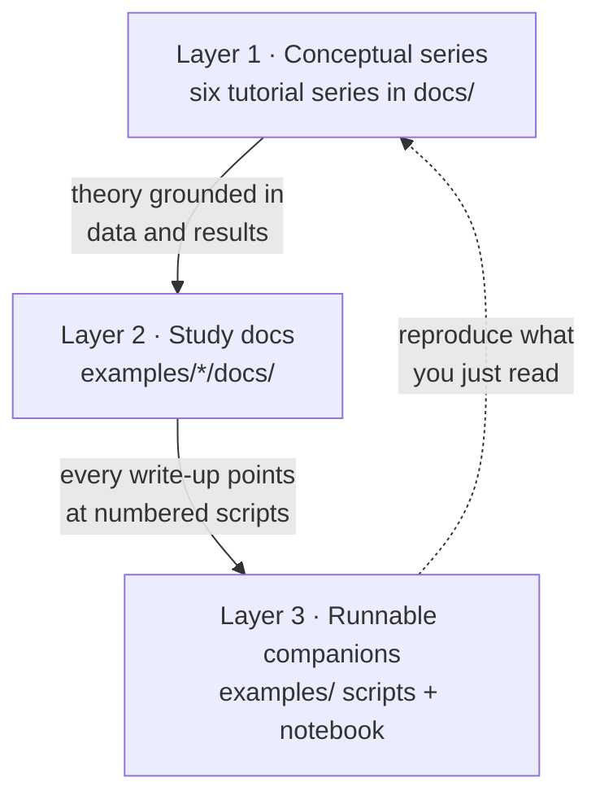
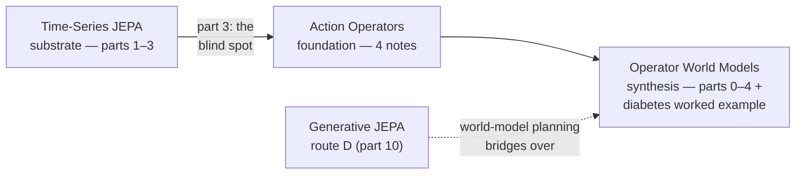
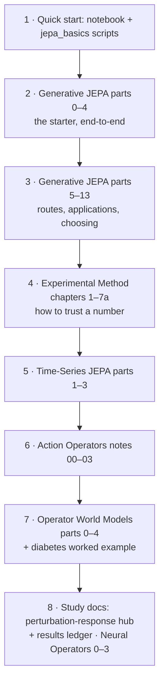

The `docs/` folder of ssl-lab is more than a collection of pages — it is a **curriculum**: six long-form tutorial series, each written as a numbered story with a declared reading order, plus a second tier of study documentation living next to the code it describes. This page is the map. It explains how the corpus is organized, what each series covers, and which paths through the material the authors themselves recommend — so that a beginner never has to guess what to read next.

Sources: [mkdocs.yml](mkdocs.yml#L70-L118), [docs/index.md](docs/index.md#L1-L5)

## What the tutorial corpus is

The documentation site is built from the `docs/` directory (`docs_dir: docs` in the MkDocs configuration) and rendered with Material for MkDocs, full LaTeX math via MathJax, and Mermaid diagram support. A **series** is a topic folder under `docs/` containing numbered Markdown chapters (`00-...`, `01-...`, ...) plus two recurring artifacts: an `index.md` that states the series' reading order, and a `notation.md` that defines every symbol used. Chapters are cross-linked by relative paths, so the series read as one continuous document rather than isolated pages.

Sources: [mkdocs.yml](mkdocs.yml#L10-L12), [mkdocs.yml](mkdocs.yml#L41-L68)

## The corpus in three layers

Tutorial material exists at three distances from the code. The first layer is the **conceptual series** under `docs/` — theory-first, rendered on the documentation site. The second layer is the **study documentation** under `examples/*/docs/` — method, data, and results written next to the pipeline scripts they describe. The third layer is the **runnable companions**: the numbered driver scripts in `examples/` and a single intuition notebook that the tutorials repeatedly point at.

| Layer | Location | Character | Example |
|---|---|---|---|
| 1 · Conceptual series | `docs/` | theory-first tutorials with math, reading-order tables, notation references | Generative JEPA (24 nav entries) |
| 2 · Study docs | `examples/*/docs/` | data primers, method write-ups, results ledgers, runbooks | perturbation-response hub (4 series + ledger) |
| 3 · Runnable companions | `examples/`, `notebooks/` | numbered scripts and one notebook that enact what the tutorials describe | `notebooks/jepa_basics/01_jepa_intuition.ipynb` |

To read the diagram below: Layer 1 states the ideas, Layer 2 grounds those ideas in real datasets and measured results, and Layer 3 lets you reproduce everything. Arrows show how each layer consumes the one above it.

Sources: [docs/index.md](docs/index.md#L30-L35), [examples/perturbation_response/docs/index.md](examples/perturbation_response/docs/index.md#L1-L13), [notebooks/jepa_basics/01_jepa_intuition.ipynb](notebooks/jepa_basics/01_jepa_intuition.ipynb#L7-L20)

## The six series at a glance

Two series serve the lab's **generative** research direction, three serve the **action-operator** direction, one serves the methodology that disciplines both, and one is a self-contained primer on a neighboring tool. The table below is the inventory you will navigate by.

| Series | Direction | Role | Size | Entry point |
|---|---|---|---|---|
| **Generative JEPA** | 1 — generative | the main generative tutorial: a starter build plus a design-space survey | Parts 0–13 + six companions + appendix + Q&A | `docs/generative_jepa/index.md` |
| **Time-Series JEPA** | 2 — operators | "the gentlest entry point in this corpus"; the substrate the operator line stands on | 3 parts + notation | `docs/time_series_jepa/index.md` |
| **Action Operators** | 2 — operators | the foundation: what an action operator is, why JEPA needs one, a gallery | 4 notes + notation | `docs/action_operator/00-from-actions-to-operators.md` |
| **Operator World Models** | 2 — operators | the synthesis: conditioning prediction on actions, two application poles, a worked example | Parts 0–4 + worked example + notation | `docs/operator_world_models/index.md` |
| **Experimental Method** | methodology | how to measure, compare, and trust a number — 7 chapters drawn from a real project | 7 chapters + companion | `docs/experimental-method/index.md` |
| **Neural Operators** | tools | functions-to-functions learning (DeepONet, FNO), bridging toward the operator line | Parts 0–3 written, 4–5 planned | `docs/neural_operators/index.md` |

Sources: [docs/generative_jepa/index.md](docs/generative_jepa/index.md#L39-L74), [docs/time_series_jepa/index.md](docs/time_series_jepa/index.md#L7-L18), [docs/operator_world_models/index.md](docs/operator_world_models/index.md#L39-L52), [docs/experimental-method/index.md](docs/experimental-method/index.md#L15-L24), [docs/neural_operators/index.md](docs/neural_operators/index.md#L49-L66)

## Series anatomy: the shared shape

Every series follows the same skeleton, which makes navigation predictable once you have seen it once. The `index.md` opens with a one-line thesis, then a **"Reading order"** table that names each part, its topic, and what you get from it. Prerequisites are declared up front in a blockquote — for example, the Operator World Models index opens with "Read the foundations first" and names exactly which two series to complete beforehand. Long parts sprout **companion sub-chapters** (lettered `6a`, `7a`–`7c`, `9a`–`9b`) that slow down on one hard piece of the parent chapter, and each series closes with a notation reference you can consult whenever a symbol becomes unfamiliar.

> [!TIP]
> The rendered site's navigation trails the corpus slightly: the Action Operators chapter `03-the-algebra-of-composition.md` and the two series `experimental-method/` and `neural_operators/` exist in the docs tree but are absent from the `nav:` list in `mkdocs.yml`. They are still built and reachable — via the "Read next" links on the site home and via cross-links inside the chapters — so treat chapter-level links, not just the sidebar, as the discovery mechanism.

Sources: [docs/generative_jepa/index.md](docs/generative_jepa/index.md#L39-L74), [docs/operator_world_models/index.md](docs/operator_world_models/index.md#L7-L7), [docs/action_operator/03-the-algebra-of-composition.md](docs/action_operator/03-the-algebra-of-composition.md#L1-L6), [mkdocs.yml](mkdocs.yml#L70-L118)

## Reading path one — the generative track

The Generative JEPA series explicitly splits into **two halves**, and the index says how to travel them. **Parts 0–4** build one complete generative model end-to-end — encoder, flow-matching prior, decoder, sampling + evaluation — as the worked example everything else opens from. **Parts 5–13** are the **design-space survey**: the two gaps every generative JEPA must close, four routes for closing them (A: latent decoder head, B: variational, C: conditioned diffusion, D: world-model planning), the conditional flow prior that synthesizes the best of them, two application chapters, and a closing discussion that finally picks a winner. Six companion notes (6a, 7a–7c, 9a–9b) unpack the hardest steps, and an appendix on data modalities welcomes readers without a biology background.

The index even calibrates your entry: *new to generative modeling or JEPA?* start at Part 0; *already comfortable with latent-variable models?* jump to Part 1; *already know the starter?* go straight to the survey. The series' own chapters point at the runnable scripts `01`–`06` in `examples/generative_jepa/`, so theory and the vertical slice advance together.

Sources: [docs/generative_jepa/index.md](docs/generative_jepa/index.md#L39-L83), [docs/generative_jepa/13-choosing-a-route.md](docs/generative_jepa/13-choosing-a-route.md#L1-L7)

In this handbook, that track corresponds to the deep-dive pages on the generative stack: [Flow-Matching Prior](9-flow-matching-prior), [Conditional Flow and Classifier-Free Guidance](10-conditional-flow-and-classifier-free-guidance), [Latent Transport and Optimal-Transport Coupling](11-latent-transport-and-optimal-transport-coupling), and [Count Decoders and CVAE Baseline](12-count-decoders-and-cvae-baseline).

Sources: [docs/generative_jepa/index.md](docs/generative_jepa/index.md#L53-L73)

## Reading path two — the operator track

The operator direction has a **prescribed three-step order**, stated on the repository README and enforced by prerequisites inside the series themselves: the **Time-Series JEPA** series is the *substrate*, the **Action Operators** notes are the *foundation*, and the **Operator World Models** series is the *synthesis*. The hinge between them is deliberately engineered: Time-Series JEPA is fully self-contained ("you do **not** need any of the action-operator or 'world model' material to follow it"), but its final part exposes **the one blind spot pure prediction cannot fix** — a temporal model can say *when* the state changed but never *what acted* — and that gap is exactly the door into the rest of the corpus.

To read the diagram: solid arrows are the required order for Direction 2; the dashed edge shows how the generative track's Part 10 (Route D) converges on the same synthesis from the other side.

The Operator World Models index restates the prerequisite ("read the Time-Series JEPA series and the Action Operators foundation first") and then adds its own arc in three moves — *JEPA watches, JEPA as a world model, JEPA you can act on* — anchored by two application domains on opposite ends of one dial: **digital phenotyping** (operator structure learned) and **protein ML** (operator structure given by SE(3) physics). Its worked example threads the entire series through one person's diabetes data and is meant to be read *alongside* the parts.

Sources: [README.md](README.md#L52-L61), [docs/time_series_jepa/index.md](docs/time_series_jepa/index.md#L7-L45), [docs/operator_world_models/index.md](docs/operator_world_models/index.md#L7-L56)

In this handbook, the matching deep dives are [Generator Bases and Lie-Group Operators](13-generator-bases-and-lie-group-operators), [Operator Algebra and Epistasis Tests](14-operator-algebra-and-epistasis-tests), and the [Operator World Models Series](15-operator-world-models-series).

## Reading path three — methodology and study documentation

The **Experimental Method** series — "Running an experiment you can trust" — is the corpus's methodology spine, linked directly from the site home under "How we run experiments." Its seven chapters (plus a companion on probes as deliberately weak instruments) walk one real project *including its failures*: what a metric is actually computed on, the scoring seam, seed noise versus metric noise, ablations versus controls, the paired bootstrap with max-$t$ simultaneous intervals, a catalogue of failure modes, and the ceiling analysis that asks whether a stage *can* matter before you improve it. The worked example is the lab's own perturbation-response project, chosen precisely because its losses force the question "is this real, or did I measure it wrong?"

That project's full documentation lives one layer down, in `examples/perturbation_response/docs/`, organized as **four series** — *Reading Perturb-seq* (the data primer), *the conditional-flow + JEPA method* (the build and its evaluation), *Action operators: a development* (the operator framework built up carefully for this dataset), and *a foundation model as the encoder* (Geneformer substitution) — plus a **results ledger** with one page per pre-registered round, a pipeline runbook, and a workflows map that sorts the eighteen numbered scripts into five kinds of work (Build, Score, Diagnose, Decide, Vary). The hub's "How they relate" paragraph is a model of corpus self-awareness: the design-space survey decided *what* to build and *why*; Reading Perturb-seq grounds it in the dataset; the method series builds and measures it; the operator series develops the alternative mechanism.

Sources: [docs/experimental-method/index.md](docs/experimental-method/index.md#L1-L30), [examples/perturbation_response/docs/index.md](examples/perturbation_response/docs/index.md#L10-L37), [docs/index.md](docs/index.md#L26-L28)

The deep-dive counterparts are [Perturbation-Response Pipeline](16-perturbation-response-pipeline), [Evaluation Toolkit: Probes and Metrics](19-evaluation-toolkit-probes-and-metrics), [Paired Bootstrap and Simultaneous Inference](20-paired-bootstrap-and-simultaneous-inference), [Experimental Methodology Series](21-experimental-methodology-series), and [Results Ledger and Pre-Registration](22-results-ledger-and-pre-registration).

## Reading path four — neural operators, the newest strand

The **Neural Operators** series is a self-contained on-ramp to a neighboring model family: networks that map **functions to functions** rather than vectors to vectors, which matters the moment your data is a *field* — a spatiotemporal response sweeping across a tissue rather than a single cell's vector. It is explicitly a **top-down tutorial**: intuition first (what the method is, what it consumes and produces, where it breaks), then the two landmark architectures — DeepONet and the Fourier Neural Operator — then applications, with the two application chapters marked *planned*. Its prerequisites are the mildest in the corpus: comfort with the idea of a function and a neural network; everything heavier is built up just-in-time.

The series also positions itself relative to the operator track at a precise point: Operator World Models is about operators on a **finite-dimensional latent state** (a learned matrix $A_\theta = \exp(M_\theta)$), while neural operators act on **whole function spaces** — and the motivating application, a tissue foundry that predicts spatiotemporal response fields under intervention, is where the two are meant to meet.

Sources: [docs/neural_operators/index.md](docs/neural_operators/index.md#L9-L46), [docs/neural_operators/index.md](docs/neural_operators/index.md#L49-L66)

## Choosing your entry point

The corpus is designed so that every profile of reader has a designated first page. The table below assembles the entry calibrations the series themselves state, translated into handbook order.

| You are… | Start here | Then |
|---|---|---|
| Brand new to SSL and JEPA | [Quick Start](2-quick-start), the notebook + `jepa_basics` scripts, then Generative JEPA **Part 0** | the full starter, Parts 1–4 |
| Familiar with latent-variable generative models | Generative JEPA **Part 1** | the survey, Parts 5–13 |
| Curious about the "active prediction" idea | **Time-Series JEPA** (needs only passing SSL familiarity) | Action Operators → Operator World Models |
| Focused on trustworthy evaluation | Experimental Method **Chapter 1** | [Paired Bootstrap and Simultaneous Inference](20-paired-bootstrap-and-simultaneous-inference) |
| From a biology background, new to the ML | the data-modalities primer (Generative JEPA appendix) or *Reading Perturb-seq* | back into the method chapters |
| Interested in fields and PDEs | Neural Operators **Part 0** | DeepONet and FNO chapters |

> [!TIP]
> Whatever path you take, keep each series' `notation.md` open in a second tab. Every series maintains its own symbol glossary and points to it with the same sentence — "New to the symbols? The notation reference defines every one" — so an unfamiliar symbol never has to stop your reading.

Sources: [docs/generative_jepa/index.md](docs/generative_jepa/index.md#L80-L83), [docs/time_series_jepa/index.md](docs/time_series_jepa/index.md#L7-L27), [docs/neural_operators/index.md](docs/neural_operators/index.md#L62-L66), [docs/generative_jepa/index.md](docs/generative_jepa/index.md#L74-L74)

## How the tutorials connect to the code

Every conceptual series declares its runnable counterpart, and the pairing is one-to-one enough to plan a read-then-run session around. The Generative JEPA chapters point at scripts `01`–`06` in `examples/generative_jepa/` (and report the reference A40 run's numbers inline). Time-Series JEPA's first runnable instance is the ECG rhythm study in `examples/ecg_rhythm/`. The Operator World Models series realizes its operator as a swappable module in Part 4 and threads everything through the diabetes worked example. At the base of it all sits the vertical slice: two `jepa_basics` scripts and one notebook that builds the masking → latent prediction → collapse → sampling intuition before any of the series is read.

| Tutorial series | Runnable counterpart | Handbook deep dive |
|---|---|---|
| Generative JEPA | `examples/generative_jepa/` scripts 03–08 | [Flow-Matching Prior](9-flow-matching-prior), [Conditional Flow and CFG](10-conditional-flow-and-classifier-free-guidance) |
| Time-Series JEPA | `examples/ecg_rhythm/` study | [ECG Rhythm Study](17-ecg-rhythm-study) |
| Action Operators / Operator World Models | `src/ssllab/action_operator/`, `examples/perturbation_response/` operator rounds | [Generator Bases and Lie-Group Operators](13-generator-bases-and-lie-group-operators), [Operator World Models Series](15-operator-world-models-series) |
| Experimental Method | `examples/perturbation_response/` scoring scripts + results ledger | [Results Ledger and Pre-Registration](22-results-ledger-and-pre-registration) |
| (pre-tutorial intuition) | `notebooks/jepa_basics/01_jepa_intuition.ipynb` + `examples/jepa_basics/` | [Quick Start](2-quick-start) |

Sources: [docs/generative_jepa/index.md](docs/generative_jepa/index.md#L76-L78), [README.md](README.md#L55-L56), [docs/operator_world_models/index.md](docs/operator_world_models/index.md#L49-L52), [notebooks/jepa_basics/01_jepa_intuition.ipynb](notebooks/jepa_basics/01_jepa_intuition.ipynb#L7-L20), [README.md](README.md#L129-L146)

## A complete reading order for the methodical reader

If you intend to work through the whole corpus, the series' own prerequisites compose into a single acyclic order. Reading the vertical slice first is optional but pays off: every later chapter becomes "the theory of the thing I already ran."

Two convergence points are worth anticipating. First, the two research directions meet on purpose: the conditional flow prior's *condition* can be an intervention, which is where the generative track and the operator track begin to share machinery. Second, the methodology series is not an appendix to be skipped — it is written to transfer to any R&D project, and the study documentation cites it as "the methodology behind every number in these series."

Sources: [README.md](README.md#L36-L59), [examples/perturbation_response/docs/index.md](examples/perturbation_response/docs/index.md#L32-L37), [docs/experimental-method/index.md](docs/experimental-method/index.md#L1-L13)

## Where to go from here

With the corpus mapped, natural next steps in this handbook are [Quick Start](2-quick-start) to run the vertical slice, [Repository Layout and Conventions](3-repository-layout-and-conventions) for how `src/`, `examples/`, and `notebooks/` divide responsibilities, and [Research Directions: Generative and Active JEPA](5-research-directions-generative-and-active-jepa) for the research framing that the two tutorial tracks each serve. When you are ready to evaluate your own runs, continue to [Evaluation Toolkit: Probes and Metrics](19-evaluation-toolkit-probes-and-metrics) and [Experimental Methodology Series](21-experimental-methodology-series).
