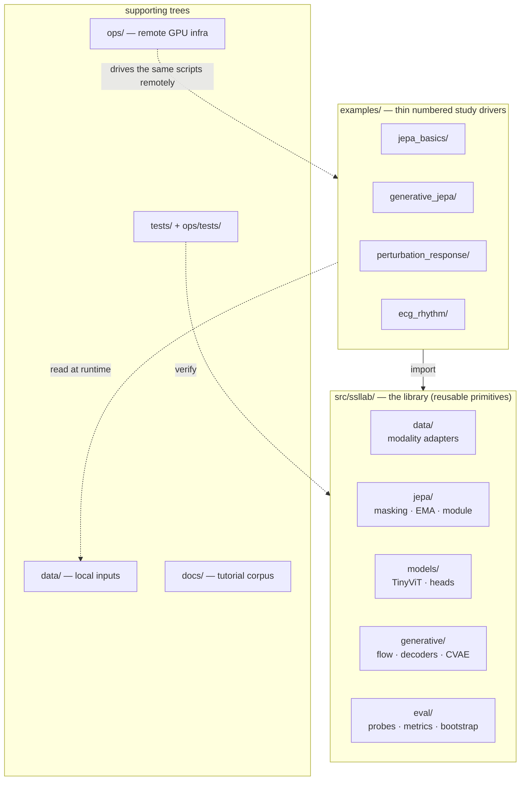
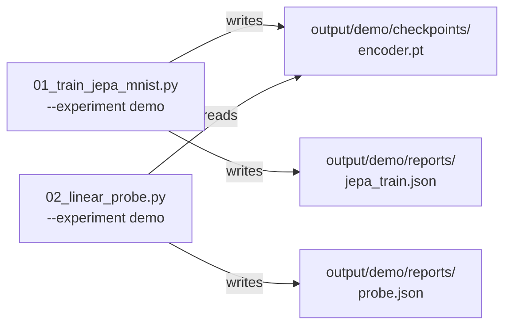

This page is the map you reach for before writing any code in `ssl-lab`. It explains *where things live* — the library, the study scripts, the data, the remote-training infrastructure, the tests, and the tutorial corpus — and *why they are arranged that way*. Every convention here exists to answer one beginner question reliably: "I want to do X, so which folder do I touch?" If you have just arrived from [Quick Start](2-quick-start), this page turns the commands you ran there into a mental model of the whole repository.

## The One Rule That Explains the Layout

The repository follows a **use-case-driven R&D convention**, stated in a single line of its README: *reusable primitives live in `src/`, thin driver scripts live in `examples/`, and intuition lives in `notebooks/`*. Everything else follows from this split. The library (`src/ssllab/`) contains no experiment-specific logic; the example folders contain almost no reusable logic — they wire library pieces together into runnable studies; the single notebook exists to build intuition rather than produce results.



Note the dashed line in the diagram: `ops/` drives the example scripts but the library never imports it. That one-way arrow is a deliberate architectural decision covered in its own section below.

Sources: [README.md](README.md#L86-L119)

## The Library: `src/ssllab/`

The package is installed with `pip install -e .` and imported as `ssllab`. Its subpackages are organized by *concern*, not by experiment — `jepa/` knows nothing about ECGs or gene counts, and the data adapters know nothing about training loops. The README's layout block documents each folder in one line.

| Subpackage | What it holds |
|---|---|
| `data/` | Modality adapters (MNIST image proxy, single-cell Perturb-seq, PTB-XL ECG) that turn raw data into modality-agnostic token tensors |
| `models/` | The TinyViT backbone, JEPA encoder/predictor, latent decoder |
| `jepa/` | Block masking, the EMA target encoder, and the assembled JEPA module |
| `objectives/` | The prediction loss plus the VICReg collapse regularizer |
| `generative/` | Flow prior (unconditional + conditional with classifier-free guidance), NB/ZINB count decoder, condition encoder, CVAE baseline, perturbation action operator and its algebra |
| `action_operator/` | Context-conditioned latent operators — generator bases, `exp(M)` |
| `eval/` | Collapse diagnostics, linear probe, effect size, calibration, interaction scores, joint paired bootstrap |
| `anatomy/` | Step-by-step shape traces of every component, for the architecture viewer |
| `utils/` | Seeding and device selection |

Two conventions make the library pleasant to use as a beginner. First, the **public API is deliberately lean**: the package's `__init__.py` exports only the essentials (`JEPA`, `JEPAConfig`, `build_jepa`, `set_seed`, `get_device`) and tells you to "reach into submodules for the rest," so the top-level import surface stays small while everything remains accessible. Second, all data adapters converge on a **universal token-tensor shape**, so the same `build_jepa(...)` call works whether the tokens came from MNIST patches or from cells — this is the contract explored in [Modality-Agnostic Data Adapters](23-modality-agnostic-data-adapters).

Sources: [README.md](README.md#L91-L105), [\_\_init\_\_.py](src/ssllab/__init__.py#L1-L24)

## The Drivers: `examples/`

Each subfolder of `examples/` is one *study* — a numbered pipeline of scripts that builds on the previous script's artifacts. The four studies progress in difficulty: `jepa_basics/` (train JEPA, probe it), `generative_jepa/` (decoder, flow prior, sampling — the image-proxy slice), `perturbation_response/` (the flagship single-cell pipeline), and `ecg_rhythm/` (the PTB-XL classification study). There is also `ops/` here, holding the thin drivers for the remote-training infrastructure.

### The numbered-script convention

Scripts are named `<number>_<verb_phrase>.py` — `00_process_norman.py`, `01_pretrain_stage_a.py`, `05_sample_perturbed.py` — and the perturbation study's README states the rule plainly: numbers reflect *the order scripts were written, not the order anyone runs them*. The five study READMEs and their `docs/` subfolders explain the actual run order. One deliberate quirk teaches you a second convention: there is no `07` in the perturbation study, and the gap is *kept* so that existing references to script numbers never break. Numbers are identifiers, not just ordering.

> [!TIP]
> Never renumber an existing script when adding a pipeline step — append a new number (or a letter suffix like `00b_data_card.py`) instead. Older READMEs, results ledgers, and pod wrappers reference scripts by their number.

Sources: [README.md](README.md#L106-L119), [examples/perturbation_response/README.md](examples/perturbation_response/README.md#L68-L82)

### The script anatomy

Every driver script follows the same three-part shape, visible in any file you open. First, a **docstring contract**: it states the milestone in plain words, then a `Usage` block with example commands, then an `Output` block naming exactly which files the script writes. Second, a **path bootstrap**: a three-line `sys.path` insertion that points Python at `src/`, so the script runs from the repo root without any installation step. Third, a **shared argparse interface**: flags like `--epochs`, `--device`, `--seed` appear everywhere, and — most importantly — every script that participates in a pipeline accepts the same `--experiment` and `--output-root` flags.

Sources: [01\_train\_jepa\_mnist.py](examples/jepa_basics/01_train_jepa_mnist.py#L1-L19), [01\_train\_jepa\_mnist.py](examples/jepa_basics/01_train_jepa_mnist.py#L21-L60)

### Five kinds of workflow

The largest study sorts its scripts into five named kinds, and this taxonomy generalizes across the repository. It is the fastest way to answer "what does this script do?" when you encounter an unfamiliar number.

| Kind | What it does | Typical location | Cost profile |
|---|---|---|---|
| **Build** | Trains something; produces an artifact later steps depend on | Numbered low (`00`–`17`) | GPU pod, except data processing |
| **Score** | Grades a trained model on the standing benchmark | Mid-range numbers | CPU, minutes |
| **Diagnose** | Answers a question about where the loss lives; trains nothing | Numbered like data (`00a`, `02`, `11`, `14`) | CPU, minutes |
| **Decide** | Runs a pre-registered statistical verdict on a family of comparisons | One script per round (`20`–`27`) | Seconds |
| **Vary** | `run_*_pod.sh` shell wrappers that retrain one stage at a time on the pod | Top level of the study folder | GPU pod |

The shell wrappers follow their own naming rule — `run_<what>_pod.sh` — and open with a *preflight* that checks staged inputs and stops within seconds, naming whatever is missing, before spending any GPU time. The "decide" scripts carry a further convention worth knowing early: from round 7b onward there is exactly one scoring script per pre-registered round, and the script's docstring *is* that round's protocol, frozen before the run.

Sources: [examples/perturbation_response/README.md](examples/perturbation_response/README.md#L84-L128)

## Artifacts: the `output/<experiment>/` Contract

The repository never writes results to a flat pile. A shared helper in the library — `ssllab.experiment.experiment()` — gives every script the same four-subdirectory hierarchy, and its docstring explains the motivation: flat `output/` or `runs/` directories "turn unwieldy fast once you have multiple models, runs, and artifact types." The layout is:

```
output/<experiment>/
  checkpoints/   model weights (encoder.pt, decoder.pt, prior.pt, ...)
  samples/       generated images (samples.png, recon.png, ...)
  reports/       metrics + metadata as JSON
  logs/          run logs
```

Because the experiment name is passed to every script in a pipeline, artifacts *compose*: the probe script finds the encoder the trainer wrote, simply because both were run with `--experiment demo`. The flow below shows the contract in action for the two `jepa_basics` scripts.



> [!TIP]
> The `--experiment` name is stable on purpose — not a timestamp. Pass a new name to run a fresh experiment side by side with an old one; keep the same name to let pipeline steps hand artifacts to each other. On a remote pod the same tree lands on the network volume and is rsynced back, with only the path prefix changing.

Sources: [README.md](README.md#L148-L160), [experiment.py](src/ssllab/experiment.py#L1-L64)

## Data: `data/` and the Data Lake

The `data/` directory holds *local input datasets*, and its first convention is a negative one: **the datasets themselves are not tracked in git** — only the documentation and the folder structure are, because real datasets are too large or sensitive. Small, SSL-specific data lives here as real files; MNIST needs no manual step at all, since torchvision auto-downloads it on first run through the library's data loader.

Large datasets shared across projects follow a different convention: **storage deduplication via symlinks**. Instead of copying a multi-gigabyte dataset into every repository, you keep one physical copy in a project-neutral "data lake" and link only what you use:

```bash
export DATA_LAKE_ROOT=/path/to/shared/data-lake
python -c "from ops.datasets import link_dataset; link_dataset('scrna/perturb_seq/norman2019')"
# -> data/norman2019 -> $DATA_LAKE_ROOT/scrna/perturb_seq/norman2019
```

Note the naming discipline inside that command: the lake is organized as `<modality>/<sub-topic>/<dataset>`, while the link creates a flat alias like `data/norman2019`, which is the path the loaders actually read. The environment variable is deliberately called `DATA_LAKE_ROOT` — the "shared lake" semantics — so no project ever hard-codes another project's name.

Sources: [data/README.md](data/README.md#L1-L25), [ops/README.md](ops/README.md#L51-L67)

## Infrastructure: the `ops/` Decoupling Rule

`ops/` is the remote-training infrastructure (SkyPilot orchestration, RunPod as provider), and it lives at the repository root as a top-level package *next to* `src/` — not inside it. The reason is stated as a strict rule in its README: **nothing in `ops/` imports JEPA, and `ssllab` never imports `ops/`**. Cloud provisioning is scaffolding for practical training, not part of self-supervised learning, so the boundary keeps the science importable on a laptop with no cloud tooling installed.

This decoupling produces three concrete conventions. First, `ops/` is *not installed* — Python finds it because you run commands from the repository root, and the pytest configuration adds the repo root to `pythonpath` for the same reason. Second, its dependencies arrive only through optional extras: `pip install -e '.[ops]'` for dry runs, `.[remote]` to actually launch pods. Third, the tooling defaults to safety: `ops_run_pipeline.py` is a **dry-run until you pass `--execute`**, and it keeps the pod alive afterwards for reuse. The workflow is a fixed four-step chain — compute check → provision pod → run job(s) → fetch results — detailed in [Remote GPU Ops: SkyPilot and RunPod](24-remote-gpu-ops-skypilot-and-runpod). Portability is part of the design too: moving `ops/` into another project means editing exactly two config lines (`project` and `job_prefix`), because nothing else in the package names a project.

Sources: [ops/README.md](ops/README.md#L1-L19), [ops/README.md](ops/README.md#L83-L90), [README.md](README.md#L162-L164), [pyproject.toml](pyproject.toml#L19-L37)

## Configuration, Dependencies, and Tests

Packaging is deliberately minimal. The library targets Python `>=3.10,<3.13` and depends on a short core list — torch, torchvision, numpy, scipy, scikit-learn, matplotlib. Anything heavy is an *optional extra*, imported lazily by the one script that needs it rather than by the library or the tests' light path. The extras and the test configuration are worth memorizing as a table:

| Extra | Adds | Who needs it |
|---|---|---|
| `dev` | pytest | running the test suite |
| `perturb` | anndata, scanpy, pertpy, scikit-misc | only `00_process_norman.py`; loaders and tests never import it |
| `ops` | pyyaml | compute checks and SkyPilot dry runs |
| `remote` | skypilot\[runpod] | actually launching GPU pods |

Tests live in two places that mirror the two importable packages: `tests/` for the `ssllab` library — with filenames that map one-to-one onto modules (`test_perturbseq.py`, `test_ptbxl.py`, `test_span_masks.py`, `test_smoke.py`, and so on) — and `ops/tests/` for the infrastructure. The pytest configuration declares both: `testpaths = ["tests", "ops/tests"]`. Getting started is three commands from the README: create the conda/mamba environment from `environment.yml`, activate it, then `pip install -e .` so the editable install picks up your changes as you edit `src/`.

Sources: [pyproject.toml](pyproject.toml#L1-L37), [README.md](README.md#L121-L127)

## Documentation Conventions

The `docs/` tree serves two audiences at once. It is the *source* for the published MkDocs Material site — `mkdocs.yml` sets `docs_dir: docs` and notes that a private `dev/` folder is intentionally excluded from the nav — and it is the *tutorial corpus* you browse in the repository. The tutorial series follow a consistent internal pattern you can rely on when reading: each series has an `index.md` overview, numbered chapters (`00-…`, `01-…`, with letter suffixes like `06a-` for digressions), and a `notation.md` reference at the end. The `examples/` studies carry their own documentation in `docs/` subfolders — runbooks, workflow maps, and the results ledger.

Rendering conventions matter if you plan to contribute: mathematics is written in LaTeX and rendered by MathJax via the `arithmatex` extension in generic mode, and ` ```mermaid ` fenced blocks are rendered as diagrams by Material's superfences config. The published nav in `mkdocs.yml` groups the corpus into the series you saw in the README — Generative JEPA, Time-Series JEPA, Action Operators, Operator World Models — each mapped chapter-by-chapter.

Sources: [mkdocs.yml](mkdocs.yml#L17-L18), [mkdocs.yml](mkdocs.yml#L47-L119)

## Conventions at a Glance

| Convention | Rule | Where you'll hit it |
|---|---|---|
| Three-way split | primitives in `src/`, thin drivers in `examples/`, intuition in `notebooks/` | everywhere |
| Script naming | `NN_verb_phrase.py`; numbers are written-order identifiers, never renumbered | any pipeline step |
| Script anatomy | docstring with Usage/Output, `sys.path` bootstrap, shared CLI flags | opening any driver |
| Artifact layout | `output/<experiment>/{checkpoints,samples,reports,logs}` via `ssllab.experiment` | every run |
| Pipeline linking | same `--experiment` name hands artifacts between steps | multi-step studies |
| Data privacy | `data/` contents are git-ignored; only structure is shared | cloning the repo |
| Storage dedup | `DATA_LAKE_ROOT` + `ops.datasets.link_dataset` symlinks | large datasets |
| Infra decoupling | `ssllab` never imports `ops`; extras `[ops]`/`[remote]`; dry-run by default | remote training |
| Pre-registration | one scoring script per round; docstring is the frozen protocol | perturbation study rounds |
| Pod wrappers | `run_<what>_pod.sh` with input preflight | GPU studies |

## Where to Go Next

With the layout in hand, the natural next step is [Architecture Overview](4-architecture-overview), which opens up the `jepa/` and `generative/` modules this page only listed. If you prefer to see the conventions in motion first, walk the vertical slice again with the map above beside you, then continue into [JEPA Module Internals](6-jepa-module-internals). For the flagship study that exercises every convention at once — numbered scripts, pre-registered scoring, pod wrappers, and the results ledger — read [Perturbation-Response Pipeline](16-perturbation-response-pipeline); for the second applied study, [ECG Rhythm Study](17-ecg-rhythm-study). When you outgrow your laptop, [Remote GPU Ops: SkyPilot and RunPod](24-remote-gpu-ops-skypilot-and-RunPod) picks up exactly where the `ops/` section here stops, and [Tutorial Corpus and Reading Paths](25-tutorial-corpus-and-reading-paths) helps you navigate the `docs/` tree as a reader rather than a contributor.