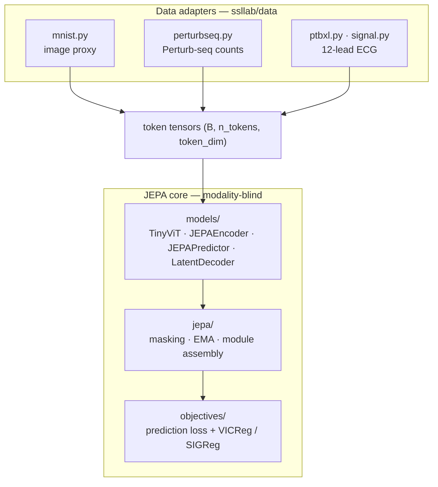
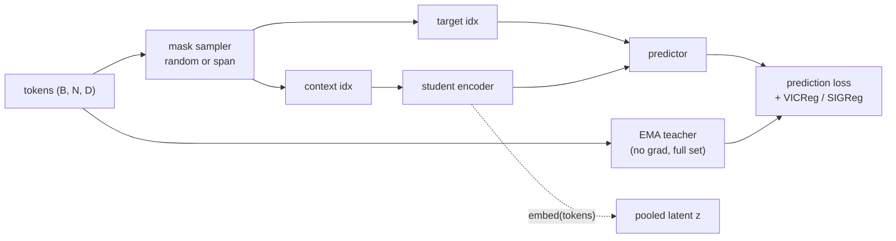
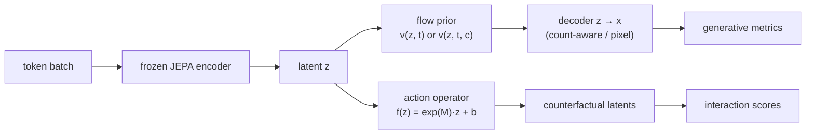
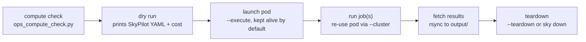
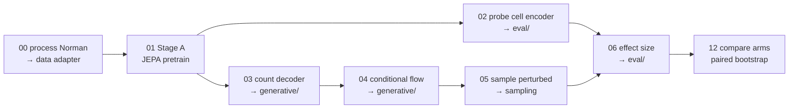

This page maps the architecture of `ssl-lab` as a system: how the repository is organized into tiers, what contract glues the layers together, and how a training study actually flows through the stack. The focus is structural — what each module owns, where the seams are, and which invariants keep the design coherent. For a guided tour of the directory tree itself, see [Repository Layout and Conventions](3-repository-layout-and-conventions); this page goes one level deeper, into module responsibilities and data flow.

## Design Philosophy: A Three-Tier R&D Layout

The repository follows a use-case-driven R&D convention: **reusable primitives in `src/`, thin driver scripts in `examples/`, intuition in `notebooks/`**. Everything that encodes a reusable idea — the JEPA module, the flow prior, evaluation probes — lives in the installable `ssllab` package; everything that encodes a *study* — a pre-registered pipeline with one scoring script per round — lives in `examples/`, importing primitives but owning no reusable logic itself. Documentation corpus and notebooks complete the outer tiers.

```
ssl-lab/
├── src/ssllab/          # the library: primitives only, no study logic
│   ├── data/            # modality adapters -> token tensors (the central contract)
│   ├── models/          # TinyViT backbone, encoder, predictor, latent decoder
│   ├── jepa/            # masking, EMA target, JEPA module assembly
│   ├── objectives/      # prediction loss + VICReg / SIGReg regularizers
│   ├── generative/      # flow prior, count decoders, CVAE, operator algebra
│   ├── action_operator/ # context-conditioned latent operators
│   ├── eval/            # probes, collapse diagnostics, generative metrics
│   ├── coadapt.py       # joint encoder+decoder training modes
│   └── anatomy/         # step-by-step shape traces for the architecture viewer
├── examples/            # one folder per study; numbered thin drivers
├── ops/                 # remote-GPU infrastructure, deliberately decoupled
├── notebooks/           # intuition-first walkthroughs
├── docs/                # the mkdocs tutorial corpus
└── tests/               # pytest suite over both src/ssllab and ops
```

The dependency graph is deliberately shallow: `examples/` depends on `ssllab`, `ssllab` depends on nothing in-repo, and `ops/` depends on neither. Study scripts stay thin — the ECG study, for instance, is a chain of numbered scripts from processing to paired-bootstrap results, each importing library functions rather than re-implementing them.

Sources: [README.md](/README.md#L86-L119), [pyproject.toml](/pyproject.toml#L32-L40)

## The Central Contract: Modality-Agnostic Tokens

The single most important seam in the codebase is the data-adapter contract. **Every adapter emits token tensors of shape `(B, n_tokens, token_dim)`**, and every model downstream consumes exactly that shape — nothing below the adapter layer ever knows whether a token came from an image patch, a gene group, or an ECG window.



| Adapter | Modality | Key surface | Design notes |
|---|---|---|---|
| `mnist.py` | image proxy (MNIST patches) | `patchify` / `unpatchify`, `get_mnist_dataloaders` | defines the reference `(n_tokens, token_dim)` grid |
| `perturbseq.py` | single-cell Perturb-seq counts | `tokenize_cells`, `make_gene_partition`, `ControlSampler` | versioned cache artifacts (`ARTIFACT_VERSION`); gene-group partition defines tokens |
| `ptbxl.py` | 12-lead ECG | `get_ptbxl_dataloaders` | physical-time signal geometry via `signal.py` |
| `signal.py` | generic 1D signals | `patchify_1d`, `SignalGeometry`, `zscore_per_lead` | shared helpers so ECG is one instance of a signal family |

This is why the method line is described as *modality-agnostic*: a new domain drops in as an adapter, and the encoder, objectives, generative heads, and evaluation toolkit all work unchanged.

Sources: [data/\_\_init\_\_.py](/src/ssllab/data/__init__.py#L1-L58)

## The JEPA Core: Student, Predictor, and EMA Teacher

`jepa/model.py` assembles the three components into one `nn.Module`. A single training step runs five moves on a token batch: sample a context/target position split, have the **student encoder** embed the context tokens, have the **predictor** guess embeddings at the target positions, have the **EMA teacher** — a slow-moving average copy of the encoder — encode the *full* token set detached, and score the prediction in latent space. The pooled image-level latent `z` is exposed separately via `embed`, and that frozen latent is what every downstream stage reads.



Masking and anti-collapse are both first-class configuration surfaces, not hard-coded choices. Two masking families exist — scattered random blocks (the MNIST and perturb-seq default) and contiguous spans for ordered 1D sequences — and two regularizer families guard against representation collapse. Because these details each deserve their own treatment, they are covered in [Masking Strategies: Random and Span](7-masking-strategies-random-and-span) and [Anti-Collapse: VICReg and SIGReg](8-anti-collapse-vicreg-and-sigreg); the table below just anchors the knobs.

| Config knob | Options | What it controls |
|---|---|---|
| `mask_kind` | `"random"` \| `"span"` | scattered target positions vs. contiguous spans (`span_len × n_spans = n_target` enforced) |
| `reg_kind` | `"vicreg"` \| `"sigreg"` | hinge variance + covariance penalty vs. isotropic-Gaussian Epps–Pulley statistic |
| `reg_target` | `"tokens"` \| `"pooled"` | regularize per-token embeddings or the mean-over-context cell vector |
| `pred_kind` | `"smooth_l1"` \| `"mse"` \| `"cosine"` | latent-space prediction distance |
| `ema_base` / `ema_final` | floats in (0, 1] | teacher momentum schedule |

The loss functions are plain functions returning `(scalar, dict_of_components)` so callers can log every term — a deliberate convention that keeps objectives testable in isolation from the module that calls them.

Sources: [jepa/model.py](/src/ssllab/jepa/model.py#L1-L14), [jepa/model.py](/src/ssllab/jepa/model.py#L30-L74), [jepa/model.py](/src/ssllab/jepa/model.py#L107-L149), [objectives/jepa_loss.py](/src/ssllab/objectives/jepa_loss.py#L1-L23), [objectives/jepa_loss.py](/src/ssllab/objectives/jepa_loss.py#L31-L41)

## Two Extension Stacks Diverge from the Frozen Latent

Everything downstream of pretraining reads the frozen JEPA latent, and the architecture branches into two complementary directions. **Generative JEPA** makes the representation *sampleable*: a flow-matching prior learns a velocity field over `z` and samples by integrating an ODE from noise to data. **Action operators** make prediction *active*: the latent itself is transformed by a learned, structured operator.



The generative stack centers on `VelocityMLP`, a velocity field with FiLM-injected time — and optionally a condition vector `c`, FiLM-injected alongside time, turning the marginal `p(z)` into a conditional `p(z | c)`. A learned `null_cond` token with per-sample condition dropping enables **classifier-free guidance** at sampling time. The same module also supports a *data base* source (transporting a control population onto a perturbed one, with independent or `ot_couple` least-action pairing) instead of pure noise. The stack rounds out with NB/ZINB count decoders, a CVAE baseline for reference, and the perturbation operator algebra — the conditional path is what the flagship perturbation study scores.

The action-operator stack implements conditioned latent dynamics `f_θ(c)(z) = exp(M_θ)·z + b_θ` where `M_θ = Σᵢ αᵢ Bᵢ` is a Lie-algebra element built from a **generator basis**. The basis is the main design decision, because it fixes the group the operator can live in:

| Basis | Generator structure | Resulting group |
|---|---|---|
| `FreeBasis` | learnable dense matrices | GL(D): invertible, otherwise free |
| `NamedBasis` | one generator per labeled intervention | GL(D), with interpretable coefficients |
| `SkewBasis` | skew-symmetric generators | SO(D): orthogonal, norm-preserving |
| `SE3Basis` | 3 rotation + 3 translation generators | SE(3): rigid motion |

Invertibility, orthogonality, and rigidity here are *structural* properties — they follow from the basis plus the matrix exponential, never from a training penalty.

> [!TIP]
> The operator's policy head is zero-initialized, so at step zero `α = 0 → M = 0 → A = I`: every action operator literally begins as "do nothing," and training pushes it away from identity only as far as the data demands. If you extend the stack with a new basis, preserve this near-identity property — it is what keeps counterfactual rollouts stable early in training.

Sources: [generative/flow.py](/src/ssllab/generative/flow.py#L1-L38), [generative/flow.py](/src/ssllab/generative/flow.py#L61-L92), [generative/\_\_init\_\_.py](/src/ssllab/generative/__init__.py#L1-L6), [action_operator/context_operator.py](/src/ssllab/action_operator/context_operator.py#L1-L39), [action_operator/context_operator.py](/src/ssllab/action_operator/context_operator.py#L51-L85)

## The Evaluation Toolkit

Evaluation is a first-class architectural layer, not an afterthought: the lab's premise — "reliable is measured, not assumed" — is embodied in `eval/`. The re-exported public surface spans collapse diagnostics, probing, and generative-sample metrics; sibling modules not re-exported (`bootstrap.py`, `calibration.py`, `effect_size.py`, `interaction.py`, `baselines.py`) carry the study-grade statistical machinery, including the joint paired bootstrap with max-t intervals used to compare arms within one study.

| Module | Capabilities |
|---|---|
| `collapse.py` | `effective_rank`, `feature_std`, `collapse_report` |
| `probe.py` | `linear_probe` — the standard readout of representation quality |
| `generative.py` | `fid`, `kid`, `precision_recall`, `density_coverage`, `nn_distance_stats`, `classifier_metrics` |
| `viz.py` | `save_image_grid` |
| `bootstrap.py` | paired-cluster bootstrap, simultaneous max-t inference |
| `effect_size.py` / `interaction.py` | perturbation effect magnitude, epistasis/interaction scores |
| `calibration.py` | whether generated populations match measured variability |

Sources: [eval/\_\_init\_\_.py](/src/ssllab/eval/__init__.py#L1-L28), [README.md](/README.md#L100-L104)

## Study Glue: Co-Adaptation, Latents, and Anatomy

Between the primitives and the study scripts sit a few *glue* modules that encode cross-cutting research decisions. `coadapt.py` trains the cell encoder and count decoder together under three modes that differ only in what may train — `dec` (frozen encoder control), `joint` (both train, encoder at a smaller learning rate), and `joint_anchor` (joint plus the JEPA predictive objective held fixed during reconstruction). `latents.py` provides *row-exact* frozen latents: diagnostics that score an explicit set of cache rows encode exactly those rows, so the cells a metric scores are the cells that were encoded — a subtle but load-bearing reproducibility guarantee. `embeddings/` stores and projects extracted latents, `anatomy/` produces step-by-step shape traces of every component for the architecture viewer, and `checkpoint.py` handles export. These modules exist because two or more numbered study scripts needed the same behavior; the glue layer is the archive of such convergences.

Sources: [coadapt.py](/src/ssllab/coadapt.py#L1-L40), [latents.py](/src/ssllab/latents.py#L1-L8), [README.md](/README.md#L104-L105)

## The Ops Layer: Deliberately Decoupled

Remote training infrastructure lives in a top-level `ops/` package that is **architecturally separated** from the library by an explicit invariant: nothing in `ops/` imports JEPA, and `ssllab` never imports `ops`. Cloud provisioning is treated as scaffolding for practically useful models, not as part of self-supervised learning itself — which is why it is installed through optional extras (`ops` adds PyYAML for compute checks and dry runs; `remote` adds SkyPilot itself) rather than core dependencies. SkyPilot orchestrates while RunPod is merely a config value (`cloud: runpod`), so switching providers is a configuration change, not an API rewrite.



Notably, the pytest `testpaths` include both `tests/` and `ops/tests/`, so the decoupled package is still verified in one continuous run.

> [!TIP]
> The decoupling invariant ("`ops` never imports `ssllab`, `ssllab` never imports `ops`") is the reason remote training can evolve — provider changes, config schema, dataset staging — without touching a single line of modeling code. When adding features, ask first whether they belong to *learning* or to *scaffolding*; that question is the whole architecture of `ops/`.

Sources: [ops/README.md](/ops/README.md#L1-L11), [ops/README.md](/ops/README.md#L21-L50), [ops/README.md](/ops/README.md#L69-L80), [pyproject.toml](/pyproject.toml#L20-L30)

## How a Study Flows Through the Stack

To see the layers cooperating end to end, consider the flagship perturbation-response study. Each numbered script is thin; each arrow crosses exactly one architectural seam.



Data enters through the Perturb-seq adapter as tokens; Stage A trains the JEPA core; downstream stages read the frozen latent and train generative heads; evaluation scores effect sizes, calibration, and arm differences with paired statistics; and heavy runs are executed remotely through `ops/` with results rsynced back. The ECG study follows the same shape with the span-masking path and scratch-vs-pretrained arms instead. When one script grows reusable logic, it graduates downward into `src/ssllab/` — that migration pressure is the mechanism by which this architecture stays coherent.

Sources: [README.md](/README.md#L106-L119), [ops/README.md](/ops/README.md#L21-L44)

## Where to Go Next

The natural progression from here follows the dependency order of the stack itself:

1. **[Research Directions: Generative and Active JEPA](5-research-directions-generative-and-active-jepa)** — the two extension branches introduced above, in full.
2. **[JEPA Module Internals](6-jepa-module-internals)** — the core module, one layer deeper than this overview.
3. **[Flow-Matching Prior](9-flow-matching-prior)** — the generative stack's central mechanism, from interpolant to sampler.
4. **[Generator Bases and Lie-Group Operators](13-generator-bases-and-lie-group-operators)** — the action-operator stack's structural core.
5. **[Evaluation Toolkit: Probes and Metrics](19-evaluation-toolkit-probes-and-metrics)** — how every claim in the studies is scored.
6. **[Modality-Agnostic Data Adapters](23-modality-agnostic-data-adapters)** and **[Remote GPU Ops: SkyPilot and RunPod](24-remote-gpu-ops-skypilot-and-runpod)** — the outer layers, if you are integrating a new modality or training remotely.