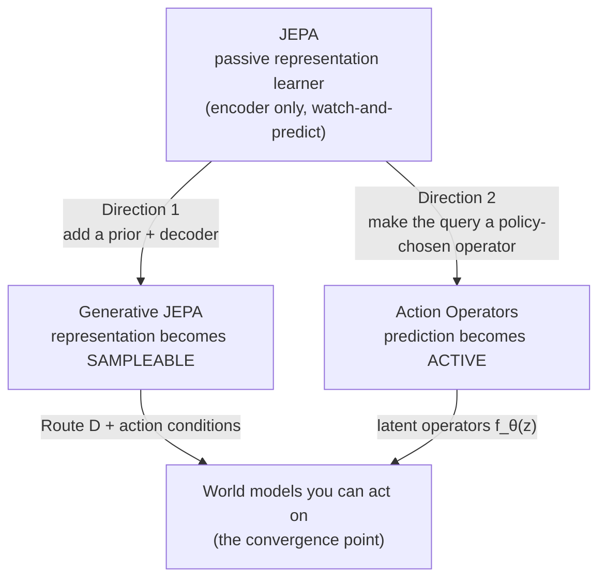
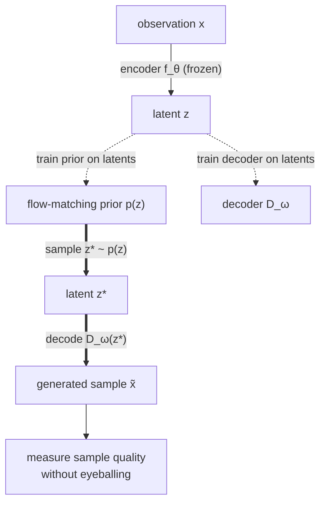
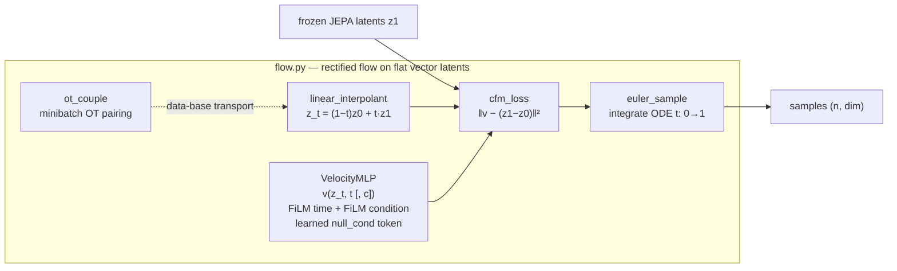
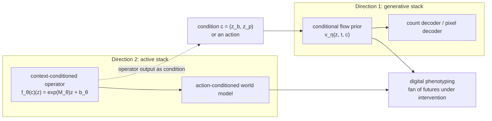

This page is the pivot of the repository's documentation: it frames the **two research programs** that extend JEPA beyond representation learning — **Generative JEPA** (make the representation *sampleable*) and **Active JEPA via action operators** (make prediction *active*). Here you will learn what each direction adds, how the design space is organized, where each direction lives in `src/ssllab/`, and which catalog pages descend from each. It sits between [Architecture Overview](4-architecture-overview) and the deep-dive modules ([JEPA Module Internals](6-jepa-module-internals), [Flow-Matching Prior](9-flow-matching-prior), [Generator Bases and Lie-Group Operators](13-generator-bases-and-lie-group-operators)).

Sources: [index.md](docs/index.md#L3-L5), [README.md](README.md#L44-L44)

## The Starting Point: JEPA as a Passive Representation Learner

Every direction in this lab begins from the same substrate. **JEPA** (joint-embedding predictive architecture) learns by predicting the *embedding* of a masked region from the embedding of its visible context — never raw pixels, never reconstruction. The reward is a famously good encoder, but only an encoder: it defines no density, has no decoder, and cannot produce new data. It also *watches* rather than *acts* — its predictor's query says only "predict region $q$," a fixed, blind instruction sampled at random. The lab's stated focus is precisely JEPA "and two ways to extend it," and each extension attacks one of those two limitations.

Sources: [index.md](docs/index.md#L3-L3), [generative_jepa/index.md](docs/generative_jepa/index.md#L3-L6), [01-jepa-action-operators.md](docs/action_operator/01-jepa-action-operators.md#L15-L25)

The two extensions are **complementary, not competing**: one gives the learned representation a generative head, the other gives the predictor an actionable structure — and they are documented as beginning to converge (more in [Where the Two Directions Converge](#where-the-two-directions-converge)). The comparison below is the map for the rest of this page.

| | **Direction 1 — Generative JEPA** | **Direction 2 — Action Operators** |
|---|---|---|
| One-line goal | Make the representation *sampleable* | Make prediction *active* |
| What it adds to JEPA | A prior over latents + a decoder back to data space | A learned operator the model *chooses* (sensing + perturbing) |
| Core question | How do I draw new data from this representation? | What does an *action* do to the state? |
| Status | Method built + de-risked; design space mapped; applications WIP | Tutorial corpus written; theory still developing |
| Code seam | `src/ssllab/generative/` | `src/ssllab/action_operator/` |
| Entry tutorial | [Generative JEPA series](docs/generative_jepa/index.md) | [Action Operators](docs/action_operator/00-from-actions-to-operators.md) |

Sources: [index.md](docs/index.md#L7-L24), [README.md](README.md#L44-L52), [README.md](README.md#L97-L100)

## Direction 1 — Generative JEPA: Make the Representation Sampleable

The generative recipe is deliberately the *simplest* thing that closes the loop: **train the encoder once, freeze it, then bolt on two pieces**. JEPA's latent space is a map where meaning is organized; generation needs (a) a way to *pick a point on that map at random* — a prior over latents — and (b) a way to *walk from a latent back to a data point* — a decoder. The v0 route makes three defining choices: train-then-freeze (the encoder never sees the prior or decoder loss), one mean-pooled latent per observation (small, transparent math), and a **rectified-flow** prior (simple regression objective, straight noise-to-data paths).

Sources: [generative_jepa/index.md](docs/generative_jepa/index.md#L8-L13), [generative_jepa/index.md](docs/generative_jepa/index.md#L27-L33)

Read in two passes: **solid arrows** are the forward training path (encode observations into latents); **dashed arrows** are the two heads fitted on frozen latents; **bold arrows** are sampling. Staged as four parts — encoder, latent prior, decoder, sampling-and-evaluation — this is the walking skeleton built on MNIST as a modality-agnostic proof of concept, and it is *verified end to end*: one A40 reference run reports a rich, non-collapsed latent (encoder effective rank 103.7, strong linear-probe accuracy). Each chapter in the series points at the runnable scripts `01`–`06` in `examples/generative_jepa/`.

Sources: [generative_jepa/index.md](docs/generative_jepa/index.md#L15-L26), [generative_jepa/index.md](docs/generative_jepa/index.md#L76-L78), [README.md](README.md#L46-L46)

### The Design Space: Two Gaps, Four Routes

"One realization is not the method." The starter above is a *single point* in a design space the survey chapter maps with a two-question lens. JEPA is not generative for **two independent reasons**, and closing one does nothing for the other:

- **Gap G1 — stochastic prediction.** JEPA's predictor is a deterministic point estimate: one context in, exactly one latent out. Generation needs a *distribution* over outcomes.
- **Gap G2 — no decoder to data space.** JEPA's entire loss lives in latent space; there is no map from a latent back to an actual data point.

A usable generative JEPA must close **both**. The biological example makes the independence concrete: solving only G2 gives one expression profile per drug — a point estimate masquerading as a population, since identical cells respond differently; solving only G1 gives many plausible latents you cannot read or score against a real measurement.

Sources: [05-two-gaps-four-routes.md](docs/generative_jepa/05-two-gaps-four-routes.md#L11-L23), [05-two-gaps-four-routes.md](docs/generative_jepa/05-two-gaps-four-routes.md#L25-L33)

Every route in the survey is a *different pairing of how-it-closes-G1 with how-it-closes-G2*:

| Route | Idea in one line | Closes G1 by… | Closes G2 by… | Landmark |
|---|---|---|---|---|
| **A: Latent decoder head** | bolt a decoder onto the latent; make the *latent* stochastic | a stochastic predictor or sampled prior | a decoder $D_\omega$ (count-aware for biology) | conditional-VAE / NB-decoder family |
| **B: Variational JEPA** | the predictor emits a *posterior* and *becomes* the conditional prior | learned $q_\phi(z\mid\text{ctx}, c)$ + sampling | a decoder (representation or data space) | **Var-JEPA** |
| **C: Rep-conditioned diffusion** | keep JEPA as encoder; train a *separate* diffusion model on its latent | diffusion noise | the diffusion model decodes to data | **D-JEPA** |
| **D: World-model planning** | freeze encoder, learn an *action-conditioned* predictor, *plan* over actions | not directly | not directly | **V-JEPA 2-AC** |

Two structural facts organize the grid: **Routes A–C produce data; Route D produces decisions** (it searches the space of actions to reach a goal state — which is exactly the bridge to Direction 2), and **the Parts 0–4 starter is a stripped-down hybrid of A and C** (Route C's flow-style machinery used unconditionally, with Route A's plain decoder).

Sources: [05-two-gaps-four-routes.md](docs/generative_jepa/05-two-gaps-four-routes.md#L41-L59)

> [!TIP]
> The route-choice constraint is empirical, not aesthetic: in perturbation biology the benchmark is **effect size** — the correlation between predicted and true differential expression on the genes a drug moved most (the scGen/CPA/scPPDM scoring protocol). Because a stable baseline dominates the latent, a generative head that maps back to *data space* is the mechanism by which effect magnitude is recovered and calibrated — Routes A/B/C, not a pure latent-space model. This is why the flagship application grades on effect size rather than sample realism.

Sources: [05-two-gaps-four-routes.md](docs/generative_jepa/05-two-gaps-four-routes.md#L72-L103)

The survey also plants a through-line to read the deep-dives with: the simplest way to close G1 is a **diagonal Gaussian** head, but that is *unimodal per condition* — one bump of probability where the truth may be genuinely multi-modal. The expressive alternatives (flows, diffusion) buy multi-modality at the cost of closed-form density and cheap sampling; the series treats this as a live trade-off, not a verdict. And the honest open problem, stated plainly: bolt a prior and decoder onto JEPA and you have structurally **rebuilt a VAE or latent-diffusion model with JEPA as encoder pretraining** — the value is that JEPA's encoder is a strong, semantically-organized substrate, not that the surrounding machinery is new.

Sources: [05-two-gaps-four-routes.md](docs/generative_jepa/05-two-gaps-four-routes.md#L104-L137)

### The Implementation Seam: `src/ssllab/generative/`

The generative stack is a small, layered module: the package exports exactly the four primitives of the flow prior — `VelocityMLP`, `linear_interpolant`, `cfm_loss`, `euler_sample` — with the count decoder, CVAE baseline, condition encoder, and the perturbation action operator as siblings in the same package (the latter two belong to the convergence story below).

Sources: [__init__.py](src/ssllab/generative/__init__.py#L1-L6), [README.md](README.md#L97-L99)

The module docstring states the conventions compactly: the interpolant $z_t = (1-t)z_0 + t z_1$ with constant target velocity $u_t = z_1 - z_0$; the loss regresses $\|v_\theta(z_t, t\,[,c]) - u_t\|^2$; sampling integrates $dz/dt = v_\theta$ from $t{=}0$ (source) to $t{=}1$ (data). Two design seams are worth knowing before you open the deep dives:

1. **Two choices of source, one loss and sampler.** With `z0=None` the source is Gaussian noise — the standard *noise→data* generative prior. Pass real samples (e.g. control-cell latents) and the same machinery becomes a *distribution-to-distribution transport*, modeling population-level displacement; `ot_couple` optionally re-pairs source and target by minibatch optimal transport for straighter, lower-variance paths. What is identified is the population-level transport, not a per-pair correspondence.

Sources: [flow.py](src/ssllab/generative/flow.py#L8-L23), [flow.py](src/ssllab/generative/flow.py#L146-L165)

2. **Conditioning and CFG are flags on the same module.** Setting `cond_dim > 0` FiLM-injects a condition vector $c$ alongside time, so the field learns a different flow per condition and samples $p(z \mid c)$ instead of the marginal $p(z)$. A learned `null_cond` token plus per-sample condition dropout (`p_drop`) during training enables classifier-free guidance at sampling time (`guidance` blends conditional and unconditional velocities); with `cond_dim=0` the module is *exactly* the original unconditional field.

Sources: [flow.py](src/ssllab/generative/flow.py#L25-L37), [flow.py](src/ssllab/generative/flow.py#L61-L126)

> [!TIP]
> `VelocityMLP`'s condition axis is backward-compatible by construction: existing unconditional callers pass no `c`, and the forward pass raises a `ValueError` on any `(c is None)` / `cond_dim` mismatch — so the unconditional prior (tutorial `04`) and the conditional flow (tutorial `07`, the perturbation arm) are the *same class* at different configurations, not two codebases. When you read [Conditional Flow and Classifier-Free Guidance](10-conditional-flow-and-classifier-free-guidance), you are reading one keyword argument's worth of delta.

Sources: [flow.py](src/ssllab/generative/flow.py#L29-L38), [flow.py](src/ssllab/generative/flow.py#L96-L110)

### Where Direction 1 Lands: The Application Line

The direction's applications are chosen so that "reliable generation" is measurable rather than assumed. The flagship is **single-cell perturbation response**: a staged "cell JEPA" on Norman-2019 Perturb-seq — intra-cell pretraining (Stage A) → variational / conditional-flow perturbation predictor (Stage B) → NB/ZINB count decoder (Stage C) — graded on *effect size* for gene combinations never measured. Second, **digital phenotyping**, where the rollout becomes a *generative personal world model*: a fan of plausible future trajectories under an intervention. Third, **further modalities** drop in as data adapters, because the core is a likelihood-matched conditional generator (the data-modalities primer surveys single-cell counts, EHR codes, and wearable/CGM streams).

Sources: [README.md](README.md#L48-L50), [README.md](README.md#L67-L67)

The deep-dive catalog pages for this track are: [Flow-Matching Prior](9-flow-matching-prior), [Conditional Flow and Classifier-Free Guidance](10-conditional-flow-and-classifier-free-guidance), [Latent Transport and Optimal-Transport Coupling](11-latent-transport-and-optimal-transport-coupling), and [Count Decoders and CVAE Baseline](12-count-decoders-and-cvae-baseline), with the applied walk-through in [Perturbation-Response Pipeline](16-perturbation-response-pipeline).

Sources: [generative_jepa/index.md](docs/generative_jepa/index.md#L46-L72)

## Direction 2 — Active JEPA: Action Operators

The second direction attacks the *passivity* of prediction. JEPA's predictor takes a context embedding and a **query** $q$ that says only *where* or *when* — which masked region, how far ahead. This leaves two precise blind spots:

| Blind spot | Axis | What the model cannot do | Closure |
|---|---|---|---|
| **1. The query is blind** | *where/when* | Targets are sampled at random; the model cannot choose informative targets — no active perception | **Sensing**: a policy picks *where to look*, rewarded by how much the choice teaches |
| **2. The prediction is unconditioned** | *what acted* | The predictor never sees what intervened between context and target, so it fits the **average** over every unobserved action | **Perturbing**: $\theta$ conditions the prediction on *what acted* |

The gap in one line: *JEPA's query says where and when, never why or under what action* — all causal, exogenous structure (slept-7h, took-meds, gene-KO) is invisible and averaged away.

Sources: [01-jepa-action-operators.md](docs/action_operator/01-jepa-action-operators.md#L43-L59), [01-jepa-action-operators.md](docs/action_operator/01-jepa-action-operators.md#L105-L119)

The fix is to replace the bare query with an **action operator the model configures**: the predictor becomes $f_\theta$, a transformation applied to the latent, with $\theta$ chosen by a policy. Crucially, the operator acts in the **latent**, not on the raw state — the intractable real-world action (a drug on a cell, a week of sleep on a person) stays implicit in the data, while the operator the model builds and applies lives in JEPA's latent space where it can be simple. The perturbing reading gives the action a measurable meaning: $\Delta z = E(\hat O_\theta(x)) - E(x)$, the change the operator induces in the latent, with an energy penalty biasing toward the *smallest* action that produces the effect.

Sources: [01-jepa-action-operators.md](docs/action_operator/01-jepa-action-operators.md#L61-L77), [01-jepa-action-operators.md](docs/action_operator/01-jepa-action-operators.md#L113-L119)

### The Conceptual Move: From Label to Operator

The foundation note makes one shift from which everything follows: an action is **not a label the agent selects** (left / right / jump — a symbol whose meaning hides inside the environment); it is **a function that transforms the state**, $\hat O_\theta : \mathcal{S} \to \mathcal{S}$, configured by a parameter $\theta$. Operators buy three properties labels lack: a **description** (so actions become *comparable* — nearby parameters mean nearby transformations), an **energy** (so a model can prefer the smallest sufficient action), and **composition** ($\hat O_2 \circ \hat O_1$ is itself an operator, so a skill is a chain of operators). And the family is *configured, not looked up*: a continuous $\theta$ manufactures $\hat O_\theta$ from scratch, as with $\hat O_\theta(s) = s + \theta$ on the number line or a rotation $R(\omega)s$ in the plane.

Sources: [00-from-actions-to-operators.md](docs/action_operator/00-from-actions-to-operators.md#L27-L47), [00-from-actions-to-operators.md](docs/action_operator/00-from-actions-to-operators.md#L49-L74), [00-from-actions-to-operators.md](docs/action_operator/00-from-actions-to-operators.md#L83-L115)

The deepest observation connecting this direction to JEPA itself is that the integration is *not* a bolt-on. JEPA's own prediction loss and an **operator equivariance loss** are the same equation under a dictionary:

$$\underbrace{\big\lVert E(\hat O_\theta(s)) - f_\theta(E(s)) \big\rVert^2}_{\text{(A) operator equivariance loss}} \;\Longleftrightarrow\; \underbrace{\big\lVert E_{\text{target}}(\text{target}) - \mathrm{Pred}(E(\text{context}), q)\big\rVert^2}_{\text{(B) JEPA prediction loss}}$$

| JEPA (right side) | Operator framework (left side) |
|---|---|
| query / position $q$ | action parameter $\theta$ |
| predictor $\mathrm{Pred}(\cdot, q)$ | latent operator $f_\theta$ |
| "reveal region $q$", a *fixed* rule | action operator $\hat O_\theta$, *configured by a policy* |

**JEPA is the special case where the action is a fixed, passive "look here" that the agent never gets to choose.** Going beyond it means letting a policy configure the operator — which is precisely the two-blind-spot fix. The direction also carries a methodological rule worth internalizing early: a predicted effect is only credible if it agrees with a *genuinely independent* view — an actual measurement, not another predictor reading the same input (that would be distillation, not validation).

Sources: [01-jepa-action-operators.md](docs/action_operator/01-jepa-action-operators.md#L81-L99), [01-jepa-action-operators.md](docs/action_operator/01-jepa-action-operators.md#L121-L131)

### The Implementation Seam: `src/ssllab/action_operator/`

The runnable core is a single module, `context_operator.py`, implementing conditioned latent dynamics

$$f_{\theta(c_t)}(z) = \exp(M_\theta)\,z + b_\theta, \qquad M_\theta = \textstyle\sum_i \alpha_i B_i, \qquad \alpha = \theta \sim \pi_\psi(z, c_t)$$

where $\{B_i\}$ is a **generator basis** and $\alpha$ is emitted by a context policy. The basis is the main design decision: it sets what $\exp(M_\theta)$ is *allowed* to be. Four bases span the expressiveness ↔ structure dial:

| Basis | Generator structure | Resulting operator group | Intended domain |
|---|---|---|---|
| `FreeBasis` | learnable dense matrices | GL(D) — invertible only | phenotyping default; the policy learns dynamics modes end-to-end |
| `NamedBasis` | one learnable matrix per *labeled* intervention; $\alpha$ can *be* $c$ | GL(D) + interpretable | quantified intervention logs; inspect $\mathrm{eig}(B_i)$ |
| `SkewBasis` | skew-symmetric generators ($B^T = -B$) | SO(D) — orthogonal, norm-preserving | cyclic / circadian latent structure; cannot blow up |
| `SE3Basis` | 3 rotation + 3 translation generators, fixed | SE(3) — rigid motion | the protein-frame instance |

Sources: [context_operator.py](src/ssllab/action_operator/context_operator.py#L7-L30), [context_operator.py](src/ssllab/action_operator/context_operator.py#L51-L60)

> [!TIP]
> Two invariants of this module reward attention before you write any code. First, **near-identity init**: the policy head is zero-initialized, so $\alpha = 0 \Rightarrow M = 0 \Rightarrow \exp(M) = I$ — the operator begins as "do nothing" and training pushes it away from identity only as far as the data demands. Second, **structural constraints, never penalties**: invertibility, orthogonality, and rigidity follow from the basis-plus-$\exp(\cdot)$ construction itself, not from a loss term. Both choices trace directly back to the "energy" and "configure" properties of the foundation note.

Sources: [context_operator.py](src/ssllab/action_operator/context_operator.py#L32-L38), [context_operator.py](src/ssllab/action_operator/context_operator.py#L61-L96)

The direction's status is honest: *an actively developing theoretical line whose operator formalism is still being worked out, not settled*. Its tutorial corpus is written and ordered — **[Time-Series JEPA](docs/time_series_jepa/index.md)** (the substrate: JEPA on time series, multimodal channels, the blind spot that motivates operators, first runnable as the ECG study), **[Action Operators](docs/action_operator/00-from-actions-to-operators.md)** (the foundation plus a gallery of concrete operators), and **[Operator World Models](docs/operator_world_models/index.md)** (the synthesis). The formalism originates in the sibling **GRL** project, which remains the deep reference for operator families beyond the four bases above (affine, field, potential, kernel).

Sources: [README.md](README.md#L52-L61), [00-from-actions-to-operators.md](docs/action_operator/00-from-actions-to-operators.md#L7-L9)

### The World-Model Arc (Direction 2's Destination)

The operator world-model series tells Direction 2's story in three moves: **JEPA watches** (masked-region prediction, passive and label-free) → **JEPA as a world model** (reinterpret "predict the masked region" as "predict the next timestep"; the predictor becomes latent dynamics $z_t \to z_{t+1}$, and prediction error becomes a *surprise* signal) → **JEPA you can act on** (condition the operator on the intervention: $f_{\theta(c_t)}$, unlocking counterfactual rollout and composable interventions). Two anchored domains sit at opposite ends of one dial — **digital phenotyping** (learned `FreeBasis`: you don't know in advance what "a week of more sleep" does to a latent) and **protein ML** (given `SE3Basis`: physics dictates the rigid-motion structure) — and the payoff is that *one piece of operator machinery serves both*.

Sources: [operator_world_models/index.md](docs/operator_world_models/index.md#L9-L20), [operator_world_models/index.md](docs/operator_world_models/index.md#L22-L43)

The catalog pages for this track are: [Generator Bases and Lie-Group Operators](13-generator-bases-and-lie-group-operators), [Operator Algebra and Epistasis Tests](14-operator-algebra-and-epistasis-tests), [Operator World Models Series](15-operator-world-models-series), with the accessible on-ramp in [Time-Series JEPA](docs/time_series_jepa/index.md) and the ECG study in [ECG Rhythm Study](17-ecg-rhythm-study).

Sources: [README.md](README.md#L54-L57)

## Where the Two Directions Converge

The README states it directly: the generative slice is one of *two complementary extensions*, and "the two are beginning to **converge**." Three concrete convergence seams are visible in the code and docs:

1. **The condition can be an action.** The generative series treats action-conditioning as the bridge: the conditional flow prior's condition $c$ is modality-agnostic — a class embedding in the MNIST proxy, the perturbation pair $(z_b, z_p)$ in the biology arm — and can equally be an *action operator's* output.

Sources: [flow.py](src/ssllab/generative/flow.py#L25-L31), [README.md](README.md#L59-L59)

2. **Route D is the hinge.** World-model planning is the one route that produces *decisions* rather than data, and the survey explicitly names it "the bridge to Operator World Models."

Sources: [05-two-gaps-four-routes.md](docs/generative_jepa/05-two-gaps-four-routes.md#L53-L59), [generative_jepa/index.md](docs/generative_jepa/index.md#L68-L68)

3. **Digital phenotyping is the meeting point.** The diabetes rollout is simultaneously Direction 1's *generative personal world model* and Direction 2's *action-conditioned world model* — one application, both directions.

Sources: [README.md](README.md#L49-L49), [operator_world_models/index.md](docs/operator_world_models/index.md#L27-L35)

A concrete motivating example ties the loop together from the genomics side: given an RNA sequence, *sense* to localize candidate splice sites, then *perturb* (in-silico edits) to learn what they do to splicing — "the kind of active, hypothesis-driven understanding passive prediction alone can't reach."

Sources: [README.md](README.md#L61-L61)

## Status and Evidence So Far

Both directions are grounded in two pre-registered applied studies, each comparing arms within one study and reporting uncertainty alongside every number. Read together they answer a narrower question too: what JEPA pretraining buys over training the same model from scratch — the answer pointing to **label and data efficiency** as the axis that matters.

| Study | Dataset | Question | Headline result |
|---|---|---|---|
| [Single-cell perturbation response](16-perturbation-response-pipeline) | Norman-2019 Perturb-seq, 20 held-out two-gene combinations | Generate the perturbed population for combinations never measured | Generative stack: cell-JEPA encoder + conditional flow or action operator, graded on effect size (flagship, WIP) |
| [ECG rhythm classification](17-ecg-rhythm-study) | PTB-XL, 21,799 twelve-lead ECGs | Does span-masked JEPA pretraining beat training from scratch? | +0.078 macro AUROC with labels for 5% of training patients; advantage fades as labels grow |

Sources: [README.md](README.md#L63-L70)

The repository layout mirrors the two directions under a use-case-driven convention — reusable primitives in `src/`, thin driver scripts in `examples/`, intuition in `notebooks/` — with `generative/` and `action_operator/` as the two research seams and `jepa/`, `objectives/`, `eval/` shared by both.

Sources: [README.md](README.md#L86-L105)

## How to Read Onward

This page is the fork in the catalog; the two tracks descend from it as follows. For **Direction 1**, the natural order is the JEPA substrate first — [JEPA Module Internals](6-jepa-module-internals), [Masking Strategies: Random and Span](7-masking-strategies-random-and-span), [Anti-Collapse: VICReg and SIGReg](8-anti-collapse-vicreg-and-sigreg) — then the generative stack: [Flow-Matching Prior](9-flow-matching-prior), [Conditional Flow and Classifier-Free Guidance](10-conditional-flow-and-classifier-free-guidance), [Latent Transport and Optimal-Transport Coupling](11-latent-transport-and-optimal-transport-coupling), [Count Decoders and CVAE Baseline](12-count-decoders-and-cvae-baseline). For **Direction 2**, the order is [Generator Bases and Lie-Group Operators](13-generator-bases-and-lie-group-operators), [Operator Algebra and Epistasis Tests](14-operator-algebra-and-epistasis-tests), [Operator World Models Series](15-operator-world-models-series). Both tracks land in the applied studies — [Perturbation-Response Pipeline](16-perturbation-response-pipeline), [ECG Rhythm Study](17-ecg-rhythm-study), [Co-Adaptation of Encoder and Decoder](18-co-adaptation-of-encoder-and-decoder) — whose verdicts are adjudicated by [Evaluation Toolkit: Probes and Metrics](19-evaluation-toolkit-probes-and-metrics) and the methodology series starting at [Experimental Methodology Series](21-experimental-methodology-series). If you prefer a guided tour across both, [Tutorial Corpus and Reading Paths](25-tutorial-corpus-and-reading-paths) assembles the full reading order.
