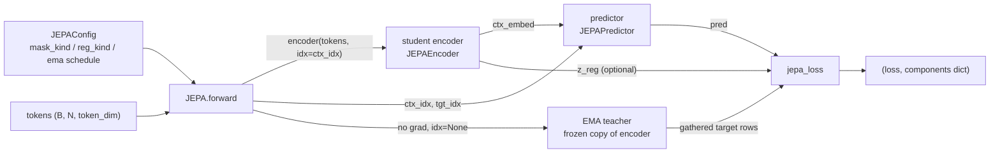
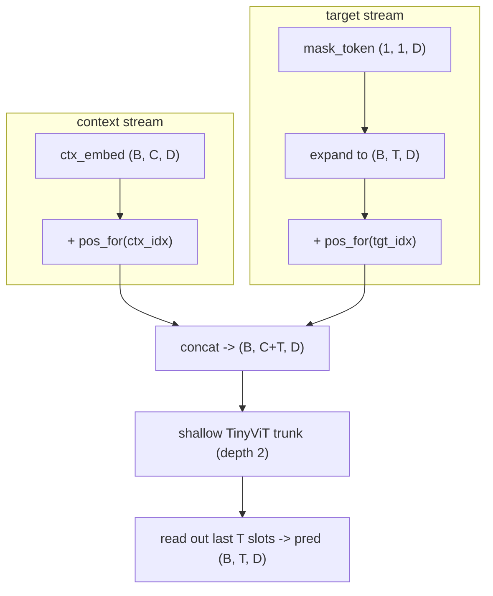

The `ssllab.jepa` package is deliberately small — three files — because the architecture it encodes is a *protocol*, not a pile of layers. The organizing principle is stated right in the module docstring as a five-step contract: sample a (context, target) position split → the student encoder embeds only the context tokens → the predictor predicts embeddings at the target positions → the EMA teacher encodes the *full* token set (no gradients) and the target rows are gathered → `jepa_loss` combines the prediction error with an optional anti-collapse regularizer [model.py](/src/ssllab/jepa/model.py#L1-L14).

This page dissects that protocol at the implementation level: the module map, the three network roles, the position-index abstraction that makes it all work, the exact per-step caller contract, the EMA mechanics, the loss assembly, and the backward-compatibility guarantees baked into the configuration. Masking strategy internals deserve their own treatment and are covered in [Masking Strategies: Random and Span](7-masking-strategies-random-and-span); the mathematical depth of VICReg and SIGReg is deferred to [Anti-Collapse: VICReg and SIGReg](8-anti-collapse-vicreg-and-sigreg). A higher-level orientation lives in [Architecture Overview](4-architecture-overview).

Sources: [model.py](/src/ssllab/jepa/model.py#L1-L14)

## Module Map

The package has a clean dependency direction: `jepa/` owns the orchestration and state (config, forward protocol, EMA teacher, mask sampling) and imports *network primitives* from `models/` and the *training signal* from `objectives/`. The package's `__init__.py` exports a narrow, stable surface — `JEPA`, `JEPAConfig`, `build_jepa`, `EMA`, and `sample_block_masks` — so downstream code never needs to reach into internals [__init__.py](/src/ssllab/jepa/__init__.py#L1-L8).

| File | Role | Key exports |
|---|---|---|
| `src/ssllab/jepa/model.py` | Orchestrator: config, five-step forward, factory | `JEPA`, `JEPAConfig`, `build_jepa` |
| `src/ssllab/jepa/ema.py` | Teacher state + cosine momentum schedule | `EMA` |
| `src/ssllab/jepa/masking.py` | Context/target split samplers | `sample_block_masks`, `sample_span_masks`, `batched` |
| `src/ssllab/models/vit.py` | Modality-agnostic transformer primitives | `PatchEmbed`, `TransformerBlock`, `TinyViT` |
| `src/ssllab/models/encoder.py` | Subset-native encoder (student *and* teacher) | `JEPAEncoder` |
| `src/ssllab/models/predictor.py` | Two-stream target-position predictor | `JEPAPredictor` |
| `src/ssllab/objectives/jepa_loss.py` | Loss terms and the combinator | `jepa_loss`, `prediction_loss`, `vicreg_reg`, `sigreg`, `epps_pulley` |

The `vit.py` header makes an important scoping claim: everything there operates on token tensors `(B, N, token_dim)` plus integer position indices — there is *nothing image-specific* in the trunk. That is what lets the same primitives serve MNIST patches, ECG time series, and gene-group tokens without modification [vit.py](/src/ssllab/models/vit.py#L1-L7).

Sources: [__init__.py](/src/ssllab/jepa/__init__.py#L1-L8), [vit.py](/src/ssllab/models/vit.py#L1-L7)

## Three Roles, Three Networks

`JEPA.__init__` wires up exactly three roles. The **student encoder** is a `JEPAEncoder` that will only ever see the context subset during training. The **predictor** is a `JEPAPredictor` — the only component whose job is to close the gap between what the student saw and what it must output. The **EMA teacher** is not a separate class at all: it is an `EMA` object wrapping a frozen deep copy of the *encoder* [model.py](/src/ssllab/jepa/model.py#L77-L104).

Two asymmetries are deliberate and structural. First, the teacher tracks the **encoder only** — the predictor has no teacher copy, because the predictor exists precisely to be the imperfect bridge that training sharpens. Second, the capacities differ: defaults give the encoder depth 4 and the predictor depth 2, the standard JEPA design where a shallow predictor prevents the trivial solution of both sides collapsing toward each other [model.py](/src/ssllab/jepa/model.py#L31-L40).



Sources: [model.py](/src/ssllab/jepa/model.py#L77-L104), [ema.py](/src/ssllab/jepa/ema.py#L1-L6), [predictor.py](/src/ssllab/models/predictor.py#L1-L8)

## Position Indices: One Encoder, Many Views

The linchpin abstraction of the whole module is that **positions travel as integer indices, not as tensor slices**. `TinyViT` stores a learned positional table of shape `(1, n_positions, embed_dim)` and exposes `pos_for(idx)`, which gathers rows by index to produce `(B, N, embed_dim)` [vit.py](/src/ssllab/models/vit.py#L51-L94). `JEPAEncoder.forward` then does three things: gather the selected tokens via `torch.gather`, add `pos_for(idx)` so every token keeps its *absolute* position regardless of what was dropped, and run the trunk. Pass `idx=None` and the full set is embedded with positions `0..N-1` — identical code path, no special casing [encoder.py](/src/ssllab/models/encoder.py#L41-L76).

> [!TIP]
> This index-gather design is why the same `JEPAEncoder` class serves both the student (context subset via `idx=ctx_idx`) and the teacher (full set via `idx=None`) with zero branching in the training code. It is also why `embed_pooled` — the downstream latent — is literally just `forward(tokens, idx=None).mean(dim=1)` [encoder.py](/src/ssllab/models/encoder.py#L78-L84).

The predictor reuses the same trick in a two-stream construction. The context stream adds position embeddings to embeddings that already carry content; the target stream builds rows from a learned `mask_token` (trunc-normal, std 0.02) plus `pos_for(tgt_idx)` — so the predictor is told *where* to predict by position, not by copying content. Both streams are concatenated, run through the shallow trunk, and the last T slots are read out as the prediction [predictor.py](/src/ssllab/models/predictor.py#L29-L73).



One implementation footnote worth knowing before you touch this code: the read-out slice ends with `.contiguous()` because the non-contiguous view breaks `smooth_l1_loss` on MPS (Apple silicon); on CPU/CUDA it is a no-op [predictor.py](/src/ssllab/models/predictor.py#L70-L73).

Sources: [vit.py](/src/ssllab/models/vit.py#L51-L94), [encoder.py](/src/ssllab/models/encoder.py#L41-L84), [predictor.py](/src/ssllab/models/predictor.py#L29-L73)

## Anatomy of One Training Step

`JEPA.forward` executes the five-step protocol in ~40 lines. Mask selection dispatches on `cfg.mask_kind` — `sample_span_masks` for contiguous spans on ordered sequences, `sample_block_masks` for scattered positions otherwise — then the resulting 1-D index vectors are broadcast across the batch with `batched()` [model.py](/src/ssllab/jepa/model.py#L107-L116). The student encodes context, the predictor predicts, the teacher encodes the full set under `torch.no_grad()`, and the target rows are gathered out of the full output with `torch.gather` [model.py](/src/ssllab/jepa/model.py#L118-L126). Before calling the loss, `forward` selects what the optional regularizer acts on — the `z_reg` tensor — according to `reg_kind` and `reg_target` (covered below) [model.py](/src/ssllab/jepa/model.py#L128-L135).

One simplification to internalize early: the (context, target) split is sampled **once per step and shared across the whole batch**, which keeps variable-length subsets rectangular and the code simple — a deliberate POC-level trade-off documented in the masking module itself. Which split to use, and why, is the subject of [Masking Strategies: Random and Span](7-masking-strategies-random-and-span) [masking.py](/src/ssllab/jepa/masking.py#L10-L15).

```mermaid
sequenceDiagram
    participant Loop as training loop
    participant J as JEPA
    participant E as student encoder
    participant P as predictor
    participant T as EMA teacher
    participant L as jepa_loss
    Loop->>J: forward(tokens)
    J->>J: sample (ctx, tgt) split
    J->>E: encoder(tokens, idx=ctx_idx)
    E-->>J: ctx_embed (B, C, D)
    J->>P: predictor(ctx_embed, ctx_idx, tgt_idx)
    P-->>J: pred (B, T, D)
    J->>T: teacher(tokens, idx=None) under no_grad
    T-->>J: full (B, N, D)
    J->>J: gather rows at tgt_idx
    J->>L: jepa_loss(pred, target, z_reg, ...)
    L-->>Loop: (loss, components)
    Loop->>Loop: zero_grad / backward / step
    Loop->>J: update_target(step, total)
```

The caller contract is strict and visible in the reference training script: per batch, call `jepa(tokens)` for `(loss, comp)`, then `opt.zero_grad()` → `loss.backward()` → `opt.step()` → `jepa.update_target(step, total_steps)` — in that order, every step. The optimizer is constructed over `jepa.parameters()`; as the next section explains, the teacher's weights are deliberately absent from that collection [01_train_jepa_mnist.py](/examples/jepa_basics/01_train_jepa_mnist.py#L84-L99).

Sources: [model.py](/src/ssllab/jepa/model.py#L107-L154), [01_train_jepa_mnist.py](/examples/jepa_basics/01_train_jepa_mnist.py#L84-L99), [masking.py](/src/ssllab/jepa/masking.py#L10-L15)

## The EMA Teacher: Frozen State on a Cosine Schedule

`EMA.__init__` builds the teacher as a `copy.deepcopy` of the student encoder, freezes every parameter with `requires_grad_(False)`, and calls `.eval()` — so it contributes no gradients, no dropout, no state-dict entries [ema.py](/src/ssllab/jepa/ema.py#L17-L24). The momentum follows the standard I-JEPA/BYOL cosine ramp: `m = final − (final − base) · (cos(π·frac) + 1) / 2`, moving from `ema_base = 0.996` early in training toward `ema_final = 1.0` at the end — the teacher stabilizes into a slowly-drifting target as the student converges [ema.py](/src/ssllab/jepa/ema.py#L26-L31).

The update itself blends parameters as `pt.mul_(m).add_(ps.detach(), alpha=1−m)` but copies **buffers wholesale** with `copy_` — parameters interpolate, buffers track the student exactly [ema.py](/src/ssllab/jepa/ema.py#L33-L41).

> [!TIP]
> `EMA` is a plain Python object, not an `nn.Module` — so the teacher is invisible to `jepa.parameters()`, `jepa.state_dict()`, and `jepa.to(device)`. This is why every training script contains the explicit line `jepa.ema.to(device)` after moving the model, and why checkpoints save only student-side weights. Forgetting that line silently leaves the teacher on CPU [01_train_jepa_mnist.py](/examples/jepa_basics/01_train_jepa_mnist.py#L83), [model.py](/src/ssllab/jepa/model.py#L94).

Sources: [ema.py](/src/ssllab/jepa/ema.py#L17-L41), [model.py](/src/ssllab/jepa/model.py#L151-L154)

## Loss Assembly: Prediction Term Plus Optional Anti-Collapse

Every loss in `objectives/jepa_loss.py` is a **plain function returning `(scalar, dict_of_components)`** — the house convention that lets every caller log the decomposition of its loss without wrapper machinery. The prediction term supports three kinds against the detached EMA target [jepa_loss.py](/src/ssllab/objectives/jepa_loss.py#L1-L23):

| `pred_kind` | Form | Character |
|---|---|---|
| `smooth_l1` *(default)* | Huber loss on `(pred, target)` | robust to outliers; the loss the MPS `.contiguous()` note guards |
| `mse` | mean squared error | plain L2 pull |
| `cosine` | `1 − cos(pred, target)` | scale-free; matches direction only [jepa_loss.py](/src/ssllab/objectives/jepa_loss.py#L31-L41) |

The anti-collapse side offers two regimes with *different combination semantics* — this is the subtlest part of the combinator:

| `reg_kind` | Combination rule | Notes |
|---|---|---|
| `vicreg` | `pred + reg_coef · VICReg` | additive; unchanged since before SIGReg existed, so old runs reproduce exactly |
| `sigreg` | `(1 − reg_coef) · pred + reg_coef · SIGReg` | LeJEPA's convex form; paper default `reg_coef = 0.05` [jepa_loss.py](/src/ssllab/objectives/jepa_loss.py#L167-L170) |

VICReg itself is two terms: a hinge that pushes each embedding dimension's std up to 1, and a penalty on off-diagonal covariance entries (summed over the matrix, divided by `D`), weighted by `var_coef = 1.0` and `cov_coef = 0.04` by default [jepa_loss.py](/src/ssllab/objectives/jepa_loss.py#L44-L76). SIGReg instead projects embeddings onto 1024 random unit directions — resampled every call — and scores each 1-D projection with the Epps–Pulley statistic comparing the empirical characteristic function to the standard normal's; the internal factor `N` keeps the statistic's scale tied to the group size rather than shrinking with the batch [jepa_loss.py](/src/ssllab/objectives/jepa_loss.py#L79-L137).

The final piece is *what* the regularizer acts on — the `z_reg` tensor chosen in `JEPA.forward` by a two-axis decision:

| | `reg_target="tokens"` | `reg_target="pooled"` |
|---|---|---|
| `reg_kind="vicreg"` | `(B·C, D)` — all context rows flattened into one pile (the historical behavior) | `(B, D)` — mean over context tokens |
| `reg_kind="sigreg"` | `(C, B, D)` — transposed, so each token position's batch is one "view", averaged | `(B, D)` [model.py](/src/ssllab/jepa/model.py#L128-L149) |

The `sigreg` row exists because SIGReg is distribution-shaped rather than moment-shaped: the statistic carries a factor `N`, so testing each token position's `B` rows as one view keeps the token target on the same scale as the pooled target — a scale-matching decision documented directly in the `sigreg` docstring [jepa_loss.py](/src/ssllab/objectives/jepa_loss.py#L102-L137). With `reg_coef = 0.0` (the config default), both regimes degenerate to the pure prediction loss — the EMA mechanism alone provides the primary defense against collapse, and the regularizer is explicitly positioned as "cheap insurance and an explicit knob" [jepa_loss.py](/src/ssllab/objectives/jepa_loss.py#L8-L11).

Sources: [jepa_loss.py](/src/ssllab/objectives/jepa_loss.py#L1-L23), [jepa_loss.py](/src/ssllab/objectives/jepa_loss.py#L31-L76), [jepa_loss.py](/src/ssllab/objectives/jepa_loss.py#L102-L137), [jepa_loss.py](/src/ssllab/objectives/jepa_loss.py#L140-L194), [model.py](/src/ssllab/jepa/model.py#L128-L149)

## Configuration Surface and Backward Compatibility

`JEPAConfig` is a single dataclass covering the entire experiment surface, with `__post_init__` validating the enum-like choices and the span-masking arithmetic constraint `n_target == span_len × n_spans` [model.py](/src/ssllab/jepa/model.py#L30-L74). The defaults encode the MNIST baseline: 16 tokens of dim 49 (a 4×4 grid of 7×7 patches) predicting 4 targets [model.py](/src/ssllab/jepa/model.py#L31-L62). The `build_jepa(**kwargs)` factory accepts any config field as a keyword, mirroring the repo's other builders [model.py](/src/ssllab/jepa/model.py#L162-L167).

| Field | Default | Meaning |
|---|---|---|
| `token_dim` / `n_tokens` | 49 / 16 | 7×7 patches on a 4×4 grid (MNIST baseline) |
| `embed_dim` | 128 | shared latent width across encoder, predictor, loss |
| `enc_depth` / `pred_depth` | 4 / 2 | deliberate capacity asymmetry |
| `n_target` | 4 | target positions per step (random masking) |
| `pred_kind` | `smooth_l1` | prediction loss family |
| `ema_base` / `ema_final` | 0.996 / 1.0 | cosine momentum endpoints |
| `mask_kind` | `random` | or `"span"`; validated against `span_len · n_spans` |
| `reg_kind` / `reg_target` | `vicreg` / `tokens` | anti-collapse regime and acting surface |
| `sigreg_slices` / `sigreg_points` / `sigreg_t_max` | 1024 / 17 / 5.0 | projection count, Epps–Pulley knots, integration range |

Backward compatibility is engineered, not hoped for, through three explicit devices. First, the SIGReg random directions come from a **private generator seeded 0**, created lazily on first use, keyed to the embeddings' device, re-created if the device changes, and deliberately excluded from the state dict — so the default VICReg path consumes exactly the same random numbers as it did before SIGReg existed, and old checkpoints load unchanged [model.py](/src/ssllab/jepa/model.py#L95-L104). Second, the VICReg combination form is kept additive-and-unmodified precisely so pre-SIGReg runs reproduce bit-for-bit [jepa_loss.py](/src/ssllab/objectives/jepa_loss.py#L164-L170). Third, new fields carry comments stating which default preserves old checkpoints — the masking defaults are chosen for exactly this reason [model.py](/src/ssllab/jepa/model.py#L45-L48).

Sources: [model.py](/src/ssllab/jepa/model.py#L30-L74), [model.py](/src/ssllab/jepa/model.py#L95-L104), [jepa_loss.py](/src/ssllab/objectives/jepa_loss.py#L164-L170)

## The `embed` Seam: What the Rest of the Repo Reads

Training produces one artifact the rest of the system cares about: `JEPA.embed(tokens)`, the mean-pooled student latent `z` of shape `(B, embed_dim)`, computed over the full token set with no masking. The encoder docstring names its consumers explicitly — the decoder, the flow prior, and the linear probe — making `embed` the single seam between the JEPA core and the generative and evaluation stacks [encoder.py](/src/ssllab/models/encoder.py#L78-L84), [model.py](/src/ssllab/jepa/model.py#L156-L159).

The reference script also shows the standard health check run against this seam each epoch: pool a held-out batch through `embed` and feed it to `collapse_report`, tracking **effective rank** and **feature std** — effective rank should stay well above 1, the canonical signal that the EMA-plus-regularizer regime is holding back collapse [01_train_jepa_mnist.py](/examples/jepa_basics/01_train_jepa_mnist.py#L102-L111).

**Where to go next.** Two natural continuations deepen exactly what this page treated at interface level: [Masking Strategies: Random and Span](7-masking-strategies-random-and-span) explains the split samplers invoked at the top of `forward`, and [Anti-Collapse: VICReg and SIGReg](8-anti-collapse-vicreg-and-sigreg) develops the mathematics of the `z_reg` regimes tabulated above. To follow `z` downstream into the generative stack, continue to [Flow-Matching Prior](9-flow-matching-prior); to see how `z` is judged, see [Evaluation Toolkit: Probes and Metrics](19-evaluation-toolkit-probes-and-metrics).
