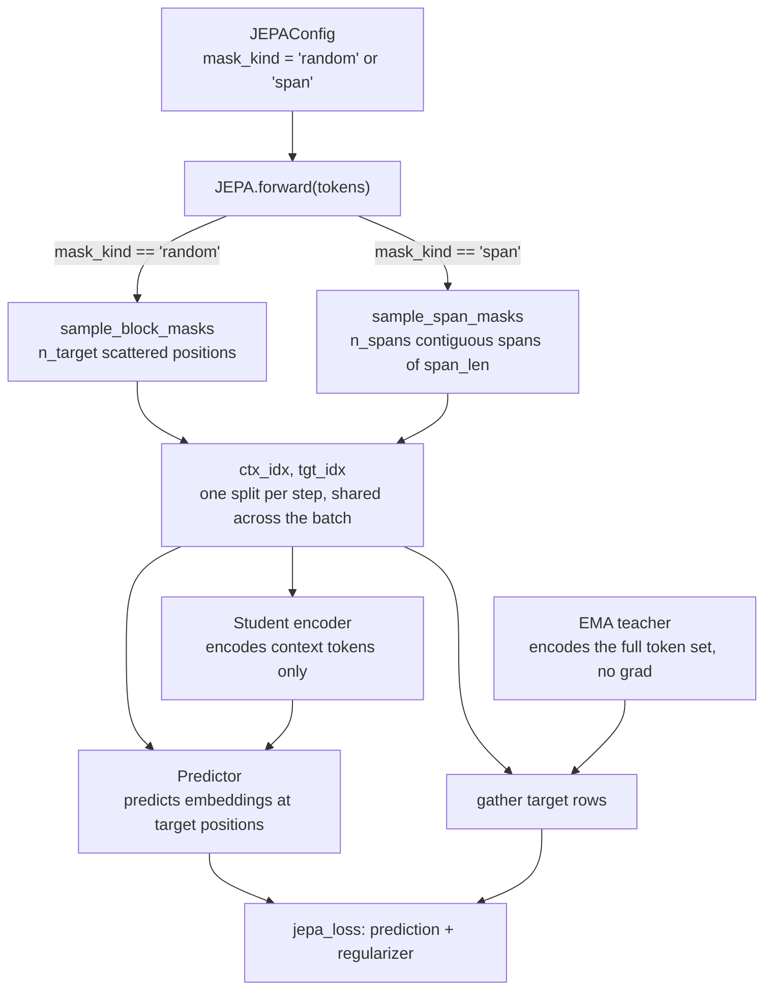
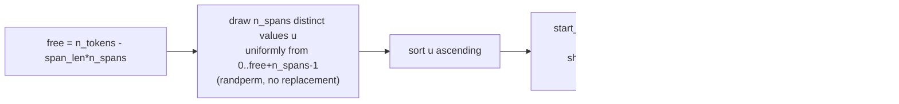

This page explains the masking subsystem of the JEPA core: the two samplers in `src/ssllab/jepa/masking.py`, the `JEPAConfig` seam that chooses between them, and the behavioral contract the test suite pins down. Masking is where the self-supervised prediction task is *defined* — the hidden positions are what the predictor must reconstruct in latent space — so the choice between scattered targets and contiguous spans is a modeling decision, not an implementation detail. It assumes you have already read [JEPA Module Internals](6-jepa-module-internals) for the encoder/predictor/EMA-teacher assembly; the anti-collapse regularizers that ride on the same forward pass are covered in [Anti-Collapse: VICReg and SIGReg](8-anti-collapse-vicreg-and-sigreg).

Sources: [masking.py](/src/ssllab/jepa/masking.py#L1-L15)

## Masking Is the Prediction Task

Every JEPA step partitions the `n_tokens` positions of a sample into a **target** subset (what the predictor must predict) and a **context** subset (everything else, what the student encoder sees). The masking module produces this split as two sorted 1-D index tensors, `ctx_idx` and `tgt_idx`, which the forward pass then threads through the three networks. The v0 design used a random target subset of fixed size — enough to drive learning on the 4×4 MNIST grid — and the span sampler was added specifically for ordered 1D token sequences such as ECG windows.

Sources: [masking.py](/src/ssllab/jepa/masking.py#L1-L10), [model.py](/src/ssllab/jepa/model.py#L107-L126)

The motivation for a second strategy is statistical rather than cosmetic. On a quasi-periodic signal like an ECG, a *randomly scattered* hidden token can be interpolated from its immediate neighbors — a nearly free task that the encoder can solve with local smoothing instead of learning the rhythm's structure. A *contiguous span* covering a whole heartbeat cannot be interpolated away, because the information needed to reconstruct it is not present in adjacent context. The two strategies thus encode different assumptions about redundancy in the token sequence.

Sources: [masking.py](/src/ssllab/jepa/masking.py#L6-L10)

The diagram below places the mask samplers in context: they are the first thing `JEPA.forward` does on every step, and the resulting index tensors flow into the student, the predictor, and the teacher-side gather.

Sources: [model.py](/src/ssllab/jepa/model.py#L107-L149)

## Random Masking: The Scattered Split

`sample_block_masks` implements the random strategy in four lines: draw a `randperm` of all `n_tokens` positions, take the first `n_target` entries as targets and the remainder as context, and sort both halves so the index vectors are monotonically increasing. Sorting matters downstream — the encoder indexes tokens in their natural order, and position-consistent ordering keeps the batch tensors well-formed. The function validates `1 <= n_target < n_tokens` up front, refusing configurations that would predict everything or nothing.

Sources: [masking.py](/src/ssllab/jepa/masking.py#L22-L47)

There is no contiguity structure of any kind here: targets are distinct single positions scattered uniformly at random. That is precisely the right bias for *order-free* token sets — the 4×4 patch grid of an MNIST image and a cell's gene-group tokens have no adjacency semantics worth preserving, so hiding 4 of 16 patches (or 12 gene tokens in the perturb-seq study) gives a rich prediction task without any spatial reasoning. Both of those studies rely on this default; neither passes `mask_kind` at all.

Sources: [01_train_jepa_mnist.py](/examples/jepa_basics/01_train_jepa_mnist.py#L74-L82), [01_pretrain_stage_a.py](/examples/perturbation_response/01_pretrain_stage_a.py#L67)

| Dimension | `sample_block_masks` (random) | `sample_span_masks` (span) |
|---|---|---|
| Target geometry | `n_target` scattered single positions | `n_spans` contiguous runs of `span_len` tokens |
| Sampling algorithm | one `randperm`, split, sort each half | stars-and-bars placement of span starts |
| Overlap guarantee | targets are distinct positions | spans disjoint; may touch, never overlap |
| Target size | exactly `n_target` | exactly `span_len × n_spans` |
| Context size | `n_tokens − n_target` | `n_tokens − span_len·n_spans` |
| Natural home | order-free token grids (MNIST patches, gene groups) | ordered 1D sequences (ECG windows) |
| Reproducibility | optional `torch.Generator` | optional `torch.Generator` |

Sources: [masking.py](/src/ssllab/jepa/masking.py#L22-L77)

## Span Masking: Contiguous Holes for Ordered Sequences

`sample_span_masks` hides `n_spans` non-overlapping contiguous blocks of `span_len` tokens each. Spans **may touch** — two adjacent spans read as one longer span — but they never overlap, so the target set always has exactly `span_len × n_spans` positions regardless of where the spans land. This fixed size is what lets the model validate the geometry once in `JEPAConfig` and never worry about variable-length targets during training.

Sources: [masking.py](/src/ssllab/jepa/masking.py#L56-L61)

The placement algorithm is a clean stars-and-bars construction. Let `free = n_tokens − span_len·n_spans` be the slack; the sampler chooses `n_spans` distinct values `u_1 < … < u_k` uniformly from `{0, …, free + n_spans − 1}` and shifts each one past the spans before it: `start_i = u_i + i·(span_len − 1)`. Choosing without replacement via `randperm` guarantees distinctness, hence non-overlap; the shift guarantees ordering; and the uniform draw over the shrunken pool makes every valid placement equally likely.

Sources: [masking.py](/src/ssllab/jepa/masking.py#L62-L77)

A worked example makes the arithmetic concrete. Take `n_tokens=10`, `span_len=3`, `n_spans=2`: the target budget is 6, so `free=4` and `u` is drawn from `{0,…,5}`. Drawing `u=[1,4]` gives `starts=[1, 4+1·2]=[1,6]` — targets `{1,2,3,6,7,8}`, two separated holes. Drawing `u=[2,3]` instead gives `starts=[2,5]` — spans `[2,4]` and `[5,7]`, which *touch* into a single six-token run. Both outcomes satisfy the invariant the tests check: every maximal run of target positions is a multiple of `span_len`. The endpoints are reachable too — the smallest possible start is 0 and the largest is 7 (span `[7,9]`), which is exactly what the coverage test verifies over 2000 draws.

Sources: [masking.py](/src/ssllab/jepa/masking.py#L68-L77), [test_span_masks.py](/tests/test_span_masks.py#L38-L44)

> [!TIP]
> Masking is resampled at *every* optimizer step but held constant *within* a step — so "every sample sees the same context" is a per-step statement, not a per-run one. Over training, each position appears in targets with equal probability; the coverage test verifies this empirically for span mode, including the sequence endpoints.

Sources: [masking.py](/src/ssllab/jepa/masking.py#L12-L14), [test_span_masks.py](/tests/test_span_masks.py#L38-L44)

## One Split Per Step: The Shared-Across-Batch Design

Masks are sampled per step but **shared across the batch**: one context/target split serves every sample in the step. The `batched` helper broadcasts the 1-D index vectors to `(B, len(idx))` so the encoder and predictor can index rectangular tensors. This is a deliberate simplification — per-sample masks would produce jagged subsets and either padding or gather-based bookkeeping, complexity a small-scale JEPA proof-of-concept does not need. The cost is a mild loss of diversity per step, which the per-step resampling amortizes away over training.

Sources: [masking.py](/src/ssllab/jepa/masking.py#L12-L14), [masking.py](/src/ssllab/jepa/masking.py#L80-L83)

Both samplers accept an optional `torch.Generator`, so the split is fully reproducible from a seed. The ECG pretraining script exploits this: its data iteration is driven by an explicitly seeded generator, keeping an entire run replayable. This matters because the masking draw is part of the experiment's noise — the same discipline the methodology pages cover under seeds and reproducibility.

Sources: [masking.py](/src/ssllab/jepa/masking.py#L26-L27), [masking.py](/src/ssllab/jepa/masking.py#L55-L56), [03_pretrain_jepa.py](/examples/ecg_rhythm/03_pretrain_jepa.py#L101-L102)

## The Configuration Seam: Dispatch and Validation

The strategy is a plain dataclass field on `JEPAConfig`. Three fields parameterize masking: `mask_kind` (the dispatch key, default `"random"`), plus `span_len` and `n_spans` (active only in span mode). `n_target` is shared by both modes — the number of hidden positions the predictor must reconstruct — and in span mode it is not an independent knob but an arithmetic identity with the other two.

Sources: [model.py](/src/ssllab/jepa/model.py#L45-L50)

| Field | Default | Role | Constraint |
|---|---|---|---|
| `mask_kind` | `"random"` | sampler dispatch key | must be `"random"` or `"span"` |
| `n_target` | `4` | hidden positions to predict | `1 <= n_target < n_tokens` |
| `span_len` | `0` | tokens per contiguous span (span mode) | `>= 1`; `span_len·n_spans < n_tokens` |
| `n_spans` | `1` | number of spans (span mode) | `>= 1`; `n_target == span_len × n_spans` |

Sources: [model.py](/src/ssllab/jepa/model.py#L45-L50), [masking.py](/src/ssllab/jepa/masking.py#L42-L43), [masking.py](/src/ssllab/jepa/masking.py#L68-L70)

Validation happens at two layers. `JEPAConfig.__post_init__` rejects unknown `mask_kind` values and refuses span configurations where `n_target != span_len × n_spans` — catching the identity violation at construction time, before any GPU work. The sampler layer then re-checks the geometry (`span_len·n_spans` strictly less than `n_tokens`), guarding against programs that call `sample_span_masks` directly and would otherwise leave no context at all; the tests exercise exactly this failure with `sample_span_masks(8, 4, 2)`.

Sources: [model.py](/src/ssllab/jepa/model.py#L64-L74), [masking.py](/src/ssllab/jepa/masking.py#L68-L70), [test_span_masks.py](/tests/test_span_masks.py#L47-L57)

At forward time the dispatch is a single branch: `mask_kind == "span"` routes to `sample_span_masks` with `cfg.span_len` and `cfg.n_spans`, everything else (by validation, only `"random"`) routes to `sample_block_masks` with `cfg.n_target`. Both return the same `(ctx_idx, tgt_idx)` shape contract, so everything downstream — the batched broadcast, the context-encoding, the predictor call, the teacher-side `torch.gather` of target rows — is strategy-agnostic. Note also that the pooled `embed` inference path (`encoder.embed_pooled`) is *not* masked; masking exists only inside the training step, and the downstream generative stack consumes the unmasked latent.

Sources: [model.py](/src/ssllab/jepa/model.py#L107-L126), [model.py](/src/ssllab/jepa/model.py#L157-L159)

## Which Strategy Where

The repository's three pretraining consumers map cleanly onto the two strategies, and the mapping follows modality structure rather than preference. Order-free token grids use random masking with the defaults; the one ordered 1D modality — ECG — uses span masking. The ECG study additionally bridges from *physical time* to token counts via `SignalGeometry`, which specifies geometry in Hz and seconds, derives `span_tokens = span_s / patch_s`, and refuses any ratio that is not a whole number or a span that would leave no context — the same "refuse rather than round" discipline the masking validators apply in index space.

Sources: [signal.py](/src/ssllab/data/signal.py#L1-L16), [signal.py](/src/ssllab/data/signal.py#L70-L76)

| Consumer | Tokens represent | Strategy | Mask arguments |
|---|---|---|---|
| `examples/jepa_basics/01_train_jepa_mnist.py` | 4×4 MNIST patch grid | random (default) | `n_target=4` |
| `examples/perturbation_response/01_pretrain_stage_a.py` | gene-group tokens per cell | random (default) | `n_target=12` |
| `examples/ecg_rhythm/03_pretrain_jepa.py` | 250 ms ECG patches | span | `span_len=4` (1 s per span at 250 ms patches), `n_spans` from the study config |

Sources: [01_train_jepa_mnist.py](/examples/jepa_basics/01_train_jepa_mnist.py#L53), [01_pretrain_stage_a.py](/examples/perturbation_response/01_pretrain_stage_a.py#L67), [03_pretrain_jepa.py](/examples/ecg_rhythm/03_pretrain_jepa.py#L87-L92)

The ECG script's `build_jepa` call shows the seam in its applied form: `n_target` is computed as `geom.span_tokens * cfg["n_spans"]`, satisfying the config identity by construction, and `mask_kind`, `span_len`, `n_spans` are passed straight from the study configuration. The docstring states the training semantics this produces: each step hides `n_spans` contiguous spans of `span_s` seconds — 4 tokens of 250 ms each by default — and predicts the EMA teacher's embeddings there, with collapse diagnostics (feature std, effective rank) logged alongside.

Sources: [03_pretrain_jepa.py](/examples/ecg_rhythm/03_pretrain_jepa.py#L1-L16), [03_pretrain_jepa.py](/examples/ecg_rhythm/03_pretrain_jepa.py#L87-L92)

## The Test Contract

`tests/test_span_masks.py` pins the subsystem down with property-based checks rather than snapshot values, so the samplers are free to change implementation as long as the contract holds. The suite covers the full lifecycle: sampler properties, config validation, end-to-end training, and storage compatibility.

Sources: [test_span_masks.py](/tests/test_span_masks.py#L1-L74)

| Property | Test | What it pins down |
|---|---|---|
| Exact partition | `test_span_masks_partition_and_contiguity` | target size exactly `span_len·n_spans`; `ctx ∪ tgt` is exactly `{0…n_tokens−1}` |
| Contiguity structure | same test | every maximal run of target positions is a multiple of `span_len` |
| Positional coverage | `test_span_positions_cover_the_whole_sequence` | 2000 draws hit every position, ends included — no dead zones |
| Geometry rejection | `test_span_masks_reject_impossible_geometry` | a span budget consuming all tokens raises `ValueError` |
| Config consistency | `test_config_validates_span_target_count` | `n_target ≠ span_len·n_spans` and unknown `mask_kind` both raise |
| Training + compatibility | `test_span_jepa_trains_and_old_checkpoints_still_load` | span JEPA trains to a finite loss; pre-span checkpoints load unchanged |

Sources: [test_span_masks.py](/tests/test_span_masks.py#L27-L35), [test_span_masks.py](/tests/test_span_masks.py#L38-L57), [test_span_masks.py](/tests/test_span_masks.py#L59-L74)

> [!TIP]
> The compatibility test is the reason `mask_kind` is a defaulted `str` field rather than an enum: a checkpoint saved before the masking fields existed deserializes cleanly and reports `mask_kind == "random"` — so every historical run remains loadable with the exact masking semantics it was trained under, and unknown values still fail fast at `__post_init__` rather than silently training with a garbage strategy.

Sources: [model.py](/src/ssllab/jepa/model.py#L45-L48), [model.py](/src/ssllab/jepa/model.py#L69-L70), [test_span_masks.py](/tests/test_span_masks.py#L59-L74)

## Where to Go Next

The masking seam sits between two other JEPA-core concerns. Upstream, how the encoder and predictor consume `idx` tensors — positional embeddings, pooling, the EMA update schedule — is the subject of [JEPA Module Internals](6-jepa-module-internals). Downstream, the regularizer term that stabilizes training on the *context* embeddings produced under these masks (VICReg on context-token rows, SIGReg per-position or on the pooled vector) is treated in [Anti-Collapse: VICReg and SIGReg](8-anti-collapse-vicreg-and-sigreg). To see span masking at work end-to-end — study configuration, seeding, collapse diagnostics, and downstream evaluation — follow [ECG Rhythm Study](17-ecg-rhythm-study); the perturb-seq consumer's full pipeline, including the count decoder that reads the pooled latent, is [Perturbation-Response Pipeline](16-perturbation-response-pipeline).