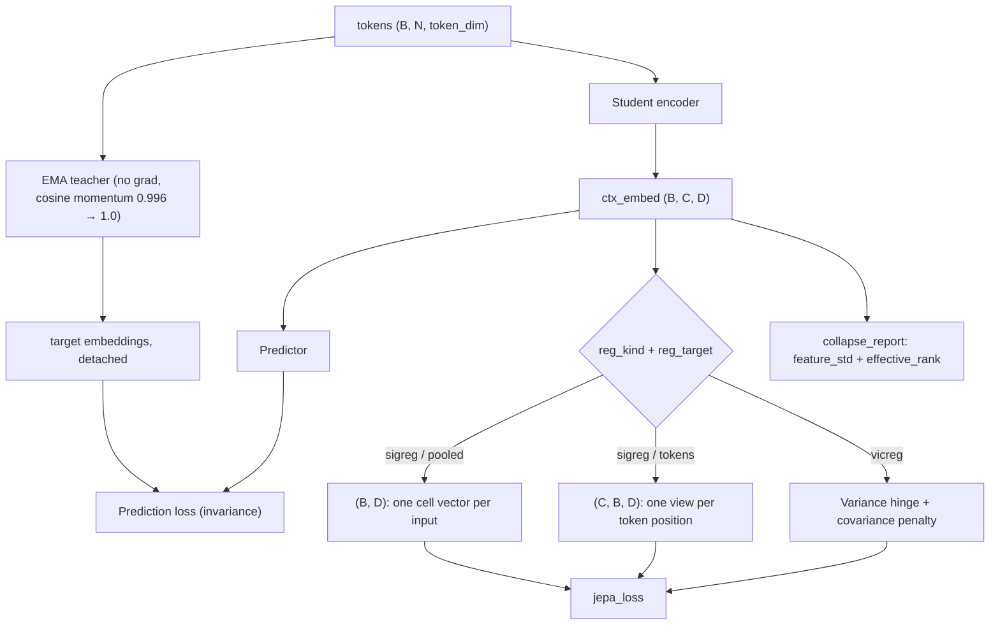
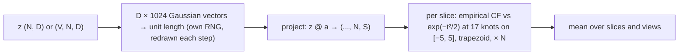

Every self-supervised objective that predicts embeddings from embeddings has a degenerate solution, and this page documents how ssl-lab fights it. The repository implements three cooperating defenses: a structural one (the EMA teacher), an explicit regularizer with two interchangeable flavors — **VICReg** (second-moment constraints) and **SIGReg** (sketched isotropic-Gaussian testing, from LeJEPA) — and a pair of runtime diagnostics that detect collapse when prevention fails. The core implementation lives in a single module, `src/ssllab/objectives/jepa_loss.py`, is wired into the JEPA forward pass in `src/ssllab/jepa/model.py`, and was stress-tested head-to-head in the perturb-seq study's Round 9.

Sources: [jepa_loss.py](/src/ssllab/objectives/jepa_loss.py#L1-L23), [model.py](/src/ssllab/jepa/model.py#L1-L14), [round-09-sigreg-regularizer.md](/examples/perturbation_response/docs/results/round-09-sigreg-regularizer.md#L1-L5)

## Why Predicting Embeddings Can Collapse

The JEPA objective invites a cheat: if the encoder maps every input to the same embedding vector, the prediction loss reaches its minimum trivially — predicting a constant from a constant needs no understanding. The repository names two flavors of this failure, because the guards attack each with its own term. **Dimensional collapse** means some latent directions shrink to near-constants and stop varying across inputs, carrying no information; in the limit every dimension collapses and all inputs map to one point. **Informational collapse** is subtler: the dimensions vary but are redundant, several encoding the same thing, so the *effective* number of independent directions falls far below the nominal embedding width.

Sources: [03c-the-vicreg-collapse-guard.md](/examples/perturbation_response/docs/conditional-flow-jepa/03c-the-vicreg-collapse-guard.md#L7-L14), [collapse.py](/src/ssllab/eval/collapse.py#L1-L10)

## Three Layers of Defense

The architecture layers its defenses so that no single mechanism is load-bearing. The first layer is **structural**: the EMA teacher is a frozen, non-trainable copy of the student whose weights track it by exponential moving average, and because targets come from this slowly-moving teacher rather than the student itself, the target manifold drifts slower than the optimizer can collapse it. The second layer is the **explicit regularizer**, off by default (`reg_coef=0`) and enabled as "cheap insurance and an explicit knob." The third layer is **detection**: every training script logs `feature_std` and `effective_rank` on a held-out batch each epoch, so a collapsing run is visible early rather than discovered at evaluation time.

Sources: [ema.py](/src/ssllab/jepa/ema.py#L1-L7), [jepa_loss.py](/src/ssllab/objectives/jepa_loss.py#L8-L11), [03c-the-vicreg-collapse-guard.md](/examples/perturbation_response/docs/conditional-flow-jepa/03c-the-vicreg-collapse-guard.md#L30-L34), [01_train_jepa_mnist.py](/examples/jepa_basics/01_train_jepa_mnist.py#L102-L111)



The diagram makes one design decision visible: the prediction loss and the regularizer read the *same* student context embeddings, but the regularizer's reshaping (`SEL` node) depends on which flavor is active — a detail the section on `reg_target` below develops fully.

Sources: [model.py](/src/ssllab/jepa/model.py#L107-L149), [ema.py](/src/ssllab/jepa/ema.py#L17-L41)

## VICReg: Second-Moment Insurance

Full VICReg (Bardes, Ponce & LeCun, 2022) has three terms: invariance, variance, and covariance. This codebase does not re-implement all three, and seeing why is the key to reading the code — **the invariance term is already there**: the JEPA prediction loss pulls the student's predictions toward the EMA teacher, which is exactly the term that learns. So `vicreg_reg` adds only the two anti-collapse statistics on a flattened batch of embeddings `(M, D)`:

Sources: [jepa_loss.py](/src/ssllab/objectives/jepa_loss.py#L44-L60), [03c-the-vicreg-collapse-guard.md](/examples/perturbation_response/docs/conditional-flow-jepa/03c-the-vicreg-collapse-guard.md#L26-L34)

```python
# Variance: hinge each dimension's std up to 1.
std = torch.sqrt(z.var(dim=0) + eps)
var_term = F.relu(1.0 - std).mean()

# Covariance: penalize off-diagonal entries of the covariance matrix.
zc = z - z.mean(dim=0, keepdim=True)
cov = (zc.T @ zc) / max(m - 1, 1)
off_diag = cov - torch.diag(torch.diag(cov))
cov_term = off_diag.pow(2).sum() / d
```

Sources: [jepa_loss.py](/src/ssllab/objectives/jepa_loss.py#L61-L76)

The variance term is a **one-sided hinge**: each dimension's standard deviation across the batch is pushed up only if it falls below 1, and left alone above it. A dimension drifting toward a constant gets an increasing gradient that inflates its spread again — exactly the counter-force dimensional collapse needs. The covariance term centers the embeddings, forms the $D \times D$ covariance matrix, ignores the diagonal (the variance term's business), and penalizes the sum of squared off-diagonal entries: dimensions that rise and fall together are one dimension wearing two hats, and decorrelation forces each to carry its own slice of information.

Sources: [03c-the-vicreg-collapse-guard.md](/examples/perturbation_response/docs/conditional-flow-jepa/03c-the-vicreg-collapse-guard.md#L36-L62)

| Term | Statistic | Failure it blocks | Default weight |
|---|---|---|---|
| Variance | `mean(relu(1 − std_dim))` | Dimensional collapse (dead directions) | `var_coef = 1.0` |
| Covariance | `Σ off-diag(cov)² / d` | Informational collapse (redundant directions) | `cov_coef = 0.04` |

The internal split leans hard on variance over covariance: keeping dimensions alive is the first-order defense, decorrelation the finer correction. The defaults `1.0` / `0.04` mirror the original VICReg paper's constants and are never tuned in any run in the repository.

Sources: [jepa_loss.py](/src/ssllab/objectives/jepa_loss.py#L44-L49), [03c-the-vicreg-collapse-guard.md](/examples/perturbation_response/docs/conditional-flow-jepa/03c-the-vicreg-collapse-guard.md#L64-L72)

## SIGReg: Testing for an Isotropic Gaussian

SIGReg (Sketched Isotropic Gaussian Regularization, from LeJEPA — Balestriero and LeCun, 2025, arXiv 2511.08544) takes a different stance: rather than constraining second moments individually, it asks the *whole* embedding distribution to look like an isotropic standard Gaussian. The mechanism is a two-step sketch. First, project the embeddings `z` onto `n_slices` random unit directions (standard Gaussian vectors scaled to unit length, so uniform on the sphere), reducing each projection to a one-dimensional sample. Second, on each 1-D sample, measure how far the empirical characteristic function is from the standard normal's using the **Epps–Pulley statistic**; the loss is the mean over directions.

Sources: [jepa_loss.py](/src/ssllab/objectives/jepa_loss.py#L13-L19), [jepa_loss.py](/src/ssllab/objectives/jepa_loss.py#L102-L137)

The statistic itself is worth reading closely, because every constant in the code is a paper value. For a projected sample $x_1, \dots, x_N$, the empirical characteristic function is $\hat\varphi(t) = \frac{1}{N}\sum_j e^{itx_j}$ and the target's is $\varphi(t) = e^{-t^2/2}$. The statistic is $T = N\int|\hat\varphi(t)-\varphi(t)|^2\, w(t)\,dt$ with Gaussian weight $w(t)=e^{-t^2/2}$, integrated by the trapezoid rule on **17 knots over $[-5, 5]$** — the exact values of the LeJEPA code listing. The implementation vectorizes this as means of `cos(tx)` and `sin(tx)` per knot, squares the shortfall against `φ`, and multiplies by `N` so the statistic keeps the scale of a proper test statistic regardless of batch size:

Sources: [jepa_loss.py](/src/ssllab/objectives/jepa_loss.py#L79-L99)

```python
t = torch.linspace(-t_max, t_max, n_points, ...)   # 17 knots on [-5, 5]
phi = torch.exp(-0.5 * t * t)                      # target CF, also the weight
xt = x.unsqueeze(-1) * t                           # (..., N, M, n_points)
err = (torch.cos(xt).mean(-3) - phi).square() + torch.sin(xt).mean(-3).square()
return torch.trapezoid(err * phi, t, dim=-1) * n
```

Sources: [jepa_loss.py](/src/ssllab/objectives/jepa_loss.py#L95-L99)

Two behavioral properties follow from the math and are pinned by tests. The statistic is near zero for genuinely Gaussian samples (its expected value under the null is ≈ 1.06, and the test asserts shifted or rescaled samples score over 50× higher), and it decomposes exactly over "views": passing `(V, N, D)` averages the statistic computed per view with the *same* directions, never pooling views into one sample — verified to machine precision against per-view evaluation.

Sources: [test_sigreg.py](/tests/test_sigreg.py#L46-L65), [test_sigreg.py](/tests/test_sigreg.py#L103-L109)



## Composition: Two Different Algebraic Forms

The two flavors enter the total loss through **structurally different forms**, and `reg_coef` means something different in each. VICReg uses the additive form `pred + reg_coef · VICReg`, so `reg_coef` is a conventional multiplier on top of the prediction loss. SIGReg uses LeJEPA's **convex form** `(1 − reg_coef) · pred + reg_coef · SIGReg`, with the paper's default `reg_coef = 0.05`. The additive form is preserved for VICReg specifically so that every checkpoint saved before SIGReg existed reproduces exactly — the docstring calls this out as "unchanged from before SIGReg existed, so old runs reproduce exactly."

Sources: [jepa_loss.py](/src/ssllab/objectives/jepa_loss.py#L154-L194)

> [!TIP]
> The two composition forms are not interchangeable knobs. A VICReg `reg_coef` of 0.04 scales a secondary term on top of an unscaled prediction loss; a SIGReg coefficient of 0.05 *redistributes* the total weight of the prediction loss itself (0.95 × pred). Comparing coefficients across the two flavors without accounting for this is a category error — and it is why Round 9 paired VICReg at 0.04 against SIGReg at 0.05, each "as its source defines it."

| Property | VICReg | SIGReg |
|---|---|---|
| What it constrains | Second moments only: per-dimension spread + pairwise covariances | Full distribution shape: distance to isotropic N(0, 1) via characteristic functions |
| Composition | Additive: `pred + w·reg` | Convex: `(1−w)·pred + w·reg` (LeJEPA) |
| Default weight | `reg_coef = 0.04` (Stage A) | `reg_coef = 0.05` (paper default) |
| Internal constants | `var_coef 1.0`, `cov_coef 0.04` | 1024 slices, 17 knots, `t_max 5`, redrawn per step |
| Centering | Centers internally (mean-subtracts) | Explicitly *not* centered — matching N(0, I) includes mean zero and unit variance |
| Extra state | None | Dedicated `torch.Generator` seeded 0 (not in state dict) |

Sources: [jepa_loss.py](/src/ssllab/objectives/jepa_loss.py#L44-L76), [jepa_loss.py](/src/ssllab/objectives/jepa_loss.py#L113-L120), [model.py](/src/ssllab/jepa/model.py#L51-L62)

## Where the Regularizer Acts: `tokens` vs `pooled`

`reg_target` decides what the regularizer consumes from the student, and the wiring in `JEPA.forward` is flavor-specific. For **VICReg on tokens**, the raw `ctx_embed` of shape `(B, C, D)` is passed straight through — the regularizer flattens it and treats all `B·C` rows as one batch, "as always" in this codebase. For **SIGReg on tokens**, the tensor is transposed to `(C, B, D)`: each token position's `B` rows form one view, tested separately and averaged. The reason is scale: the Epps–Pulley statistic carries a factor `N`, so the group size sets the statistic's scale, and testing one batch per token position keeps the token target on the same scale as the pooled one. For **SIGReg on pooled**, the context tokens are mean-reduced to `(B, D)` — one cell vector per input, "the student's view of the representation downstream stages read."

Sources: [model.py](/src/ssllab/jepa/model.py#L128-L135), [jepa_loss.py](/src/ssllab/objectives/jepa_loss.py#L113-L131)

> [!TIP]
> The pooled target is not just a convenience — it is the regularizer acting on the exact tensor the downstream stack reads: `embed()` pools the same way, and the count decoder, flow prior, and linear probe all consume that `(B, D)` vector. Regularizing tokens shapes the geometry mid-network; regularizing pooled shapes the representation where it is actually sold.

## Reproducibility Engineering

The SIGReg integration is a case study in adding a random component without perturbing existing experiments. SIGReg's random directions are drawn from a **dedicated `torch.Generator`**, created lazily on the embeddings' device, seeded 0, and advanced every step — explicitly so the default VICReg path draws exactly the same random numbers as before SIGReg existed. The generator is deliberately *not* saved in the state dict, so pre-SIGReg checkpoints load unchanged. Three tests pin this contract: the VICReg default path must produce a bit-identical loss and gradient sum to values recorded before SIGReg was added; a pre-SIGReg config dict missing the new fields must load as `vicreg`/`tokens`; and after a SIGReg step, the next draw from the *global* random stream must be identical to a VICReg step's, proving masks and initialization drew exactly as before.

Sources: [model.py](/src/ssllab/jepa/model.py#L95-L104), [test_sigreg.py](/tests/test_sigreg.py#L27-L43), [test_sigreg.py](/tests/test_sigreg.py#L88-L100)

## Configuration Reference

All anti-collapse behavior is configured through `JEPAConfig` fields, surfaced as CLI flags in the Stage A trainer. The validation in `__post_init__` rejects unknown `reg_kind`/`reg_target` values at construction time, so a typo fails before any GPU time is spent.

Sources: [model.py](/src/ssllab/jepa/model.py#L30-L74), [01_pretrain_stage_a.py](/examples/perturbation_response/01_pretrain_stage_a.py#L68-L76)

| Field | CLI flag | Default | Meaning |
|---|---|---|---|
| `reg_coef` | `--reg-coef` | `0.04` (Stage A) / `0.0` (MNIST) | Overall weight; `0` disables. VICReg: `pred + w·reg`. SIGReg: `(1−w)·pred + w·reg` |
| `reg_kind` | `--reg-kind` | `"vicreg"` | `"vicreg"` or `"sigreg"`; default reproduces every earlier run |
| `reg_target` | `--reg-target` | `"tokens"` | `"tokens"` (context-token embeddings) or `"pooled"` (their mean, one vector per input) |
| `var_coef` | — | `1.0` | Weight on the VICReg spread term |
| `cov_coef` | — | `0.04` | Weight on the VICReg decorrelation term |
| `sigreg_slices` | `--sigreg-slices` | `1024` | Random directions per step, redrawn each call |
| `sigreg_points` | — | `17` | Trapezoid knots for Epps–Pulley |
| `sigreg_t_max` | — | `5.0` | Integration half-width, `[-5, 5]` |

The two trainers expose different defaults by design: the MNIST tutorial leaves `reg_coef` at `0.0` — pure JEPA, leaning entirely on the EMA target — while Stage A defaults to `0.04` because a perturb-seq encoder feeds a generative pipeline and the insurance is priced in.

Sources: [01_train_jepa_mnist.py](/examples/jepa_basics/01_train_jepa_mnist.py#L54), [01_pretrain_stage_a.py](/examples/perturbation_response/01_pretrain_stage_a.py#L68-L70), [jepa_loss.py](/src/ssllab/objectives/jepa_loss.py#L8-L11)

## Diagnostics: Detecting What the Regularizer Prevents

The loss *prevents* the two failure modes and the diagnostics *detect* whether prevention worked — they line up almost one to one, which is no accident. `feature_std`, the mean per-dimension standard deviation over a batch, is exactly what the variance term defends: a healthy run logs std near or above 1, meaning the floor is holding (or was never needed). `effective_rank`, the entropy-based soft rank `exp(entropy of normalized singular values)` of the centered embedding covariance, is what the covariance term defends: it falls toward 1 as dimensions become redundant and reaches `D` when the representation spans its full width. Every JEPA training script calls `collapse_report` per epoch and logs both numbers, turning collapse from a post-hoc discovery into a visible trajectory.

Sources: [collapse.py](/src/ssllab/eval/collapse.py#L17-L43), [03c-the-vicreg-collapse-guard.md](/examples/perturbation_response/docs/conditional-flow-jepa/03c-the-vicreg-collapse-guard.md#L74-L81), [01_train_jepa_mnist.py](/examples/jepa_basics/01_train_jepa_mnist.py#L102-L111)

## Empirical Head-to-Head: the Round 9 Verdict

The repository does not just ship both regularizers — it ran a pre-committed, three-seed head-to-head and wrote down the result. Round 9 of the perturb-seq study trained nine Stage A encoders (three arms × seeds 0–2): VICReg at 0.04 on tokens (the existing recipe), SIGReg at 0.05 on tokens (`sigreg_tok`), and SIGReg at 0.05 on the pooled cell vector (`sigreg_pool`), identical in every other respect. The pre-committed endpoint was the ceiling analysis's linear readout: a closed-form ridge regression from each encoder's cell vector to expression, scored by Δ-correlation on the twenty held-out perturbation pairs' top-20 genes, judged under max-*t* simultaneous 95% intervals from 10,000 paired bootstrap resamples.

Sources: [round-09-sigreg-regularizer.md](/examples/perturbation_response/docs/results/round-09-sigreg-regularizer.md#L9-L22), [run_sigreg_pod.sh](/examples/perturbation_response/run_sigreg_pod.sh#L8-L10)

**Verdict: neither SIGReg arm passed.**

| Arm | Linear readout Δr | Contrast vs VICReg | Simultaneous 95% interval | Pairs higher than VICReg | Verdict |
|---|---|---|---|---|---|
| VICReg (retrained, 3 seeds) | 0.853 | — | — | — | reference |
| SIGReg on tokens | 0.747 | −0.106 | [−0.282, +0.070] | 0/20 | does not pass |
| SIGReg on pooled | 0.756 | −0.097 | [−0.244, +0.050] | 1/20 | does not pass |

The simultaneous intervals include zero, so by the frozen rule neither arm is formally worse — but descriptively they are lower on essentially every pair, both unadjusted intervals lie wholly below zero, and the secondary endpoints agree: size-aware error rose by ~0.25, interaction recovery fell by ~0.21, and effective rank of the cell vectors collapsed from **216–232 of 256** (VICReg) to **16–22** (SIGReg) — above the hard collapse flag of 10, yet a representation putting >99% of its variance in ~20 directions against VICReg's 21%.

Sources: [round-09-sigreg-regularizer.md](/examples/perturbation_response/docs/results/round-09-sigreg-regularizer.md#L24-L45)

The post-hoc diagnosis is the most instructive part for an advanced reader: SIGReg's cell vectors failed in a way second-moment diagnostics are shaped to catch but a distributional test is not — SIGReg scores a distribution whose variance concentrates in a few directions *provided each 1-D projection still looks Gaussian along its own axis*, and at the paper's default weight in this regime it evidently tolerated exactly the low-rank geometry this pipeline's readout needs. The round's own scope statement is equally honest: this tested SIGReg-in-place-of-VICReg only — not full LeJEPA, which also removes the EMA teacher and the stop-gradient — at no other weight, with the downstream pipeline deliberately not retrained. The swap was set aside, and the standing recipe remains VICReg at 0.04.

Sources: [round-09-sigreg-regularizer.md](/examples/perturbation_response/docs/results/round-09-sigreg-regularizer.md#L41-L49)

## Running the Swap Yourself

The entire experiment is reproducible through one script with a drift gate: it first re-scores the existing VICReg encoder and stops before spending GPU hours if the harness has drifted (the gate checks the stored md5s of the encoder and the graded gene list). Arm definitions are a three-line `case` statement mapping directly onto the CLI flags above:

```bash
vicreg)      reg=(--reg-kind vicreg --reg-coef 0.04) ;;
sigreg_tok)  reg=(--reg-kind sigreg --reg-target tokens --reg-coef 0.05) ;;
sigreg_pool) reg=(--reg-kind sigreg --reg-target pooled --reg-coef 0.05) ;;
```

Sources: [run_sigreg_pod.sh](/examples/perturbation_response/run_sigreg_pod.sh#L82-L96)

For a cheap local trial without the pod machinery, the Stage A trainer accepts the flags directly, with a CPU smoke profile documented in its usage block:

```bash
# SIGReg in place of VICReg, on the pooled cell vector, at the paper default weight
python examples/perturbation_response/01_pretrain_stage_a.py --reg-kind sigreg --reg-target pooled --reg-coef 0.05
# local CPU smoke
python examples/perturbation_response/01_pretrain_stage_a.py --limit 3000 --epochs 3 --embed-dim 128
```

Sources: [01_pretrain_stage_a.py](/examples/perturbation_response/01_pretrain_stage_a.py#L13-L20), [run_sigreg_pod.sh](/examples/perturbation_response/run_sigreg_pod.sh#L23)

## Where to Go Next

The regularizer is one term in a larger objective. To see where the prediction loss and the EMA schedule come from, continue with [JEPA Module Internals](6-jepa-module-internals), and for how the context/target split that determines *which* embeddings get regularized is chosen, see [Masking Strategies: Random and Span](7-masking-strategies-random-and-span). The frozen head-to-head protocol and its verdict format are part of the broader measurement discipline covered in [Results Ledger and Pre-Registration](22-results-ledger-and-pre-registration) and [Evaluation Toolkit: Probes and Metrics](19-evaluation-toolkit-probes-and-metrics); the ceiling-analysis readout used as Round 9's endpoint is defined in the perturb-seq study itself, [Perturbation-Response Pipeline](16-perturbation-response-pipeline). Finally, the Round 9 outcome — that the encoder's representation quality, not the regularizer choice, dominated downstream behavior — motivates the decoder-side follow-up in [Co-Adaptation of Encoder and Decoder](18-co-adaptation-of-encoder-and-decoder).