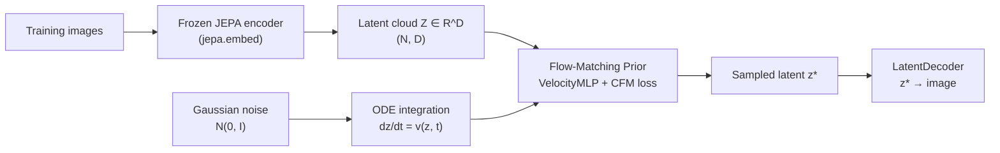
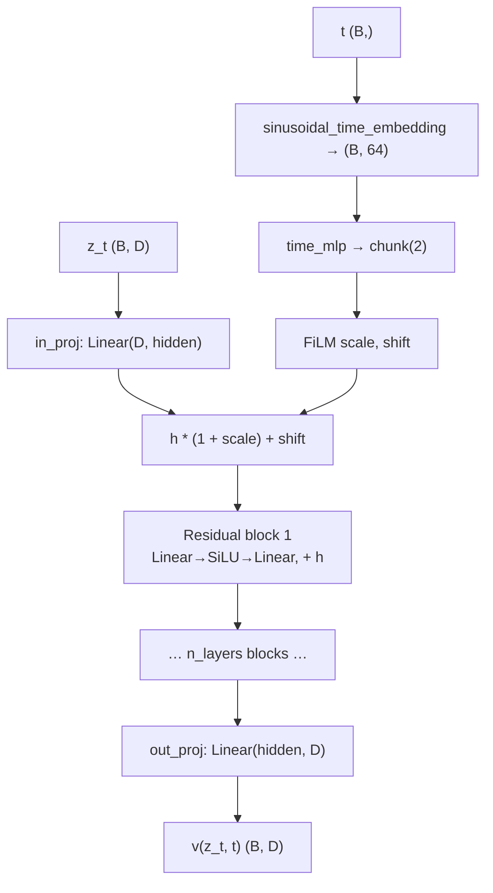
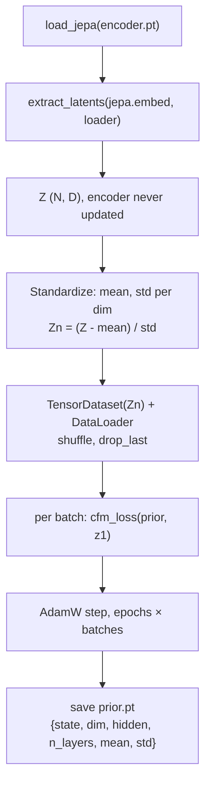

This page documents the **flow-matching prior** — the component that makes a JEPA encoder *sampleable*. JEPA training shapes latents to be predictive but never distributional: after pretraining you own a cloud of vectors $z \in \mathbb{R}^D$, yet no way to draw a new one. The flow-matching prior closes that gap by fitting a learned velocity field over the **frozen** latent space, so that integrating an ODE from Gaussian noise lands on the data-latent distribution. We cover the rectified-flow formulation, the `VelocityMLP` network, the CFM loss, the training and sampling drivers, and the invariants pinned by tests. Conditional fields and classifier-free guidance (Page 10) and optimal-transport coupling (Page 11) are flagged as forward pointers only.

## Why the Prior Exists: Position in the Generative Stack

The generative stack is a three-stage pipeline: an encoder that *embeds*, a prior that *samples*, and a decoder that *renders*. Each stage is trained against a frozen predecessor, which is what makes the prior cheap — it sees precomputed latents, not images. The package's own docstring calls this the "generative head: a sampleable prior over the JEPA latent", and exports exactly four symbols that constitute the public API: `VelocityMLP`, `linear_interpolant`, `cfm_loss`, and `euler_sample`.

Read the diagram as a left-to-right training order: the encoder is pretrained first (JEPA Module Internals internals), latents are extracted once, then the prior fits the velocity field, and finally the decoder maps samples back to observable space. Because the encoder is frozen during prior training, the latent distribution is a fixed target — no co-adaptation dynamics enter this stage.

Sources: [__init__.py](/src/ssllab/generative/__init__.py#L1-L6), [04_train_flow_prior.py](/examples/generative_jepa/04_train_flow_prior.py#L1-L16), [02-the-latent-prior.md](/docs/generative_jepa/02-the-latent-prior.md#L1-L71)

## The Rectified-Flow Construction

The implementation uses the **linear interpolant** convention of rectified flow. For a source sample $z_0$ and a data latent $z_1$, the path is a straight line in time $t \in [0,1]$ with a velocity that is *constant along the path*:

$$z_t = (1-t)\,z_0 + t\,z_1, \qquad u_t = z_1 - z_0$$

This is implemented literally in `linear_interpolant`, which broadcasts $t$ against the latent dimension and returns the pair $(z_t, u_t)$. The training objective is the **conditional flow-matching (CFM) MSE loss**: sample $t \sim U[0,1]$, draw $z_0 \sim \mathcal{N}(0,I)$ (when no explicit source is passed), and regress the network's predicted velocity against the displacement target:

$$\mathcal{L}_{\mathrm{CFM}}(\theta) = \mathbb{E}\big\lVert v_\theta(z_t, t) - u_t \big\rVert^2$$

| Mathematical object | Code artifact | Contract |
|---|---|---|
| Path $z_t = (1-t) z_0 + t z_1$ | `linear_interpolant` | returns `(z_t, u_t)` for batched `t` |
| Target velocity $u_t = z_1 - z_0$ | `linear_interpolant` | constant in $t$; shape `(B, D)` |
| Loss $\lVert v_\theta(z_t,t) - u_t \rVert^2$ | `cfm_loss` | draws `z0 = randn_like(z1)` when `z0=None`; `t = rand(B)` |
| ODE $\frac{dz}{dt} = v_\theta(z,t)$ | `euler_sample` | fixed-step Euler, `z ← z + dt·v`, from $t=0$ to $t=1$ |

> [!TIP]
> The per-pair target $u_t$ is almost never the "right" velocity at $z_t$ — yet the regressed field converges to $\mathbb{E}[z_1 - z_0 \mid z_t]$, the *marginal* velocity whose ODE transports the full noise marginal onto the data marginal. This is the quiet miracle of flow matching: regressing conditional velocities yields a globally correct field. The module docstring states this identification explicitly for both noise and data bases.

A useful invariant for reasoning about the sampler: at $t=0$ the interpolant equals $z_0$ exactly and at $t=1$ it equals $z_1$ exactly — so the ODE genuinely starts at the source and ends in the data cloud, which the test suite pins as hard assertions. Because rectified-flow paths are nearly straight, a few dozen Euler steps suffice; the starter default is 50 steps, and the sampling example defaults to 100.

Sources: [flow.py](/src/ssllab/generative/flow.py#L1-L24), [flow.py](/src/ssllab/generative/flow.py#L121-L128), [flow.py](/src/ssllab/generative/flow.py#L148-L175), [test_flow_transport.py](/tests/test_flow_transport.py#L9-L14)

## The Velocity Network: `VelocityMLP`

The field $v_\theta(z, t)$ is a small MLP whose behavior depends on time through a **sinusoidal embedding + FiLM** composition. Time scalars in $[0,1]$ are first mapped to `(B, time_dim)` sinusoidal features by `sinusoidal_time_embedding` (frequencies log-spaced down to $10^{-4}$, sin/cos concatenated, odd dims zero-padded). A two-layer `time_mlp` converts the embedding into per-feature `(scale, shift)` pairs that modulate the projected latent: `h = h * (1 + scale) + shift`. The trunk is a stack of residual blocks — each block is `Linear → SiLU → Linear` added back onto `h` — followed by a linear output projection back to `data_dim`.

The forward signature `forward(z_t, t, c=None)` carries the module's extensibility seam: the constructor rejects a mismatch between `cond_dim` and whether a condition is supplied, so an unconditional field (`cond_dim=0`) *must* be called with `c=None` and vice versa. The conditional branch (`cond_dim > 0`) adds a second FiLM from a condition vector and a learned `null_cond` token for classifier-free guidance — that machinery is documented in [Conditional Flow and Classifier-Free Guidance](10-conditional-flow-and-classifier-free-guidance); for the unconditional prior discussed here it remains entirely inert.

| Constructor parameter | Default | Role |
|---|---|---|
| `data_dim` | required | latent dimension $D$ (set to `jepa.cfg.embed_dim` in training) |
| `hidden` | `256` | width of trunk and FiLM layers |
| `n_layers` | `4` | number of residual blocks |
| `time_dim` | `64` | sinusoidal time-embedding width |
| `cond_dim` | `0` | `0` = unconditional prior; `> 0` = conditional field (Page 10) |

Sources: [flow.py](/src/ssllab/generative/flow.py#L48-L58), [flow.py](/src/ssllab/generative/flow.py#L61-L109), [flow.py](/src/ssllab/generative/flow.py#L94-L99)

## Training the Prior: `04_train_flow_prior.py`

The training driver is deliberately thin — roughly forty lines of orchestration around the four API functions — because all difficulty was front-loaded into freezing the encoder and extracting latents. The procedure is: load the pretrained encoder from the experiment directory, run `extract_latents` once over the MNIST training loader to obtain the latent matrix `Z (N, D)`, standardize per-dimension, and fit the field with AdamW against `cfm_loss`.

> [!TIP]
> The standardization statistics are *part of the model contract*, not incidental preprocessing. `prior.pt` serializes `mean` and `std` alongside the weights precisely because sampling must run the ODE in standardized space and invert afterward ($z^* = \sigma \hat z^* + \mu$). If you retrain the prior or swap encoders, the stale stats silently corrupt every sample — always consume stats from the same checkpoint that produced the weights.

Standardization matches the flow target's geometry to the noise source's geometry: the data cloud is centered at the origin with unit per-dimension spread, the same shape as $\mathcal{N}(0,I)$, which is why a plain MLP with no output scaling succeeds at all.

| CLI flag | Default | Meaning |
|---|---|---|
| `--experiment` | `jepa_mnist` | experiment name; reads `output/<name>/checkpoints/encoder.pt` |
| `--encoder` | `None` | override the encoder checkpoint path |
| `--epochs` | `20` | passes over the latent set |
| `--batch-size` | `256` | latent batch size |
| `--lr` | `1e-3` | AdamW learning rate |
| `--hidden` / `--n-layers` | `256` / `4` | `VelocityMLP` capacity |
| `--limit` | `None` | cap train latents for smoke runs |
| `--seed` | `42` | reproducibility |

Sources: [04_train_flow_prior.py](/examples/generative_jepa/04_train_flow_prior.py#L60-L100), [04_train_flow_prior.py](/examples/generative_jepa/04_train_flow_prior.py#L43-L57), [extract.py](/src/ssllab/extract.py#L13-L40), [02-the-latent-prior.md](/docs/generative_jepa/02-the-latent-prior.md#L55-L71)

## Sampling and Decoding: `05_sample_and_decode.py`

Generation is the reverse composition of training. The driver loads `prior.pt` (reconstructing `VelocityMLP` from the checkpoint's stored `dim`, `hidden`, `n_layers`, and restoring `mean`/`std`), loads the trained `LatentDecoder`, then executes the payoff loop under `torch.no_grad()`: `euler_sample` integrates the ODE for `n` particles from Gaussian noise, the sample is un-standardized by `z = z_norm * std + mean`, and `decoder.decode_images(z)` renders the grid, saved via `save_image_grid` to `output/<experiment>/samples/samples.png`.

The `euler_sample` implementation is an explicit fixed-step loop: `dt = 1 / n_steps`, and at each step `t` is a constant batch vector `full((n,), step*dt)` — so every particle advances on the same schedule, which is valid because the field is deterministic in `(z, t)` and particles do not interact. The function is decorated `@torch.no_grad()` and calls `model.eval()`, since sampling must not touch autograd or batch statistics.

| CLI flag | Default | Meaning |
|---|---|---|
| `--n` | `64` | number of latents to sample (rendered as an 8×8 grid) |
| `--steps` | `100` | Euler integration steps of the ODE |
| `--prior` / `--decoder` | `None` | override checkpoint paths from the experiment directory |
| `--seed` | `0` | sampling seed, independent of training seed |

`euler_sample` also accepts optional `c`, `guidance`, and `z0` arguments. Those parameters activate the conditional field and the distribution-to-distribution transport mode respectively — extensions covered in [Conditional Flow and Classifier-Free Guidance](10-conditional-flow-and-classifier-free-guidance) and [Latent Transport and Optimal-Transport Coupling](11-latent-transport-and-optimal-transport-coupling). On this page's scope, they default to `c=None, guidance=1.0, z0=None`, reducing exactly to the unconditional noise→data prior.

Sources: [05_sample_and_decode.py](/examples/generative_jepa/05_sample_and_decode.py#L53-L82), [05_sample_and_decode.py](/examples/generative_jepa/05_sample_and_decode.py#L40-L50), [flow.py](/src/ssllab/generative/flow.py#L178-L213)

## Invariants Under Test

`tests/test_flow_transport.py` pins the mathematical contracts with minimal, fast assertions — each test verifies one structural fact rather than statistical behavior:

| Test | Invariant pinned |
|---|---|
| `test_linear_interpolant_endpoints` | $z_t \big|_{t=0} = z_0$, $z_t \big|_{t=1} = z_1$, and $u_t = z_1 - z_0$ exactly |
| `test_euler_sample_default_is_noise` | `z0=None` draws Gaussian noise (backward-compatible prior behavior), output shape/finite |
| `test_euler_sample_respects_source_z0` | a zero-initialized field is the identity ODE, so the integrated output equals `z0` — proving `z0` is the true start state |
| `test_cfm_loss_accepts_source` | the loss accepts an explicit transport source and returns a finite scalar |

The identity-ODE test is the most instructive: by zero-initializing every parameter, the velocity field is identically zero, so Euler integration must leave any starting state untouched. That turns an implementation detail (where the ODE begins) into a hard, framework-independent assertion.

Sources: [test_flow_transport.py](/tests/test_flow_transport.py#L1-L59), [test_flow_transport.py](/tests/test_flow_transport.py#L16-L33)

## Where the Design Extends

The `flow.py` module is one architecture serving three roles, distinguished purely by constructor and call-site arguments — this is the key architectural pattern of the generative stack. The unconditional prior documented here is the base case; the same `VelocityMLP`/`cfm_loss`/`euler_sample` triple extends along two axes:

- **Conditioning axis** — `cond_dim > 0` turns the field conditional, `p_drop` trains the null token, and `guidance` blends conditional with unconditional velocities at sampling time. This powers class-conditional MNIST sampling and, later, the $(z_b, z_p)$ perturbation pair. Full treatment: [Conditional Flow and Classifier-Free Guidance](10-conditional-flow-and-classifier-free-guidance).
- **Source axis** — passing real latents as `z0` instead of noise reinterprets the identical loss as *distribution-to-distribution transport* (e.g. control-cell → perturbed-cell latents), with `ot_couple` providing an optimal-transport pairing for straighter paths. Full treatment: [Latent Transport and Optimal-Transport Coupling](11-latent-transport-and-optimal-transport-coupling).

Neither extension changes the rectified-flow core: `linear_interpolant` is untouched, `cfm_loss` merely swaps the source of $z_0$, and `euler_sample` changes only its starting state and velocity blend.

Sources: [flow.py](/src/ssllab/generative/flow.py#L25-L38), [flow.py](/src/ssllab/generative/flow.py#L131-L145), [flow.py](/src/ssllab/generative/flow.py#L148-L166)

## Reading Path

Before this page, you should understand how the frozen encoder and its latents are produced — see [JEPA Module Internals](6-jepa-module-internals) and, for the masking and anti-collapse machinery that shapes the latent geometry the flow models, [Masking Strategies: Random and Span](7-masking-strategies-random-and-span) and [Anti-Collapse: VICReg and SIGReg](8-anti-collapse-vicreg-and-sigreg). The natural continuation is [Conditional Flow and Classifier-Free Guidance](10-conditional-flow-and-classifier-free-guidance), which activates the `cond_dim`/`guidance` machinery flagged above, followed by [Latent Transport and Optimal-Transport Coupling](11-latent-transport-and-optimal-transport-coupling) for the `z0`-as-data interpretation. To see the decoder side of the sampling pipeline (what happens after `z*` is produced), continue to [Count Decoders and CVAE Baseline](12-count-decoders-and-cvae-baseline); for a gentler, prose-first walkthrough of the same four functions, the tutorial companion is `docs/generative_jepa/02-the-latent-prior.md`.
