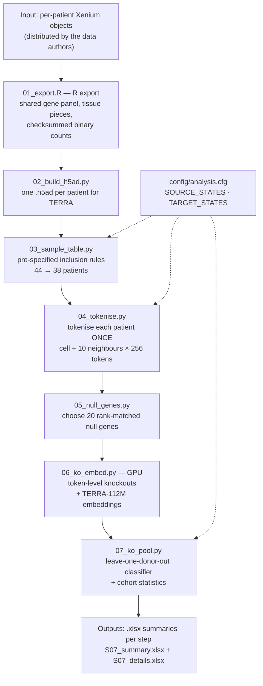

This page gives a beginner-friendly map of the **terra-ligand-perturbation** repository: what scientific question it answers, how the seven pipeline steps fit together, what controls make the results trustworthy, and where to read next in this documentation. No prior knowledge of spatial transcriptomics or foundation models is assumed — each concept is introduced in plain terms before being used.

## What this repository does
This repository answers a specific biological question with a computational experiment: **if we remove the ligand *CSF1* from cancer-associated fibroblasts sitting near tumour macrophages, does the model's internal representation of those macrophages change — and is the change specific to CSF1?** It does this *in silico* (inside the computer, no wet-lab experiment) using the pretrained spatial transcriptomics foundation model **TERRA-112M**, applied to the public triple-negative breast cancer (TNBC) Xenium cohort of Yan *et al.* The pipeline is version 0.1, packaged from the original analysis scripts, with TERRA used for zero-shot inference — meaning the model is applied as-is, without any additional training. It was developed with `terra-st` 0.1.13 at Hugging Face revision `00d1c977`, and TERRA's interface may change in later versions.

Sources: [README.md](/README.md#L3-L14), [CITATION.cff](/CITATION.cff#L3-L6)

For beginners, three terms recur throughout this documentation. A **foundation model** is a large neural network pretrained on massive data, here encoding a cell *together with its spatial neighbours* rather than in isolation. A **token** here is one gene inside the model's input: TERRA-112M represents each cell as 11 blocks of 256 gene tokens — the cell's own genes, then the genes of its 10 nearest neighbours, each listed in order of normalised expression. **In silico perturbation** means editing those tokens directly (removing the *CSF1* token) and observing how the model's output embedding changes, instead of running a real experiment.

Sources: [README.md](/README.md#L20-L28), [README.md](/README.md#L67-L71)

## The two guiding principles of the design
Two verifiable facts about TERRA motivated the pipeline's most important design decision. First, setting a gene's counts to zero and **re-tokenising** changes tokens of cells far beyond the intended target, because re-tokenisation re-normalises the edited cell. Second, TERRA's built-in `perturb_dataset` in `terra-st 0.1.13` edits neighbour blocks belonging to unlisted cells. The pipeline therefore **tokenises every patient exactly once** (step 04) and builds every perturbation by editing the saved baseline token sequences directly — only in the neighbour blocks that belong to a CSF1+ fibroblast. This is why the pipeline splits tokenisation (04) from editing (06) instead of re-running the model's own perturbation utility.

Sources: [README.md](/README.md#L65-L83)

> [!TIP]
> Every downstream condition is derived from the *same saved token sequences* produced by step 04. If you re-run tokenisation with different settings, cached knockout results from step 06 become invalid — this coupling is the single most important thing to understand before modifying the pipeline.

## Pipeline at a glance
The pipeline is a strict seven-step sequence, numbered by script prefix. It begins in **R** (exporting the data authors' per-patient objects into a language-neutral format) and continues in **Python** (assembly, quality filtering, tokenisation, perturbation, and statistics). Every step writes an `.xlsx` summary to `RESULTS_DIR/<step>/`, and large intermediates go to `WORK_DIR`. Steps 01, 02, 04 and 06 skip patients whose outputs already exist, and step 07 reuses cached per-donor predictions — so interrupted runs resume rather than restart. Steps 03 and 05 are quick and always recompute.

Sources: [README.md](/README.md#L160-L183), [README.md](/README.md#L187-L198)

The repository layout is deliberately flat: one numbered script per step, plus a shared R/`sh` launcher pair, and two example configuration files that you copy and edit before the first run. The `config/analysis.cfg` file (validated by `scripts/analysis_config.py`, which steps 03, 04 and 07 all import) defines which fibroblast states are the ligand **source** and which macrophage states are the **targets** — the pipeline is general in structure but parameterised by these cell-state labels.

| Step | Script | Language | Purpose | Main output |
|---|---|---|---|---|
| 01 | `01_export.R` / `.sh` | R | Export per-patient matrices on the shared gene panel, defining tissue pieces | `<WORK_DIR>/export/` binary counts + manifest |
| 02 | `02_build_h5ad.py` | Python | Assemble one AnnData `.h5ad` per patient in TERRA's expected layout | `<WORK_DIR>/export/
/adata.h5ad` |
| 03 | `03_sample_table.py` | Python | Per-patient summary table and pre-specified inclusion rules | `03_sample_table.xlsx` |
| 04 | `04_tokenise.py` | Python | Harmonise and tokenise each included patient **once** | tokenised datasets + per-patient summary |
| 05 | `05_null_genes.py` | Python | Choose the 20 rank-matched null genes for the cohort | null-gene list + cohort table |
| 06 | `06_ko_embed.py` | Python (GPU) | Build token-level knockouts and embed target macrophages with TERRA-112M | `emb_ko.npz` per patient |
| 07 | `07_ko_pool.py` | Python | Pool embeddings, fit the classifier readout, compute cohort statistics | `S07_summary.xlsx` + `S07_details.xlsx` |

Sources: [README.md](/README.md#L160-L183), [analysis_config.py](/scripts/analysis_config.py#L1-L35), [02_build_h5ad.py](/scripts/02_build_h5ad.py#L19-L26), [06_ko_embed.py](/scripts/06_ko_embed.py#L1-L9)

> [!TIP]
> The R→Python boundary in steps 01→02 is a checksummed binary handoff: step 01 writes raw sparse-matrix slots (`x`, `i`, `p` as int32) plus a manifest, and step 02 verifies shapes and checksums against that manifest before assembling the `.h5ad`. Corrupted or partially-written exports are therefore caught at step 02, not silently propagated.

Sources: [01_export.R](/scripts/01_export.R#L26-L43)

## The experimental conditions — how specificity is established
Every perturbation edit happens **only in the neighbour blocks belonging to CSF1+ fibroblasts** — the receiving macrophage's own block is never touched. The test condition `CSF1_remove` is never interpreted alone: it is compared against 20 **null genes** selected once for the cohort, whose presence and median rank in fibroblast token blocks match CSF1's within fixed bands (presence within 0.15, median rank within 40 positions), excluding CSF1 itself and ligands with known direct effects on macrophages. Three further controls — a positive control, an encoding check, and a negative control — close the loop. This layered design exists because *any* input change alters a model's output; the question is whether the CSF1 effect exceeds what comparable, non-specific edits produce.

| Condition | Edit in each CSF1+ fibroblast neighbour block | Role |
|---|---|---|
| `CSF1_remove` (test) | *CSF1* token and value removed; remaining tokens move up | The perturbation of interest |
| `NULL_<gene>` × 20 | Same removal, for a rank-matched null gene | Reference distribution for an edit of comparable size at the same positions |
| `POS_block` | Whole block emptied | Positive control — proves the pipeline can detect a neighbourhood change |
| `CSF1_zero` | *CSF1* value set to 0, token kept | Checks sensitivity to how a loss is encoded |
| `cell_emb` readout | (all conditions) | Negative control — a neighbour edit cannot change the cell's own embedding |

Sources: [README.md](/README.md#L85-L97), [README.md](/README.md#L112-L128), [06_ko_embed.py](/scripts/06_ko_embed.py#L10-L25)

The **primary readout** is statistical rather than raw: a logistic regression trained on baseline embeddings of all macrophage states scores each cell's probability of being in a target state, fitted leave-one-donor-out so the model scoring a donor never saw that donor's cells; per cell, `dP = P(perturbed) − P(baseline)`. Two **descriptive magnitude readouts** accompany it — per-cell cosine shift and TERRA's own Wasserstein-2 distance per donor. A full walkthrough of the statistics belongs to the dedicated readout pages; here it suffices to know that step 07 produces both.

Sources: [README.md](/README.md#L99-L110), [07_ko_pool.py](/scripts/07_ko_pool.py#L20-L35)

## What you get out
Every step writes an unformatted `.xlsx` workbook; the analysis's endpoint is step 07, which produces `S07_summary.xlsx` (one table plus a sheet explaining every column) and `S07_details.xlsx` with per-sheet breakdowns: the cross-donor Wilcoxon test (overall and per depth batch), per-condition gene rankings, per-donor summaries, stratified results by number of edited neighbours and by target state, W2-distance comparisons against the null genes, per-donor held-out classifier AUC, and per-patient input quality checks. Every workbook carries the run's settings signature, so results are traceable to their exact configuration.

Sources: [README.md](/README.md#L140-L158)

## Running environment at a glance
This is a cluster-oriented pipeline, not a laptop notebook. It expects a Linux cluster with Sun Grid Engine (`qsub` job chaining via `-hold_jid`), Singularity or Apptainer containers, an NVIDIA GPU with at least 40 GB memory for the embedding step 06, and R (developed with 4.4.1) with `Matrix`, `igraph` and `openxlsx` for step 01. Before any job runs, you copy the two example configs (`paths.cfg` — five paths including input data, work and results directories; `analysis.cfg` — the source and target cell states), install the environment once via `env/install.sh` on an internet-connected node, and validate everything with `env/check_config.sh`. The full walkthrough is reserved for the Getting Started pages that follow.

| Requirement | Detail |
|---|---|
| Cluster scheduler | Sun Grid Engine, jobs chained with `-hold_jid` |
| Container runtime | Singularity or Apptainer |
| GPU | NVIDIA, ≥ 40 GB memory (step 06 only) |
| R | 4.4.1 with `Matrix`, `igraph`, `openxlsx` (step 01) |
| Configuration | `config/paths.cfg` (5 paths) + `config/analysis.cfg` (cell states) |
| Validation | `bash env/check_config.sh`, also inside a GPU session |

Sources: [README.md](/README.md#L185-L222), [paths.cfg.example](/config/paths.cfg.example#L1-L24), [analysis.cfg.example](/config/analysis.cfg.example#L1-L12)

A few caveats frame every interpretation: a ligand is only visible to the model if it falls within a cell's 256 most-expressed genes; TERRA was not trained to predict perturbation responses, so a representation shift is not a predicted biological response; and the classifier readout depends on the data authors' cell-state annotations. These are expanded in the dedicated limitations page.

Sources: [README.md](/README.md#L130-L138)

## Where to go next
The recommended reading path continues in the **Get Started** section, then descends into the **Deep Dive** pages following the same order as the pipeline itself:

1. **[Quick Start](2-quick-start)** — run the pipeline end-to-end, one patient first, then the cohort array.
2. **[Data and Model Requirements](3-data-and-model-requirements)** — the Yan *et al.* Xenium objects and TERRA weights: formats, versions, licences.
3. **[Configuration Setup](4-configuration-setup)** — filling in `paths.cfg` and `analysis.cfg` correctly, and what `check_config.sh` verifies.
4. **[Pipeline Architecture](5-pipeline-architecture)** — a deeper structural tour of the seven steps and their interfaces.
5. **[Study Design and Hypothesis](6-study-design-and-hypothesis)** — the biological and statistical motivation behind the cohort, conditions, and readouts.

If you later need the fine detail of any single stage, the Deep Dive section mirrors the pipeline: data preparation steps ([R Export and Tissue Pieces](7-r-export-and-tissue-pieces), [Patient Inclusion Rules](8-patient-inclusion-rules)), tokenisation and model integration ([Cell-and-Neighbour Tokenisation](9-cell-and-neighbour-tokenisation), [Harmonisation and Model Bundles](10-harmonisation-and-model-bundles)), the perturbation framework ([Token-Level Knockout Editing](11-token-level-knockout-editing) through [Null-Gene Control Rationale](14-null-gene-control-rationale)), statistics ([Leave-One-Donor-Out Classifier](15-leave-one-donor-out-classifier) to [Cohort Summary Statistics](17-cohort-summary-statistics)), and operations ([Cluster Execution and Job Chaining](18-cluster-execution-and-job-chaining), [Reproducibility and Caching](19-reproducibility-and-caching), [Outputs and Result Interpretation](20-outputs-and-result-interpretation), [Limitations and Caveats](21-limitations-and-caveats), [Planned Generalisation Roadmap](22-planned-generalisation-roadmap)).
