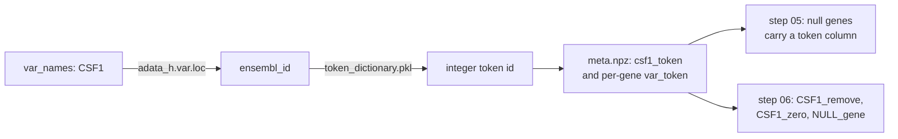
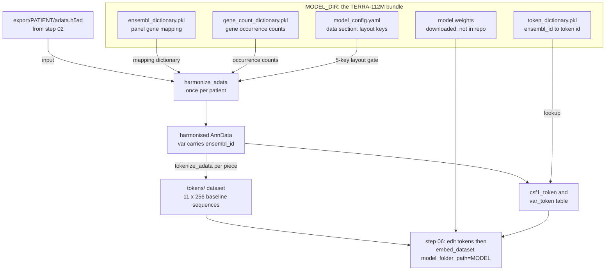

This page explains how the pipeline bridges the gap between exported Xenium data and the pretrained **TERRA-112M** foundation model. Two mechanisms do this: *harmonisation*, which maps the study's gene panel onto the model's Ensembl-based vocabulary, and the *model bundle*, a directory of dictionaries, a data configuration, and weights that both step 04 (tokenisation, CPU) and step 06 (embedding, GPU) read from a single location (`MODEL_DIR`). Harmonisation runs exactly once per patient inside step 04; the bundle is referenced read-only by every later stage. This page covers the bundle's anatomy, its runtime validation contract, harmonisation semantics, and token resolution. It does not cover the token sequence layout itself — see [Cell-and-Neighbour Tokenisation](9-cell-and-neighbour-tokenisation) — nor how those tokens are edited, which is [Token-Level Knockout Editing](11-token-level-knockout-editing).

Sources: [04_tokenise.py](scripts/04_tokenise.py#L7-L29), [04_tokenise.py](scripts/04_tokenise.py#L37-L46)

## Why Harmonise Exactly Once

Step 04 harmonises and tokenises each patient **once**, so that every knockout built in step 06 is constructed at token level from the *same* baseline sequences. The docstring is explicit about the failure mode this avoids: re-tokenisation reshuffles tied genes, meaning a baseline re-tokenised after an edit would no longer correspond row-for-row with the original baseline embeddings. Freezing the harmonised, tokenised baseline is therefore a precondition for the condition-vs-baseline comparison design used throughout the perturbation framework.

Sources: [04_tokenise.py](scripts/04_tokenise.py#L7-L9), [README.md](README.md#L68-L72)

Before harmonisation, the script also computes the patient's **depth batch** on the raw shared panel: the median total counts of annotated cells (those with a non-missing `cell_state`), classified as `"deep"` if ≥ 500 (`DEPTH_CUT`) and `"shallow"` otherwise. This value is measured *before* harmonisation by design, stored in `meta.npz`, written to the summary workbook, and later used by step 07 to stratify results. Note that this classification is a study-design stratum, not a bundle property.

Sources: [04_tokenise.py](scripts/04_tokenise.py#L18-L20), [04_tokenise.py](scripts/04_tokenise.py#L64), [04_tokenise.py](scripts/04_tokenise.py#L206-L209), [04_tokenise.py](scripts/04_tokenise.py#L311-L312), [README.md](README.md#L62-L64)

## Anatomy of the Model Bundle

The bundle lives at `MODEL_DIR`, an environment variable set by `env/terra_env.sh` (which sources `config/paths.cfg`); the repository's `paths.cfg.example` documents that `SOFTWARE_DIR` holds the "Container image, Python packages installed into it, model weights, caches". The weights themselves are downloaded from Hugging Face by `env/install.sh` and are **not redistributed** with this repository — the README pins the software environment to `terra-st` 0.1.13 and TERRA-112M at Hugging Face revision `00d1c977`, and warns that TERRA's interface may change on publication.

Sources: [04_tokenise.py](scripts/04_tokenise.py#L59), [paths.cfg.example](config/paths.cfg.example#L19-L20), [README.md](README.md#L12-L14), [README.md](README.md#L43-L44)

Four files in the bundle are read by name in step 04, plus the weights in step 06:

| Bundle file | Role | Consumer |
|---|---|---|
| `model_config.yaml` | Data configuration; its `data` section defines the input layout | Step 04 validation gate |
| `token_dictionary.pkl` | Maps `ensembl_id` → integer token id | Step 04 (CSF1 token, per-gene `var_token` table) |
| `ensembl_dictionary.pkl` | Gene mapping dictionary: panel genes → model vocabulary | `harmonize_adata` |
| `gene_count_dictionary.pkl` | Gene occurrence counts used during mapping | `harmonize_adata` |
| Model weights | TERRA-112M parameters | `embed_dataset` in step 06 |

Sources: [04_tokenise.py](scripts/04_tokenise.py#L185-L194), [04_tokenise.py](scripts/04_tokenise.py#L212-L216), [06_ko_embed.py](scripts/06_ko_embed.py#L198-L199)

## The Layout Contract: Validating the Bundle Before Use

Step 04 opens `model_config.yaml`, reads its `data` section, and checks five keys against the constants hard-coded at the top of the script (`W, L_CELL, N_SEG = 2816, 256, 11`): `tokenizer_type` must be `"cell_graph"`, `model_input_size` must be 2816, `n_neighs` must be 10, `seq_len_cell` must be 256, and `seq_len_neighborhood` must be 2560. If any check fails, the script exits with *"Model config does not match the 11 x 256 cell_graph layout"* — nothing downstream runs against an incompatible bundle. Only after the gate passes is `token_dictionary.pkl` loaded into memory.

> [!TIP]
> The five-key gate converts bundle compatibility from an implicit assumption into an explicit runtime contract. Because the repository hard-codes `W/L_CELL/N_SEG` while TERRA "is under active development and its interface may change", upgrading the bundle requires confirming these keys still match — the gate is your first line of defence against a silently incompatible model version.

Sources: [04_tokenise.py](scripts/04_tokenise.py#L74), [04_tokenise.py](scripts/04_tokenise.py#L185-L194), [README.md](README.md#L12-L14)

## Harmonisation in Practice

The harmonisation call is a single invocation per patient:

```python
adata_h = harmonize_adata(
    adata,
    gene_mapping_dict_file_path=str(MODEL / "ensembl_dictionary.pkl"),
    gene_occurrence_count_file_path=str(MODEL / "gene_count_dictionary.pkl"),
    min_genes_per_cell=10, min_cells_per_gene=0)
```

Its parameters have deliberate semantics: `min_genes_per_cell=10` drops cells with too few genes surviving the vocabulary mapping, while `min_cells_per_gene=0` means **no gene is removed for being rare** — the entire shared panel is preserved. Immediately after the call, the pre-harmonisation object is deleted (`del adata`), and `obs["cell_id"]` is set from `obs_names` (`"<patient>_<xenium id>"`). The number of cells removed by harmonisation is recorded as a report check in the summary workbook rather than enforced as a threshold.

| Parameter | Value | Effect |
|---|---|---|
| `min_genes_per_cell` | 10 | Cells with fewer mapped genes are filtered out |
| `min_cells_per_gene` | 0 | Panel is kept intact; no gene dropped for low occurrence |
| `gene_mapping_dict_file_path` | `ensembl_dictionary.pkl` | Aligns panel symbols with the model's Ensembl vocabulary |
| `gene_occurrence_count_file_path` | `gene_count_dictionary.pkl` | Occurrence statistics consulted during mapping |

Sources: [04_tokenise.py](scripts/04_tokenise.py#L210), [04_tokenise.py](scripts/04_tokenise.py#L212-L217), [04_tokenise.py](scripts/04_tokenise.py#L233-L235)

> [!TIP]
> `min_cells_per_gene=0` is not a loose setting — it is what keeps token positions stable. If harmonisation dropped panel genes per patient, the column indexing used for edits in step 06 would drift between patients. The script enforces the one gene that absolutely must survive with a hard exit: if `"CSF1"` is not in `adata_h.var_names`, it aborts with *"CSF1 removed by harmonisation"*, because the entire knockout design depends on resolving CSF1's token.

Sources: [04_tokenise.py](scripts/04_tokenise.py#L212-L216), [04_tokenise.py](scripts/04_tokenise.py#L221-L222)

## Resolving Tokens: Symbol → Ensembl → Token ID

Harmonisation attaches an `ensembl_id` column to `adata.var`, and the token dictionary completes the chain. For the perturbation target this is explicit: the script locates CSF1's column, reads `adata_h.var.loc["CSF1", "ensembl_id"]`, and looks up `token_dict[csf1_ens]` to obtain the integer token used by every knockout condition in step 06. For the whole panel, three parallel arrays are built — `var_symbol`, `var_ensembl`, and `var_token` (using `token_dict.get(e, -1)`, so unmapped genes carry a `-1` sentinel) — and all three are persisted in `meta.npz` alongside `csf1_token`.

Sources: [04_tokenise.py](scripts/04_tokenise.py#L223-L225), [04_tokenise.py](scripts/04_tokenise.py#L300-L302), [04_tokenise.py](scripts/04_tokenise.py#L304-L312)



Persisting the token table matters for reproducibility: downstream steps never re-open the bundle to resolve genes. Step 06 loads the null-gene table produced by step 05 and finds each null gene's token already materialised as a `token` column, then constructs all conditions (`CSF1_remove`, `CSF1_zero`, `POS_block`, twenty `NULL_<gene>` conditions) from `csf1_token` in `meta.npz` and those precomputed tokens.

Sources: [06_ko_embed.py](scripts/06_ko_embed.py#L240), [06_ko_embed.py](scripts/06_ko_embed.py#L251-L256)

## Tokenising Against the Bundle and Freezing the Baseline

With harmonisation done, `tokenize_adata` runs per tissue piece (`obs["sample"]`, sorted), passing `model_folder_path=str(MODEL)` so the tokenizer reads its vocabulary from the same bundle, with `add_neigh_cell_ids=True` and `include_special_tokens=False`. The per-piece datasets are concatenated and saved to `<KO_DIR>/<PATIENT>/tokens/`. The script then deletes its build cache, reloads the dataset *from the saved copy*, and works from that — the exact artifact step 06 will read — so the baseline sequences are frozen on disk rather than held only in memory. Hugging Face cache directories (`HF_DATASETS_CACHE`, `HF_HOME`) are redirected into the patient's working directory to keep caches colocated with the outputs.

Sources: [04_tokenise.py](scripts/04_tokenise.py#L232), [04_tokenise.py](scripts/04_tokenise.py#L242-L258), [04_tokenise.py](scripts/04_tokenise.py#L262-L265), [04_tokenise.py](scripts/04_tokenise.py#L77-L78)



## Bundle Reuse at Embedding Time (Step 06)

Step 06 resolves the same `MODEL_DIR` and hands it to `embed_dataset` from `terra.inference.embed`: `embed_dataset(ds, model_folder_path=str(MODEL), batch_size=BATCH_SIZE, num_workers=NUM_WORKERS, include_spatial_cell_emb=True)`. Because embedding reads the identical bundle that produced the tokens, vocabulary and layout are guaranteed consistent between baseline and perturbed sequences — this is why the same `model_folder_path` argument appears in both steps. The call returns three embedding kinds checked for one row per sequence: `spatial_cell_emb` (primary readout), `neighborhood_emb` (secondary), and `cell_emb` (negative control). The batch size of 256 is kept fixed so every patient is embedded identically.

Sources: [06_ko_embed.py](scripts/06_ko_embed.py#L64), [06_ko_embed.py](scripts/06_ko_embed.py#L68), [06_ko_embed.py](scripts/06_ko_embed.py#L82), [06_ko_embed.py](scripts/06_ko_embed.py#L194-L207)

The two steps use the same bundle on very different hardware, which the job scripts make explicit:

| Aspect | Step 04 — tokenise | Step 06 — embed |
|---|---|---|
| Bundle artifacts used | Both harmonisation dictionaries, token dictionary, config | Weights (via `embed_dataset`) + config expectations |
| Hardware | CPU-only, in the TERRA container, 64 GB RAM requested | GPU array job; needs a card with ≥ 40 GB (batch 256 ≈ 21 GB + CUDA overhead) |
| Container runner | `tx python` | `txg python` (GPU-enabled environment) |
| Bundle-derived outputs | `tokens/`, `meta.npz`, `cf_blocks.npz` | `emb_ko.npz` |

Sources: [04_tokenise.sh](scripts/04_tokenise.sh#L6), [04_tokenise.sh](scripts/04_tokenise.sh#L10), [04_tokenise.sh](scripts/04_tokenise.sh#L17), [04_tokenise.sh](scripts/04_tokenise.sh#L20), [06_ko_embed.sh](scripts/06_ko_embed.sh#L8), [06_ko_embed.sh](scripts/06_ko_embed.sh#L12-L14), [06_ko_embed.sh](scripts/06_ko_embed.sh#L26)

## Where the Harmonised Artifacts Flow

Step 04's outputs carry the bundle's influence forward without requiring the bundle again for gene resolution: the tokenised dataset (`tokens/`) holds the frozen 11×256 baseline sequences; `meta.npz` holds the per-row annotation, neighbour index, depth batch, and the `var_symbol`/`var_ensembl`/`var_token` table; `cf_blocks.npz` holds each CSF1+ fibroblast's own 256-token block. Step 06 reads the first two plus the null-gene table, and writes `emb_ko.npz` for step 07. In catalog terms: the token blocks feed [Token-Level Knockout Editing](11-token-level-knockout-editing), `cf_blocks.npz` feeds [Rank-Matched Null Gene Selection](12-rank-matched-null-gene-selection), and the embeddings feed [Embedding Shift Magnitudes](16-embedding-shift-magnitudes) and the [Leave-One-Donor-Out Classifier](15-leave-one-donor-out-classifier), with `depth_batch` used for stratification in [Cohort Summary Statistics](17-cohort-summary-statistics).

Sources: [04_tokenise.py](scripts/04_tokenise.py#L37-L42), [06_ko_embed.py](scripts/06_ko_embed.py#L41-L45)

## Where to Go Next

Upstream, [Cell-and-Neighbour Tokenisation](9-cell-and-neighbour-tokenisation) details the 11×256 `cell_graph` sequences this page's validated bundle produces, and [Patient Inclusion Rules](8-patient-inclusion-rules) explains which patients reach step 04 at all. Configuration of `MODEL_DIR` and the other paths is covered in [Configuration Setup](4-configuration-setup). Downstream, the natural continuation is [Token-Level Knockout Editing](11-token-level-knockout-editing), which consumes the frozen baseline sequences against the CSF1 token resolved here; [Rank-Matched Null Gene Selection](12-rank-matched-null-gene-selection) shows how the `cf_blocks.npz` artifact drives control-gene choice. For cache and skip behaviour around these steps, see [Reproducibility and Caching](19-reproducibility-and-caching).
