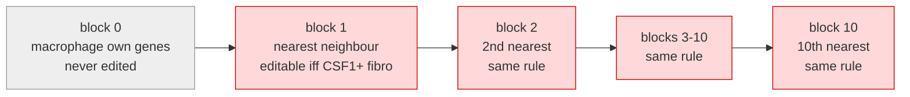
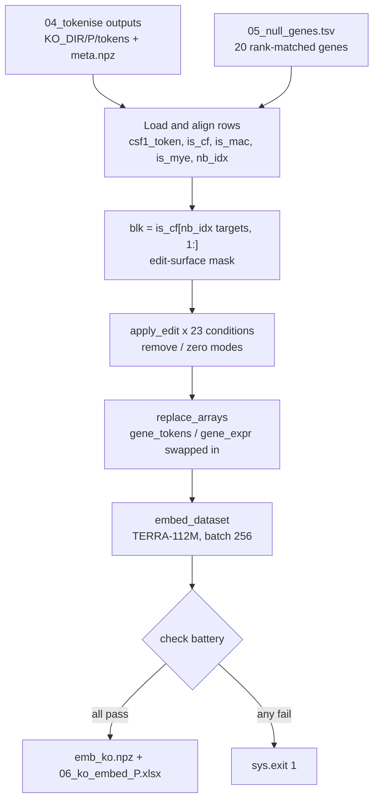

This page explains how `06_ko_embed.py` — the heart of the perturbation framework — constructs every in silico knockout directly on TERRA token sequences and embeds the target macrophages with TERRA-112M. It covers the rationale for token-level editing, the exact edit surface, the 23-condition matrix, the compaction algorithm behind gene removal, the embedding protocol, the in-script verification contract, the artifacts it produces, and how to run it as a GPU array job. Pooling and statistics are deliberately out of scope here — they live in step 07 and are documented in the readouts pages.

## Why Perturbation Happens at the Token Level

The pipeline tokenises each of the 38 included patients exactly once (step 04) and never re-tokenises. Every knockout is manufactured by editing the stored `gene_tokens` / `gene_expr` arrays of the baseline sequences in place, then re-embedding. This is a deliberate architectural decision, motivated by two observed failure modes of the alternatives: setting *CSF1* counts to zero and re-tokenising changes tokens in non-fibroblast cells far beyond the intended CSF1+ fibroblast neighbour blocks (re-tokenisation and re-normalisation reshuffle tied genes and leak the edit outward), and `terra-st 0.1.13`'s `perturb_dataset` with `perturbation_target="neighborhood"` was observed to also edit neighbour blocks belonging to unlisted cells. Direct token editing sidesteps both: the edit is provably confined, because the code itself asserts the confinement (see the verification contract below).

Sources: [04_tokenise.py](scripts/04_tokenise.py#L6-L12), [06_ko_embed.py](scripts/06_ko_embed.py#L8-L18), [README.md](README.md#L67-L83)

## The Edit Surface: 11 Blocks, 10 Editable

To read the editing code you first need TERRA's `cell_graph` layout: each sequence is 2,816 tokens organised as 11 blocks of 256 — block 0 holds the macrophage's own genes, blocks 1–10 hold its 10 nearest neighbours in nearest-first order, each block listing that cell's genes by normalised expression rank. The editor operates on reshaped **views** of this structure (`tok.reshape(n, 11, 256)[:, 1:, :]`), which is what makes "skip block 0, address blocks 1–10" a one-slice operation rather than index arithmetic over a flat array.

The edit surface is further masked by cell identity, not just position. For each target macrophage, the boolean matrix `blk = is_cf[nb_idx[t_rows, 1:]]` (shape: targets × 10) marks exactly which neighbour blocks belong to a CSF1+ fibroblast. A cell is *edited by a condition* if and only if at least one of its CSF1+ fibroblast neighbour blocks contains the condition's gene; `n_edit` counts those blocks per cell and per condition, and becomes a covariate in downstream analysis. The macrophage's own block and every non-CSF1+ fibroblast neighbour block are never touched, under any condition.

Red blocks are the candidate edit surface; a red block is actually edited only when it belongs to a CSF1+ fibroblast *and* contains the condition's gene (for `POS_block`: membership alone suffices).

Sources: [04_tokenise.py](scripts/04_tokenise.py#L26-L30), [06_ko_embed.py](scripts/06_ko_embed.py#L147-L157), [06_ko_embed.py](scripts/06_ko_embed.py#L243-L249), [06_ko_embed.py](scripts/06_ko_embed.py#L21-L26)

## The Condition Matrix: 23 Conditions Per Patient

Step 06 builds 23 conditions: three hand-specified plus one per null gene. The condition list is constructed as a table of `(name, token, mode)` triples, where `token = None` signals "whole block" and `mode` selects the edit algorithm. All conditions are applied to the **same** target rows in the **same** order.

| Condition | Count | Edit per eligible CSF1+ fibroblast block | Role |
|---|---|---|---|
| `CSF1_remove` | 1 | CSF1 token **and** value removed; remaining tokens compact upward | Main knockout — the perturbation of interest |
| `CSF1_zero` | 1 | CSF1 value set to 0; token kept in place | Encoding-sensitivity probe |
| `NULL_<gene>` | 20 | Same removal algorithm, applied to the null gene's token | Reference distribution at the same positions |
| `POS_block` | 1 | Entire block emptied — every non-zero token and value zeroed, compacted to pure padding | Positive control: maximal neighbourhood edit |

`POS_block` reuses the removal machinery with `token=None`: the selection becomes `blk & (nt != 0)` — every real token in the block — so the block ends up indistinguishable from a neighbour with no detected genes. The null genes arrive from step 05 as a 20-row TSV (`symbol`, `token`) and are validated (`len(null) == 20`) before use; their selection methodology is the subject of [Rank-Matched Null Gene Selection](12-rank-matched-null-gene-selection), and the design logic behind the full control set is covered in [Control Conditions Design](13-control-conditions-design) and [Null-Gene Control Rationale](14-null-gene-control-rationale).

Sources: [06_ko_embed.py](scripts/06_ko_embed.py#L251-L256), [06_ko_embed.py](scripts/06_ko_embed.py#L21-L26), [06_ko_embed.py](scripts/06_ko_embed.py#L240-L241), [README.md](README.md#L85-L91)

## Inside `apply_edit`: Removal as Stable Compaction

`apply_edit(tok, expr, blk, token, mode)` is the single function through which all 23 conditions flow, which guarantees algorithmic uniformity. Its mechanics, in order: reshape both token and expression arrays to views of shape `(n, 11, 256)` and slice off block 0; build the boolean selection (`blk[:, :, None] & (nt == token)` for gene-targeted conditions, `blk[:, :, None] & (nt != 0)` for `POS_block`); reduce with `any(axis=2)` to get `edited_blk`, the per-row set of touched blocks. Then the mode diverges:

| Aspect | mode `"zero"` | mode `"remove"` |
|---|---|---|
| Token slot | Kept at original position | Set to 0 |
| Value slot | Set to 0.0 | Set to 0.0 |
| Block length | Unchanged | Remaining tokens compact up; zero-padding grows at the end |
| Ordering effect | None | Preserves relative gene order (stable sort), padding forced to suffix |
| Used by | `CSF1_zero` | `CSF1_remove`, all `NULL_<gene>`, `POS_block` |

The compaction in `"remove"` mode is a three-line vectorised idiom worth studying: for each edited (row, block) pair, `order = np.argsort(sub_t == 0, axis=1, kind="stable")` sorts positions by "is padding" ascending — a **stable** sort, so real tokens keep their original relative order (their expression-rank order from tokenisation) while zeros sink to the end — and `np.take_along_axis` applies the permutation to both token and value arrays simultaneously. This is what keeps the invariant "padding is always a suffix of each block" true, which the padding check later verifies explicitly.

> [!TIP]
> The `kind="stable"` argument is not cosmetic. With a non-stable sort, surviving genes could be permuted within the block, silently changing their positional encoding and conflating "gene removed" with "gene order changed" — precisely the confound the token-level design exists to avoid.

Sources: [06_ko_embed.py](scripts/06_ko_embed.py#L147-L177), [06_ko_embed.py](scripts/06_ko_embed.py#L290-L295)

## Embedding Discipline: Identical Batches Across Conditions

The embedding protocol has two distinct passes. The **baseline** pass embeds *every Mye cell of the patient* — this is the classifier training set consumed by step 07, not just the targets. The **perturbed** pass embeds only the target macrophages, once for baseline and once per condition, always the same rows in the same order. Row-order invariance is what makes cell-by-cell comparison across conditions valid: since targets occupy identical positions in every pass, fixed batch size 256 produces identical batching composition everywhere, so any embedding difference is attributable to the edit alone — never to batch assembly.

Two implementation details protect numeric integrity in the HF `datasets` plumbing. First, `subset()` strips the dataset format (`with_format(None)`) before `select`/`flatten_indices`, because flattening a torch-formatted dataset re-encodes values through the formatter and loses precision. Second, `replace_arrays()` re-injects edited arrays via a batched `map` with `with_indices=True`, `keep_in_memory=True`, and `load_from_cache_file=False` — the last flag prevents HF's caching layer from serving stale pre-edit columns under the same fingerprint. The embedding call itself delegates to `terra.inference.embed.embed_dataset` (TERRA-112M from `MODEL_DIR`, `include_spatial_cell_emb=True`), collecting three readouts per row: `spatial_cell_emb` (primary), `neighborhood_emb` (secondary), and `cell_emb`, which is retained purely as a negative control — a neighbourhood edit cannot change it, so it doubles as a leak detector.

> [!TIP]
> The `cell_emb` negative control is the cheapest falsification test in the pipeline: since block 0 is provably untouched, any nonzero deviation in `cell_emb` would indicate state leakage through the datasets cache or an edit that escaped its slice. The < 1e-4 threshold on max absolute deviation turns that into a hard pass/fail gate.

Sources: [06_ko_embed.py](scripts/06_ko_embed.py#L28-L34), [06_ko_embed.py](scripts/06_ko_embed.py#L119-L131), [06_ko_embed.py](scripts/06_ko_embed.py#L180-L207), [06_ko_embed.py](scripts/06_ko_embed.py#L261-L266), [README.md](README.md#L99-L110)

## The Verification Contract

Every run records a battery of named checks (via the `check()` helper, which logs and accumulates them) and **exits with code 1 if any fails** — a failed check invalidates the patient's outputs for the array. The contract covers input integrity, edit confinement, and model-interface sanity:

| Check | Asserts |
|---|---|
| tokens/meta row alignment | `tokens` dataset and `meta.npz` have identical row count and cell-id order |
| null genes | exactly 20 rows in the step 05 TSV |
| targets are Mye cells | target rows are a subset of Mye rows (`searchsorted` membership proof) |
| own block purity | no padding token appears before a real token in block 0 of targets |
| changed == edited (per condition) | exactly the cells with `n_edit > 0` changed, no others |
| confinement (per condition) | every token/value difference lies inside an edited neighbour block |
| padding suffix (per condition) | within each edited block, zeros form a contiguous suffix |
| `cell_emb` invariance (per condition) | max abs deviation from baseline < 1e-4 |
| one row per sequence | each embedding array has exactly `len(ds)` rows |

The confinement and padding checks deserve emphasis: they are executed *per condition* on the full target matrix, converting the design claim ("only CSF1+ fibroblast neighbour blocks are touched") into a machine-verified property of every artifact the step emits.

Sources: [06_ko_embed.py](scripts/06_ko_embed.py#L91-L96), [06_ko_embed.py](scripts/06_ko_embed.py#L229-L241), [06_ko_embed.py](scripts/06_ko_embed.py#L267-L269), [06_ko_embed.py](scripts/06_ko_embed.py#L283-L300), [06_ko_embed.py](scripts/06_ko_embed.py#L353-L357)

The diagram shows the module-level data flow of one array task: two upstream artifacts, one mask computation, one edit function applied 23 times, one embedding call per pass, and a gate that decides whether outputs are emitted at all.

Sources: [06_ko_embed.py](scripts/06_ko_embed.py#L216-L256), [06_ko_embed.py](scripts/06_ko_embed.py#L261-L331)

## Outputs and Interfaces

Step 06 writes two artifacts per patient, both required for the skip logic. **`<KO_DIR>/
/emb_ko.npz`** is the machine interface consumed by step 07; **`<RESULTS_DIR>/06_ko_embed_
.xlsx`** is the human audit interface, written unformatted (the script suppresses pandas' Excel header styling) with one sheet per concern.

| `emb_ko.npz` key group | Content |
|---|---|
| `patient`, `depth_batch` | Run identity and the depth batch covariate from step 04 |
| `mye_cell_id`, `mye_state`, `base_mye_spatial/neigh/cell` | All macrophages + baseline embeddings (classifier training set for 07) |
| `t_in_mye`, `t_cell_id`, `t_state` | Target indices into the Mye rows, plus identity and state |
| `n_cf_nb`, `base_t_spatial`, `base_t_neigh` | Per-target CSF1+ fibroblast neighbour count; target baseline embeddings |
| `cond_names`, `n_edit` | The 23 condition names; edited-block counts (targets × 23) |
| `cond_spatial`, `cond_neigh` | Perturbed embeddings, `(23, n_targets, dim)` |

The workbook carries `parameters`, `checks`, `negative_control_cell_emb` (the `cell_emb` deviations), `per_cell`, `timing`, and `gpu_memory` sheets. The `per_cell` sheet is where per-cell effect sizes first materialise: for each target and each condition it records `n_edit_<condition>` and the cosine shift against baseline, computed as `1 − cos(spatial)  = 1 − Σ(x̂·ŷ)` for both the spatial and neighbourhood embeddings. Interpretation of these shifts — how they're pooled, tested, and ranked across donors — belongs to [Embedding Shift Magnitudes](16-embedding-shift-magnitudes) and [Cohort Summary Statistics](17-cohort-summary-statistics); step 07 itself is introduced in [Leave-One-Donor-Out Classifier](15-leave-one-donor-out-classifier).

Sources: [06_ko_embed.py](scripts/06_ko_embed.py#L41-L45), [06_ko_embed.py](scripts/06_ko_embed.py#L210-L213), [06_ko_embed.py](scripts/06_ko_embed.py#L304-L331), [06_ko_embed.py](scripts/06_ko_embed.py#L342-L352)

## Executing Step 06 on the Cluster

The shell wrapper `06_ko_embed.sh` submits an SGE array of 38 tasks (`-t 1-38`, concurrency `-tc 8`), one patient per task. Each task selects its patient as index `SGE_TASK_ID` into the sorted list of the 38 included patients; `PATIENT=<id>` overrides this and is validated against the included set. Both artifacts' existence triggers a skip unless `FORCE_REBUILD = True`, which is how the documented workflow — run patient P12 alone, inspect its log, then submit the full array — avoids recomputation. Chaining from step 05 is mandatory in practice: the null-gene TSV is a hard input. Full job-chain wiring is covered in [Cluster Execution and Job Chaining](18-cluster-execution-and-job-chaining).

| Resource / parameter | Value | Rationale |
|---|---|---|
| GPU memory | >= 40 GB card | Batch 256 needs ~21 GB + CUDA overhead; fails on 24 GB cards |
| Batch size | 256, fixed | Held constant so every patient is embedded identically |
| `h_rt` / memory | 03:00:00 / `tmem=32G`, `h_vmem=200G` | Per-task envelope, adapt names to your scheduler |
| Node type | GPU, inside TERRA container, `require_avx` | `terra_env.sh` supplies all paths and `MODEL_DIR` |
| DataLoader workers | `NSLOTS` (default 1) | Fed to `embed_dataset` as `num_workers` |

Sources: [06_ko_embed.sh](scripts/06_ko_embed.sh#L6-L18), [06_ko_embed.sh](scripts/06_ko_embed.sh#L21-L27), [06_ko_embed.py](scripts/06_ko_embed.py#L47-L51), [06_ko_embed.py](scripts/06_ko_embed.py#L98-L116), [06_ko_embed.py](scripts/06_ko_embed.py#L216-L224), [README.md](README.md#L211-L221)

## Position in the Pipeline

Upstream, this step consumes the frozen token sequences and neighbour indices from [Cell-and-Neighbour Tokenisation](9-cell-and-neighbour-tokenisation) and the null-gene set from [Rank-Matched Null Gene Selection](12-rank-matched-null-gene-selection). Downstream, everything it emits flows into the readouts. If you want to understand *why* each of the 23 conditions exists before reading the statistics, continue to [Control Conditions Design](13-control-conditions-design); to see what the embeddings become, continue to [Leave-One-Donor-Out Classifier](15-leave-one-donor-out-classifier).
