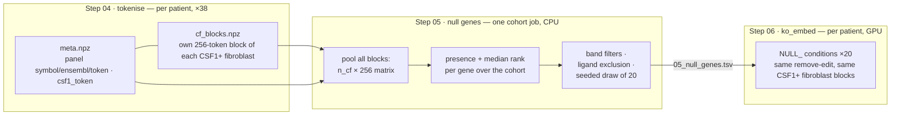
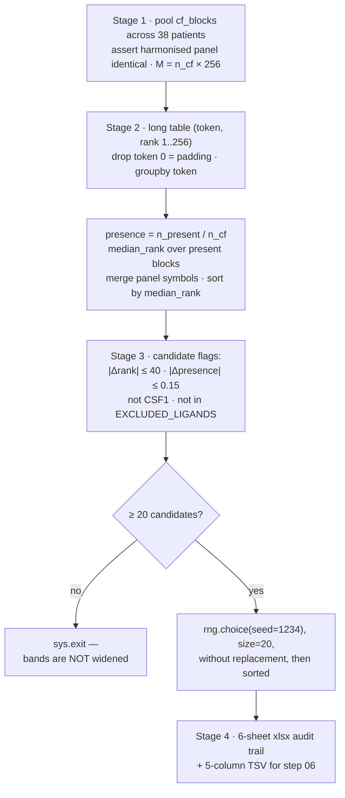

This page documents step 05 of the pipeline (`scripts/05_null_genes.py`), the point in the perturbation framework where the **negative controls for the in silico knockout are fixed**. Before any perturbation is computed, the script selects 20 *null genes* — genes that are not CSF1 and carry no established macrophage signal, but whose visibility inside the model's context is statistically indistinguishable from CSF1's. It is a single, cohort-level job: one run covers all 38 patients and produces one artifact that every per-patient task in step 06 later consumes. The selection rule was fixed before any knockout result was seen, which is what makes the nulls usable as a pre-registered reference distribution.

Sources: [05_null_genes.py](scripts/05_null_genes.py#L1-L37), [README.md](README.md#L93-L97)

## Role in the Perturbation Framework

Step 05 sits at the boundary between data preparation and perturbation. It reads only frozen outputs of step 04 — the own 256-token block of every CSF1+ fibroblast (`cf_blocks.npz`), the harmonised panel metadata (`meta.npz`), and the per-patient 04 summary sheets — and it never touches the model. Because it must summarise the *whole cohort*, it runs as one CPU-only SGE job that is chained behind every 04 array task via `-hold_jid tlp_04_tokenise`, requesting 16 GB RAM and one hour. Its outputs are a six-sheet audit workbook and a machine-readable TSV that step 06 reads to build the `NULL_*` knockout conditions.

The cohort definition is inherited, not re-derived: the script rediscovers patient directories, excludes the same six patients removed in step 03, and hard-asserts that exactly 38 remain before doing any work.

Sources: [05_null_genes.py](scripts/05_null_genes.py#L28-L36), [05_null_genes.py](scripts/05_null_genes.py#L63-L73), [05_null_genes.sh](scripts/05_null_genes.sh#L1-L17), [04_tokenise.py](scripts/04_tokenise.py#L8-L10)

## The Matching Statistics and Bands

A null gene must be *seen by the model in the same blocks as CSF1, about as often, and at about the same rank*. Both statistics are computed over the pooled own-blocks of all CSF1+ fibroblasts across the 38 patients. **Presence** is the fraction of CSF1+ fibroblast blocks that contain the gene at all; **median rank** is the median 1-based position of the gene within those blocks (rank 1 = highest normalised expression), computed only over blocks where the gene is present. CSF1's reference values are presence 0.66 and median rank 60, and a candidate must fall within ±0.15 presence and ±40 rank positions of those targets.

| Statistic | Definition over CSF1+ fibroblast own-blocks | CSF1 value | Tolerance for a candidate |
|---|---|---|---|
| `presence` | fraction of CSF1+ fibroblasts whose block contains the gene | 0.66 | absolute difference ≤ `PRESENCE_BAND` (0.15) |
| `median_rank` | median position (1 = highest) in the block, when present | 60 | absolute difference ≤ `RANK_BAND` (40 positions) |

| Constant | Value | Role |
|---|---|---|
| `GENE` | `"CSF1"` | test ligand whose visibility defines the match target |
| `N_NULL` | `20` | number of null genes drawn |
| `SEED` | `1234` | seed of `np.random.default_rng` for the draw |
| `RANK_BAND` | `40` | maximum rank deviation from CSF1 |
| `PRESENCE_BAND` | `0.15` | maximum presence deviation from CSF1 |
| `N_INCLUDED` | `38` | asserted cohort size |
| `EXCLUDED_LIGANDS` | 50 entries | biologically active ligands barred from the null |

Sources: [05_null_genes.py](scripts/05_null_genes.py#L12-L26), [05_null_genes.py](scripts/05_null_genes.py#L46-L59), [05_null_genes.py](scripts/05_null_genes.py#L93-L112), [README.md](README.md#L93-L97)

## The Exclusion List: Keeping Real Signal Out of the Null

Band matching alone is not enough — a gene that mimics CSF1's token statistics could still *cause* a real macrophage effect when removed, which would silently contaminate the reference distribution. The script therefore excludes 50 ligands with established direct effects on macrophage recruitment, survival, or polarisation: colony stimulating factors (`CSF1`, `IL34`, `CSF2`, `CSF3`), interleukins (`IL1A/B`, `IL4`, `IL6`, `IL10`, `IL13`, `IL18`, `IL33`), inflammatory cytokines (`TNF`, `IFNG`, `TGFB1-3`), chemokines (`CCL2-CCL22`, `CXCL8-CXCL12`, `CX3CL1`), and matrix/scar and clearance ligands (`SPP1`, `THBS1`, `GAS6`, `PROS1`, `VEGFA/FC`, `HGF`, `IGF1`, `PDGFB`, `CD47`, among others). CSF1 itself is additionally removed by name. The full list is written verbatim into the workbook so the exclusion is auditable, not folklore.

Sources: [05_null_genes.py](scripts/05_null_genes.py#L20-L22), [05_null_genes.py](scripts/05_null_genes.py#L57-L59), [05_null_genes.py](scripts/05_null_genes.py#L148-L149)

## Algorithm Walkthrough

The script is four explicit stages, and every stage ends in an assertion or an early exit rather than a silent fallback.

**Stage 1 — cohort assembly.** Each patient's `cf_tokens` array is loaded and vertically stacked into one `(n CSF1+ fibroblasts, 256)` matrix; the panel mapping (symbol, ensembl, token) is loaded once from the first patient and asserted identical across all others, and the CSF1 token id is captured from `meta.npz`. This is where the per-patient 04 summaries are also collected into the cohort table (depth batch, cell counts, CSF1 visibility).

Sources: [05_null_genes.py](scripts/05_null_genes.py#L63-L91), [04_tokenise.py](scripts/04_tokenise.py#L35-L39)

**Stage 2 — visibility statistics.** The pooled matrix is melted into a long `(token, rank)` table, rank positions 1–256 being broadcast per block; padding tokens (`token == 0`) are dropped before grouping. `groupby("token")` then yields `n_present`, `median_rank`, and `mean_rank`, presence is normalised by the total fibroblast count, and every surviving token is asserted to map onto a panel gene. The table is sorted by median rank and CSF1's row is extracted with an assertion that it was seen at least once in the blocks.

Sources: [05_null_genes.py](scripts/05_null_genes.py#L93-L112)

**Stage 3 — candidates and the seeded draw.** Boolean flags per gene (`in_rank_band`, `in_presence_band`, `excluded_ligand`) are combined into a single `candidate` column; candidates are sorted by symbol, and if fewer than 20 exist the script exits rather than widening the bands. Otherwise 20 genes are drawn without replacement from `np.random.default_rng(1234)` and the picked indices are re-sorted into a canonical order.

Sources: [05_null_genes.py](scripts/05_null_genes.py#L114-L130)

**Stage 4 — write-out.** The workbook records the full decision chain: `parameters` (all eleven run constants including `n_candidates` and the deep/shallow depth-batch counts, 12/26), `selected`, `candidates`, `all_genes` (every panel gene's statistics), `excluded_ligands`, and `patients`. Excel header styling is deliberately suppressed to keep the files machine-diffable. The TSV keeps only what step 06 needs.

Sources: [05_null_genes.py](scripts/05_null_genes.py#L132-L158), [README.md](README.md#L61-L63)

> [!TIP]
> Candidates are sorted by symbol *before* `rng.choice` is applied, so the selected set is a pure function of (candidate set, seed) — directory iteration order, mount order, or process scheduling cannot change the draw. Combined with the `parameters` sheet (seed + bands + `n_candidates`) and the full `candidates` sheet, anyone can re-derive the exact 20 genes from the audit workbook alone.

## Determinism and Fail-Fast Semantics

Every branch that could silently degrade control quality fails loudly instead. A missing per-patient `cf_blocks.npz` aborts the job up front; a panel mismatch between patients aborts at merge time; CSF1 never appearing in the blocks aborts at reference extraction; a token without a panel gene aborts at join time. Most importantly, the candidate shortfall is a hard `sys.exit` — the rank and presence bands are *pre-registered parameters*, and widening them after seeing a shortfall would break the "fixed before results are seen" contract stated in the module docstring.

Sources: [05_null_genes.py](scripts/05_null_genes.py#L12-L26), [05_null_genes.py](scripts/05_null_genes.py#L66-L72), [05_null_genes.py](scripts/05_null_genes.py#L104-L109), [05_null_genes.py](scripts/05_null_genes.py#L125-L126)

## The Output Contract Consumed by Step 06

Step 06 reads `05_null_genes.tsv` with a plain tab-separator parse and immediately asserts the row count is exactly 20. Each TSV row becomes one knockout condition, wired as a `(symbol, token)` pair: the condition named `NULL_<symbol>` edits the `token` value, not the symbol string. The edit itself uses the same `remove` mode as `CSF1_remove` — token and value deleted, remaining tokens of the block shifted up with stable ordering so padding stays at the end — and is applied to exactly the same neighbour blocks 1..10 that belong to CSF1+ fibroblasts. This symmetry is the entire point: the nulls are *edits of comparable size at the same positions*, differing from the test only in the gene identity.

| Contract field | Content | Consumer-side check in step 06 |
|---|---|---|
| `symbol` | null gene symbol | condition name `NULL_<symbol>` |
| `token` | harmonised panel token id | passed as the edit target token |
| `ensembl` | Ensembl id | carried for provenance/readouts |
| `presence`, `median_rank` | selection statistics | audit context for per-condition results |
| row count | exactly 20 | `check("null genes", len(null), 20, ...)` |

> [!TIP]
> The TSV carries *token ids* rather than symbols, which is only safe because stage 1 asserts the harmonised panel is byte-identical across all 38 patients — one shared token id therefore denotes the same gene everywhere in the cohort. If step 04 ever regenerates with a different bundle dictionary, step 05 and step 06 must be re-run together, never mixed.

Sources: [06_ko_embed.py](scripts/06_ko_embed.py#L11-L19), [06_ko_embed.py](scripts/06_ko_embed.py#L18-L25), [06_ko_embed.py](scripts/06_ko_embed.py#L226-L260), [05_null_genes.py](scripts/05_null_genes.py#L151-L152)

## Where This Fits and What to Read Next

The selection answers one design question — *what is a fair negative control for removing CSF1?* — by matching model visibility (presence and rank) and excluding biological confounders. What the nulls do *not* fix is decided elsewhere in the framework: the token-level edit mechanics they reuse are specified in [Token-Level Knockout Editing](11-token-level-knockout-editing); how they sit alongside `CSF1_zero`, `POS_block`, and the `cell_emb` negative control is covered in [Control Conditions Design](13-control-conditions-design); how the null distribution is turned into a decision rule in step 07 is the subject of [Null-Gene Control Rationale](14-null-gene-control-rationale); and the reproducibility guarantees touched on here (seeded draw, cached 04 inputs) are elaborated in [Reproducibility and Caching](19-reproducibility-and-caching).
