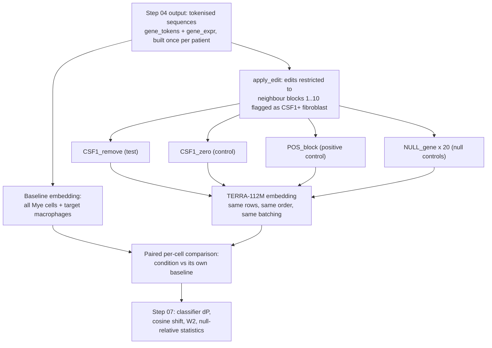
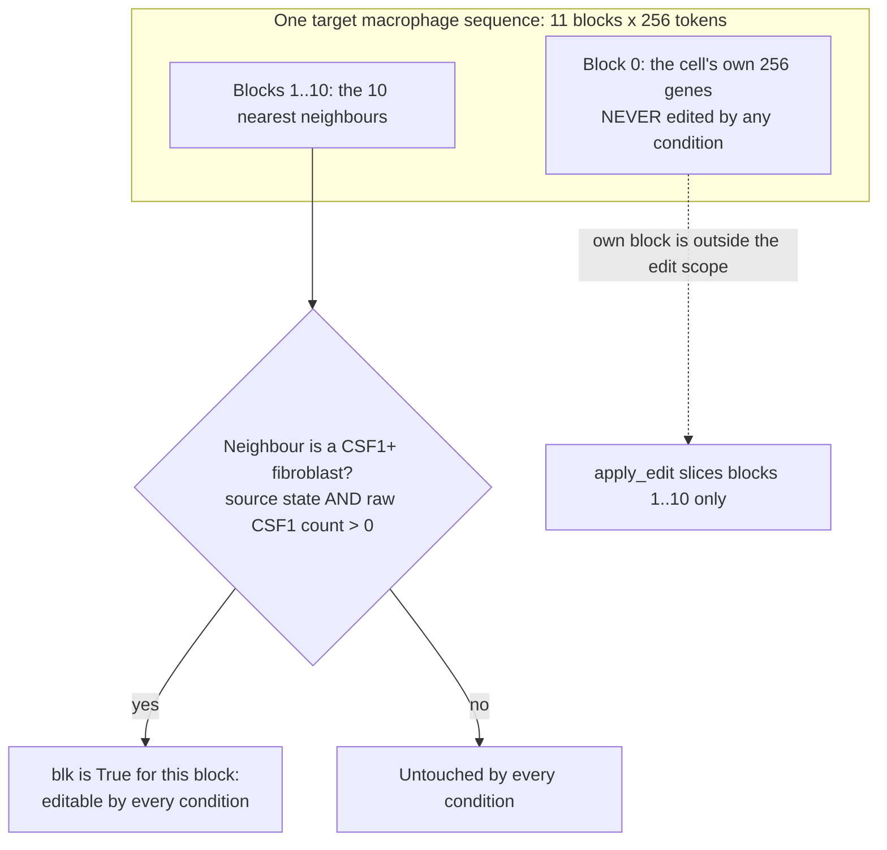
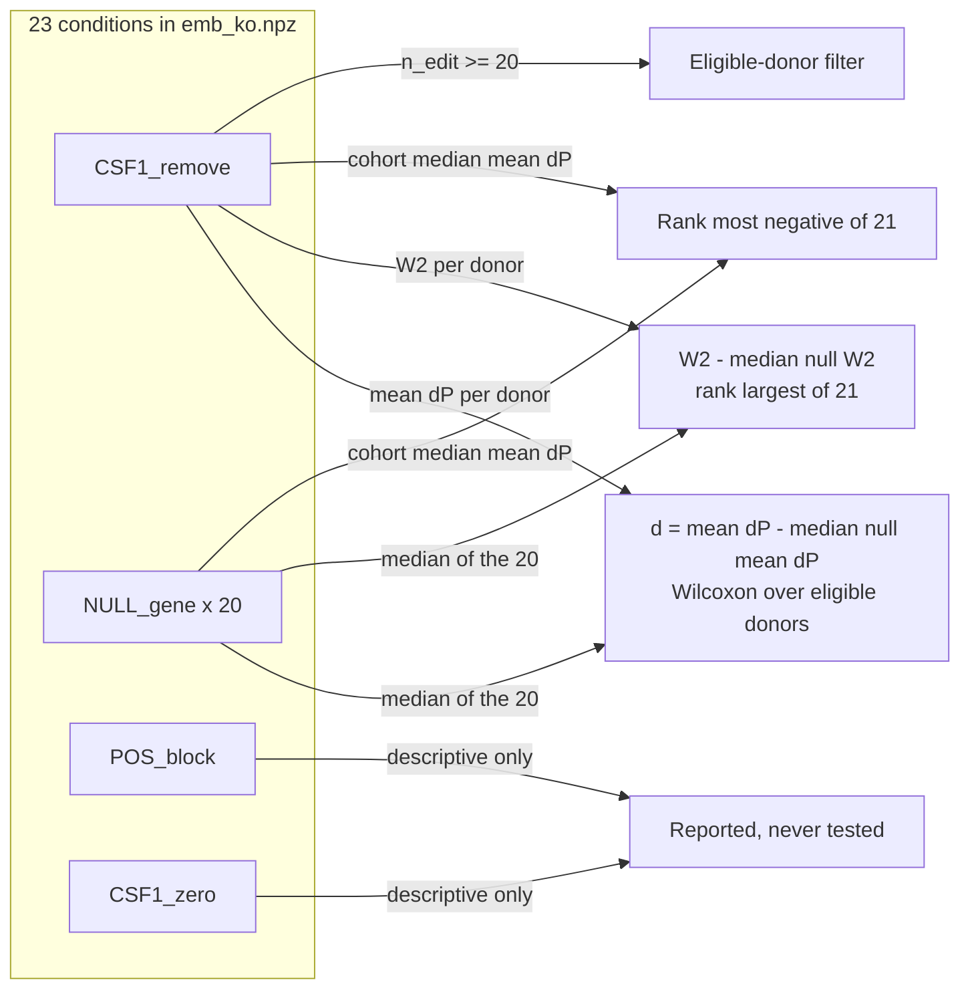

Every in silico perturbation in this pipeline is only as credible as the set of conditions it is compared against. This page explains the **catalogue of 23 conditions** that `06_ko_embed.py` attaches to each target macrophage — one test condition, 20 rank-matched null genes, and two standalone controls — how each is constructed from the same token sequence, and the distinct role each plays in the step 07 readout. It sits between the selection of the null genes themselves ([Rank-Matched Null Gene Selection](12-rank-matched-null-gene-selection)) and the statistical justification for gene-level controls ([Null-Gene Control Rationale](14-null-gene-control-rationale)).

The unifying constraint of the design is that **all conditions operate on the identical tokenised sequence** produced once by step 04. No condition re-tokenises, re-normalises, or re-derives its input; each is a deterministic token edit restricted to the same neighbourhood blocks, so any downstream difference between conditions is attributable to the edit itself, not to upstream variation.

Sources: [06_ko_embed.py](scripts/06_ko_embed.py#L12-L27), [06_ko_embed.py](scripts/06_ko_embed.py#L251-L255), [README.md](README.md#L67-L71)

## The Condition Catalogue

Each target macrophage is embedded once unedited (the baseline) and once per condition. The condition list is constructed explicitly in step 06 as `(name, token, mode)` triples: `CSF1_remove` and `CSF1_zero` act on the CSF1 token, `POS_block` acts on the whole block, and the 20 `NULL_<gene>` entries are read from the cohort-level null gene table produced by step 05. The resulting 23 names are stored in `cond_names` inside each patient's `emb_ko.npz`, and step 07 verifies that every patient carries the identical list before pooling.

| Condition | Count | Token edit per CSF1+ fibroblast neighbour block | Role |
|---|---|---|---|
| `CSF1_remove` | 1 | *CSF1* token and value removed; remaining tokens compact upward | The perturbation of interest |
| `NULL_<gene>` | 20 | Same removal semantics for a rank-matched null gene | Reference distribution for an edit of comparable size at the same positions |
| `POS_block` | 1 | Entire block emptied (all tokens and values → padding) | Positive control: proves the pipeline can detect a neighbourhood change |
| `CSF1_zero` | 1 | *CSF1* value set to 0, token kept | Checks whether the conclusion depends on how a loss is encoded |
| `cell_emb` readout | — (readout, not a condition) | None — the cell's own embedding | Negative control: a neighbour edit cannot change it |

Sources: [06_ko_embed.py](scripts/06_ko_embed.py#L251-L255), [07_ko_pool.py](scripts/07_ko_pool.py#L21-L24), [README.md](README.md#L85-L91)

The flow below shows how one tokenised sequence fans out into the condition family and converges again into paired comparisons:

Sources: [06_ko_embed.py](scripts/06_ko_embed.py#L251-L266), [06_ko_embed.py](scripts/06_ko_embed.py#L296-L299)

## Anatomy of an Editable Block

TERRA-112M represents each cell as 11 blocks of 256 gene tokens (`W=2816`): block 0 is the cell's own genes and blocks 1–10 are its nearest neighbours. The design draws a hard boundary here: **no condition ever touches block 0 or any block that does not belong to a CSF1+ fibroblast**. The editable blocks are precomputed per target macrophage as the boolean matrix `blk`, built by indexing the `is_cf` flag (written by step 04) through the neighbour index table; `n_cf_nb` is the row sum, i.e. the number of CSF1+ fibroblast neighbours per cell.

The CSF1+ fibroblast definition — a fibroblast in one of the configured source states with a raw *CSF1* count > 0 — is inherited from the study design rather than re-derived in step 06, and the source/target states themselves are read from `config/analysis.cfg` via the shared `analysis_config.py` module.

Sources: [06_ko_embed.py](scripts/06_ko_embed.py#L70), [06_ko_embed.py](scripts/06_ko_embed.py#L236-L249), [06_ko_embed.py](scripts/06_ko_embed.py#L147-L157), [analysis_config.py](scripts/analysis_config.py#L7-L9), [README.md](README.md#L56-L58)

## Three Edit Semantics, One Code Path

All 23 conditions flow through a single `apply_edit` function that differs only in its *selection* and *mode*. The selection narrows to tokens inside blocks where `blk` is true: for gene-targeted conditions it matches the gene's token ID, while for `POS_block` (`token=None`) it matches every non-padding token in the eligible blocks. The two modes then diverge:

| Mode | Used by | Token after edit | Value after edit | Block layout after edit |
|---|---|---|---|---|
| `remove` (gene token) | `CSF1_remove`, all 20 nulls | Set to 0 (padding) | Set to 0 | Remaining tokens compact upward; padding pushed to block end |
| `zero` | `CSF1_zero` | Kept | Set to 0 | Unchanged |
| `remove` (whole block, `token=None`) | `POS_block` | All set to 0 | All set to 0 | Block fully emptied into padding |

> [!TIP]
> The compaction in `remove` mode uses `np.argsort(sub_t == 0, kind="stable")` on each edited block: a *stable* sort that moves padding to the end while preserving the original expression-ranked order of surviving tokens. This is the invariant the downstream check `padding stays at block ends` relies on — a naive `argsort` without `stable` could reorder surviving tokens and silently change the semantics of the knockout for every condition using this mode.

Sources: [06_ko_embed.py](scripts/06_ko_embed.py#L147-L177)

## Which Cells Count as Edited

Membership in a condition is defined per cell, not per gene: **a target macrophage is edited by a condition when at least one of its eligible blocks contains that condition's gene** (`POS_block`: when it has at least one CSF1+ fibroblast neighbour at all), and `n_edit` stores the count of edited blocks per cell and condition. This has an important asymmetry across the catalogue. Because a CSF1+ fibroblast is defined by having raw *CSF1* > 0, *CSF1* is present in every eligible block by construction, so `n_edit(CSF1_remove)` equals `n_cf_nb` exactly — a property step 07 audits as the QC column `frac_nedit_CSF1_remove_eq_n_cf_nb`. Null genes, by contrast, are only rank-*matched* to CSF1's presence (about 0.66 of blocks, band ±0.15), so their per-cell `n_edit` genuinely varies, and a null gene may edit no target cell in a given donor at all — which is why step 07 reports `n_null_used` alongside every null median.

Sources: [06_ko_embed.py](scripts/06_ko_embed.py#L24-L26), [06_ko_embed.py](scripts/06_ko_embed.py#L276-L284), [07_ko_pool.py](scripts/07_ko_pool.py#L56-L59), [07_ko_pool.py](scripts/07_ko_pool.py#L247-L249), [05_null_genes.py](scripts/05_null_genes.py#L8-L10), [README.md](README.md#L93-L97)

## Paired Embedding Protocol

The control design only works if condition embeddings are directly comparable to the baseline, and step 06 enforces this structurally. The baseline is embedded once for every myeloid cell (the classifier training set for step 07) and once for the target macrophages; every condition then embeds **exactly the same target rows in the same order**, so batching is identical across conditions and any row index refers to the same cell in baseline and all 23 condition arrays. Three embedding types are collected per pass: `spatial_cell_emb` (the primary readout), `neighborhood_emb` (secondary), and `cell_emb` — the last kept purely as a negative control, since a neighbourhood edit cannot change the cell's own embedding.

Sources: [06_ko_embed.py](scripts/06_ko_embed.py#L28-L34), [06_ko_embed.py](scripts/06_ko_embed.py#L261-L266), [06_ko_embed.py](scripts/06_ko_embed.py#L296-L299), [07_ko_pool.py](scripts/07_ko_pool.py#L26-L33)

## Built-In Verification of Every Condition

Each condition embedding pass is followed by a battery of structural checks that are recorded per patient and abort the task on failure: (1) the set of changed rows equals the set of rows with `n_edit > 0` — an edit must change precisely its members and nobody else; (2) nothing changed outside the edited blocks; (3) padding remains at block ends after removal; and (4) `cell_emb` is unchanged versus baseline (max absolute difference < 1e-4). The last check operationalises the negative control: if the pipeline ever produced a non-zero `cell_emb` deviation, the neighbourhood-isolation premise of the whole design would be broken and the run would fail loudly rather than produce misleading shifts.

Sources: [06_ko_embed.py](scripts/06_ko_embed.py#L36-L39), [06_ko_embed.py](scripts/06_ko_embed.py#L283-L300), [06_ko_embed.py](scripts/06_ko_embed.py#L315-L317), [06_ko_embed.py](scripts/06_ko_embed.py#L353-L357)

## How Each Control Enters the Statistics

Step 07 does not treat the catalogue uniformly — each condition earns a distinct analytical role, encoded in the `role` column of the summary sheet (`test`, `control`, or `null gene`). The 20 nulls are *quantitative instruments*: the donor-level effect of any reported condition is defined as `d = mean dP(condition) − median over the nulls of mean dP(null)`, the same null median anchors the `W2(condition) − median W2(null)` magnitude comparison, and the test gene is ranked among the 21-gene set (test + nulls; `POS_block` and `CSF1_zero` are explicitly excluded from the rank set). `CSF1_zero` and `POS_block` are *qualitative instruments*: they are reported descriptively — same eligible donors, same null median — but never enter significance testing. Donor eligibility itself is tied to the test condition only: a donor is eligible when `CSF1_remove` edits at least `MIN_EDITED = 20` target macrophages.

| Control | Where it acts in step 07 | What it guards against |
|---|---|---|
| 20 `NULL_<gene>` | `d` subtraction, `n_null_used`, 21-gene ranks, W2-vs-null | A generic edit of comparable size at the same positions producing a similar output change |
| `POS_block` | Descriptive magnitude reporting only | An insensitive readout / pipeline failure to detect any neighbourhood change |
| `CSF1_zero` | Descriptive magnitude reporting only | Conclusions that depend on the token-removal encoding rather than the biology |
| `cell_emb` readout | Hard check in step 06 (< 1e-4) | Edits leaking outside the neighbourhood into the cell's own representation |
| `MIN_EDITED` on `CSF1_remove` | Eligible-donor filter for all statistics | Donors contributing noisy `d` from too few edited cells |

Sources: [07_ko_pool.py](scripts/07_ko_pool.py#L53-L67), [07_ko_pool.py](scripts/07_ko_pool.py#L100-L104), [07_ko_pool.py](scripts/07_ko_pool.py#L257-L263), [07_ko_pool.py](scripts/07_ko_pool.py#L442-L447), [07_ko_pool.py](scripts/07_ko_pool.py#L474-L482), [07_ko_pool.py](scripts/07_ko_pool.py#L486-L504), [07_ko_pool.py](scripts/07_ko_pool.py#L513-L531)

> [!TIP]
> When reading `07_summary.xlsx`, the `role` column is the authoritative map from condition to interpretation: `null gene` rows form the reference distribution, the single `test` row is the only object of the Wilcoxon test, and `control` rows (`POS_block`, `CSF1_zero`) exist solely to be eyeballed against expectation. Because all non-null conditions share the same eligible donors and the same null median, any difference between `CSF1_remove`, `CSF1_zero`, and `POS_block` rows reflects the condition edit itself — not cohort composition.

## Why This Particular Control Set

The catalogue is not generic best practice — each element answers a specific failure mode. Two observed behaviours of the model/tooling motivated building edits directly on step 04's tokens instead of re-tokenising or using the library's perturbation helper: re-tokenising after zeroing counts leaked changes into cells outside the intended neighbourhood, and `perturb_dataset` with `perturbation_target="neighborhood"` additionally edited blocks belonging to unlisted cells in `terra-st 0.1.13`. Token-level editing in pinned blocks removes both confounds at the source, which in turn makes the fine-grained control set meaningful. The gene-level controls address the remaining, subtler problem: changing *any* input changes a foundation model's output, so raw shift magnitude alone cannot distinguish a CSF1-specific effect from the effect of removing any comparably ranked gene at the same positions — hence the nulls; and a positive control distinguishes "small biological effect" from "broken measurement" — hence `POS_block`.

Sources: [README.md](README.md#L73-L83), [README.md](README.md#L112-L128), [05_null_genes.py](scripts/05_null_genes.py#L12-L24)

## Where to Go Next

The construction details of the removal semantics and the edit-invariant checks are elaborated in [Token-Level Knockout Editing](11-token-level-knockout-editing); the candidate bands, exclusion list, and seed behind the 20 nulls are covered in [Rank-Matched Null Gene Selection](12-rank-matched-null-gene-selection), and their statistical rationale in [Null-Gene Control Rationale](14-null-gene-control-rationale). How `dP` is produced by the classifier that scores every condition, and how the per-donor `d` values are tested and summarised across the cohort, are documented in [Leave-One-Donor-Out Classifier](15-leave-one-donor-out-classifier) and [Cohort Summary Statistics](17-cohort-summary-statistics).