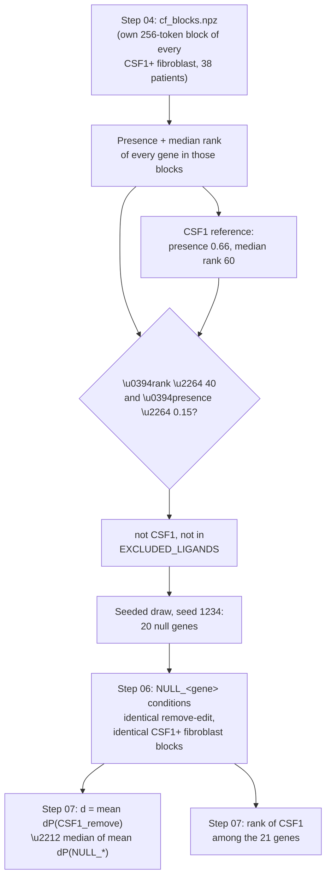

This page explains the *why* behind the pipeline's central inferential device: every CSF1 knockout is compared against 20 rank-matched null-gene knockouts rather than judged on its raw embedding shift. It covers the statistical problem the nulls solve, the properties a null gene must match, why the selection rules are fixed before any result is seen, and how the null distribution is consumed downstream to turn magnitudes into relative evidence. The mechanical selection procedure is documented in [Rank-Matched Null Gene Selection](12-rank-matched-null-gene-selection), and the full set of experimental conditions in [Control Conditions Design](13-control-conditions-design).

## The inference problem: a raw shift is not evidence of specificity

The premise of the study is that removing a ligand from the *neighbour* blocks of a target macrophage may shift the TERRA representation of that macrophage. But TERRA is a foundation model evaluated zero-shot: **changing any input changes its output**, and larger or more prominent input changes tend to produce larger output changes. A shift observed after removing CSF1 therefore admits two competing explanations — CSF1 carries specific signal for the target macrophage states, or the model simply responds to *any* comparable edit made at the same positions in the token sequence. Reporting only the magnitude of the output change cannot separate these two hypotheses.

The design consequence is precise: rather than assessing whether removal of the test gene changes the output, the analysis evaluates **whether its effect exceeds that of comparable genes** — genes removed in the same way, at the same positions, with comparable prominence in the block, but with no expectation of a macrophage-specific effect.

Sources: [README.md](README.md#L112-L123), [07_ko_pool.py](scripts/07_ko_pool.py#L40-L51)

## What a valid null must match

A null gene is knocked out **in exactly the same neighbour blocks as CSF1** — the blocks belonging to CSF1+ fibroblasts within each target macrophage's 10-neighbour context. Since the identical intervention is applied to identical token positions, the remaining confound is the *characteristics of the gene itself* inside those blocks. The pipeline fixes this with two statistics computed over the own 256-token block of every CSF1+ fibroblast across all 38 included patients:

| Statistic | Definition | Confound it equalises |
|---|---|---|
| **presence** | fraction of CSF1+ fibroblasts whose block contains the gene | how *often* the knockout edit actually fires per cell |
| **median rank** | median position (1 = highest) when present, in the expression-ordered token list | how *salient* the removed token is within the 256-token block |

TERRA blocks list each cell's genes in order of normalised expression, so token position encodes expression prominence — removing a top-ranked token is not the same intervention as removing a rank-250 token. CSF1's reference values in this cohort are presence 0.66 and median rank 60; a gene present in only 10% of blocks, or living at rank 200, would be a structurally different edit even if removed from the same blocks.

> [!TIP]
> The rank band is compensating for a subtle property of sequence models: within a 256-token block, the same deletion at different positions is not necessarily an equally "visible" edit to the network. Matching median rank makes the null edit positionally indistinguishable from the CSF1 edit, on average.

Sources: [05_null_genes.py](scripts/05_null_genes.py#L6-L19), [05_null_genes.py](scripts/05_null_genes.py#L99-L114), [06_ko_embed.py](scripts/06_ko_embed.py#L19-L20), [README.md](README.md#L67-L71), [README.md](README.md#L93-L97)

## Selection rules: fixed before results, with signal leakage excluded

A null is only a valid baseline if the null genes themselves carry no real macrophage signal. Candidate genes must satisfy **|median rank − CSF1 median rank| ≤ 40 positions** and **|presence − CSF1 presence| ≤ 0.15**, must not be CSF1, and must not appear in `EXCLUDED_LIGANDS` — a list of 49 ligands with established direct effects on macrophage recruitment, survival or polarisation (e.g. `CCL2`, `SPP1`, `VEGFA`, `TGFB1`, `CXCL12`), each of which would risk the null containing exactly the signal the design is trying to subtract.

Two procedural commitments make the selection statistically defensible. First, the docstring states the rules were **"fixed before results are seen"** — the bands and exclusion list are pre-specified, not tuned against outcomes. Second, the draw is mechanical and fail-fast: exactly 20 genes are drawn from the candidate pool with `np.random.default_rng(1234)`, and if fewer than 20 candidates exist the script **exits without widening the bands**, eliminating data-dependent flexibility at the point of failure. The full audit trail (parameters, selected genes, all candidates, all-gene statistics, excluded ligands, per-patient cohort table) is written to `05_null_genes.xlsx`, and the 20 selected genes travel forward as a single TSV consumed by step 06.

| Funnel stage | Criterion | Purpose |
|---|---|---|
| Band — rank | \|Δ median rank\| ≤ 40 | equalise positional salience |
| Band — presence | \|Δ presence\| ≤ 0.15 | equalise edit frequency |
| Exclusion — identity | ≠ CSF1 | null must not be the test gene |
| Exclusion — biology | ∉ `EXCLUDED_LIGANDS` (49 ligands) | null must contain no macrophage signal |
| Draw | 20 of the candidates, seed 1234 | deterministic, pre-registered pick |
| Guard | exit if < 20 candidates; bands never widened | no outcome-driven relaxation |

Sources: [05_null_genes.py](scripts/05_null_genes.py#L12-L24), [05_null_genes.py](scripts/05_null_genes.py#L50-L63), [05_null_genes.py](scripts/05_null_genes.py#L119-L131), [05_null_genes.py](scripts/05_null_genes.py#L155-L156)

## How the nulls convert magnitude into relative evidence

Step 06 guarantees the intervention is identical: each `NULL_<gene>` condition removes the gene's token *and* value and shifts the remaining tokens up — exactly the `CSF1_remove` edit, applied in exactly the CSF1+ fibroblast neighbour blocks. The loader asserts exactly 20 null conditions reach the embedding stage. Step 07 then uses the 20 null knockouts as a **paired reference distribution** at three levels:

| Readout | Null-relative form | Guardrail it enforces |
|---|---|---|
| `d` (per donor, primary) | mean dP(`CSF1_remove`) − median over the 20 nulls of mean dP(null) | CSF1 must beat *comparable* edits, not zero |
| Donor test | two-sided Wilcoxon signed-rank of d = 0 over eligible donors | cohort-level significance of the null-relative effect |
| Gene rank | cohort median donor mean dP per condition, ranked among the 21 genes | CSF1's standing in the full gene set, not just vs the null median |
| W2 (descriptive) | raw, as W2(condition) − median W2(null), and rank among 21 | magnitude-only metric never used for direction |

A donor-level subtlety is worth noting: a null gene contributes to the median only when it actually edited at least one target macrophage in that donor (since applicability requires a CSF1+ fibroblast neighbour block containing the gene). The number of nulls used is reported per donor as `n_null_used`, so donors where few null genes fire remain interpretable rather than silently degraded.

> [!TIP]
> The null median in step 07 is computed per donor via `null_tab.median(axis=1, skipna=True)` over donor-level *mean* dP values — not pooled across cells. This keeps the test statistic at the donor level, matching the Wilcoxon unit and avoiding pseudo-replication from treating cells as independent.

Sources: [06_ko_embed.py](scripts/06_ko_embed.py#L229-L256), [07_ko_pool.py](scripts/07_ko_pool.py#L55-L64), [07_ko_pool.py](scripts/07_ko_pool.py#L257-L263), [07_ko_pool.py](scripts/07_ko_pool.py#L429-L458)

## Position among the control family

The null genes answer one specific question — *is CSF1's effect specific relative to comparable edits?* — and are designed to interlock with the other controls, each of which answers a different failure mode:

| Control | Question it answers | Consequence if it behaves unexpectedly |
|---|---|---|
| 20 × `NULL_<gene>` | Is the CSF1 effect above comparable edits at the same positions? | Effect is not specific to CSF1's biology |
| `POS_block` (whole block emptied) | Can the pipeline detect a real neighbourhood change at all? | A small CSF1 effect could be a sensitivity failure, not weak biology |
| `CSF1_zero` (value zeroed, token kept) | Does the result depend on how the loss is encoded in tokens? | `CSF1_remove` result is an artefact of the edit encoding |
| `cell_emb` readout | Does a neighbour edit improperly leak into the cell's own embedding? | Premise of the whole neighbourhood design breaks |

The logic is asymmetric and diagnostic: if the positive control fires as expected while CSF1's effect stays within the null distribution, the small effect can be read as biologically or functionally weak rather than as a method failure — the inference the null design exists to license. Notably, step 07 makes **no automatic call** from these statistics; interpretation is deferred to the analyst, with the summary tables produced in [Cohort Summary Statistics](17-cohort-summary-statistics) and caveats discussed in [Limitations and Caveats](21-limitations-and-caveats).

Sources: [README.md](README.md#L85-L97), [README.md](README.md#L123-L128), [07_ko_pool.py](scripts/07_ko_pool.py#L53-L54), [06_ko_embed.py](scripts/06_ko_embed.py#L21-L26)

## Summary: the rationale in one chain

The null-gene control exists because a zero-shot model guarantees *some* shift for *any* edit. The pipeline therefore never asks "did removing CSF1 shift the embedding?" — that answer is trivially yes — but "does removing CSF1 shift it more than removing a rank- and presence-matched, macrophage-signal-free gene from the same blocks?" The answer is constructed by (1) pre-specifying matching rules before results exist, (2) excluding all ligands with known macrophage activity so nulls carry no true signal, (3) applying the byte-identical edit to the identical blocks, and (4) reporting CSF1 only relative to the null distribution — as donor-level d, as a rank among 21 genes, and as null-relative W2. Every element downstream of step 05 inherits the validity of these pre-commitments.

Sources: [05_null_genes.py](scripts/05_null_genes.py#L6-L24), [06_ko_embed.py](scripts/06_ko_embed.py#L12-L26), [07_ko_pool.py](scripts/07_ko_pool.py#L55-L67), [README.md](README.md#L112-L128)

**Continue reading**: the selection mechanics behind these rules in [Rank-Matched Null Gene Selection](12-rank-matched-null-gene-selection), how each condition is constructed at token level in [Token-Level Knockout Editing](11-token-level-knockout-editing), and how the null-relative statistics surface in the final outputs in [Cohort Summary Statistics](17-cohort-summary-statistics).