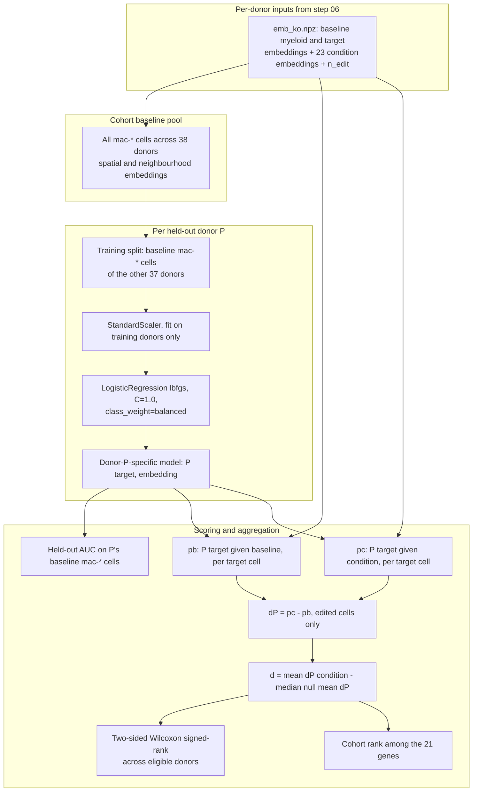
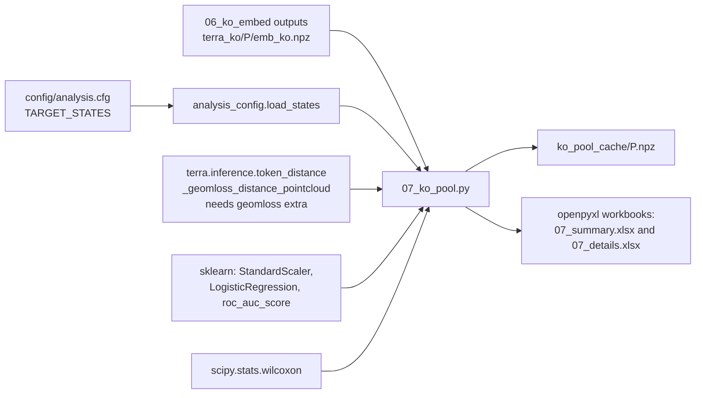
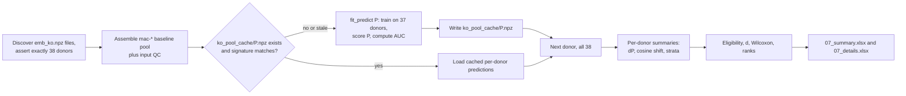

This page explains the **leave-one-donor-out (LODO) classifier** — the directional readout of the perturbation framework, implemented in the final pipeline step `scripts/07_ko_pool.py`. While the upstream in-silico knockout produces perturbed embeddings and W₂ distances quantify *how far* embeddings move, only the classifier answers *in which direction*: it converts TERRA embeddings into a probability that a macrophage belongs to the target states, then measures whether in-silico CSF1 knockout displaces target macrophages beyond what 20 rank-matched null genes do — with each donor serving as an independent replicate.

Sources: [07_ko_pool.py](scripts/07_ko_pool.py#L6-L10), [07_ko_pool.py](scripts/07_ko_pool.py#L26-L34)

## Position in the Readout Stack

The script declares the classifier as the **primary readout**: `PRIMARY = ("target", "spatial")` — the target-state classifier evaluated on the spatial cell embedding. Two classifiers × two embeddings are computed (`CLASSIFIERS = ["target"]`, `EMBEDDINGS = ["spatial", "neigh"]`), but the summary is anchored on the spatial variant; the neighbourhood embedding is retained as a secondary readout. The script's docstring is explicit about the division of labour: W₂ is *magnitude only* — it cannot distinguish a shift towards the target states from one away from it — so it is never used as directional evidence. The classifier exists precisely to fill that gap.

Sources: [07_ko_pool.py](scripts/07_ko_pool.py#L120-L123), [07_ko_pool.py](scripts/07_ko_pool.py#L48-L52)

## Why Leave One Donor Out

The core threat to validity is **donor-level confounding**: baseline embedding structure varies across donors, and a classifier trained on cells from donor P would partially memorise P-specific geometry, inflating `P(target)` for P's own cells and contaminating `dP`. The design eliminates this by construction: for each held-out donor P, the training split is `donor_all != p` — the model that scores a donor **never saw that donor's cells**. Each of the 38 donors therefore receives a model fitted exclusively on the other 37, and any per-cell probability difference is attributable to the embedding content itself, not to donor-shared training signal.

Sources: [07_ko_pool.py](scripts/07_ko_pool.py#L31-L33), [07_ko_pool.py](scripts/07_ko_pool.py#L312)

## Architecture and Module Interactions

The diagram below shows the full data flow. Read it left to right: per-donor knockout files from step 06 feed both the cohort-wide baseline pool (training material) and the scoring stage; donor-specific models emit held-out AUCs and per-cell probabilities that cascade into donor-level statistics and the final workbooks. The donor loop (second diagram) then shows how the 38 fits are orchestrated and cached.

Module-level dependencies are deliberately narrow: the classifier uses only `sklearn` primitives plus one TERRA inference helper for W₂, and reads the cell-state definitions from the shared configuration module used by steps 03, 04 and 07. The script aborts at start-up if the TERRA `perturb` extra (`geomloss`) is missing, so a partially installed environment fails fast rather than producing partial results.

Sources: [07_ko_pool.py](scripts/07_ko_pool.py#L128-L142), [analysis_config.py](scripts/analysis_config.py#L1-L9), [07_ko_pool.sh](scripts/07_ko_pool.sh#L9-L19)

## Training Data and Label Construction

Training uses **baseline embeddings only** — no perturbed embedding ever enters a training set. For each donor, every myeloid cell whose state starts with the `mac-` prefix contributes its baseline spatial and neighbourhood embeddings to the cohort pool, together with its state label. The binary label is defined by `clf_labels`: `1` if the cell's state is in `TARGET_STATES`, `0` for all other `mac-*` states. `TARGET_STATES` is read from `config/analysis.cfg` through `analysis_config.load_states()`, which validates that the placeholder file has been replaced and that no state is listed twice — so retraining the classifier on a different target definition is a pure configuration change.

Before any fit, the script enforces cohort integrity: exactly `EXPECTED_N_DONORS = 38` patient folders with `emb_ko.npz`, identical `cond_names` across patients, `n_edit` shape consistency, and a cross-check that `mye_state[t_in_mye]` equals `t_state`. A mismatch on any of these aborts the run.

| Parameter | Value | Role |
|---|---|---|
| Task | any `TARGET_STATES` vs other `mac-*` states | Binary target-membership probability |
| Training cells | baseline embeddings of all `mac-*` cells | Per-embedding matrices, stacked cohort-wide |
| Scaler | `StandardScaler`, fit on training donors only | Prevents donor-specific moments leaking into evaluation |
| Model | `LogisticRegression` (lbfgs), `C=1.0`, `tol=1e-4` | Regularised linear probe |
| Class weights | `balanced` | Corrects target-state prevalence imbalance |
| Max iterations | 5000, with `hit_max_iter` flagged per donor | Convergence audit |
| Replications | 38 donor-specific fits × 2 embeddings | Donor = statistical replicate |
| Primary variant | `target` classifier on `spatial` embedding | Anchors all headline statistics |

Sources: [07_ko_pool.py](scripts/07_ko_pool.py#L233-L237), [07_ko_pool.py](scripts/07_ko_pool.py#L279-L282), [analysis_config.py](scripts/analysis_config.py#L16-L34), [analysis.cfg.example](config/analysis.cfg.example#L10-L11), [07_ko_pool.py](scripts/07_ko_pool.py#L96-L104), [07_ko_pool.py](scripts/07_ko_pool.py#L109-L123), [07_ko_pool.py](scripts/07_ko_pool.py#L206-L255)

## The Donor Loop: Fit, Score, Cache

Each donor is processed independently by `fit_predict(P)`, which performs four operations per embedding: fit the scaler and logistic regression on the 37-donor training split, compute the held-out AUC on P's own baseline `mac-*` cells, score P's baseline target macrophages (`pb`), and score the same cells under all 23 condition embeddings (`pc`). The critical subtlety is the **scaler fit location**: `StandardScaler` is fitted on `base[e][tr]` — the training donors only — so held-out cells are standardised with donor-foreign statistics. This closes the last leakage channel: even the mean/variance used to transform P's cells come from other donors.

> [!TIP]
> The scaler is fitted on the training split only (line 334), not on the full cohort. Fitting it on all donors would leak donor-P's embedding moments into the transform of P's held-out cells — a subtle but real source of optimistic AUC bias that this implementation explicitly avoids.

Per-donor predictions are cached in `ko_pool_cache/
.npz`. Cache validity is governed by an MD5 **settings signature** computed over the entire analytical context: the donor list, logistic-regression hyperparameters, `TARGET_STATES`, the condition name set, and W₂ parameters. On rerun with `FORCE_REBUILD = False`, a matching signature loads predictions from cache; a mismatch triggers a re-fit with a "cache stale" message. Every cached record embeds this signature, so any cohort or configuration change silently invalidates old caches while remaining fully auditable.

> [!TIP]
> The signature (line 287-291) covers not just hyperparameters but the donor roster and condition set — meaning the cache also protects against silently mixing predictions computed under an edited cohort definition, which is exactly the failure mode donor-level statistics are most sensitive to.

| Population | Donors seen | Consumed by | Purpose |
|---|---|---|---|
| Training split | 37 others' baseline `mac-*` | Scaler + logistic fit | Learn target-state boundary |
| Held-out QC set | donor P's baseline `mac-*` | `roc_auc_score` | Generalisation gate |
| Scored baseline | donor P's target macrophages | `pb` | Per-cell reference probability |
| Scored conditions | donor P's targets × 23 conditions | `pc`, cosine distance | Perturbation response |

Sources: [07_ko_pool.py](scripts/07_ko_pool.py#L287-L293), [07_ko_pool.py](scripts/07_ko_pool.py#L308-L352), [07_ko_pool.py](scripts/07_ko_pool.py#L355-L367), [07_ko_pool.py](scripts/07_ko_pool.py#L95)

## Per-Cell Readout: dP

The classifier's raw output is a per-cell probability difference: **`dP = P(target | condition) − P(target | baseline)`**, computed with the *same* donor-held-out model scoring both the baseline embedding and the perturbed embedding of each target macrophage. Restriction matters: `dP` is only summarised for cells with `n_edit > 0` under that condition — cells whose neighbourhoods were actually edited by the in-silico knockout. Alongside it, the cosine distance `1 − cos(condition, baseline)` is recorded for the same cells as a pure magnitude companion. The donor-level aggregation then takes the mean over that donor's edited cells.

Sources: [07_ko_pool.py](scripts/07_ko_pool.py#L35-L38), [07_ko_pool.py](scripts/07_ko_pool.py#L344-L348), [07_ko_pool.py](scripts/07_ko_pool.py#L403-L410)

## Held-Out AUC as a Quality Gate

Every donor fit records a full audit row per embedding: `heldout_AUC`, held-out cell count, held-out positive count, training size, lbfgs iteration count, and a `hit_max_iter` convergence flag. The AUC is computed on the held-out donor's baseline `mac-*` cells and is set to **NA when one class is absent** in that donor (`0 < yh.sum() < yh.size` guard) — a scenario the pipeline handles gracefully rather than crashing. These rows populate the `classifier_auc` sheet, and the per-embedding median surfaces directly in the summary workbook as `median_heldout_AUC`. Before trusting any headline statistic, this column answers the prerequisite question: does the target-state boundary generalise to unseen donors at all?

Sources: [07_ko_pool.py](scripts/07_ko_pool.py#L338-L343), [07_ko_pool.py](scripts/07_ko_pool.py#L397-L402), [07_ko_pool.py](scripts/07_ko_pool.py#L512-L531)

## Donor-Level d, Null Calibration, and the Wilcoxon Test

Raw `dP` means are not comparable across donors, so each donor's CSF1 effect is **calibrated against its own null distribution**: `d = mean dP(condition) − median over the 20 null genes of mean dP(null)`. Null genes in which no target cell was edited contribute nothing to that donor's median, and the count actually used is reported as `n_null_used`. Donors are eligible for inference only if `CSF1_remove` edited at least `MIN_EDITED = 20` target macrophages — a floor that prevents donors with almost no edited targets from contributing noise.

The inferential test is a **two-sided Wilcoxon signed-rank test of `d = 0`** across eligible donors, treating the donor as the independent unit. The test is repeated within each depth batch to expose batch sensitivity, and each run reports the direction counts (`n_d_negative`), median and mean `d` alongside the statistic and p-value. A guard skips the test when no non-zero `d` exists, writing NA rather than a degenerate p-value. Because the null calibration is donor-specific and the test is donor-level, no pooled-cell pseudo-replication inflates significance — the sample size is the cohort, not the cell count.

Sources: [07_ko_pool.py](scripts/07_ko_pool.py#L53-L59), [07_ko_pool.py](scripts/07_ko_pool.py#L104), [07_ko_pool.py](scripts/07_ko_pool.py#L428-L433), [07_ko_pool.py](scripts/07_ko_pool.py#L442-L473)

## Gene Ranking Among the 21 Conditions

Beyond the hypothesis test, the classifier output supports a non-parametric ranking: for each condition, the cohort median of donor-mean `dP` over eligible donors is computed and ranked among the 21-gene set (`CSF1_remove` + 20 nulls), with `rank(method="min", ascending=True)` so that **rank 1 = most negative displacement** — the strongest shift away from target states. This rank is reported for every condition including the descriptive controls (`CSF1_zero`, `POS_block`), giving a single glanceable position of CSF1 within its calibrated null landscape. The W₂ analogue ranks in the opposite direction (1 = largest magnitude), reinforcing that the two metrics answer different questions.

Sources: [07_ko_pool.py](scripts/07_ko_pool.py#L263), [07_ko_pool.py](scripts/07_ko_pool.py#L474-L482), [07_ko_pool.py](scripts/07_ko_pool.py#L498-L504)

## Direction vs Magnitude: Why Both Metrics Exist

| Dimension | LODO classifier (`dP`, `d`) | W₂ distance |
|---|---|---|
| Evidence type | **Directional** — probability displacement relative to baseline | Magnitude only — cannot resolve shift direction |
| Granularity | Cell → donor → cohort inference | Per donor × condition, descriptive |
| Calibration | vs median of 20 null genes per donor | vs median null W₂; rank of 21 |
| Statistical test | Two-sided Wilcoxon signed-rank | None (never used as evidence of direction) |
| Implementation | sklearn logistic probe | TERRA Sinkhorn via `token_distance` |

The docstring states the division of responsibility unambiguously: W₂ is reported raw, as `W2(condition) − median W2(null)`, and as a rank — but it is *never* used as evidence of direction. The directional claim rests entirely on the classifier. For the full treatment of the magnitude side, see [Embedding Shift Magnitudes](16-embedding-shift-magnitudes).

Sources: [07_ko_pool.py](scripts/07_ko_pool.py#L40-L52), [07_ko_pool.py](scripts/07_ko_pool.py#L485-L504)

## Outputs: Where Each Artefact Lives

The step writes two unformatted Excel workbooks plus the per-donor prediction cache. The summary workbook is intentionally small — one row per embedding × condition with the headline statistics and a `role` column distinguishing `test`, `null gene` and `control` — while the details workbook preserves every intermediate table for audit. Execution is a single CPU-only SGE job (32 GB, 24 h wall clock) submitted with `hold_jid tlp_06_ko_embed`, so it starts only after every per-patient knockout embedding has finished.

| Sheet (07_details.xlsx) | Content |
|---|---|
| `settings` | Provenance: script, date, donor counts, every metric definition, settings signature |
| `wilcoxon` | Per classifier/embedding/condition/batch: n, median/mean `d`, `n_d_negative`, statistic, p |
| `gene_rank` | Cohort median donor-mean `dP` and rank among the 21 genes |
| `donor_d` | Per donor: `mean_dP_condition`, `median_null_mean_dP`, `n_null_used`, `d`, eligibility |
| `donor_condition` | Per donor × condition × embedding: `n_edited`, `mean_dP`, `median_dP`, `mean_cos_shift` |
| `strata_n_edited` | `dP`/cosine summaries stratified by edited-neighbour count (1, 2, 3+) |
| `by_target_state` | Same summaries stratified by target cell state |
| `classifier_auc` | Per donor: held-out AUC, class counts, train size, lbfgs iterations, convergence flag |
| `input_qc` | Per donor: cell counts, target-state composition, edit coverage, embedding dimensions |
| `w2_*` sheets | W₂ magnitudes, null differences and ranks (see [Embedding Shift Magnitudes](16-embedding-shift-magnitudes)) |

Sources: [07_ko_pool.py](scripts/07_ko_pool.py#L69-L75), [07_ko_pool.py](scripts/07_ko_pool.py#L506-L532), [07_ko_pool.py](scripts/07_ko_pool.py#L581-L588), [07_ko_pool.sh](scripts/07_ko_pool.sh#L1-L19)

## Reading Progression

To understand what the classifier scores, read upstream first: [Token-Level Knockout Editing](11-token-level-knockout-editing) explains how `cond_spatial`/`cond_neigh` are produced, [Rank-Matched Null Gene Selection](12-rank-matched-null-gene-selection) justifies the 20-gene calibration set, and [Control Conditions Design](13-control-conditions-design) covers `CSF1_zero` and `POS_block`. From here, continue to [Embedding Shift Magnitudes](16-embedding-shift-magnitudes) for the magnitude readout, [Cohort Summary Statistics](17-cohort-summary-statistics) for how these tables aggregate, [Reproducibility and Caching](19-reproducibility-and-caching) for the signature mechanics, and finally [Outputs and Result Interpretation](20-outputs-and-result-interpretation) for how to read the workbooks without over-calling results.