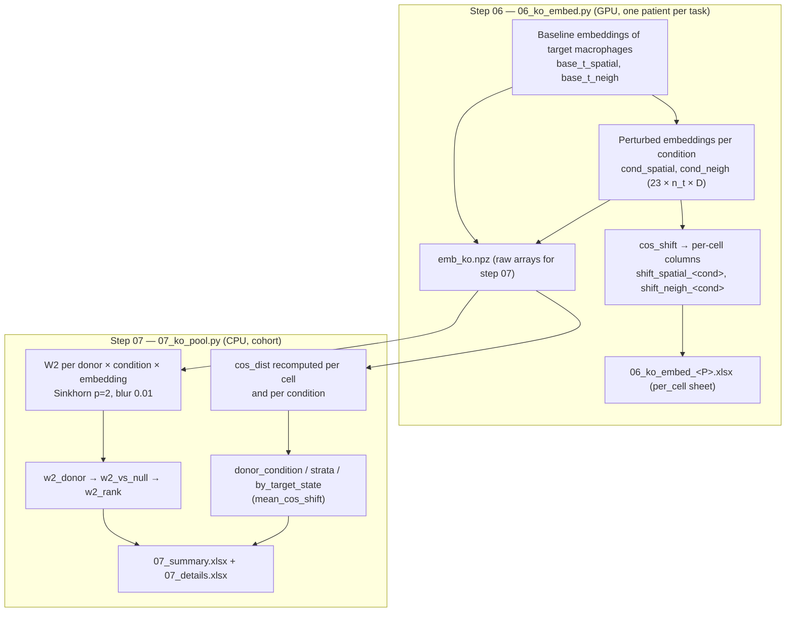

This page explains the **magnitude readouts** of the perturbation pipeline: how far the TERRA representation of a target macrophage moves when a ligand token is knocked out, and how those movements are aggregated from single cells up to cohort-level summaries. Magnitudes are *descriptive* — they measure how much the representation changes, never in which direction. They complement the primary classifier readout ([Leave-One-Donor-Out Classifier](15-leave-one-donor-out-classifier)) and feed the cohort tables described in [Cohort Summary Statistics](17-cohort-summary-statistics). Both readouts are computed downstream of the knockout embedding step ([Token-Level Knockout Editing](11-token-level-knockout-editing)): per-cell cosine shifts in step 06, and the Wasserstein-2 population distance in step 07.

Sources: [README.md](/README.md#L99-L110), [06_ko_embed.py](/scripts/06_ko_embed.py#L2-L10), [07_ko_pool.py](/scripts/07_ko_pool.py#L6-L10)

## Two magnitudes, two granularities

The pipeline reports exactly two magnitude measures, each at a different granularity and with a different tool. The **cosine shift** is a per-cell quantity: for every edited target macrophage, it measures the angular displacement between its baseline embedding and its perturbed embedding, computed independently for the spatial cell embedding (`spatial_cell_emb`, primary) and the neighbourhood embedding (`neighborhood_emb`, secondary). The **Wasserstein-2 distance (W2)** is a per-donor quantity: it compares the *distribution* of baseline embeddings of all edited target macrophages of a donor against the distribution of their perturbed embeddings, using TERRA's own distance metric.

Sources: [README.md](/README.md#L101-L110), [07_ko_pool.py](/scripts/07_ko_pool.py#L40-L51)

| Property | Cosine shift | Wasserstein-2 (W2) |
|---|---|---|
| Granularity | Per target macrophage | Per donor (population) |
| Definition | `1 − cos(condition, baseline)` | GeomLoss Sinkhorn distance, p = 2 |
| Implementing step | 06 (per-cell sheet) and 07 (summaries) | 07 only |
| Normalisation | Row unit-vectors before dot product | Row L2-normalisation, matching TERRA |
| Point clouds compared | Each cell with itself (paired) | Edited cells of one donor, baseline vs condition (paired) |
| Embeddings covered | spatial and neighbourhood | spatial and neighbourhood |
| Can express direction | No (magnitude only) | No (magnitude only) |
| Role in outputs | `mean_cos_shift` in per-donor summary sheets | `w2_donor`, `w2_vs_null`, `w2_rank` sheets and summary columns |

Sources: [07_ko_pool.py](/scripts/07_ko_pool.py#L36-L51), [06_ko_embed.py](/scripts/06_ko_embed.py#L303-L314), [07_ko_pool.py](/scripts/07_ko_pool.py#L585-L586)

Because both are pure magnitudes, neither can tell a shift *towards* the target states from a shift *away* from them. The docstring is explicit: W2 is "magnitude only (it cannot tell a shift towards the target states from one away from it), so it is never used as evidence of direction." Directional evidence comes exclusively from the classifier's dP statistic on the primary readout.

Sources: [07_ko_pool.py](/scripts/07_ko_pool.py#L48-L51), [README.md](/README.md#L101-L110)

## Where the magnitudes live in the pipeline

Step 06 embeds every target macrophage under baseline and under each of the 23 conditions (CSF1_remove, CSF1_zero, POS_block, and 20 null-gene knockouts), storing raw embeddings in `emb_ko.npz` for step 07, and writing per-cell cosine shifts immediately to the step-06 workbook. Step 07 re-loads the cached embeddings, recomputes the cosine distances, computes W2 per donor and condition, and aggregates everything into the cohort workbooks.

Sources: [06_ko_embed.py](/scripts/06_ko_embed.py#L261-L331), [07_ko_pool.py](/scripts/07_ko_pool.py#L309-L329), [07_ko_pool.py](/scripts/07_ko_pool.py#L485-L504)

## Cosine shift per cell

For a condition `c` and target macrophage `i`, the cosine shift is `1 − cos(emb_c[i], emb_base[i])`, computed after normalising each embedding to unit length. Step 06 implements this as `cos_shift`, applied condition-wise to both embedding types immediately after each knockout is embedded, and stores the result as `shift_spatial_<condition>` and `shift_neigh_<condition>` columns of the per-cell sheet — one row per target macrophage, annotated with cell id, sample/piece, cell state, and the number of CSF1+ fibroblast neighbours.

Sources: [06_ko_embed.py](/scripts/06_ko_embed.py#L210-L213), [06_ko_embed.py](/scripts/06_ko_embed.py#L303-L314)

Step 07 does not parse the step-06 workbook; it recomputes the identical quantity from the raw arrays in `emb_ko.npz` as `cos_dist`, this time guarding the denominator with an epsilon (`np.maximum(na * nb, 1e-12)`). Restricting to edited cells happens only at summary time: for each donor × condition × embedding, `summ()` reports `mean_cos_shift` over exactly the cells with `n_edit > 0` for that condition — the same cell-selection rule as the classifier's dP — stratified overall, by number of edited neighbours (1, 2, 3+), and by target state.

Sources: [07_ko_pool.py](/scripts/07_ko_pool.py#L296-L299), [07_ko_pool.py](/scripts/07_ko_pool.py#L320), [07_ko_pool.py](/scripts/07_ko_pool.py#L377-L381), [07_ko_pool.py](/scripts/07_ko_pool.py#L403-L418)

> [!TIP]
> The per-cell cosine-shift columns in `06_ko_embed_
.xlsx` cover *all* target macrophages, including those with `n_edit = 0` (whose embeddings are necessarily unchanged, cosine shift ≈ 0). Only step 07's summaries restrict to edited cells — so if you read the step-06 sheet directly, filter on `n_edit_<condition> > 0` first.

## Wasserstein-2 distance per donor

W2 answers a different question: taken together, how far did the *population* of edited target macrophages of one donor move? For each donor, each condition, and each embedding, step 07 builds two point clouds from the **same cells** — the baseline embeddings of all target macrophages edited by that condition, and their perturbed embeddings — and computes the optimal-transport distance between the two clouds. Pairing the identical cells on both sides keeps the comparison strictly within-donor and within-cell-set; there is no subsampling.

Sources: [07_ko_pool.py](/scripts/07_ko_pool.py#L40-L47), [07_ko_pool.py](/scripts/07_ko_pool.py#L321-L329)

The computation deliberately delegates to TERRA's own helper, `_geomloss_distance_pointcloud` from `terra.inference.token_distance` — the same function behind TERRA's `summarize_w2_by_label` — so the numbers are directly comparable with what the model itself reports. Before calling it, rows are L2-normalised exactly as in TERRA's `_l2_normalize_rows`. The distance is the GeomLoss Sinkhorn loss with p = 2, blur 0.01, on the tensorized backend, all matching TERRA's defaults. If a condition edits no target cell in a donor, the W2 value is `NA` (the gate `W2_MIN_CELLS = 1`).

Sources: [07_ko_pool.py](/scripts/07_ko_pool.py#L114-L118), [07_ko_pool.py](/scripts/07_ko_pool.py#L138-L142), [07_ko_pool.py](/scripts/07_ko_pool.py#L302-L305), [07_ko_pool.py](/scripts/07_ko_pool.py#L322-L329)

| W2 parameter | Value | Meaning |
|---|---|---|
| `W2_P` | 2 | Order of the Sinkhorn loss (Wasserstein-2) |
| `W2_BLUR` | 0.01 | GeomLoss entropic regularisation scale (TERRA default) |
| `W2_BACKEND` | `tensorized` | GeomLoss backend (TERRA default) |
| `W2_MIN_CELLS` | 1 | Minimum edited targets required; fewer → W2 = NA |
| `device` | `None` | CPU — step 07 runs outside the GPU |

Sources: [07_ko_pool.py](/scripts/07_ko_pool.py#L114-L118), [07_ko_pool.py](/scripts/07_ko_pool.py#L76-L79)

Because GeomLoss is a TERRA optional dependency, step 07 refuses to start unless the model was installed with the `perturb` extra, which pulls in `geomloss`.

Sources: [07_ko_pool.py](/scripts/07_ko_pool.py#L76-L77), [07_ko_pool.py](/scripts/07_ko_pool.py#L138-L142)

## From per-donor W2 to cohort summaries

The W2 sheets form a three-stage pyramid. The `w2_donor` sheet is the raw layer: one row per donor × embedding × condition with the donor's W2 and the number of cells edited by that condition. The `w2_vs_null` sheet places CSF1_remove, CSF1_zero and POS_block in context: for each of them it reports the donor's `W2_condition`, the median W2 across the 20 null-gene knockouts in that donor (`n_null_used` counts nulls with at least one edited cell), and the difference `W2_minus_null_median`. The `w2_rank` sheet collapses the cohort: `cohort_median_W2` is the median over **eligible donors** (those with ≥ 20 target macrophages edited by CSF1_remove), and `rank_largest_of_21` ranks that median among the 21 genes (CSF1 + 20 nulls), with rank 1 = largest shift. Ties use minimum rank, and POS_block/CSF1_zero appear in the tables but are excluded from the 21-gene rank set.

Sources: [07_ko_pool.py](/scripts/07_ko_pool.py#L384-L393), [07_ko_pool.py](/scripts/07_ko_pool.py#L485-L504), [07_ko_pool.py](/scripts/07_ko_pool.py#L429-L433), [README.md](/README.md#L144-L158)

The single-row summary table carries two magnitude columns forward: `cohort_median_W2` and `W2_rank_largest_of_21`, sitting next to the classifier columns so the reader sees magnitude and direction evidence side by side. Note the deliberate asymmetry with the classifier: the classifier rank rewards the *most negative* dP (rank 1 = most negative), while the W2 rank rewards the *largest* shift (rank 1 = largest) — direction and magnitude are kept conceptually separate all the way into the final workbook.

Sources: [07_ko_pool.py](/scripts/07_ko_pool.py#L499), [07_ko_pool.py](/scripts/07_ko_pool.py#L513-L531), [07_ko_pool.py](/scripts/07_ko_pool.py#L533-L551)

The `settings` sheet of both workbooks records the exact W2 configuration in prose ("descriptive only; TERRA Sinkhorn p=2 blur=0.01 tensorized on L2-normalised rows … rank 1 = largest"), and the whole analysis is checksummed into a settings signature that also invalidates the per-donor prediction cache when cohort or W2 settings change.

Sources: [07_ko_pool.py](/scripts/07_ko_pool.py#L560-L579), [07_ko_pool.py](/scripts/07_ko_pool.py#L287-L293)

## How to read magnitudes: controls and caveats

The gene-level-control design (see [Null-Gene Control Rationale](14-null-gene-control-rationale)) applies to magnitudes with full force: changing *any* input changes the model's output, so a large cosine shift or W2 for CSF1_remove is only meaningful relative to the rank-matched null genes edited at the same positions in the same blocks. The intended inference pattern is therefore relative: CSF1's magnitude exceeds the null distribution (high `W2_minus_null_median`, small `rank_largest_of_21`) *and* the positive control `POS_block` — emptying an entire fibroblast neighbour block — produces the large shift that certifies the pipeline can detect a real neighbourhood change at all.

Sources: [README.md](/README.md#L112-L128), [README.md](/README.md#L85-L91), [06_ko_embed.py](/scripts/06_ko_embed.py#L20-L22)

A negative control guards the embeddings themselves: because edits touch only neighbour blocks, the cell's *own* embedding (`cell_emb`) must not change at all. Step 06 verifies per condition that the maximum absolute difference of `cell_emb` is below 1e-4 and records the values in the `negative_control_cell_emb` sheet; any failure aborts the patient's run with a non-zero exit.

Sources: [06_ko_embed.py](/scripts/06_ko_embed.py#L31-L34), [06_ko_embed.py](/scripts/06_ko_embed.py#L299), [06_ko_embed.py](/scripts/06_ko_embed.py#L315-L317), [06_ko_embed.py](/scripts/06_ko_embed.py#L353-L357)

> [!TIP]
> Interpret W2 ranks jointly with the classifier ranks of the summary table: a CSF1_remove with `W2_rank_largest_of_21` = 1 but a middling dP rank means the representation moved strongly in a direction unrelated to the target states — a specificity signal, not a positive result. This is precisely why the repository labels both magnitude readouts "descriptive".

Two structural caveats bound what the magnitudes can mean. First, TERRA is a zero-shot model: a change in its representation is not a predicted biological response, only evidence that the model's encoding of the receiving cell is sensitive to the ligand token. Second, the null genes were matched to CSF1's *presence and rank* within the fibroblast token blocks ([Rank-Matched Null Gene Selection](12-rank-matched-null-gene-selection)), so the magnitude comparison is fair only to the extent that token-level edit size is the dominant confounder — which is exactly the hypothesis the design tests.

Sources: [README.md](/README.md#L130-L138), [README.md](/README.md#L93-L97)

## Where to go next

With magnitudes understood, the natural reading path continues through how all readouts are rolled up per donor and per cohort in [Cohort Summary Statistics](17-cohort-summary-statistics), how the outputs are packaged in [Outputs and Result Interpretation](20-outputs-and-result-interpretation), and which interpretive limits apply in [Limitations and Caveats](21-limitations-and-caveats). To revisit the perturbation conditions that generate the embeddings being compared, see [Token-Level Knockout Editing](11-token-level-knockout-editing) and [Control Conditions Design](13-control-conditions-design).
