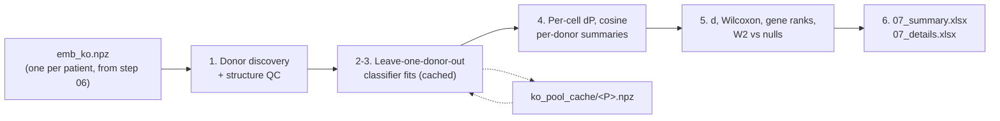

The *Cohort Summary Statistics* page explains **step 07** of the pipeline (`scripts/07_ko_pool.py`), the stage where per-patient knockout results from step 06 are pooled into cohort-level statistical evidence. It covers donor discovery and input validation, the leave-one-donor-out classifier that converts embedding shifts into directional probabilities, the per-cell and per-donor summaries, the null-gene-normalised cohort statistic `d`, the Wilcoxon signed-rank test and gene ranks, the W2 magnitude statistics, and the two Excel workbooks the step produces. The step deliberately makes **no automatic significance call**: every quantity is reported, and interpretation is left to the analyst (see [Outputs and Result Interpretation](20-outputs-and-result-interpretation)).

Sources: [07_ko_pool.py](scripts/07_ko_pool.py#L1-L80), [README.md](README.md#L99-L110)

## Position in the Pipeline

Step 07 is the terminal, CPU-only stage. It consumes one `emb_ko.npz` file per patient — produced by the GPU array job of step 06 — and requires **all** patients to be present before it starts. Per donor, the input carries baseline embeddings of all myeloid cells, the subset of target macrophages, the perturbed embeddings for 23 conditions (`CSF1_remove`, `CSF1_zero`, `POS_block`, and 20 `NULL_<gene>` files), and `n_edit`, the count of edited neighbours per target cell per condition. The step fits classifiers, computes all readouts, and writes two workbooks plus a per-donor prediction cache.

Sources: [07_ko_pool.py](scripts/07_ko_pool.py#L12-L33), [07_ko_pool.py](scripts/07_ko_pool.py#L69-L78)

To read the diagram: solid arrows are data flow through the six internal stages of `07_ko_pool.py`; the stage numbers 1–6 match the section headers printed in the script's own log output.

Sources: [07_ko_pool.py](scripts/07_ko_pool.py#L163-L171), [07_ko_pool.py](scripts/07_ko_pool.py#L285-L296), [07_ko_pool.py](scripts/07_ko_pool.py#L369-L382), [07_ko_pool.py](scripts/07_ko_pool.py#L425-L504)

Execution is orchestrated by `scripts/07_ko_pool.sh`: a single Sun Grid Engine job requesting 32 GB memory and 24 hours, submitted with `qsub -hold_jid tlp_06_ko_embed` so it runs only after every step-06 task has finished. Inside the TERRA container it runs `tx python scripts/07_ko_pool.py` — no GPU is requested, because inference already happened in step 06; this stage is classification and bookkeeping.

Sources: [07_ko_pool.sh](scripts/07_ko_pool.sh#L1-L21)

## Input Validation and Cohort QC

Before any statistics are computed, the step asserts that the cohort is structurally complete. It globs `<KO_DIR>/
/emb_ko.npz` and aborts unless exactly `EXPECTED_N_DONORS = 38` patients are found — the number guaranteed by the inclusion rules of step 03 (median depth ≥ 100 counts, ≥ 50 CSF1+ fibroblasts, ≥ 50 target macrophages, as described in [Patient Inclusion Rules](8-patient-inclusion-rules)). Loading uses `allow_pickle=True` because step 06 stores some string arrays as object arrays.

Sources: [07_ko_pool.py](scripts/07_ko_pool.py#L95-L96), [07_ko_pool.py](scripts/07_ko_pool.py#L163-L186), [README.md](README.md#L53-L54)

Each patient file then passes a battery of cross-checks: the folder name must match the embedded `patient` key; `cond_names` must be identical across all patients (the cohort-wide condition set is established by the first file); `n_edit` must have shape `(n_targets, n_conditions)`; embedding row counts must match state counts; and `mye_state[t_in_mye]` must equal `t_state`. Simultaneously, the step builds baseline training matrices by extracting all `mac-*` cells from both embeddings across the full cohort — these are what the classifiers train on — and records a per-patient QC row (myeloid/mac/target counts, target-state composition, fraction where `n_edit` for `CSF1_remove` equals the cell's CSF1+ neighbour count, and max absolute difference between the target-row and full-array baseline embeddings, a consistency probe).

Sources: [07_ko_pool.py](scripts/07_ko_pool.py#L200-L276), [07_ko_pool.py](scripts/07_ko_pool.py#L241-L254)

## The Leave-One-Donor-Out Classifier Readout

The **primary readout** is directional and probabilistic. For each donor *p*, a binary logistic regression is trained on baseline embeddings of `mac-*` cells from **all other donors** (`tr = tr_donor & m_all`) and scores held-out probabilities on donor *p*'s cells. The classifier predicts P(target): any state in `TARGET_STATES` (read from `config/analysis.cfg` via `analysis_config.load_states`) versus all other macrophage states. Features are `StandardScaler`-scaled with the scaler fit on training donors only, and the logistic regression uses `class_weight="balanced"`, `C=1.0`, `max_iter=5000`, `tol=1e-4`. Because the model scoring donor *p* never saw any of *p*'s cells, donor-level means are not contaminated by within-donor leakage — the foundation of the paired cohort test below. Held-out AUC is computed on the held-out donor's baseline `mac-*` cells and reported as NA when one class is absent; the record also stores `n_train`, `lbfgs_iter`, and a `hit_max_iter` convergence flag.

> [!TIP]
> The `StandardScaler` is fitted **inside** the leave-one-donor-out loop on training donors only (`scripts/07_ko_pool.py#L334`). Reusing a cohort-wide scaler would leak held-out donor statistics into the transform and invalidate the independence assumption behind the Wilcoxon test.

Sources: [07_ko_pool.py](scripts/07_ko_pool.py#L279-L281), [07_ko_pool.py](scripts/07_ko_pool.py#L308-L352), [analysis_config.py](scripts/analysis_config.py#L16-L34)

The classifier is applied twice per donor: once to the **baseline** embeddings of the target macrophages (`pb`), once to every **perturbed** embedding (`pc`, shape `n_conditions × n_targets`). The per-cell score is `dP = P(condition) − P(baseline)`, computed only for target cells with `n_edit > 0` in that condition — cells whose neighbourhood contained no editable CSF1+ fibroblast are excluded, since an edit of zero tokens cannot be interpreted. A secondary magnitude score, `cosd = 1 − cosine(condition, baseline)`, is computed on the same cell set. The classifier/embedding pair `("target", "spatial")` is flagged `PRIMARY`; the neighbourhood embedding serves as a secondary readout, reported identically for comparison.

Sources: [07_ko_pool.py](scripts/07_ko_pool.py#L120-L123), [07_ko_pool.py](scripts/07_ko_pool.py#L403-L410)

## Per-Donor Summaries and Strata

Donor-level aggregation is deliberately simple and transparent: for every donor × condition × classifier × embedding, the `summ` helper reports `n_edited`, `mean_dP`, `median_dP`, and `mean_cos_shift` over the edited target cells. The same summaries are additionally broken out along two prespecified strata — by number of edited neighbours (`1`, `2`, `3+`) and by target-state label — producing the `strata_n_edited` and `by_target_state` sheets. These strata exist to reveal dose–response (cells with more edited neighbours should shift more if the neighbourhood signal is real) and state heterogeneity without being part of the primary test.

Sources: [07_ko_pool.py](scripts/07_ko_pool.py#L377-L423)

## The Primary Statistic: Null-Normalised Shift `d`

The cohort analysis starts with **donor eligibility**: a donor is eligible when at least `MIN_EDITED = 20` target macrophages were edited by `CSF1_remove`, ensuring each donor's contribution rests on a meaningful cell count. Then, per donor, the raw effect is normalised against the null-gene reference distribution:

> **d = mean dP(CSF1_remove) − median over the 20 null genes of mean dP(NULL_<gene>)**

This construction is the statistical heart of the step. It answers the question posed in the study design — *does removing CSF1 shift the representation more than removing a comparable gene at the same token positions?* — rather than asking whether any shift occurs at all (see [Null-Gene Control Rationale](14-null-gene-control-rationale) and [Rank-Matched Null Gene Selection](12-rank-matched-null-gene-selection)). A null gene with no edited target cell in that donor contributes nothing to the median (`skipna=True`), and the number actually used is reported as `n_null_used`. The same `d` is computed for the descriptive conditions `CSF1_zero` and `POS_block` over the identical eligible donors and null median, so all conditions are compared on equal footing.

Sources: [07_ko_pool.py](scripts/07_ko_pool.py#L429-L458), [07_ko_pool.py](scripts/07_ko_pool.py#L100-L104)

## Cohort Tests: Wilcoxon Signed-Rank and Gene Ranks

Because each eligible donor contributes one paired value of `d` (its own CSF1 effect minus its own null median), the cohort test is a **two-sided Wilcoxon signed-rank test of d = 0** — a distribution-free test appropriate for a modest donor count (n = 38 maximum) with no normality assumption. It is run over all eligible donors and repeated within each depth batch (`deep`/`shallow`, defined in step 04), exposing whether the effect is driven by sequencing depth. Each test record stores `n_donors`, `n_d_negative` (donors shifted *away* from the target states beyond the null median), `median_d`, `mean_d`, the statistic `wilcoxon_V`, and `p_two_sided`; if a group has fewer than one non-zero value the test is reported as NA rather than fabricated.

Sources: [07_ko_pool.py](scripts/07_ko_pool.py#L459-L473), [README.md](README.md#L61-L63)

The second cohort-level view is the **gene rank**. For each condition, the cohort median of donor `mean_dP` (over eligible donors) is computed and ranked among the 21 genes in `RANK_SET` (CSF1 + 20 nulls) with `method="min", ascending=True`, so **rank 1 = most negative median shift**. This reframes the result as a placement question: does CSF1_remove sit at the extreme of the null distribution, or in its middle? It is robust to the absolute calibration of the classifier probabilities and is the figure the summary workbook surfaces first.

Sources: [07_ko_pool.py](scripts/07_ko_pool.py#L474-L482)

## Magnitude Statistics: W2 Relative to the Nulls

Alongside the directional readout, the step computes TERRA's own population distance: per donor × condition × embedding, **W2** between the L2-normalised baseline and condition embeddings of the edited target cells, via `terra.inference.token_distance._geomloss_distance_pointcloud` (Sinkhorn, p=2, blur 0.01, tensorized backend — TERRA's defaults, no subsampling). W2 requires the TERRA `perturb` extra (`geomloss`); the script exits at start-up if it is missing. W2 is NA when a condition edits no target in that donor.

Sources: [07_ko_pool.py](scripts/07_ko_pool.py#L114-L118), [07_ko_pool.py](scripts/07_ko_pool.py#L302-L329), [07_ko_pool.py](scripts/07_ko_pool.py#L138-L142)

W2 is **magnitude only** — it cannot distinguish a shift toward the target states from one away from them — so it is never used as evidence of direction. It is reported three ways: raw per donor, as `W2(condition) − median null W2` per donor (with `n_null_used`), and as the cohort median W2 ranked among the 21 genes with **rank 1 = largest** (note the inverted convention relative to the dP rank, documented explicitly in the columns sheet). The cosine shift `cosd` plays the same descriptive-magnitude role at per-cell resolution.

Sources: [07_ko_pool.py](scripts/07_ko_pool.py#L48-L51), [07_ko_pool.py](scripts/07_ko_pool.py#L485-L504)

| Readout | Direction? | Level | Cohort aggregation | Rank convention |
|---|---|---|---|---|
| `dP` via classifier | Yes (toward/away target states) | Per edited cell | `d` → Wilcoxon + median rank | Rank 1 = most negative |
| `W2` (Sinkhorn) | No (magnitude only) | Per donor's edited cells | Median vs null, rank | Rank 1 = largest |
| `cosd` | No (magnitude only) | Per edited cell | `mean_cos_shift` per donor | Not ranked |

Sources: [07_ko_pool.py](scripts/07_ko_pool.py#L40-L51), [07_ko_pool.py](scripts/07_ko_pool.py#L533-L551)

## The Summary Table and Workbook Outputs

All statistics converge into `07_summary.xlsx`: one row per embedding × condition (ordered `CSF1_remove`, controls, then nulls), a `role` column labelling each row `test`/`control`/`null gene`, and a `columns` sheet explaining every field. The `settings` sheet records the run's provenance — script, timestamp, donor and eligibility counts, readout definitions, classifier settings, W2 parameters, and the settings signature — so a workbook is self-describing years later. The console log also prints a one-line headline for the primary readout: CSF1_remove on the spatial embedding, with median d, two-sided p, and rank of 21.

> [!TIP]
> The summary workbook uses only the `depth_batch == "all"` Wilcoxon rows (`scripts/07_ko_pool.py#L509`). The per-batch tests exist only in `07_details.xlsx` — if a reviewer asks whether the effect holds in both depth strata, the answer is in the details workbook, not the summary.

Sources: [07_ko_pool.py](scripts/07_ko_pool.py#L505-L554), [07_ko_pool.py](scripts/07_ko_pool.py#L560-L581)

`07_details.xlsx` carries every intermediate table, so any summary number can be traced back to per-donor values:

| Sheet | Content |
|---|---|
| `settings` | run metadata, definitions, settings signature |
| `wilcoxon` | signed-rank tests, overall and per depth batch, all classifier × embedding × condition combinations |
| `gene_rank` | cohort median `mean_dP` and rank of 21 per condition |
| `donor_d` | per-donor `d`, null median, `n_null_used`, eligibility flags |
| `donor_condition` | per-donor × condition summaries (`mean_dP`, `median_dP`, `mean_cos_shift`, `n_edited`) |
| `strata_n_edited` / `by_target_state` | the same summaries stratified by edited-neighbour count / target state |
| `w2_donor` / `w2_vs_null` / `w2_rank` | W2 per donor, minus null median, and cohort rank |
| `classifier_auc` | held-out AUC, train/held-out sizes, lbfgs convergence per donor |
| `input_qc` | per-patient structural checks of the step 06 files |

Sources: [07_ko_pool.py](scripts/07_ko_pool.py#L581-L588), [README.md](README.md#L144-L158)

## Caching and the Settings Signature

The expensive part of step 07 is the 38 leave-one-donor-out fits plus the Sinkhorn distances, so per-donor predictions are cached in `WORK_DIR/ko_pool_cache/
.npz`. Cache validity is governed by an MD5 **settings signature** computed from the donor list, classifier hyperparameters (`C`, `max_iter`, `tol`), the target states, the condition set, and the W2 parameters. On re-run with `FORCE_REBUILD = False`, a cached file whose stored signature matches is reused as-is; a mismatch (changed cohort, classifier, or W2 settings) marks the cache stale and refits that donor. This means silently changing `MIN_EDITED` or cohort composition invalidates the cache correctly, while pure summary-layer tweaks (e.g., eligibility threshold alone, which is *not* in the signature) reuse fits legitimately — a deliberate separation of fit-time from summary-time parameters.

Sources: [07_ko_pool.py](scripts/07_ko_pool.py#L285-L296), [07_ko_pool.py](scripts/07_ko_pool.py#L355-L367), [README.md](README.md#L179-L183)

## Configuration Parameters

| Parameter | Default | Meaning |
|---|---|---|
| `TEST_COND` | `CSF1_remove` | the test perturbation |
| `DESCR_CONDS` | `CSF1_zero`, `POS_block` | descriptive controls, same `d` machinery |
| `NULL_PREFIX` / `N_NULL` | `NULL_` / 20 | null-gene conditions, asserted exactly |
| `MIN_EDITED` | 20 | eligibility: ≥ this many targets edited by `TEST_COND` |
| `TARGET_STATES` | from `config/analysis.cfg` | target macrophage states (classifier labels) |
| `MAC_PREFIX` | `mac-` | classifier training population |
| `LR_C` / `LR_MAX_ITER` / `LR_TOL` | 1.0 / 5000 / 1e-4 | logistic-regression hyperparameters |
| `W2_P` / `W2_BLUR` / `W2_BACKEND` | 2 / 0.01 / tensorized | Sinkhorn W2 settings (TERRA defaults) |
| `PRIMARY` | `("target", "spatial")` | primary classifier × embedding pair |
| `STRATA` | `1`, `2`, `3+` | edited-neighbour strata |
| `EXPECTED_N_DONORS` | 38 | hard cohort-size assertion |
| `FORCE_REBUILD` | False | ignore/delete per-donor prediction cache |

Sources: [07_ko_pool.py](scripts/07_ko_pool.py#L95-L123), [07_ko_pool.py](scripts/07_ko_pool.py#L105-L107)

## Reading the Results and Where to Go Next

The step's contract is descriptive-plus-inferential, not verdict-rendering: it reports `d`, the Wilcoxon p-value, the rank of CSF1 among 21 genes, and the magnitude ranks, but never prints an automatic "effect/no effect" call. Interpretation requires reading the pieces together — a convincing CSF1-specific result needs a negative median `d` with a low p-value in *both* depth batches, a rank of 1 against the null distribution, a `POS_block` that demonstrates detectability, and `classifier_auc` values showing the classifier itself is informative. Field-by-field guidance lives in the `columns` sheet of the summary workbook and in [Outputs and Result Interpretation](20-outputs-and-result-interpretation); known limits of the zero-shot readout are catalogued in [Limitations and Caveats](21-limitations-and-caveats).

Sources: [07_ko_pool.py](scripts/07_ko_pool.py#L53-L67), [07_ko_pool.py](scripts/07_ko_pool.py#L533-L554)

Recommended reading order from here: the statistical context for `dP` and W2 is developed in [Leave-One-Donor-Out Classifier](15-leave-one-donor-out-classifier) and [Embedding Shift Magnitudes](16-embedding-shift-magnitudes); the nulls that anchor `d` come from [Rank-Matched Null Gene Selection](12-rank-matched-null-gene-selection) and [Control Conditions Design](13-control-conditions-design); and the scheduler mechanics behind the `-hold_jid tlp_06_ko_embed` submission shown above are covered in [Cluster Execution and Job Chaining](18-cluster-execution-and-job-chaining).
