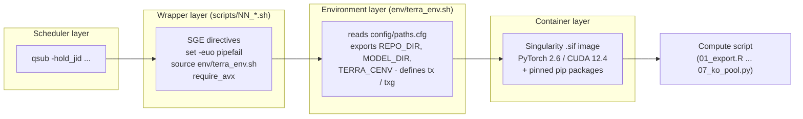
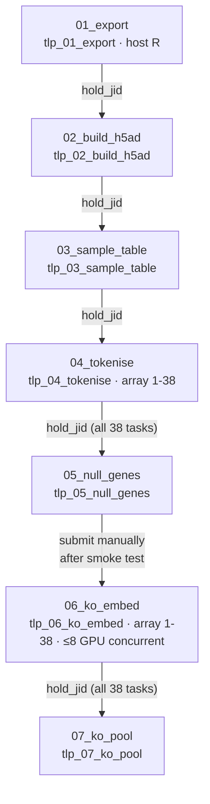
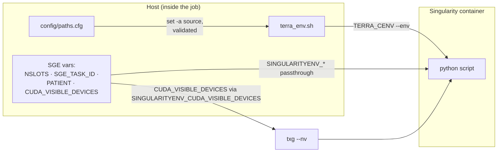

This page documents how the seven pipeline steps run on a cluster: the SGE (Sun Grid Engine) wrapper scripts that define resources and job names, the shared environment layer that bridges the scheduler to a Singularity container, and the `-hold_jid` mechanism that chains jobs into a strict linear sequence. It also covers array-job parallelism, the resumability contract between steps, and the smoke-test workflow used before committing expensive GPU time. The computational content of each step is out of scope here — see [Pipeline Architecture](5-pipeline-architecture) — as is the configuration file format, covered in [Configuration Setup](4-configuration-setup).

Sources: [README.md](/README.md#L185-L199), [env/terra_env.sh](/env/terra_env.sh#L1-L15)

## Three-Layer Execution Architecture

Every pipeline step is separated into three layers with a strict one-directional dependency: the **scheduler layer** (a `qsub` invocation carrying SGE resource requests), the **wrapper layer** (one `.sh` script per step, identical in shape), and the **environment layer** (`env/terra_env.sh`, sourced by every wrapper, which translates paths and scheduler state into a containerized execution). The compute scripts themselves contain no cluster code and no paths — they read locations exclusively from environment variables injected by the environment layer (`WORK_DIR`, `RESULTS_DIR`, `MODEL_DIR`, etc.). This means a step's Python or R code is identical whether it runs interactively on a login node or as job task 17 of an array; only the wrapper differs.



The environment layer is itself bootstrapped by a one-off install: `env/install.sh` pulls the pinned container image, installs locked Python packages into a user directory mounted into the container, downloads the TERRA-112M checkpoint at a pinned Hugging Face revision, and verifies the model checksum — all safe to re-run because each artifact is skipped when already present. Installation is deliberately kept outside the job chain: it requires internet access and runs once on a suitable node, while every later job is fully offline.

Sources: [env/terra_env.sh](/env/terra_env.sh#L17-L69), [env/terra_env.sh](/env/terra_env.sh#L80-L110), [env/install.sh](/env/install.sh#L1-L17), [env/install.sh](/env/install.sh#L35-L84), [README.md](/README.md#L160-L177)

> [!TIP]
> The design invariant worth internalizing: **`terra_env.sh` is the single point where the cluster meets the code**. All paths reach Python through one exported variable, `TERRA_CENV`, so moving the pipeline to a different cluster or storage layout touches only `config/paths.cfg` — never the step scripts.

## Anatomy of a Job Wrapper

All seven wrappers follow one template: an SGE directive block (`#$ ...`), a comment header documenting the submission command, `set -euo pipefail` for fail-fast shell semantics, `source env/terra_env.sh`, an optional hardware gate, a diagnostic `echo` line, and finally the compute invocation. The directives request a job **name** (which the chaining mechanism depends on), merged stdout/stderr logging, memory, and a wall-clock limit. Each wrapper is submitted from the repository root so that relative paths (`env/terra_env.sh`, `logs/`) resolve identically in every job.

| Directive | Purpose | Set in |
|---|---|---|
| `#$ -N tlp_01_export` | Stable job name; the anchor for `-hold_jid` dependencies | all wrappers |
| `#$ -cwd` | Run in the submission directory (repository root) | all wrappers |
| `#$ -j y` | Merge stderr into stdout so each job has one log | all wrappers |
| `#$ -l tmem=..G,h_vmem=..G` | Memory request (site-specific resource names) | all wrappers |
| `#$ -l h_rt=HH:MM:SS` | Wall-clock limit | all wrappers |
| `#$ -t 1-38` | Array job: one task per included patient | 04, 06 |
| `#$ -tc 8` | Cap concurrent array tasks at 8 (GPU pool sizing) | 06 only |
| `#$ -l gpu=true` | Request a GPU slot | 06 only |

Sources: [scripts/01_export.sh](/scripts/01_export.sh#L2-L18), [scripts/06_ko_embed.sh](/scripts/06_ko_embed.sh#L2-L10), [scripts/04_tokenise.sh](/scripts/04_tokenise.sh#L2-L14)

Step 01 is the deliberate exception to the template: R runs **on the host**, not in the container, so it invokes `Rscript` directly and skips both the container runner and the `require_avx` gate. Its only software requirement is R 4.4.1 with the `Matrix`, `igraph`, and `openxlsx` packages available to the job. Every other step runs inside the container via `tx` (CPU steps 02–05, 07) or `txg` (GPU step 06). Every wrapper also carries the portability note *"Adapt resource names (tmem, h_vmem, gpu) to your scheduler"* — `tmem`/`h_vmem` are SGE-site conventions, not standards.

Sources: [scripts/01_export.sh](/scripts/01_export.sh#L9-L18), [README.md](/README.md#L185-L190), [scripts/02_build_h5ad.sh](/scripts/02_build_h5ad.sh#L11)

## Resource and Topology Profile

The seven steps divide into two shapes: **serial checkpoints** (01, 02, 03, 05, 07) that aggregate or decide something cohort-wide, and **array jobs** (04, 06) that process one patient per task. Memory and wall-clock requests track each step's actual workload — from the light 16 GB / 1 h null-gene selection up to step 06's 200 GB host-memory request and step 07's 24 h classification budget.

| Step | Job name | Topology | CPU mem | GPU | Runtime | Holds on |
|---|---|---|---|---|---|---|
| 01 export | `tlp_01_export` | single, host R | 64 G | — | 6 h | — |
| 02 build h5ad | `tlp_02_build_h5ad` | single | 64 G | — | 6 h | `tlp_01_export` |
| 03 sample table | `tlp_03_sample_table` | single | 32 G | — | 2 h | `tlp_02_build_h5ad` |
| 04 tokenise | `tlp_04_tokenise` | array, 38 tasks | 64 G | — | 6 h | `tlp_03_sample_table` |
| 05 null genes | `tlp_05_null_genes` | single | 16 G | — | 1 h | `tlp_04_tokenise` (all tasks) |
| 06 ko embed | `tlp_06_ko_embed` | array, 38 tasks, ≤8 concurrent | 32 G (+200 G host) | ≥40 GB card | 3 h | `tlp_05_null_genes` |
| 07 ko pool | `tlp_07_ko_pool` | single | 32 G | — | 24 h | `tlp_06_ko_embed` (all tasks) |

Sources: [scripts/01_export.sh](/scripts/01_export.sh#L2-L7), [scripts/02_build_h5ad.sh](/scripts/02_build_h5ad.sh#L2-L10), [scripts/03_sample_table.sh](/scripts/03_sample_table.sh#L2-L10), [scripts/04_tokenise.sh](/scripts/04_tokenise.sh#L2-L13), [scripts/05_null_genes.sh](/scripts/05_null_genes.sh#L2-L10), [scripts/06_ko_embed.sh](/scripts/06_ko_embed.sh#L2-L10), [scripts/07_ko_pool.sh](/scripts/07_ko_pool.sh#L2-L13)

The 200 GB host-memory request on step 06 is not the GPU memory — it is the host-side working set needed to load tokenised patients alongside the model. The GPU requirement itself is a hardware floor, not a scheduler attribute: the script requests only `gpu=true` (any card), and the README instructs you to restrict the queue or host list so the job lands on a card with at least 40 GB. The batch size of 256 is kept **fixed across all patients** precisely so every patient is embedded identically — lowering it to fit smaller cards would change the numerics of the comparison.

Sources: [scripts/06_ko_embed.sh](/scripts/06_ko_embed.sh#L6-L14), [README.md](/README.md#L220-L222)

## The Dependency Chain: `-hold_jid` by Job Name

Job chaining uses SGE's name-based hold: each submission names the **job name** (not the numeric job ID) of its predecessor, so submission order is free and the scheduler enforces ordering. A hold on an array job name releases only when *every* task of that array has finished — which is exactly the semantics steps 05 and 07 need, since they consume cohort-wide outputs of the preceding arrays. The full run is therefore seven `qsub` lines, each adding one `-hold_jid` link:

```bash
qsub -o logs/ scripts/01_export.sh
qsub -o logs/ -hold_jid tlp_01_export      scripts/02_build_h5ad.sh
qsub -o logs/ -hold_jid tlp_02_build_h5ad  scripts/03_sample_table.sh
qsub -o logs/ -hold_jid tlp_03_sample_table scripts/04_tokenise.sh   # array, 38 tasks
qsub -o logs/ -hold_jid tlp_04_tokenise    scripts/05_null_genes.sh
```

Sources: [README.md](/README.md#L201-L209), [scripts/02_build_h5ad.sh](/scripts/02_build_h5ad.sh#L9-L10), [scripts/07_ko_pool.sh](/scripts/07_ko_pool.sh#L9-L13)



Step 06 breaks the pure fire-and-forget pattern by design: it is expensive (38 GPU tasks) and is submitted only after a **single-patient smoke test**. You first run one task on the GPU, inspect its log, and only then submit the full array — the array re-detects the already-processed patient and skips it. Step 05's hold, by contrast, submits straight after step 04 because its inputs (the per-patient `cf_blocks.npz` files) are cheap to re-derive and the step itself runs in one hour.

```bash
qsub -o logs/ -t 1-1 -v PATIENT=P12 scripts/06_ko_embed.sh   # smoke test: one patient
qsub -o logs/ scripts/06_ko_embed.sh                         # full array (skips P12)
qsub -o logs/ -hold_jid tlp_06_ko_embed scripts/07_ko_pool.sh
```

Sources: [README.md](/README.md#L211-L218), [scripts/06_ko_embed.sh](/scripts/06_ko_embed.sh#L12-L18), [scripts/06_ko_embed.py](/scripts/06_ko_embed.py#L47-L49)

> [!TIP]
> The `-hold_jid` targets are **string-matched against the `#$ -N` job names**, which are hardcoded in each wrapper. If you override a name on the `qsub` command line (e.g. `qsub -N my_04 ...`), a successor holding on `tlp_04_tokenise` will wait forever or fail against a name that never exists — keep the `tlp_*` names intact unless you retarget every downstream hold.

## Environment Bootstrap: What `source env/terra_env.sh` Actually Does

Every wrapper's first real action is sourcing the environment layer, which performs four operations in order. First, it derives `REPO_DIR` from its own location, so jobs work from any checkout path. Second, it loads `config/paths.cfg` with `set -a` (auto-exporting every variable) and **fails immediately with a named variable** if the file is missing or if any of `INPUT_DIR`, `WORK_DIR`, `RESULTS_DIR`, `SOFTWARE_DIR`, `BIND_PATHS` is unset — turning configuration errors into instant, readable job failures rather than mid-pipeline crashes. Third, it exports the container image path, the pinned model identity (`MODEL_REPO`, `MODEL_REVISION`, `MODEL_SHA256`), and builds `TERRA_CENV`, a single comma-separated `--env` payload that carries every path *into* the container. Fourth, it defines and exports the three functions the wrappers call: `tx`, `txg`, and `require_avx`.

Sources: [env/terra_env.sh](/env/terra_env.sh#L17-L46), [env/terra_env.sh](/env/terra_env.sh#L48-L69), [env/terra_env.sh](/env/terra_env.sh#L110)

The two runner functions are where the container boundary is negotiated, and both use `singularity exec --cleanenv` — the host environment is dropped entirely and replaced by an explicit, audited set of variables. `tx` binds `BIND_PATHS` and injects `TERRA_CENV`; `txg` additionally passes `--nv` for GPU access and sets `HF_HUB_OFFLINE=1` / `TRANSFORMERS_OFFLINE=1`, since the model is pre-downloaded and verified by `install.sh`. The scheduler handshake lives in `_terra_job_env`: SGE's slot count, array task ID, and the `PATIENT` override are re-exported as `SINGULARITYENV_*` variables because `--cleanenv` would otherwise erase them inside the container.



Sources: [env/terra_env.sh](/env/terra_env.sh#L56-L83), [env/terra_env.sh](/env/terra_env.sh#L85-L99), [env/install.sh](/env/install.sh#L58-L75)

> [!TIP]
> The GPU path in `txg` solves a subtle multi-tenant failure mode: SGE assigns a card by setting `CUDA_VISIBLE_DEVICES` on the host, and `--cleanenv` drops it — the container would then see every card on the node and grab card 0, **which may belong to another job**. Forwarding it as `SINGULARITYENV_CUDA_VISIBLE_DEVICES` preserves the scheduler's assignment, including multi-card lists like `"4,5"` that the comma-separated `--env` string cannot carry. `txg` also refuses to run outside a GPU job, failing with a clear message if `CUDA_VISIBLE_DEVICES` is unset.

## Array Jobs and the Task-to-Patient Contract

Steps 04 and 06 request `-t 1-38`, one task per included patient, and both Python scripts implement the same deterministic contract: **task N processes the Nth patient of the sorted list of the 38 included patients** (P10, P23 and the four low-inclusion patients are excluded upstream in step 03). A `PATIENT` environment variable overrides the mapping — this is the mechanism behind the `-t 1-1 -v PATIENT=P12` smoke test. The `PATIENT` value reaches the Python process only because `terra_env.sh` forwards it as `SINGULARITYENV_PATIENT`; likewise, SGE slot counts become `SINGULARITYENV_NSLOTS`, which the scripts read as `NUM_WORKERS` / `NPROC` for intra-job parallelism, so scheduler slot requests directly control DataLoader and process threading.

| Variable | Set by | Forwarded as | Consumed by |
|---|---|---|---|
| `SGE_TASK_ID` | SGE array scheduler | `SINGULARITYENV_SGE_TASK_ID` | 04, 06 → patient index |
| `PATIENT` | operator (`-v PATIENT=P12`) | `SINGULARITYENV_PATIENT` | 04, 06 → single-patient override |
| `NSLOTS` | SGE slot request | `SINGULARITYENV_NSLOTS`, `OMP_NUM_THREADS` | 04 (`NPROC`), 06 (`NUM_WORKERS`) |
| `CUDA_VISIBLE_DEVICES` | SGE GPU assignment | `SINGULARITYENV_CUDA_VISIBLE_DEVICES` | 06 via `txg` |

Sources: [scripts/04_tokenise.py](/scripts/04_tokenise.py#L31-L36), [scripts/04_tokenise.py](/scripts/04_tokenise.py#L63-L66), [scripts/06_ko_embed.py](/scripts/06_ko_embed.py#L47-L49), [scripts/06_ko_embed.py](/scripts/06_ko_embed.py#L67-L69), [env/terra_env.sh](/env/terra_env.sh#L73-L78)

Both wrappers print the mapping context at startup — host, job ID, task ID, and the patient override — so a log line like `task: 17 patient override: none` is enough to reconstruct which patient produced any given log file. Step 06 additionally probes the assigned hardware with `nvidia-smi` before starting work, recording the card name and total memory in the log.

Sources: [scripts/04_tokenise.sh](/scripts/04_tokenise.sh#L19-L20), [scripts/06_ko_embed.sh](/scripts/06_ko_embed.sh#L24-L26)

## Resumability: What Reruns Skip and What Recomputes

The chain is built to be **re-runnable in place** rather than resubmitted from scratch. Steps 01, 02, 04 and 06 carry `FORCE_REBUILD = False` and skip any patient whose outputs already exist on disk; step 07 reuses cached per-donor predictions under the same flag. Steps 03 and 05 are cheap, cohort-wide decisions and always recompute. This has direct operational consequences: after a single array task crashes (say, task 22 of step 06 on an OOM), you resubmit the array and only the failed patients actually run; after editing step 07's analysis logic, resubmitting it is nearly free because the expensive embeddings from step 06 are untouched on disk.

| Step | On rerun | Reason |
|---|---|---|
| 01, 02 | Skips patients with existing outputs | Export/assembly is expensive and deterministic per patient |
| 03 | Always recomputes | Cohort-wide inclusion decision, cheap |
| 04 | Skips tokenised patients | Tokenisation is done exactly once per patient by design |
| 05 | Always recomputes | Null-gene draw is cheap; reruns reflect any step 04 changes |
| 06 | Skips embedded patients | Each GPU task costs ~21 GB and hours of compute |
| 07 | Reuses cached per-donor predictions | Classification is the analysis layer; embeddings are the data layer |

Sources: [scripts/04_tokenise.py](/scripts/04_tokenise.py#L44-L64), [scripts/06_ko_embed.py](/scripts/06_ko_embed.py#L47-L49), [README.md](/README.md#L179-L183)

Note the one asymmetry to plan around: steps 01 and 02 run *before* step 03's exclusion decision, exporting all 44 patients, while 04/06 arrays cover only the 38 included ones — a rerun of 01/02 reprocesses the full cohort. The full data-lineage between steps (which files each hold consumes) is documented in [Pipeline Architecture](5-pipeline-architecture), and the interaction of these skips with config changes is covered in [Reproducibility and Caching](19-reproducibility-and-caching).

Sources: [README.md](/README.md#L48-L54), [scripts/04_tokenise.py](/scripts/04_tokenise.py#L31-L35)

## Monitoring and Failure Triage

Observability is built from three cheap mechanisms rather than a monitoring stack: `#$ -j y` gives every job exactly one log under `logs/`; each wrapper echoes `host / job / task / timestamp` at start (and most at end); and `set -euo pipefail` plus `require_avx` convert the two most common silent failure classes — a failed intermediate command, and an incompatible CPU node — into immediate, explicitly worded job exits. The AVX gate exists because the container's jaxlib (imported by TERRA) requires AVX; on a node lacking it, the job fails at startup with *"resubmit excluding this node"* instead of a deep import traceback.

| Symptom in `logs/` | Likely cause | Action |
|---|---|---|
| Job stuck in `qw` state, never starts | `-hold_jid` target name doesn't match any job | Check `qstat`; keep `tlp_*` names unchanged |
| `terra_env.sh: .../paths.cfg not found` | Config not created before submission | Copy and edit the `.cfg.example` files, resubmit |
| `terra_env.sh: WORK_DIR is not set` | Incomplete `paths.cfg` | Fill all five required paths |
| `txg: CUDA_VISIBLE_DEVICES is not set` | Step 06 submitted without a GPU slot | Verify the queue/complex grants `gpu=true` |
| `ERROR: <host> has no AVX` | Old CPU node without AVX | Resubmit excluding that host |
| Task 06 fails on an ≥24 GB card | Card below the 40 GB floor at batch size 256 | Target an ≥40 GB queue; do not lower batch size |
| `the repository is not visible in the container` | Repo path missing from `BIND_PATHS` | Add it to `paths.cfg`, re-run `env/install.sh` checks |

Sources: [env/terra_env.sh](/env/terra_env.sh#L18-L33), [env/terra_env.sh](/env/terra_env.sh#L90-L94), [env/terra_env.sh](/env/terra_env.sh#L101-L108), [scripts/06_ko_embed.sh](/scripts/06_ko_embed.sh#L12-L14), [env/install.sh](/env/install.sh#L44-L45)

Before the first submission of any session, the README's setup sequence ends with `bash env/check_config.sh` (run once normally and once inside a GPU session), which validates configuration, software, inputs, and model presence — catching environment drift before it becomes a 38-task array failure. For what those checks verify and how caching interacts with reruns, continue to [Reproducibility and Caching](19-reproducibility-and-caching); for interpreting what the chained run ultimately produces, see [Outputs and Result Interpretation](20-outputs-and-result-interpretation).
