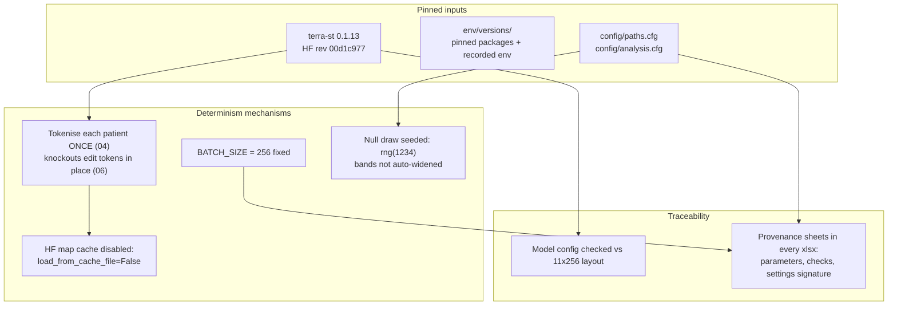
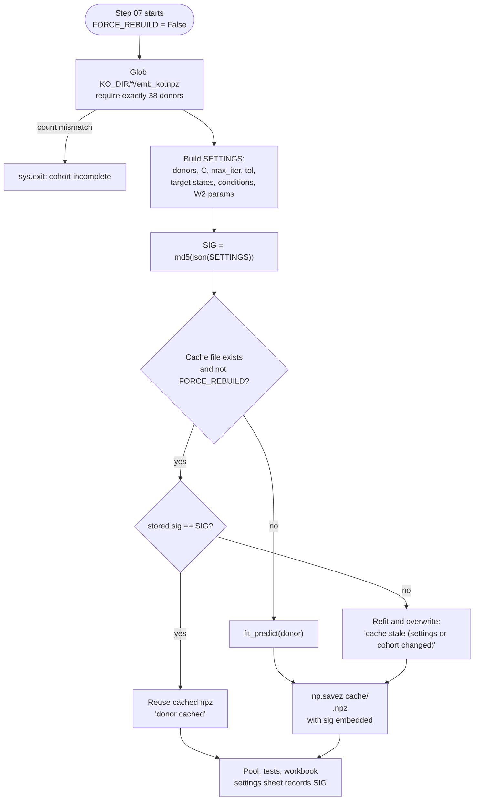

This page explains how *terra-ligand-perturbation* makes its results traceable and its reruns cheap. The pipeline is a linear chain of seven steps (see [Pipeline Architecture](5-pipeline-architecture)) whose heaviest stages — tokenisation and GPU embedding — can take hours per patient, so the repository separates **what guarantees a result can be reproduced** (pinned versions, validated configuration, deterministic algorithms, provenance written into outputs) from **what makes a rerun fast** (three cache layers with different granularity and invalidation rules). Everything on this page concerns the mechanics of repetition and traceability; how to submit and chain the jobs on the cluster is covered in [Cluster Execution and Job Chaining](18-cluster-execution-and-job-chaining).

Sources: [README.md](README.md#L9-L14), [README.md](README.md#L179-L183)

## The Reproducibility Contract: Pinned Versions and Validated Configuration

Reproducibility in this repository rests on pinning the two things most likely to drift: the model and the analysis parameters. The analysis was developed and run with `terra-st` 0.1.13 and the TERRA-112M weights at Hugging Face revision `00d1c977`; the weights are downloaded once by the install script (not redistributed), and the README warns that later `terra-st` versions may change the interface and require adjustments. The recorded environment and pinned package list live in `env/versions/`, so the exact software stack of the original run can be inspected rather than guessed.

Sources: [README.md](README.md#L9-L14), [README.md](README.md#L166-L168)

The second half of the contract is the two configuration files you create from the `config/*.cfg.example` templates (set up in [Configuration Setup](4-configuration-setup)). `paths.cfg` fixes the five absolute locations the whole pipeline shares — `INPUT_DIR`, `WORK_DIR`, `RESULTS_DIR`, `SOFTWARE_DIR`, and `BIND_PATHS` — and is verified by `env/check_config.sh`, which also confirms the software, input data and model are present before any job runs. `analysis.cfg` fixes the `SOURCE_STATES` and `TARGET_STATES` cell-state labels.

Sources: [config/paths.cfg.example](config/paths.cfg.example#L8-L24), [README.md](README.md#L187-L199)

Configuration is not merely read — it is **enforced at every point of use**. Steps 03, 04 and 07 import `analysis_config.load_states()`, which fails immediately if `config/analysis.cfg` is missing, if a required key is absent, if a value still contains a `<placeholder>`, or if `TARGET_STATES` lists the same state twice. The heavy scripts never fall back to defaults: each resolves its directories from environment variables (`WORK_DIR`, `RESULTS_DIR`, `MODEL_DIR`) exported by the shared `env/terra_env.sh`, and exits if they are unset. This fail-fast posture means a half-configured checkout cannot silently produce results under different parameters than the original run.

Sources: [scripts/analysis_config.py](scripts/analysis_config.py#L13-L34), [scripts/04_tokenise.py](scripts/04_tokenise.py#L44-L59)

| Configuration key | File | Role in reproducibility |
|---|---|---|
| `INPUT_DIR` | `paths.cfg` | Fixes the exact version of the distributed Xenium objects |
| `WORK_DIR` | `paths.cfg` | Single location for every intermediate and cache (several hundred GB) |
| `RESULTS_DIR` | `paths.cfg` | Fixed home of the per-step summary workbooks |
| `SOFTWARE_DIR` | `paths.cfg` | Container image, packages, model weights and caches |
| `BIND_PATHS` | `paths.cfg` | Container mounts, verified to cover the repo and all paths above |
| `SOURCE_STATES` / `TARGET_STATES` | `analysis.cfg` | The analysis definition; enters the step-07 settings signature |

Sources: [config/paths.cfg.example](config/paths.cfg.example#L8-L24), [config/analysis.cfg.example](config/analysis.cfg.example#L7-L12)

## Determinism by Construction: Tokenise Once, Edit Tokens, Seed the Draw

Beyond pinning versions, the pipeline removes three known sources of nondeterminism by design rather than by configuration. First, each patient is tokenised **exactly once** in step 04, and every knockout in step 06 is built by editing those baseline token sequences in place — deliberately avoiding re-tokenisation, which reshuffles genes tied in expression rank. This single-tokenisation rule means the perturbed and baseline inputs differ *only* at the edited positions, which is both a scientific requirement (see [Cell-and-Neighbour Tokenisation](9-cell-and-neighbour-tokenisation)) and a reproducibility guarantee: the same `tokens/` directory feeds every condition.

Sources: [scripts/04_tokenise.py](scripts/04_tokenise.py#L7-L11), [README.md](README.md#L69-L71)

Second, the GPU embedding step fixes `BATCH_SIZE = 256` as a constant, kept fixed explicitly "so that every patient is embedded identically" — batching is otherwise a silent source of variation across runs and hardware. Within step 06, the Hugging Face `datasets` `.map` call used to substitute edited tokens is invoked with `load_from_cache_file=False`, so the library's own automatic map-caching (which could silently reuse a stale transform) is disabled; the script manages its caching explicitly instead.

Sources: [scripts/06_ko_embed.py](scripts/06_ko_embed.py#L68), [scripts/06_ko_embed.sh](scripts/06_ko_embed.sh#L12-L14), [scripts/06_ko_embed.py](scripts/06_ko_embed.py#L180-L191)

Third, the one stochastic element of the analysis — drawing 20 rank-matched null genes from the candidate pool — is seeded with `np.random.default_rng(1234)`, with candidate rules (rank band 40, presence band 0.15, excluded-ligand list) fixed before any results were seen. The bands are *not* widened automatically if too few candidates exist; the script exits instead, preserving the pre-specified design. The seed, the bands and the candidate count are recorded in the output workbook, so the draw can be re-executed bit-for-bit.

Sources: [scripts/05_null_genes.py](scripts/05_null_genes.py#L12-L24), [scripts/05_null_genes.py](scripts/05_null_genes.py#L128-L130), [scripts/05_null_genes.py](scripts/05_null_genes.py#L137-L143)

The diagram summarises how the three mechanisms connect: pinned inputs feed the determinism mechanisms, which in turn feed the provenance trail. Note that the model-config check in step 04 (verifying the `cell_graph` 11 × 256 layout against `model_config.yaml` before tokenising) belongs to traceability: it ensures the recorded outputs were produced under the layout the rest of the analysis assumes, as described in [Harmonisation and Model Bundles](10-harmonisation-and-model-bundles).

Sources: [scripts/04_tokenise.py](scripts/04_tokenise.py#L184-L192)

## Three Cache Layers

The caching system is deliberately layered, because different steps have different cost profiles. **Layer 1** is *existence-based patient-level skipping* in the expensive steps (01, 02, 04, 06): each script starts with a `FORCE_REBUILD = False` constant and checks whether the patient's outputs already exist, exiting immediately if so. The checks are conservative — step 04 requires **all four** outputs (`tokens/dataset_info.json`, `meta.npz`, `cf_blocks.npz`, and the summary xlsx) before skipping, and step 06 requires both `emb_ko.npz` and its xlsx. Steps 03 and 05 are quick and always recompute.

Sources: [README.md](README.md#L179-L183), [scripts/04_tokenise.py](scripts/04_tokenise.py#L174-L179), [scripts/06_ko_embed.py](scripts/06_ko_embed.py#L219-L224)

**Layer 2** is the *signature-checked prediction cache* inside step 07, the only layer that validates content rather than existence. Before fitting, step 07 builds a `SETTINGS` dictionary — the donor list, classifier hyperparameters (`C`, `max_iter`, `tol`), the target states from `analysis.cfg`, the condition list, and the W2 distance parameters — and reduces it to an MD5 `SIG`. Per-donor classifier predictions are cached as `<WORK_DIR>/ko_pool_cache/
.npz` with the signature embedded inside; on rerun a cached donor is reused only if its stored `sig` equals the current one, otherwise it is reported as "cache stale (settings or cohort changed)" and refitted in place.

Sources: [scripts/07_ko_pool.py](scripts/07_ko_pool.py#L287-L293), [scripts/07_ko_pool.py](scripts/07_ko_pool.py#L355-L367)

**Layer 3** is *provenance written into the outputs themselves*. Every step records a `parameters` sheet: step 05 logs the seed, bands and candidate count; step 06 logs the patient, model path, batch size, GPU name and torch version alongside its structural `checks`, timing, and GPU-memory sheets; and step 07's settings sheet carries the full parameter documentation plus the `settings_signature`. Because the signature is a digest of the effective settings, any output can be matched to the run configuration that produced it without consulting job logs.

Sources: [scripts/05_null_genes.py](scripts/05_null_genes.py#L137-L143), [scripts/06_ko_embed.py](scripts/06_ko_embed.py#L334-L352), [scripts/07_ko_pool.py](scripts/07_ko_pool.py#L560-L579)

| Layer | Where | Granularity | Hit condition | Invalidation |
|---|---|---|---|---|
| 1. Existence skip | Steps 01, 02, 04, 06 | Per patient | All designated output files exist | Manual (delete outputs, or set `FORCE_REBUILD = True`) |
| 2. Signature cache | Step 07 only | Per donor | Cache `.npz` exists **and** embedded `sig` matches current MD5 | Automatic (stale entries refit and overwritten) |
| 3. Provenance sheets | All steps' outputs | Per run / per patient | — (always written, never read back) | — |

Sources: [scripts/04_tokenise.py](scripts/04_tokenise.py#L64-L179), [scripts/07_ko_pool.py](scripts/07_ko_pool.py#L89-L96)

> [!TIP]
> The two layers behave oppositely on upstream edits: changing a setting that feeds the step-07 signature (e.g. `TARGET_STATES` in `analysis.cfg`) **automatically** invalidates the prediction cache, but editing upstream data (say, an input matrix for one patient) does **not** invalidate the existence-based caches of steps 04/06 — you must delete that patient's outputs in `WORK_DIR` yourself, or the skip guard will happily reuse them.

## What Gets Reused: A Rerun Walkthrough

Because the repository's skip guards are keyed on outputs rather than timestamps, a rerun after an interruption resumes exactly where it stopped. This is visible in the recommended workflow for the GPU array: submit one patient first (`-t 1-1 -v PATIENT=P12`), inspect its log, then submit the full 38-task array — the array tasks for already-finished patients exit at the skip guard within seconds. The same semantics make a crashed step 04 array safe to resubmit: only patients with genuinely missing outputs are recomputed.

Sources: [scripts/06_ko_embed.sh](scripts/06_ko_embed.sh#L15-L18), [README.md](README.md#L211-L218)

Step 07 adds a cohort-level consistency check on top of its cache: it requires exactly the expected 38 donors to be present, verifies every patient's `cond_names` match the first patient's, and exits otherwise — so a partially completed step 06 cannot produce a summary workbook over an unintended cohort subset. The following flowchart traces a step-07 rerun; the signature decision is the interesting branch.

Sources: [scripts/07_ko_pool.py](scripts/07_ko_pool.py#L165-L171), [scripts/07_ko_pool.py](scripts/07_ko_pool.py#L211-L215)

Sources: [scripts/07_ko_pool.py](scripts/07_ko_pool.py#L287-L367)

| Step | Outputs in `RESULTS_DIR/<step>/` | Large intermediates in `WORK_DIR` | Rerun behaviour |
|---|---|---|---|
| 01 export | per-step xlsx | per-patient exported matrices | skips finished patients |
| 02 build_h5ad | per-step xlsx | one `adata.h5ad` per patient | skips finished patients |
| 03 sample_table | per-step xlsx | — | always recomputes |
| 04 tokenise | `04_tokenise_
.xlsx` | `tokens/`, `meta.npz`, `cf_blocks.npz` | skips patient only when **all 4** outputs exist |
| 05 null_genes | `05_null_genes.xlsx` + `.tsv` | — | always recomputes (seeded, so identical) |
| 06 ko_embed | `06_ko_embed_
.xlsx` | `emb_ko.npz` per patient | skips patient when npz **and** xlsx exist |
| 07 ko_pool | `07_summary.xlsx`, `07_details.xlsx` | `ko_pool_cache/
.npz` | reuses donors whose `sig` matches; refits stale ones |

Sources: [README.md](README.md#L179-L183), [scripts/07_ko_pool.py](scripts/07_ko_pool.py#L69-L75)

## Changing Settings Without Corrupting the Record

The layering gives you a precise vocabulary for partial reruns. To refit the step-07 classifiers under new hyperparameters, edit the constants at the top of `07_ko_pool.py` (or `TARGET_STATES` in `analysis.cfg`) and rerun — the signature changes, every donor cache is marked stale, and each is refit and overwritten, with no manual deletion. To force a clean rebuild of the whole cohort, flip the `FORCE_REBUILD` constant at the top of the relevant script (`04_tokenise.py`, `06_ko_embed.py`, or `07_ko_pool.py`); this is why the flag is a conspicuous single line rather than a buried CLI option.

Sources: [scripts/07_ko_pool.py](scripts/07_ko_pool.py#L74-L96), [scripts/07_ko_pool.py](scripts/07_ko_pool.py#L355-L367)

> [!TIP]
> The settings signature deliberately includes the **donor list**, not just model hyperparameters. If step 06 has produced outputs for only 35 of 38 patients, those 35 cached predictions stay valid, and the remaining donors are simply fitted on the next run — the cache survives incomplete cohorts. But because the signature also embeds the condition list, a change to the knockout conditions defined upstream (step 06) would *not* be caught by the step-07 existence check on `emb_ko.npz`; step 06 outputs must be rebuilt manually in that case.

The final guard against silent inconsistency is structural rather than cache-related: step 06 runs a battery of per-condition checks (only edited cells change, nothing changes outside edited blocks, padding stays at block ends, `cell_emb` negative control is unchanged) and exits non-zero if any fail, and step 07 re-verifies each input file's shape and cross-references before pooling. A cached artifact that predates a bug fix therefore cannot flow into results unnoticed — it either fails a check on load or is overwritten by a refit. For how to read the resulting workbooks, continue to [Outputs and Result Interpretation](20-outputs-and-result-interpretation).
