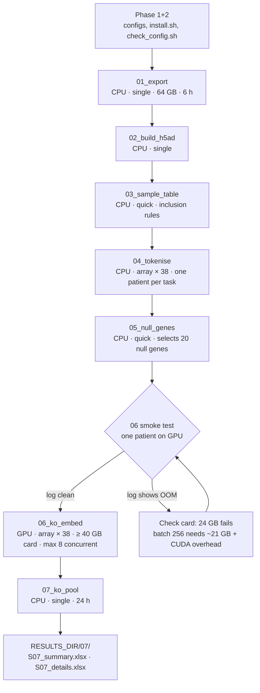

This page takes you from a fresh clone of `terra-ligand-perturbation` to a completed cohort analysis. It covers the four phases you must execute in order: **configure**, **install and verify**, **launch the seven-step job chain**, and **collect outputs**. Each phase is deliberately minimal — the reasoning behind the study design, the tokenisation strategy, and the statistics are treated in their dedicated Deep Dive pages. By the end of this page you will have submitted all seven pipeline stages and located the final result workbooks.

The pipeline performs an in silico knockout of the ligand *CSF1* in the spatial neighbourhood of tumour macrophages, using the pretrained TERRA foundation model on the public TNBC Xenium cohort, with rank-matched null-gene and positive controls to contextualise any observed effect.

Sources: [README.md](/README.md#L1-L9)

## Prerequisites

Before starting, confirm your environment satisfies every requirement below. The pipeline was developed for a specific cluster profile, and a missing item here is the most common cause of a failed first run.

| Requirement | Detail | Needed by |
|---|---|---|
| Scheduler | Linux cluster with Sun Grid Engine (job scripts submit via `qsub`) | All steps |
| Container runtime | Singularity or Apptainer | Steps 02–07 |
| GPU | NVIDIA card with **≥ 40 GB** memory | Step 06 only |
| Internet-connected node | For the one-off installation | Setup phase |
| R ≥ 4.4.1 | With packages `Matrix`, `igraph`, `openxlsx` | Step 01 only |

Note two asymmetries that trip up newcomers: the GPU is needed **only** for step 06 (embedding the perturbations), and R runs **only** in step 01 and must be visible to that job on the host — the rest of the pipeline executes Python inside the Singularity/Apptainer container. If your cluster uses different resource names than `tmem`, `h_vmem`, and `gpu`, adapt the `#$` directives at the top of each job script.

Sources: [README.md](/README.md#L187-L190), [README.md](/README.md#L220-L222), [01_export.sh](/scripts/01_export.sh#L2-L7)

## Phase 1 — Clone and Configure

Configuration is the only editing you do before running. Copy both example files into their live counterparts, then edit the copies — the `.example` files remain as documentation, and the live files are ignored by git.

```bash
git clone <this repository> && cd terra-ligand-perturbation
cp config/paths.cfg.example config/paths.cfg       # edit the five paths
cp config/analysis.cfg.example config/analysis.cfg # set the cell states
mkdir -p logs
```

`paths.cfg` has exactly five keys, all of which must be **absolute paths** on your system:

| Key | What it points to | Notes |
|---|---|---|
| `INPUT_DIR` | Per-patient Xenium folders as distributed by the dataset authors | Each patient folder contains `mat_counts.rds`, `df_meta.rds`, `spatial_xy.rds` |
| `WORK_DIR` | Large intermediates: exported matrices, `.h5ad` files, tokenised datasets, embeddings, caches | Expect **several hundred GB** for the full cohort |
| `RESULTS_DIR` | The `.xlsx` summary workbooks written by each step | Small files only |
| `SOFTWARE_DIR` | Container image, Python packages, model weights, caches | Populated by `env/install.sh` |
| `BIND_PATHS` | Host paths mounted inside the container, comma-separated | Must cover this repository **and** every path above |

`analysis.cfg` defines which cell states the study reads out, replacing the placeholders with `cell_state` labels exactly as they appear in the dataset — comma-separated, no quotes, comments on their own lines:

| Key | Meaning |
|---|---|
| `SOURCE_STATES` | Fibroblast states whose *CSF1+* cells are the ligand source |
| `TARGET_STATES` | Macrophage states whose model representation is measured |

> [!TIP]
> The `BIND_PATHS` entry is the least obvious requirement: because all Python steps run inside a container, anything the container must see — including the cloned repository itself — must appear in this comma-separated list. `env/check_config.sh` verifies this for you, so run it before submitting anything.

Sources: [README.md](/README.md#L192-L199), [paths.cfg.example](/config/paths.cfg.example#L8-L25), [analysis.cfg.example](/config/analysis.cfg.example#L7-L12)

## Phase 2 — Install and Verify

Two scripts do all environment work. Run the install **once**, on a node with internet access, because it downloads the container image, Python packages, and the TERRA-112M weights from Hugging Face. Then run the checker — importantly, run it **also inside a GPU session**, since part of the verification is GPU-specific.

```bash
bash env/install.sh      # once, on a node with internet
bash env/check_config.sh # also inside a GPU session
```

The checker validates your configuration, software, input data, and model in one pass. If it reports a problem, fix the offending `paths.cfg` or `analysis.cfg` entry and re-run — do not submit jobs against an unverified configuration. Behind the scenes, every job script sources `env/terra_env.sh`, which defines the container execution commands (`tx` for CPU jobs, `txg` for GPU jobs) used throughout the pipeline.

Sources: [README.md](/README.md#L196-L197), [04_tokenise.sh](/scripts/04_tokenise.sh#L17-L20), [06_ko_embed.sh](/scripts/06_ko_embed.sh#L23-L26)

## Phase 3 — Launch the Pipeline

All jobs are submitted from the repository root, and steps are chained with `-hold_jid` so that each starts only when its predecessor's job name completes. The first five steps form a single CPU chain:

```bash
qsub -o logs/ scripts/01_export.sh
qsub -o logs/ -hold_jid tlp_01_export      scripts/02_build_h5ad.sh
qsub -o logs/ -hold_jid tlp_02_build_h5ad  scripts/03_sample_table.sh
qsub -o logs/ -hold_jid tlp_03_sample_table scripts/04_tokenise.sh   # array, 38 tasks
qsub -o logs/ -hold_jid tlp_04_tokenise    scripts/05_null_genes.sh
```

Step 06 is the GPU-heavy stage and follows a **smoke-test-first** pattern: run exactly one patient, read its log, and only then submit the full array. Because completed patients are skipped, the array simply resumes past the patient you already did:

```bash
qsub -o logs/ -t 1-1 -v PATIENT=P12 scripts/06_ko_embed.sh   # one patient first
qsub -o logs/ scripts/06_ko_embed.sh                         # GPU array, rest of cohort
qsub -o logs/ -hold_jid tlp_06_ko_embed scripts/07_ko_pool.sh
```



The per-step resource profile is fixed in each job script's `#$` header; know it before you submit so your scheduler quotas are not surprised:

| Step | Execution model | Memory / time request | Special |
|---|---|---|---|
| 01_export | CPU, single job | 64 GB, 6 h | Runs R on the host |
| 04_tokenise | CPU, array of 38 tasks | 64 GB, 6 h each | One included patient per task |
| 06_ko_embed | GPU, array of 38 tasks | 32 GB RAM / 200 GB h_vmem, 3 h | `gpu=true`; throttled to 8 concurrent tasks |
| 07_ko_pool | CPU, single job | 32 GB, 24 h | Pools all patients, fits classifiers |

> [!TIP]
> The one-patient GPU test before the full array is not optional ceremony: step 06's embedding batch size is deliberately fixed at 256 (so every patient is embedded identically), which needs roughly 21 GB plus CUDA overhead and **fails on 24 GB cards**. Catching this on one patient costs minutes; discovering it in a 38-task array wastes quota and time.

Sources: [README.md](/README.md#L201-L218), [06_ko_embed.sh](/scripts/06_ko_embed.sh#L11-L17), [01_export.sh](/scripts/01_export.sh#L5-L7), [04_tokenise.sh](/scripts/04_tokenise.sh#L5-L8), [07_ko_pool.sh](/scripts/07_ko_pool.sh#L5-L8)

## Phase 4 — Monitor and Resume

The pipeline is designed so that **resubmission is safe**. Steps 01, 02, 04 and 06 skip any patient whose outputs already exist, and step 07 reuses cached per-donor predictions (`FORCE_REBUILD = False` at the top of each script). Only steps 03 and 05 are quick enough that they always recompute from scratch. Practically, this means a killed or timed-out job is repaired by resubmitting the same script — the completed patients are never redone.

| Step | On resubmission |
|---|---|
| 01, 02, 04, 06 | Skips patients whose outputs already exist |
| 03, 05 | Always recomputes (inherently quick) |
| 07 | Reuses cached per-donor predictions unless rebuilt |

Every step writes an unformatted `.xlsx` summary to `RESULTS_DIR/<step>/`, while large intermediates accumulate in `WORK_DIR`. The final step produces two workbooks: **S07_summary.xlsx**, a single table plus a sheet explaining every column, and **S07_details.xlsx**, with sheets for the Wilcoxon donor test, gene ranks, per-donor and per-condition summaries, W2 distances, classifier AUCs, and input QC. Interpreting those sheets is the subject of [Outputs and Result Interpretation](20-outputs-and-result-interpretation).

Sources: [README.md](/README.md#L179-L183), [README.md](/README.md#L140-L160)

## Where to Go Next

This page gave you the operational path; the following pages fill in what you just executed. A natural progression:

- [Data and Model Requirements](3-data-and-model-requirements) — what must be inside `INPUT_DIR`, and which TERRA version the pipeline pins.
- [Configuration Setup](4-configuration-setup) — a deeper treatment of `paths.cfg` and `analysis.cfg` than the summary tables above.
- [Pipeline Architecture](5-pipeline-architecture) — what each of the seven steps actually computes, stage by stage.
- [Cluster Execution and Job Chaining](18-cluster-execution-and-job-chaining) — the `-hold_jid` mechanics, array jobs, and resource tuning behind Phase 3.
- [Outputs and Result Interpretation](20-outputs-and-result-interpretation) — how to read `S07_summary.xlsx` and `S07_details.xlsx` once Phase 4 completes.