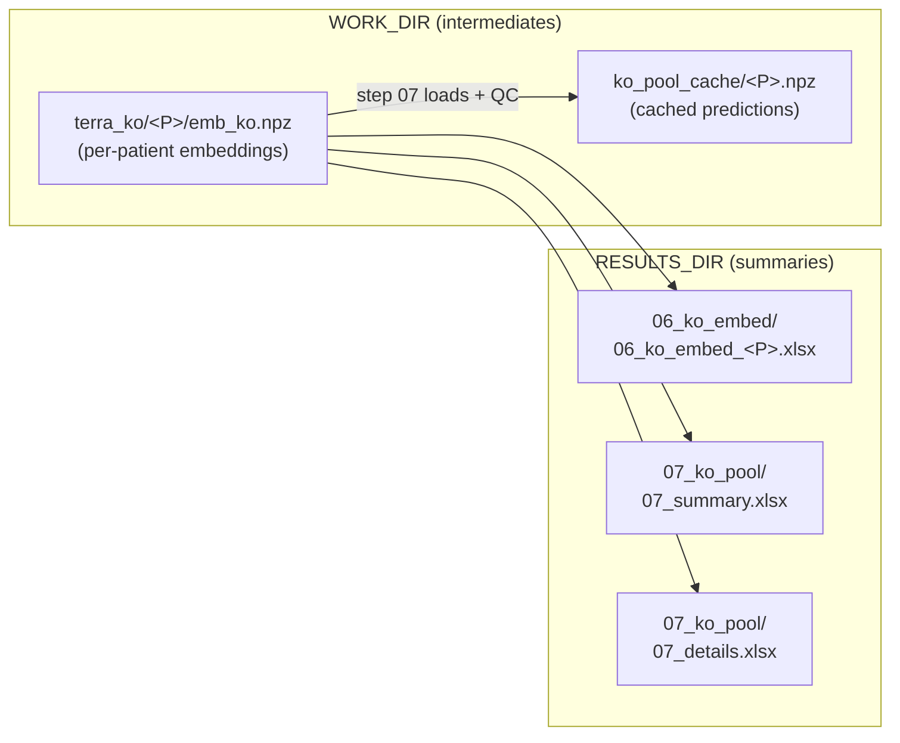

This page documents every artifact the pipeline produces and how to read them. The pipeline separates **intermediate data products** (large files in `WORK_DIR`) from **human-readable summaries** (unformatted `.xlsx` workbooks in `RESULTS_DIR/<step>/`). The decisive results live in two workbooks written by step 07, and the page focuses on their structure, the statistical definitions behind each column, and the control logic needed to interpret a result as evidence — or absence of evidence — for a CSF1-specific effect.

Sources: [README.md](README.md#L140-L158), [07_ko_pool.py](scripts/07_ko_pool.py#L69-L79)

## The Output Landscape

Every step writes its summary into `RESULTS_DIR/<step>/`, while bulk intermediates (tokenised datasets, per-patient embedding arrays, the prediction cache) accumulate under `WORK_DIR`. Steps 01, 02, 04 and 06 skip patients whose outputs already exist, and step 07 reuses cached per-donor predictions unless the cohort or classifier settings changed. This means the `RESULTS_DIR` tree is the canonical place to inspect results, and `WORK_DIR` is an implementation detail you should rarely need to open.

Sources: [README.md](README.md#L179-L183)

The per-step summary inventory is deliberately uniform:

| Step | Artifact | Content |
|---|---|---|
| 03 | `03_sample_table/03_sample_table.xlsx` (+ `.csv`) | `per_patient` sheet with inclusion flags (`pass_depth`, `pass_csf1pos_fib`, `pass_target_mac`, `included`), `depth_batch`; `parameters` sheet with thresholds |
| 04 | `04_tokenise/04_tokenise_
.xlsx` | per-patient tokenisation summary |
| 05 | `05_null_genes/05_null_genes.xlsx` + `.tsv` | the 20 rank-matched null genes (the `.tsv` is consumed by step 06) |
| 06 | `06_ko_embed/06_ko_embed_
.xlsx` | per-patient checks, per-cell shifts, negative control, timing, GPU memory |
| 07 | `07_summary.xlsx`, `07_details.xlsx` | the final cohort-level results (detailed below) |

Sources: [03_sample_table.py](scripts/03_sample_table.py#L105-L118), [04_tokenise.py](scripts/04_tokenise.py#L37-L42), [05_null_genes.py](scripts/05_null_genes.py#L28-L37), [06_ko_embed.py](scripts/06_ko_embed.py#L344-L352)

## Per-Patient Artifacts from Step 06

Each GPU array task writes one `emb_ko.npz` per patient under `WORK_DIR/terra_ko/
/` — this is the single input of step 07. It stores baseline embeddings for **all myeloid cells** (the classifier training set: `mye_cell_id`, `mye_state`, `base_mye_spatial`, `base_mye_neigh`), baseline and condition embeddings for the **target macrophages** (`t_*` keys; `cond_spatial` and `cond_neigh` shaped `n_cond × n_t × D`), the condition list (`CSF1_remove`, `CSF1_zero`, `POS_block`, 20 × `NULL_<gene>`), and `n_edit`, the per-cell count of edited neighbour blocks per condition. A separate `base_mye_cell` key and the `cell_emb` readout exist as a negative control, since a neighbourhood edit cannot change a cell's own embedding.

Sources: [06_ko_embed.py](scripts/06_ko_embed.py#L319-L331), [07_ko_pool.py](scripts/07_ko_pool.py#L12-L25)

The human-readable companion, `06_ko_embed_
.xlsx`, contains six sheets: `parameters` (patient, depth batch, model, cell counts, GPU and torch version), `checks`, `negative_control_cell_emb` (`max_abs_diff_cell_emb` per condition), `per_cell` (one row per target macrophage with `shift_spatial_<cond>` and `shift_neigh_<cond>` cosine shifts plus `n_edit_<cond>`), `timing`, and `gpu_memory`. Before trusting any downstream result, verify the `checks` sheet: the run logs structural assertions — each condition changes exactly the cells with `n_edit > 0`, nothing changes outside the edited blocks, padding stays at block ends, and `cell_emb` is unchanged (< 1e-4) — and the script **exits with status 1 if any check fails**.

Sources: [06_ko_embed.py](scripts/06_ko_embed.py#L303-L317), [06_ko_embed.py](scripts/06_ko_embed.py#L292-L300), [06_ko_embed.py](scripts/06_ko_embed.py#L353-L357)

> [!TIP]
> The `per_cell` sheet of `06_ko_embed_
.xlsx` is the only place where single-cell cosine shifts are exported; step 07 aggregates them as `mean_cos_shift` but never writes the per-cell values back out. If you need cell-level magnitudes for a specific donor, read them here.

## Cohort Results: `07_summary.xlsx`

Step 07 refuses to run unless it finds exactly 38 patient files and consistent condition names across patients, then writes two workbooks into `RESULTS_DIR/07_ko_pool/`. `07_summary.xlsx` holds three sheets: `summary` (one row per embedding × condition), `columns` (a data dictionary explaining every column), and `settings` (a key–value record of the run). The design intent is that the summary workbook alone answers "what happened", while `columns` and `settings` make it self-documenting.

Sources: [07_ko_pool.py](scripts/07_ko_pool.py#L166-L170), [07_ko_pool.py](scripts/07_ko_pool.py#L560-L588), [07_ko_pool.py](scripts/07_ko_pool.py#L590-L607)

The `summary` sheet, ordered `CSF1_remove`, `CSF1_zero`, `POS_block`, then the 20 nulls, carries these columns:

| Column | Meaning |
|---|---|
| `embedding` / `primary_embedding` | `spatial` (from `spatial_cell_emb`) or `neigh` (from `neighborhood_emb`); flag 1 marks the primary embedding |
| `condition` / `role` | condition name and its role: `test`, `null gene`, or `control` |
| `n_donors` | eligible donors with a value of `d` (≥ 20 targets edited by `CSF1_remove`) |
| `median_d` | median over donors of d = mean dP(condition) − median over the null genes of mean dP(null) |
| `n_d_negative` | donors with d < 0, i.e. shift away from the target states beyond the null median |
| `p_two_sided` | two-sided Wilcoxon signed-rank test of d = 0 across eligible donors |
| `cohort_median_mean_dP` / `rank_most_negative_of_21` | median of donor mean dP, and its rank among the 21 genes (CSF1 + 20 nulls; 1 = most negative) |
| `cohort_median_W2` / `W2_rank_largest_of_21` | median of TERRA's Wasserstein-2 distance, and rank (1 = largest); **magnitude only** |
| `median_heldout_AUC` | median over donors of the held-out AUC of the leave-one-donor-out classifier |

Sources: [07_ko_pool.py](scripts/07_ko_pool.py#L506-L532), [07_ko_pool.py](scripts/07_ko_pool.py#L533-L551)

## Deep Dive: `07_details.xlsx`

The details workbook has twelve sheets, all unformatted and machine-readable. The `settings` sheet doubles as a provenance record: script name, timestamp, donor counts, the full null-gene list, `MIN_EDITED`, plain-language definitions of `dP`, `cos_shift`, `d`, the donor test and gene rank, classifier hyperparameters, W2 parameters, and an MD5 **settings signature** of the run.

| Sheet | Content |
|---|---|
| `settings` | run provenance and definitions (incl. `settings_signature`) |
| `wilcoxon` | the two-sided signed-rank test of d = 0, overall and per depth batch (`all`, `deep`, `shallow`), with `n_donors`, `n_d_negative`, `median_d`, `mean_d`, `wilcoxon_V`, `p_two_sided` |
| `gene_rank` | cohort median of donor mean dP per condition with `rank_most_negative_of_21` and `n_donors_nonNA` |
| `donor_d` | per-donor d for every test/control condition, with `eligible`, `n_edited_CSF1_remove`, `median_null_mean_dP`, `n_null_used` |
| `donor_condition` | per-donor × condition summaries: `n_edited`, `mean_dP`, `median_dP`, `mean_cos_shift` |
| `strata_n_edited` | the same summaries stratified by edited neighbours (1, 2, 3+) |
| `by_target_state` | the same summaries per target macrophage state |
| `w2_donor` | raw W2 per donor × condition × embedding |
| `w2_vs_null` | `W2_condition` − `median_null_W2` per donor |
| `w2_rank` | cohort median W2 ranked among the 21 genes (1 = largest) |
| `classifier_auc` | held-out AUC per donor, with `n_heldout`, `n_heldout_pos`, `n_train`, `lbfgs_iter`, `hit_max_iter` |
| `input_qc` | per-patient structure checks of the step 06 files |

Sources: [07_ko_pool.py](scripts/07_ko_pool.py#L582-L588), [07_ko_pool.py](scripts/07_ko_pool.py#L560-L579)

The `input_qc` sheet deserves attention before any biological interpretation. Per patient it reports `n_myeloid`, `n_mac`, `n_target`, per-state target counts, `n_target_other_state` (targets outside the configured states — a warning is printed if any exist), `n_target_cf_nb_gt0`, `frac_nedit_CSF1_remove_eq_n_cf_nb` (consistency between edits and CSF1+ fibroblast neighbours), the maximum absolute difference between target and myeloid baseline embeddings, and embedding dimensionalities.

Sources: [07_ko_pool.py](scripts/07_ko_pool.py#L241-L254), [07_ko_pool.py](scripts/07_ko_pool.py#L274-L276)

> [!TIP]
> `hit_max_iter` in `classifier_auc` flags donors whose logistic regression did not converge within `LR_MAX_ITER = 5000`. A systematically high value across donors suggests the classifier readout itself is unstable and should temper any interpretation of `median_heldout_AUC`.

## How to Read the Primary Readout

The **primary readout** is the target classifier on the spatial embedding (`PRIMARY = ("target", "spatial")`). The classifier is a StandardScaler + L2 logistic regression (balanced class weights, C = 1.0) fitted leave-one-donor-out on baseline embeddings of all `mac-*` cells, so the model scoring a donor never saw that donor's cells; AUC is computed on that donor's held-out baseline cells (NA if one class is absent). For every edited target cell, dP = P(condition) − P(baseline).

Sources: [07_ko_pool.py](scripts/07_ko_pool.py#L120-L122), [07_ko_pool.py](scripts/07_ko_pool.py#L26-L33), [07_ko_pool.py](scripts/07_ko_pool.py#L308-L352)

Donor-level evidence is built in three strict stages. First, a donor is **eligible** only if `CSF1_remove` edits at least `MIN_EDITED = 20` target macrophages. Second, the per-donor effect size d subtracts the *median over the 20 null genes* of the donor mean dP — a null gene with no edited target cell in that donor contributes nothing to the median, and `n_null_used` records how many were used. Third, the two-sided Wilcoxon signed-rank test of d = 0 runs across eligible donors, repeated within each depth batch. Negative d means the knockout moves cells *away* from the target states beyond what matched null edits do.

Sources: [07_ko_pool.py](scripts/07_ko_pool.py#L425-L433), [07_ko_pool.py](scripts/07_ko_pool.py#L435-L473)

Crucially, **no automatic call is made** — the code computes statistics but leaves the judgement to you. The intended logic is comparative, per the repository's rationale: because any input change alters model output, the question is not "does removing CSF1 change the embedding?" but "does its effect exceed that of 20 genes matched for presence and rank in the same neighbour blocks?". A result is strongest when `CSF1_remove` shows both a significantly negative d and `rank_most_negative_of_21 = 1`, while the positive control behaves as expected; a small test-gene effect under a working positive control is then interpretable as a weak effect rather than a method failure.

Sources: [07_ko_pool.py](scripts/07_ko_pool.py#L53-L54), [README.md](README.md#L112-L128)

## Controls and Magnitude Readouts

Each control answers a distinct question, and all of them are visible as rows of the `summary` sheet:

| Row / readout | Question it answers | Expected behaviour if the pipeline is sound |
|---|---|---|
| `CSF1_zero` | Does the result depend on how gene loss is encoded (token removed vs value zeroed)? | Should qualitatively agree with `CSF1_remove` |
| `POS_block` (whole fibroblast block emptied) | Can the pipeline detect a real neighbourhood change at all? | Clear, large effect — the sanity floor |
| `NULL_<gene>` × 20 | Is the CSF1 effect larger than edits of comparable size at the same positions? | CSF1_remove should stand apart from their distribution (d, rank) |
| `cell_emb` max abs diff | Negative control: could the edit leak into the cell's own embedding? | < 1e-4 (enforced as a hard check in step 06) |
| `median_heldout_AUC` | Is P(target) meaningful at baseline, before any perturbation? | Well above 0.5; NA if a donor lacks one class |

Sources: [06_ko_embed.py](scripts/06_ko_embed.py#L12-L27), [README.md](README.md#L85-L97), [06_ko_embed.py](scripts/06_ko_embed.py#L315-L317)

The magnitude readouts — per-cell cosine shift and TERRA's Sinkhorn Wasserstein-2 distance between baseline and perturbed embeddings of the edited cells per donor (p = 2, blur = 0.01, tensorized backend, L2-normalised rows, no subsampling) — are **descriptive only**: W2 cannot tell a shift toward the target states from one away from it, so it is never used as evidence of direction. It is reported raw (`w2_donor`), relative to the null median (`w2_vs_null`), and as the rank of `CSF1_remove`'s cohort median among the 21 genes where 1 = *largest* — note the deliberate contrast with the d-based rank, where 1 = *most negative*. Running step 07 requires the TERRA `perturb` extra (`geomloss`); the script aborts at start-up without it.

Sources: [07_ko_pool.py](scripts/07_ko_pool.py#L40-L51), [07_ko_pool.py](scripts/07_ko_pool.py#L114-L118), [07_ko_pool.py](scripts/07_ko_pool.py#L138-L142)

## Reproducibility of Results

The results you read are stamped for reproducibility in two places. Every `07_summary.xlsx`/`07_details.xlsx` embeds a `settings` sheet whose last entry is the MD5 **settings signature** — a hash of the donor list, classifier hyperparameters, condition names and W2 parameters. Step 07 caches per-donor predictions in `WORK_DIR/ko_pool_cache/
.npz` keyed by this signature: with `FORCE_REBUILD = False` (default), a cache hit reuses stored predictions, while a changed cohort or classifier setting marks the cache *stale* and refits — so an unchanged signature in a later workbook certifies an unchanged analysis definition. Additionally, step 06's `parameters` sheet records the exact model, GPU, torch version and null-gene list per patient.

Sources: [07_ko_pool.py](scripts/07_ko_pool.py#L287-L291), [07_ko_pool.py](scripts/07_ko_pool.py#L355-L367), [07_ko_pool.py](scripts/07_ko_pool.py#L566-L579), [06_ko_embed.py](scripts/06_ko_embed.py#L334-L341)

## Recommended Reading Order for a Result

A disciplined interpretation sequence mirrors the pipeline's dependency order: (1) `06_ko_embed_
.xlsx` `checks` — all pass?; (2) `input_qc` in `07_details.xlsx` — no targets outside configured states, embeddings the right dimensionality?; (3) `classifier_auc` — held-out AUC healthy and convergent?; (4) the primary row of `summary` (`spatial` × `CSF1_remove`) — sign of `median_d`, `p_two_sided`, `rank_most_negative_of_21`; (5) controls — `POS_block` detectable, `CSF1_zero` concordant, `cell_emb` flat; (6) only then, the descriptive `w2_rank` and stratified sheets. For a quick first pass, step 07 also prints one console line: `CSF1_remove, spatial embedding: median d = …, p (two-sided) = …, rank … of 21`.

Sources: [07_ko_pool.py](scripts/07_ko_pool.py#L552-L554), [06_ko_embed.py](scripts/06_ko_embed.py#L353-L357)

Interpretation must always be read against the framework's documented limits: TERRA is a zero-shot model not trained to predict perturbation responses, a ligand is represented only within a cell's 256 most-expressed genes, and the classifier readout depends on the dataset authors' label-transfer annotations. These caveats, and the planned generalisation of the readouts, are covered on the following pages.

Sources: [README.md](README.md#L130-L138)

## Where to Go Next

This page closed the pipeline's arc from raw Xenium export to interpretable workbooks. To understand why these particular statistics — rather than a simple pre/post comparison — were chosen, see [Null-Gene Control Rationale](14-null-gene-control-rationale); for the mechanics of the classifier and the magnitude metrics, see [Leave-One-Donor-Out Classifier](15-leave-one-donor-out-classifier), [Embedding Shift Magnitudes](16-embedding-shift-magnitudes) and [Cohort Summary Statistics](17-cohort-summary-statistics); for how the cached predictions behind these workbooks are managed, see [Reproducibility and Caching](19-reproducibility-and-caching); and before drawing biological conclusions, read [Limitations and Caveats](21-limitations-and-caveats).