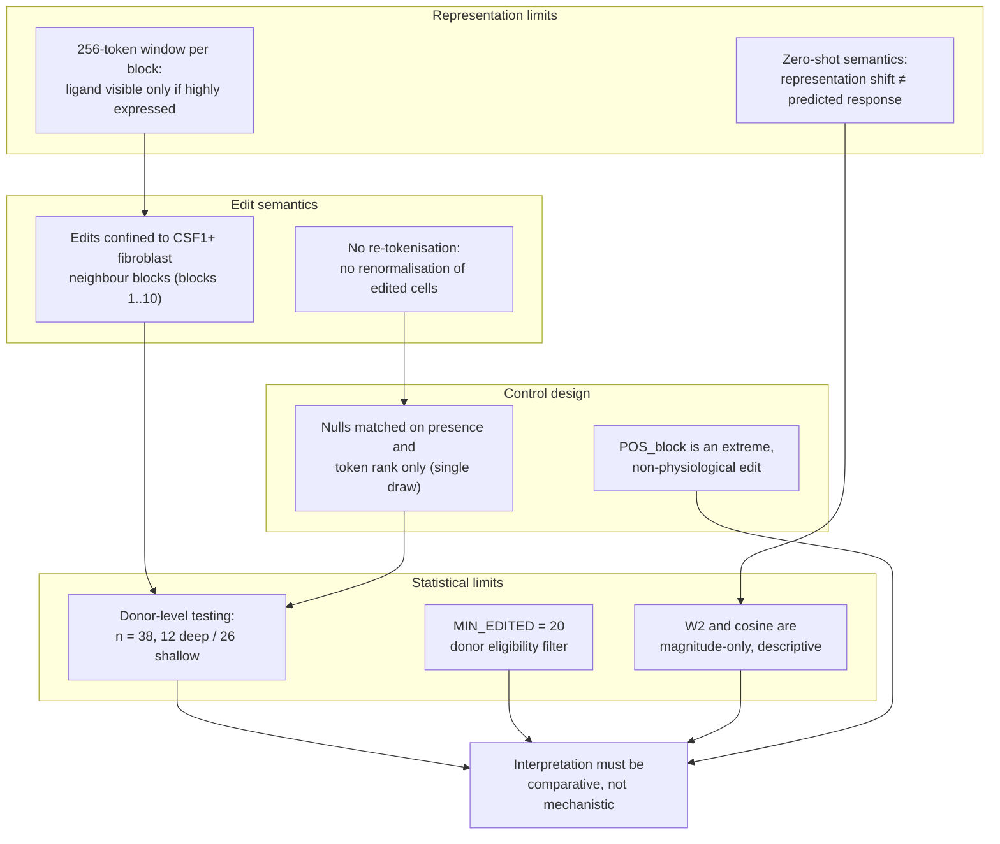

This page is the honest ledger of the pipeline: a consolidated, code-verified inventory of what `terra-ligand-perturbation` can and cannot tell you. Version 0.1 is a packaged reproduction of a single-cohort analysis (CSF1 knockout around tumour macrophages in the Yan TNBC Xenium data, zero-shot with TERRA-112M), and most of its constraints follow directly from that scope. Each limitation below is traced to the file and lines where it is implemented or documented, so you can distinguish *inherent* method limits (which apply to any in-silico knockout of this kind) from *version-0.1 engineering constraints* (which the planned generalisation roadmap addresses).

## A Map of the Limitation Domains

The limitations are not independent facts — they cascade. A representational limit (what the model can see) shapes the edit semantics (how the knockout is applied), which shapes the control design (what a comparison means), which finally constrains statistical inference (what can be concluded). Reading them as a chain prevents the most common misinterpretation: treating a null result on the primary readout as evidence that the pipeline failed, rather than as one link in a chain of constraints.

Sources: [README.md](README.md#L130-L138), [07_ko_pool.py](scripts/07_ko_pool.py#L53-L67)

## Representation Limits: What the Model Can See

TERRA-112M represents each cell as 11 blocks of 256 gene tokens — the cell itself plus its 10 nearest neighbours, each block listing genes in order of normalised expression. A ligand therefore exists for the model only if it falls within a block's 256 most highly expressed genes; anything below the cutoff is invisible, regardless of its biological importance. This is the first README-listed limitation ("Low-count transcripts"), and it is structural to the `cell_graph` layout rather than a bug.

Sources: [README.md](README.md#L67-L71), [README.md](README.md#L130-L133), [04_tokenise.py](scripts/04_tokenise.py#L26-L29)

Even for the intended target the visibility is partial. The null-selection step measured *CSF1* across the own 256-token blocks of all CSF1+ fibroblasts in the 38 included patients: presence 0.66 and median rank 60. In practice this means roughly a third of CSF1+ fibroblast neighbour blocks do not contain the CSF1 token at all, and a knockout of *CSF1* only changes blocks where the token is present — `n_edit` counts exactly those blocks per target cell. Cells whose edited-neighbour count is zero contribute nothing to any condition's statistics.

Sources: [README.md](README.md#L93-L97), [05_null_genes.py](scripts/05_null_genes.py#L110-L114), [06_ko_embed.py](scripts/06_ko_embed.py#L24-L26)

Second, the semantics of the readout are zero-shot. TERRA was not trained to predict responses to perturbation; the pipeline measures how the model's *representation* of a macrophage moves when a ligand token disappears from its neighbourhood. A shift in that representation is not, and cannot be certified as, a predicted biological response. Any causal language about macrophage state change overreaches what this design licenses.

Sources: [README.md](README.md#L134-L136)

## Edit Semantics: No Re-Tokenisation by Design

Every patient is tokenised once (step 04), and all 23 conditions are built by editing those frozen token sequences directly (step 06): the CSF1 token and its value are removed from the affected neighbour blocks, the remaining tokens of each block shift up with a stable sort so padding stays at the end, and nothing outside those blocks is touched. Two observed behaviours of `terra-st 0.1.13` motivated this design and are themselves caveats about the tooling:

* Setting *CSF1* counts to zero and **re-tokenising** changes the tokens of non-fibroblast cells beyond those whose CSF1+ fibroblast neighbour blocks contain *CSF1* — re-tokenisation re-normalises and re-ranks the edited fibroblasts and propagates the change to unintended blocks.
* The library's own `perturb_dataset` with `perturbation_target="neighborhood"` edited neighbour blocks belonging to unlisted cells, in addition to the intended edits. The pipeline therefore implements the knockout manually at token level.

Sources: [README.md](README.md#L73-L83), [04_tokenise.py](scripts/04_tokenise.py#L8-L11), [06_ko_embed.py](scripts/06_ko_embed.py#L12-L17)

The cost of this choice is that the edit is **not renormalised**: removing CSF1 from a fibroblast's neighbour block does not re-rank the remaining 255 genes the way re-computing expression ranks would. The perturbation is therefore a token-deletion intervention, deliberately local, and its results should not be read as simulating the systemic consequences of ligand loss in a cell. The pipeline enforces and audits this locality: per-patient checks assert that changed cells are exactly the edited cells, that no position outside the edited blocks changes, that padding stays at block ends, and that the `cell_emb` readout (which cannot change under a neighbour-only edit) remains identical within 1e-4 across all conditions.

Sources: [06_ko_embed.py](scripts/06_ko_embed.py#L12-L26), [06_ko_embed.py](scripts/06_ko_embed.py#L147-L177), [06_ko_embed.py](scripts/06_ko_embed.py#L285-L300), [06_ko_embed.py](scripts/06_ko_embed.py#L315-L317)

> [!TIP]
> The `cell_emb` negative control in each patient's step-06 checks sheet is the certification of edit locality. If a re-run shows a non-zero `max_abs_diff_cell_emb`, the frozen-token premise of the whole design has been violated upstream — stop interpreting downstream results and re-audit step 04.

## Control Design Caveats

The rank-matched null genes are the statistical backbone of the analysis, and their construction carries specific limits. Matching is defined on **presence** (fraction of CSF1+ fibroblast own-blocks containing the gene) and **median token rank** only — within ±0.15 and ±40 positions of CSF1's values. Genes with established direct effects on macrophages are excluded via a hand-curated list of ~50 ligands, so the null is free of *known strong* signal, but matching says nothing about functional similarity beyond visibility. Twenty genes are drawn once from the candidate pool with seed 1234; there is no resampling-based sensitivity analysis, and if fewer than 20 candidates exist the script exits rather than widening the bands — the bands are a pre-specified, non-negotiable design constant.

Sources: [05_null_genes.py](scripts/05_null_genes.py#L12-L24), [05_null_genes.py](scripts/05_null_genes.py#L57-L63), [05_null_genes.py](scripts/05_null_genes.py#L119-L131)

The positive and encoding controls also have asymmetric interpretations. `POS_block` empties an entire CSF1+ fibroblast neighbour block — as if that neighbour had no detected genes — which validates that the pipeline detects *large* neighbourhood changes but is a stronger, non-physiological edit than any gene-level knockout. `CSF1_zero` (value zeroed, token kept) versus `CSF1_remove` (token removed) tests whether results depend on how a loss is encoded in the token sequence. The methodological rationale is that changing *any* input changes a model's output, so magnitude alone cannot establish specificity: the test gene must exceed the effect of comparable edits at the same positions to claim a CSF1-specific signal.

Sources: [README.md](README.md#L85-L91), [README.md](README.md#L112-L128)

## Statistical Inference Limits

The unit of inference is the **donor**, not the cell — per-cell dP values are summarised per donor precisely to avoid pseudoreplication, but this caps power at the cohort size. The donor-level test is a two-sided Wilcoxon signed-rank test of d = 0 (donor mean dP minus the null-gene median of donor mean dP), computed over all eligible donors and repeated within each depth batch. With 38 donors overall but a bimodal depth split of 12 deep and 26 shallow, the per-batch deep stratum has very little power, and the script reports NA rather than inventing a test when a stratum has fewer than one non-zero value.

Sources: [07_ko_pool.py](scripts/07_ko_pool.py#L53-L67), [07_ko_pool.py](scripts/07_ko_pool.py#L459-L473), [README.md](README.md#L56-L63)

Three further filters shape what reaches the primary summary. Donor eligibility requires at least `MIN_EDITED = 20` target macrophages edited by CSF1_remove; donors below the threshold are excluded from d, the Wilcoxon test, and the gene ranks (eligibility is recorded per row). A null gene with no edited target cell in a donor contributes nothing to that donor's null median, and `n_null_used` reports how many nulls actually entered each d. And because the classifier readout is trained on the dataset authors' label-transfer annotations of macrophage states, the entire primary readout inherits their label quality — the third README-listed limitation. Held-out AUC is reported per donor, but is NA whenever the held-out mac cells contain only one class.

Sources: [07_ko_pool.py](scripts/07_ko_pool.py#L99-L106), [07_ko_pool.py](scripts/07_ko_pool.py#L429-L433), [07_ko_pool.py](scripts/07_ko_pool.py#L335-L345), [README.md](README.md#L137-L138)

Finally, the magnitude readouts are descriptive by construction. TERRA's Wasserstein-2 distance between baseline and perturbed embeddings of a donor's edited targets cannot tell a shift *towards* the target states from one *away* from it, so it is never used as directional evidence — it appears raw, as W2 minus the null median, and as a rank among the 21 genes. The script explicitly makes **no automatic call**: no significance threshold is applied, no multiple-testing correction across the 23 conditions is performed, and the outputs are designed to be read comparatively (ranks among 21 genes, sign consistency across donors).

Sources: [07_ko_pool.py](scripts/07_ko_pool.py#L40-L51), [07_ko_pool.py](scripts/07_ko_pool.py#L54), [07_ko_pool.py](scripts/07_ko_pool.py#L572-L578)

| Readout | Role | What it can establish | Structural limit |
|---|---|---|---|
| Classifier dP, `spatial_cell_emb` | Primary | Directional shift beyond the null median | Inherits annotation labels; donor n ≤ 38; per-batch power low |
| Classifier dP, `neighborhood_emb` | Secondary | Same, on the neighbourhood embedding | Same donor/annotation limits |
| Cosine shift per cell | Descriptive | Per-cell magnitude of representation change | Magnitude only |
| W2 per donor | Descriptive | Population magnitude (TERRA's own metric) | Cannot indicate direction; reported as rank |

Sources: [07_ko_pool.py](scripts/07_ko_pool.py#L533-L551), [README.md](README.md#L101-L110)

## Dataset Specificity and Version Pinning

Version 0.1 reproduces *one* analysis, and much of it is hardcoded rather than configurable. The configurable surface is deliberately thin: `config/analysis.cfg` holds only the source fibroblast states and target macrophage states; everything else — the ligand (`CSF1`), the inclusion thresholds (median depth ≥ 100, ≥ 50 CSF1+ fibroblasts, ≥ 50 target macrophages), the excluded patients (P10, P23, P71, P87, P89, P93, duplicated as literal sets in steps 04, 05 and 06), the cohort-size assertions (`N_INCLUDED = 38`, `EXPECTED_N_DONORS = 38`), and the null-selection bands — are constants in the scripts. Running this pipeline on a different dataset, ligand, or panel requires code edits, not configuration. The README's "Planned developments" section scopes the generalisation work explicitly.

Sources: [config/analysis.cfg.example](config/analysis.cfg.example#L1-L11), [04_tokenise.py](scripts/04_tokenise.py#L60-L66), [03_sample_table.py](scripts/03_sample_table.py#L51-L54), [README.md](README.md#L224-L233)

The model surface is pinned just as tightly. The pipeline was developed and run with `terra-st` 0.1.13 and TERRA-112M at Hugging Face revision `00d1c977`; step 04 asserts the model config matches the exact 11 × 256 `cell_graph` layout and exits otherwise. TERRA is under active development and its interface may change on publication — including the two library behaviours documented above that this pipeline works around — so later versions may require adjustments, and the TERRA weights (CC BY-NC 4.0, non-commercial) are not redistributed here.

Sources: [README.md](README.md#L12-L14), [04_tokenise.py](scripts/04_tokenise.py#L185-L192), [README.md](README.md#L250-L254)

One subtle trap for interpreters: **depth batch is defined twice**. Step 03's informational table applies `DEEP_DEPTH = 400` and notes the cohort is bimodal (~140 vs ~730 counts); the authoritative `depth_batch` used by step 07's stratified tests comes from step 04, where the cut is `DEPTH_CUT = 500`, computed on the shared panel *before* harmonisation. Stratified results should always be traced to the step-04 definition. (Minor documentation drift also exists: the step-07 docstring refers to a "How to read the results" README section that is not present in the current README — the interpretive material lives in "Why gene-level controls matter".)

Sources: [03_sample_table.py](scripts/03_sample_table.py#L26-L27), [03_sample_table.py](scripts/03_sample_table.py#L98-L102), [04_tokenise.py](scripts/04_tokenise.py#L18-L20), [07_ko_pool.py](scripts/07_ko_pool.py#L54)

| Element | Step 03 (informational) | Step 04 (authoritative, used by 07) |
|---|---|---|
| Deep threshold | 400 (`DEEP_DEPTH`) | 500 (`DEPTH_CUT`) |
| Measurement basis | annotated-cell depth per patient | shared panel, before harmonisation |
| Consumer | reporting only | depth-batch stratified Wilcoxon in step 07 |

Sources: [03_sample_table.py](scripts/03_sample_table.py#L51-L54), [04_tokenise.py](scripts/04_tokenise.py#L60-L66)

## Reading Results Under These Constraints

The limitations combine into an interpretation protocol rather than a list of disclaimers. The table below maps common observations to the reading the code and README actually license.

| Observation | Warranted reading | Evidence |
|---|---|---|
| `POS_block` detected as expected, `CSF1_remove` effect small | Effect is biologically/functionally weak — **not** a pipeline failure | [README.md](README.md#L125-L128) |
| `CSF1_remove` dP and W2 rank among the 20 nulls | No evidence of a CSF1-specific effect beyond comparable edits | [README.md](README.md#L120-L123), [07_ko_pool.py](scripts/07_ko_pool.py#L474-L482) |
| Deep-batch Wilcoxon NA or n = 12 | Absence of evidence from a low-power stratum (12 donors) | [07_ko_pool.py](scripts/07_ko_pool.py#L459-L473) |
| Held-out AUC NA for a donor | Only one mac class present in that donor's held-out cells | [07_ko_pool.py](scripts/07_ko_pool.py#L335-L345) |
| `CSF1_zero` disagrees with `CSF1_remove` | Result depends on loss encoding — treat as unstable | [README.md](README.md#L85-L91) |

Sources: [README.md](README.md#L112-L128), [07_ko_pool.py](scripts/07_ko_pool.py#L533-L551)

> [!TIP]
> The pipeline's strongest statement is always comparative: read the primary p-value together with `rank_most_negative_of_21` and `n_d_negative` in the same summary row, and check consistency between the `spatial` (primary) and `neigh` (secondary) embeddings before drawing any conclusion. A single significant p without rank support among the nulls is not a result this design licenses.

Practically, the environment inherits these constraints too: step 06 requires an NVIDIA GPU with ≥ 40 GB memory inside the TERRA container on an SGE cluster, and the working directory expects several hundred GB for the cohort's intermediates and caches. These are operating limits rather than method limits, but they bound how easily the frozen-token, single-draw results can be re-generated or extended.

Sources: [README.md](README.md#L187-L191), [README.md](README.md#L220-L222), [config/paths.cfg.example](config/paths.cfg.example#L12-L14)

## Where This Leads

None of these caveats are hidden costs — they are the pre-specified design. The null-gene construction rules and inclusion thresholds were fixed before results were seen ([Rank-Matched Null Gene Selection](12-rank-matched-null-gene-selection), [Patient Inclusion Rules](8-patient-inclusion-rules)), the classifier machinery is documented in [Leave-One-Donor-Out Classifier](15-leave-one-donor-out-classifier), the magnitude readouts in [Embedding Shift Magnitudes](16-embedding-shift-magnitudes), and the constraint chain starts at [Cell-and-Neighbour Tokenisation](9-cell-and-neighbour-tokenisation). The structural constraints — hardcoded cohort, single ligand, manual token editing — are exactly what the next page commits to lifting: continue to [Planned Generalisation Roadmap](22-planned-generalisation-roadmap).
