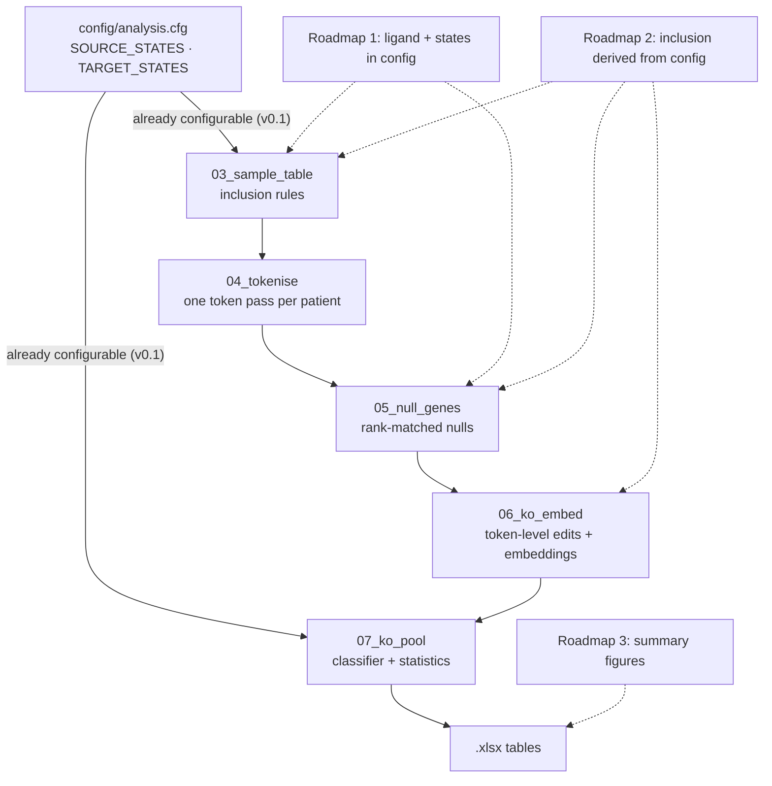

This page explains the **planned generalisation roadmap** of `terra-ligand-perturbation`: where version 0.1 stands today, which future generalisations the author has committed to in the README, and — most usefully for a new developer — exactly which scripts each planned change would touch. The scope here is deliberately narrow: we map the *roadmap onto the code*. How each pipeline step works today is covered by the dedicated Deep Dive pages, which we link to as we go.

## Where the Roadmap Comes From

Version 0.1 is explicitly framed as a reproduction, not a general tool: the README states it was "packaged from the scripts of the original analysis with configurable cell states", with TERRA used zero-shot. Everything else about the study — the ligand (CSF1), the source cells (CSF1+ fibroblasts), the receiving cells (target macrophages), the cohort (44 patients exported, 38 passing inclusion on the Yan TNBC Xenium dataset) — is baked into the scripts. The roadmap section, titled "Planned developments", then states the intent: *"a future version is intended to generalise the pipeline, so that any ligand, source cell states and target cell states can be tested on a single-cell-resolution spatial dataset"*, with three concrete deliverables: (1) the ligand and cell states set in the configuration, (2) patient inclusion derived from the configured states and thresholds, and (3) summary figures of the classifier and magnitude readouts.

Sources: [README.md](/README.md#L9-L10), [README.md](/README.md#L224-L233), [README.md](/README.md#L50-L54)

The table below translates those three roadmap bullets into the v0.1 → planned contrast, and names the scripts where the change would land. Everything in the "Today" column is verifiable in the code, which we examine in the following sections.

| Roadmap item | Today (v0.1) | Planned | Scripts affected |
|---|---|---|---|
| **1. Ligand + cell states in config** | `LIGAND = "CSF1"` fixed in step 03; `GENE = "CSF1"` and a macrophage-specific ligand exclusion list fixed in step 05; states filtered through fixed `cell_type` anchors `"Fibro"` / `"Mye"` | Ligand name and target-relevant biology join `config/analysis.cfg`; states decoupled from fixed lineages | `03_sample_table.py`, `05_null_genes.py`, `analysis_config.py` |
| **2. Inclusion derived from config** | Hard-coded thresholds (`MIN_MEDIAN_DEPTH = 100`, `MIN_CSF1POS_FIB = 50`, `MIN_TARGET_MAC = 50`) and hard-coded cohort pins (`EXCLUDED` patient set, `N_INCLUDED = 38` assertions in steps 05 and 06) | Step 03's inclusion output drives the downstream cohort; pins become derived checks | `03_sample_table.py`, `05_null_genes.py`, `06_ko_embed.py` |
| **3. Summary figures** | Step 07 writes unformatted `.xlsx` workbooks only (`07_summary.xlsx`, `07_details.xlsx`) | Figures summarising the classifier and magnitude readouts | `07_ko_pool.py` |

Sources: [README.md](/README.md#L224-L233)

The diagram below shows where the three roadmap items would attach to the seven-step chain. Solid arrows are the existing v0.1 data flow (detailed in [Pipeline Architecture](5-pipeline-architecture)); dashed arrows mark each roadmap commitment pointing at the step it modifies. Note that the configuration file already feeds steps 03 and 07 today — the roadmap extends that surface rather than creating a new mechanism.

Sources: [README.md](/README.md#L224-L233), [scripts/analysis_config.py](/scripts/analysis_config.py#L4)

## Already Configurable in v0.1: the Cell States

Before looking at what is *planned*, it helps to see what is *already done*, because the existing mechanism is the template the roadmap items will follow. The module `scripts/analysis_config.py` reads `config/analysis.cfg` and returns `SOURCE_STATES` (the fibroblast states whose CSF1+ cells emit the ligand) and `TARGET_STATES` (the macrophage states whose representation is read out). Steps 03, 04 and 07 import this module, so the cell states of the analysis are already user-editable without touching any script — this is the "configurable cell states" part that v0.1 shipped.

Sources: [analysis_config.py](/scripts/analysis_config.py#L4-L13), [analysis_config.py](/scripts/analysis_config.py#L6-L8), [03_sample_table.py](/scripts/03_sample_table.py#L47-L48), [07_ko_pool.py](/scripts/07_ko_pool.py#L26-L28)

Two details of this module matter for the roadmap. First, it validates aggressively before any computation happens: it exits if the file is missing, if a key is unset, if placeholders (`<...>`) were never replaced, or if `TARGET_STATES` lists a state twice. Second, its docstring already documents the consumption contract ("Steps 03, 04 and 07 import this module"), so a developer extending the config for the ligand has a worked example of the intended pattern: parse, validate loudly, then let every step read the same source of truth.

> [!TIP]
> When the roadmap adds `LIGAND` to `analysis.cfg`, the cleanest implementation follows `load_states()` exactly: a required key, a placeholder check that fails at start-up, and one import shared by every step. The v0.1 validation style ("fail fast, before the GPU is busy") is itself part of the project's design philosophy — see [Configuration Setup](4-configuration-setup).

Sources: [analysis_config.py](/scripts/analysis_config.py#L16-L34), [analysis_config.py](/scripts/analysis_config.py#L4)

## Roadmap Item 1 — Any Ligand, Any Source and Target States

The first roadmap deliverable — ligand and cell states set in the configuration — targets three separate hard-coded assumptions in v0.1. The most visible one is the ligand name itself: step 03 defines `LIGAND = "CSF1"` as a module constant, asserts that CSF1 is on the gene panel of every patient, and counts ligand-positive source cells with `lig > 0`; step 05 similarly pins `GENE = "CSF1"` and looks up CSF1's presence and median token rank to anchor the null-gene bands. Generalising means a single config entry flows into both scripts, replacing every literal `CSF1`.

Sources: [03_sample_table.py](/scripts/03_sample_table.py#L49), [03_sample_table.py](/scripts/03_sample_table.py#L66-L68), [03_sample_table.py](/scripts/03_sample_table.py#L82), [05_null_genes.py](/scripts/05_null_genes.py#L52), [05_null_genes.py](/scripts/05_null_genes.py#L110-L114)

The subtler assumption is **cell-type anchoring**. Even though the states themselves are configurable, step 03 intersects them with fixed lineages: a source cell must satisfy `cell_type == "Fibro"` and a target cell must satisfy `cell_type == "Mye"` before the configured states are applied. The classifier in step 07 is likewise trained on "mac-* cells only". This means v0.1 is not yet "any source and target states" — it is "any fibroblast states and any macrophage states". The roadmap's phrase *any source cell states and target cell states* implies these lineage anchors must themselves become configurable (or be derived from the configured states), since a different study might, for example, ask about an endothelial ligand acting on T cells.

Sources: [03_sample_table.py](/scripts/03_sample_table.py#L70-L71), [07_ko_pool.py](/scripts/07_ko_pool.py#L26-L28)

Finally, there is a piece of **receiver-specific biology** hidden in step 05: the `EXCLUDED_LIGANDS` list contains 49 ligands "with established direct effects on macrophage recruitment, survival or polarisation", kept out of the null set so that the null genes carry no real signal for *this* receiver cell type (the rationale is explained in [Null-Gene Control Rationale](14-null-gene-control-rationale) and the selection mechanics in [Rank-Matched Null Gene Selection](12-rank-matched-null-gene-selection)). Under the roadmap, a new target cell type requires a *new* exclusion list — the current list encodes macrophage biology and cannot simply be reused. The null-selection bands themselves (rank band 40, presence band 0.15) are generic, but they are anchored on CSF1's observed statistics (presence 0.66, median rank 60) reported in the README, so the whole step re-derives correctly once the gene name is configurable.

Sources: [05_null_genes.py](/scripts/05_null_genes.py#L57-L63), [05_null_genes.py](/scripts/05_null_genes.py#L17-L24), [README.md](/README.md#L93-L97)

## Roadmap Item 2 — Inclusion Derived from the Configuration

The second deliverable — *patient inclusion derived from the configured states and thresholds* — addresses a different kind of hard-coding: cohort pins. In step 03, the inclusion thresholds are module constants (`MIN_MEDIAN_DEPTH = 100`, `MIN_CSF1POS_FIB = 50`, `MIN_TARGET_MAC = 50`, plus the `DEEP_DEPTH = 400` batch cut), and even the constant names carry the study's biology (`CSF1POS`, `TARGET_MAC`). The README's cohort description — 44 patients exported, inclusion rules of median depth ≥ 100 counts, ≥ 50 CSF1+ fibroblasts, ≥ 50 target macrophages leaving 38 patients — is the exact realisation of these constants.

Sources: [03_sample_table.py](/scripts/03_sample_table.py#L51-L54), [03_sample_table.py](/scripts/03_sample_table.py#L99-L100), [README.md](/README.md#L50-L54)

Downstream, two scripts re-pin the *result* of those rules rather than deriving it: both `05_null_genes.py` and `06_ko_embed.py` carry the same `EXCLUDED = {"P10", "P23", "P71", "P87", "P89", "P93"}` patient set and `N_INCLUDED = 38`, and both exit with an error if the discovered cohort does not match. For a beginner this looks like duplication, but it is a deliberate v0.1 trade-off: each script independently verifies it is analysing exactly the pre-specified cohort, so a rerun after any upstream change fails loudly instead of silently mixing cohorts. The roadmap item converts these pins into derived values — step 03's inclusion output (its table of per-patient pass flags) becomes the single authority that steps 05 and 06 consume, so that changing a threshold in config automatically propagates through the whole chain.

Sources: [05_null_genes.py](/scripts/05_null_genes.py#L50-L52), [05_null_genes.py](/scripts/05_null_genes.py#L70-L75), [06_ko_embed.py](/scripts/06_ko_embed.py#L65-L66), [06_ko_embed.py](/scripts/06_ko_embed.py#L98-L104), [README.md](/README.md#L171-L183)

> [!TIP]
> The `EXCLUDED` / `N_INCLUDED` pattern is worth studying even if you never extend this pipeline: it is a lightweight alternative to a workflow manager for guaranteeing cohort consistency. The roadmap's change (derive, don't re-pin) removes the duplication *without* removing the loud-failure guarantee — the derived count must still be checked, just from one source.

## Roadmap Item 3 — Figures, Not Just Tables

The third deliverable is presentational: today every step writes an unformatted `.xlsx` summary, and step 07 — where the cohort-level statistics live — writes two workbooks, `07_summary.xlsx` (one table plus a column dictionary) and `07_details.xlsx` (sheets for the Wilcoxon test, gene ranks, per-donor results, strata, W2 magnitudes, classifier AUC and input QC). All numerical results a reader needs already exist; what the roadmap adds is *summary figures of the classifier and magnitude readouts*, i.e. a visual layer over the existing statistics rather than new statistics. Because step 07 also caches per-donor predictions, figure generation can reuse the cache without re-embedding or re-scoring.

Sources: [README.md](/README.md#L140-L159), [07_ko_pool.py](/scripts/07_ko_pool.py#L69-L72), [07_ko_pool.py](/scripts/07_ko_pool.py#L74-L75), [README.md](/README.md#L224-L233)

## What the Roadmap Deliberately Does Not Change

A roadmap is defined as much by its boundaries as by its items, and the README is explicit about what stays fixed. First, the **token-level editing design** in step 06 — building every perturbation by editing the saved baseline token sequences directly, rather than re-tokenising or using TERRA's own `perturb_dataset` — is motivated by two observed behaviours of `terra-st 0.1.13` (re-tokenisation touching unrelated cells; `perturb_dataset` editing unlisted neighbour blocks). That design is a correctness response to the *model library's* behaviour, so it survives generalisation unchanged. Second, the **model itself** is pinned: `terra-st` 0.1.13 with TERRA-112M at a fixed Hugging Face revision, used strictly zero-shot, with the 11 × 256-token geometry (`W = 2816, L_CELL = 256, N_SEG = 11`) fixed as module constants in step 06.

Sources: [README.md](/README.md#L73-L83), [README.md](/README.md#L12-L14), [06_ko_embed.py](/scripts/06_ko_embed.py#L70), [06_ko_embed.py](/scripts/06_ko_embed.py#L12-L26)

The boundary table below summarises the split between the configurable surface (what the roadmap opens up) and the fixed core (what it protects):

| Dimension | v0.1 | After generalisation |
|---|---|---|
| Ligand name | Hard-coded (`CSF1`) | Config entry |
| Source / target cell states | Configurable via `analysis.cfg` | Unchanged, plus |
| Cell-type lineage anchors (`"Fibro"`, `"Mye"`) | Hard-coded | Configurable or derived |
| Null-gene exclusion list | Macrophage-specific, hard-coded | Re-derived per target cell type |
| Inclusion thresholds | Constants in step 03 | Config entries |
| Cohort membership | Re-pinned in steps 05/06 | Derived from step 03 output |
| Output format | `.xlsx` tables only | Tables + summary figures |
| Token-editing design, model version, token geometry, zero-shot mode | Fixed | **Still fixed** |

Sources: [README.md](/README.md#L224-L233)

Two documented limitations also bound how far generalisation can go, and they are worth internalising before planning extensions: a ligand only influences the model if it appears in a cell's 256 most-expressed genes (low-count transcripts are invisible); TERRA is a zero-shot model, so a representation shift is not a predicted biological response; and the classifier readout depends on the dataset authors' cell-state annotations. These constraints apply to *any* ligand and *any* dataset the generalised pipeline is pointed at — they are properties of the method, not of CSF1 or of the TNBC cohort.

Sources: [README.md](/README.md#L132-L138)

> [!TIP]
> The pinned TERRA version is simultaneously the pipeline's biggest reproducibility asset and its main external risk: the README warns that TERRA "is under active development and its interface may change on publication; later versions may need adjustments". Generalising the biology inputs (roadmap items 1–2) is therefore deliberately independent of the model layer — the roadmap upgrades what you can *ask*, without touching how the model *answers*.

Sources: [README.md](/README.md#L12-L14)

## Position in the Documentation and How to Engage

This page closes the Deep Dive section, so the natural next step depends on your goal. To understand the machinery the roadmap modifies, read [Pipeline Architecture](5-pipeline-architecture) first, then [Configuration Setup](4-configuration-setup) for the config mechanism that items 1 and 2 extend, [Rank-Matched Null Gene Selection](12-rank-matched-null-gene-selection) for the step 05 logic that becomes ligand-configurable, and [Limitations and Caveats](21-limitations-and-caveats) for a fuller treatment of the boundaries summarised above. If you want to interpret v0.1 results while the figures of roadmap item 3 do not yet exist, [Outputs and Result Interpretation](20-outputs-and-result-interpretation) walks through the current `.xlsx` workbooks.

Sources: [README.md](/README.md#L224-L233)

Finally, the roadmap is stated as intent, not as a scheduled release — the README says only that "a future version is intended to generalise the pipeline". The author explicitly welcomes suggestions and bug reports via GitHub issues, so if you plan to apply the pipeline to a new ligand or dataset, raising an issue with your target receiver cell type (and which ligands you would need excluded from the null set) is the sanctioned way to influence which generalisation lands first.
