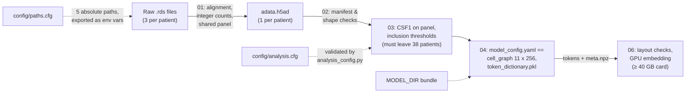

This page defines everything that must exist **before** you run the first pipeline step: the input dataset and its exact on-disk format, the cell-state labels you must configure, the pinned TERRA model bundle, and the hardware/software environment. Each requirement is traced to the script that checks it, so you can verify your setup with evidence rather than guesswork. If a requirement listed here is not met, the pipeline stops early with an explicit error — it never silently continues.

## Requirements at a Glance

The pipeline has four categories of requirements, and each is enforced automatically at a specific stage:

| Category | What you must provide | Where it is verified |
|---|---|---|
| Input dataset | Yan *et al.* TNBC Xenium per-patient folders with three `.rds` files each | Step 01 export, Step 02 assembly |
| Configuration | `config/paths.cfg` (5 absolute paths) and `config/analysis.cfg` (2 cell-state lists) | `analysis_config.py`, every step |
| Model | TERRA-112M bundle (`terra-st` 0.1.13, HF revision `00d1c977`) | Step 04 config checks |
| Hardware | SGE cluster, Apptainer/Singularity container, GPU ≥ 40 GB for step 06, R 4.4.1 for step 01 | Job scripts, runtime checks |

Sources: [README.md](README.md#L187-L190), [analysis_config.py](scripts/analysis_config.py#L1-L35), [04_tokenise.py](scripts/04_tokenise.py#L170-L185), [06_ko_embed.sh](scripts/06_ko_embed.sh#L6-L14)

## Input Dataset Requirements

The expected input is the publicly released triple-negative breast cancer (TNBC) Xenium cohort of Yan *et al.* (2026) — spatial transcriptomics data where each cell has a position and a gene-count profile. The per-patient Xenium objects are distributed by the dataset authors (code repository: `navinlabcode/tnbc-chemo`), and cell types and states are the authors' annotations, which the pipeline relies on and does not recompute.

Sources: [README.md](README.md#L32-L37), [README.md](README.md#L50-L54)

The data must be laid out as **one folder per patient**, where `<PATIENT>` is the patient identifier (e.g. `P12`), each containing three R data files (`.rds` is R's serialised object format):

```
INPUT_DIR/
├── P01/
│   ├── mat_counts.rds    # genes × cells raw count matrix
│   ├── df_meta.rds       # one metadata row per cell
│   └── spatial_xy.rds    # x/y coordinates per cell
├── P02/
│   └── ...
└── P44/
    └── ...
```

Sources: [paths.cfg.example](config/paths.cfg.example#L8-L12), [01_export.R](scripts/01_export.R#L11-L22)

Each file has a precise contract, checked with hard assertions before anything is written:

| File | Required content | Validation performed |
|---|---|---|
| `mat_counts.rds` | Genes × cells matrix (sparse `dgCMatrix`), rownames = gene symbols, **raw integer counts** | Aborts if counts are non-integer; colnames must equal `df_meta` rownames |
| `df_meta.rds` | One row per cell, rownames = cell IDs; columns `cell_type`, `cell_state`, `Niche`, `paper_patient_id`, `nCount_Xenium`, `nFeature_Xenium` | Row count must match matrix columns |
| `spatial_xy.rds` | Columns `x`, `y` (finite, in micrometres), rownames = cell IDs | Must be identical to `df_meta` rownames, same row count |

Sources: [01_export.R](scripts/01_export.R#L120-L166), [02_build_h5ad.py](scripts/02_build_h5ad.py#L6-L17)

> [!TIP]
> The most common failure at this stage is **row-order misalignment**: the three `.rds` files must list cells in exactly the same order (`rownames(spatial_xy) == rownames(df_meta)` and `ncol(mat_counts) == nrow(df_meta)`). The pipeline deliberately aborts instead of guessing an alignment, because a silent misalignment would attach wrong coordinates and metadata to cells downstream.

## Quality Filters Applied Before the Model

You do not need to pre-filter your data — step 01 applies three fixed selection rules that mirror the original study and TERRA's own preprocessing:

| Filter | Rule | Parameter |
|---|---|---|
| Genes | Only the **intersection of all patients' gene panels** is kept, so every section shares one panel; *CSF1* must be present (checked again in step 03) | — |
| Tissue pieces | Cells are grouped into connected regions of 100 µm bins (≥ 5 cells/bin, rook connectivity); regions smaller than 10 bins are treated as debris and dropped, so spatial neighbourhoods never bridge separate pieces | `BIN_UM=100`, `MIN_CELLS_BIN=5`, `MIN_REGION_BINS=10` |
| Cells | Cells with ≥ 10 detected genes on the shared panel are kept — including **unannotated cells**, because they are real spatial neighbours; this threshold matches TERRA's pretraining QC | `MIN_GENES_CELL=10` |

Sources: [01_export.R](scripts/01_export.R#L11-L22), [01_export.R](scripts/01_export.R#L53-L66), [03_sample_table.py](scripts/03_sample_table.py#L77-L78)

Step 02 then re-assembles these exports into one `.h5ad` file (the HDF5 container format of the Python `AnnData` library that TERRA reads) per patient, validating every transfer against a checksum manifest: shapes, non-zero counts, gene indices, total counts, and per-cell gene counts must all agree between the R export and the Python read.

Sources: [02_build_h5ad.py](scripts/02_build_h5ad.py#L58-L75)

## Cohort Inclusion Requirements

From the 44 patients with Xenium data, step 03 applies three pre-specified inclusion rules. All must hold for a patient to enter the analysis, leaving **38 patients**:

| Rule | Threshold | Why it exists |
|---|---|---|
| Median sequencing depth (annotated cells) | ≥ 100 counts | Too-shallow sections cannot represent the ligand |
| CSF1+ fibroblasts (source cells) | ≥ 50 | Enough source cells to edit neighbour blocks |
| Target macrophages (receiving cells) | ≥ 50 | Enough receiving cells for a stable readout |

A "CSF1+ fibroblast" is a cell with `cell_type == "Fibro"`, a `cell_state` in your configured source states, and a raw *CSF1* count > 0; a "target macrophage" is a cell with `cell_type == "Mye"` and a `cell_state` in your configured target states. Patients are additionally tagged as a **depth batch** ("deep" vs "shallow") from their median depth, which later steps use for stratified statistics.

Sources: [README.md](README.md#L50-L60), [03_sample_table.py](scripts/03_sample_table.py#L13-L23), [03_sample_table.py](scripts/03_sample_table.py#L46-L49)

Steps 04 and 06 additionally hard-fail unless **exactly 38 patients** pass (the six excluded patients — P10, P23, P71, P87, P89, P93 — are listed in the scripts with their exclusion reasons). This is a cohort-specific guard for reproducing the published analysis, not a general requirement of the method.

Sources: [04_tokenise.py](scripts/04_tokenise.py#L54-L58), [06_ko_embed.py](scripts/06_ko_embed.py#L62-L64)

## Cell-Type and Gene Labels the Pipeline Expects

Two things are configurable, and three are currently hard-coded — knowing the difference is essential before substituting your own data:

| Setting | Value | Configurable? |
|---|---|---|
| Ligand | `CSF1` | No (hard-coded in steps 03–06) |
| Source cell type | `Fibro` | No (hard-coded) |
| Target cell type | `Mye` | No (hard-coded) |
| Source cell **states** | `SOURCE_STATES` in `config/analysis.cfg` | Yes |
| Target cell **states** | `TARGET_STATES` in `config/analysis.cfg` | Yes |

The two state lists must use the exact `cell_state` labels of the dataset authors' annotations, written as comma-separated values without quotes. `analysis_config.py` validates your file and refuses to run if the config is missing, either key is empty, or placeholder text like `<fibroblast_state_1>` is still present.

Sources: [04_tokenise.py](scripts/04_tokenise.py#L13-L17), [04_tokenise.py](scripts/04_tokenise.py#L61-L66), [analysis.cfg.example](config/analysis.cfg.example#L7-L11), [analysis_config.py](scripts/analysis_config.py#L18-L33)

> [!TIP]
> Only the state *labels* are configurable in version 0.1 — the ligand and the coarse cell types (`Fibro`, `Mye`) are hard-coded, so swapping in a different dataset or ligand requires editing the scripts. Generalising these is the explicitly planned roadmap item, so check the roadmap before investing effort in adapting the pipeline yourself.

## TERRA Model Requirements

The pipeline uses the pretrained spatial-transcriptomics foundation model **TERRA-112M** in zero-shot mode (no fine-tuning). Version pinning is strict because TERRA is under active development and its interface may change:

| Requirement | Value |
|---|---|
| Python package | `terra-st` 0.1.13 |
| Model | TERRA-112M |
| Hugging Face revision | `00d1c977` |
| Weights licence | CC BY-NC 4.0 (non-commercial — check the model card) |

Sources: [README.md](README.md#L12-L14), [README.md](README.md#L38-L44), [README.md](README.md#L252-L254)

The weights are downloaded from Hugging Face by the installation script and are **not redistributed** with this repository. Once downloaded, the model folder (`MODEL_DIR`, set via `config/paths.cfg`) must contain a specific bundle, and step 04 verifies its structure against TERRA's expected input layout before doing any work:

| Bundle file | What it provides | What is checked |
|---|---|---|
| `model_config.yaml` | Data configuration | `tokenizer_type == "cell_graph"`, `model_input_size == 2816`, `n_neighs == 10`, `seq_len_cell == 256`, `seq_len_neighborhood == 2560` |
| `token_dictionary.pkl` | Maps gene symbols to token IDs | Loaded and used for all knockout edits |

The checked numbers encode TERRA's input format: each cell is represented as **11 blocks of 256 gene tokens** (2,816 values wide) — the cell's own genes, then its 10 nearest neighbours, nearest first, each listing genes in order of normalised expression. If your model bundle does not match this `11 × 256` layout, step 04 exits with *"Model config does not match the 11 x 256 cell_graph layout"*.

Sources: [README.md](README.md#L62-L66), [04_tokenise.py](scripts/04_tokenise.py#L170-L185)

Step 06 uses the same bundle for inference via `terra.inference.embed.embed_dataset`, requesting three embedding types per cell: `spatial_cell_emb` (primary readout), `neighborhood_emb` (secondary), and `cell_emb` (kept as a negative control).

Sources: [06_ko_embed.py](scripts/06_ko_embed.py#L57-L69), [06_ko_embed.py](scripts/06_ko_embed.py#L195-L200)

> **Repository note:** the README lists `env/terra_env.sh`, `env/install.sh` and `env/check_config.sh` as the components that set paths, install dependencies and validate the setup — however, no `env/` directory is present in the current repository snapshot. If you clone the repository and these files are missing, treat them as a required prerequisite described in [Configuration Setup](4-configuration-setup) and [Quick Start](2-quick-start).

Sources: [README.md](README.md#L163-L168)

## Environment and Hardware Requirements

| Requirement | Details | Used by |
|---|---|---|
| Cluster scheduler | Sun Grid Engine (`qsub`); job arrays chain steps via `-hold_jid` | All steps |
| Container runtime | Singularity or Apptainer (Python steps run inside the TERRA container; `SOFTWARE_DIR` holds image + weights + caches) | Steps 02–07 |
| GPU | NVIDIA card with **≥ 40 GB memory**, step 06 only | Step 06 |
| CPU support | AVX instructions required (`require_avx` check) | Containerised steps |
| R | 4.4.1, running on the **host** (not container), with packages `Matrix`, `igraph`, `openxlsx` | Step 01 |
| Memory / time (step 01) | 64 GB, 6 h | Step 01 |
| Memory / time (step 06) | 32 GB requested, 200 GB `h_vmem`, 3 h | Step 06 |
| Disk | Several hundred GB for `WORK_DIR` (exports, h5ad files, tokenised datasets, embeddings, caches) | All steps |
| Network | One node with internet access for the installation | Setup only |

Sources: [README.md](README.md#L187-L190), [README.md](README.md#L220-L222), [01_export.sh](scripts/01_export.sh#L6-L10), [06_ko_embed.sh](scripts/06_ko_embed.sh#L6-L14), [paths.cfg.example](config/paths.cfg.example#L12-L24)

> [!TIP]
> The GPU threshold of 40 GB is not arbitrary: step 06 embeds all conditions with a **fixed batch size of 256**, which needs about 21 GB plus CUDA overhead and fails on 24 GB cards. The batch size is deliberately not configurable — identical batching across baseline and all perturbation conditions is what makes the embedding shifts comparable.

## How the Pipeline Verifies Your Setup

Each requirement is checked exactly once, at the earliest possible step, so failures surface with a specific message rather than as corrupted results downstream:



Two design properties are worth noticing as a beginner: every step is **idempotent** (it skips patients whose outputs already exist unless `FORCE_REBUILD` is set), and every check result is recorded into the per-step `.xlsx` summary, so you can audit what was verified after the fact.

Sources: [01_export.R](scripts/01_export.R#L58-L66), [02_build_h5ad.py](scripts/02_build_h5ad.py#L30-L75), [04_tokenise.py](scripts/04_tokenise.py#L170-L185), [06_ko_embed.py](scripts/06_ko_embed.py#L195-L200), [README.md](README.md#L179-L183)

## Where to Go Next

Once you have confirmed your data, model, and hardware match the requirements above, the logical reading order is:

1. **[Configuration Setup](4-configuration-setup)** — fill in the five paths in `config/paths.cfg` and the two state lists in `config/analysis.cfg` (the exact files introduced in the sections above).
2. **[Quick Start](2-quick-start)** — submit the job chain and run your first patient end-to-end.
3. **[Pipeline Architecture](5-pipeline-architecture)** — understand how the seven steps connect and what each writes.
4. For deeper background on the requirements introduced here, see **[Patient Inclusion Rules](8-patient-inclusion-rules)** for the statistical reasoning behind the 38-patient cohort, and **[Harmonisation and Model Bundles](10-harmonisation-and-model-bundles)** for what happens to your data inside the TERRA container.
