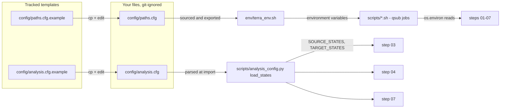
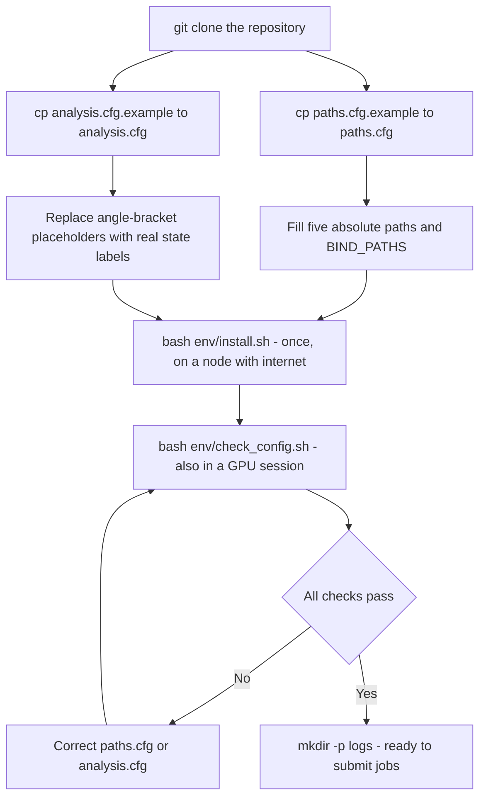

Every value that makes this pipeline *yours* lives in exactly two files. This page walks you through creating, editing, and validating them before any pipeline step is submitted: `config/paths.cfg` tells the pipeline where your data, scratch space, results, and software live, and `config/analysis.cfg` tells it which cell states to analyse. Both are created by copying a tracked `.example` template — the real files are machine-specific and git-ignored, so your edits never touch the repository. The workflow is: copy → edit → validate.

Sources: [README.md](README.md#L192-L199), [analysis.cfg.example](config/analysis.cfg.example#L1-L6)

## What You Are Configuring

The repository ships only templates; nothing under `config/` is ever read directly by the pipeline until you create the non-example versions. The two files are deliberately separated by *concern*: one answers "where is everything on my system", the other answers "which biological populations does this study compare". Keeping them apart means you can switch datasets or study designs without touching filesystem layout, and vice versa.

| | `config/paths.cfg` | `config/analysis.cfg` |
|---|---|---|
| Template | `paths.cfg.example` | `analysis.cfg.example` |
| Controls | Five absolute filesystem paths | Two cell-state selections |
| Format | `KEY=value`, one per line | `KEY=state1,state2`, comma-separated |
| Read by | `env/terra_env.sh`, which exports them as environment variables | `scripts/analysis_config.py`, imported by steps 03, 04, 07 |
| Validation | `bash env/check_config.sh` | Built-in guards in `load_states()` |

Sources: [paths.cfg.example](config/paths.cfg.example#L1-L6), [analysis.cfg.example](config/analysis.cfg.example#L1-L12), [analysis_config.py](scripts/analysis_config.py#L13-L34), [README.md](README.md#L163-L177)

The relevant slice of the repository, annotated for this page:

```
config/
├── analysis.cfg.example   # template → copy to config/analysis.cfg
└── paths.cfg.example      # template → copy to config/paths.cfg
scripts/
├── 01_export.R|.sh        # step 01: reads $REPO_DIR from the env layer
├── 02_build_h5ad.py|.sh   # step 02: reads WORK_DIR from environment
├── 03_sample_table.py|.sh # step 03: reads paths AND analysis.cfg
├── 04_tokenise.py|.sh     # step 04: reads paths AND analysis.cfg
├── 05_null_genes.py|.sh   # step 05: paths only
├── 06_ko_embed.py|.sh     # step 06: paths only
├── 07_ko_pool.py|.sh      # step 07: reads paths AND analysis.cfg
└── analysis_config.py     # loader + validator for config/analysis.cfg
```

Sources: [README.md](README.md#L163-L177), [analysis.cfg.example](config/analysis.cfg.example#L1)

## The Configuration Flow

Understanding *how* values travel prevents the most common beginner mistake: editing a config file and wondering why nothing changed. Job scripts do not read `config/paths.cfg` themselves — every `.sh` file begins by sourcing `env/terra_env.sh` (for example, `01_export.sh` does so immediately after enabling strict error mode), which turns the configured paths into environment variables that the Python and R programs then read via `os.environ`. The cell states take a different route: steps 03, 04, and 07 import `load_states()` from `scripts/analysis_config.py`, which parses `config/analysis.cfg` directly.



Sources: [01_export.sh](scripts/01_export.sh#L15-L18), [03_sample_table.py](scripts/03_sample_table.py#L44-L48), [analysis_config.py](scripts/analysis_config.py#L13-L13)

> [!TIP]
> The five keys in `paths.cfg` are never read directly by a pipeline step. They reach the code as environment variables exported by `env/terra_env.sh` — every job script sources it first — and Python steps read them with `os.environ` (`WORK_DIR`, `RESULTS_DIR`, and additionally `MODEL_DIR`, which `04_tokenise.py` notes is "set by terra_env.sh"). This is why the pipeline must always be launched through the `.sh` job scripts from the repository root, not by running the `.py` files alone.

Sources: [04_tokenise.py](scripts/04_tokenise.py#L56-L59), [06_ko_embed.sh](scripts/06_ko_embed.sh#L21-L26)

## Step 1 — Create `config/paths.cfg`

Start from the repository root with the copy command from the README:

```bash
cp config/paths.cfg.example config/paths.cfg       # edit the five paths
```

Sources: [README.md](README.md#L192-L195)

Then replace every placeholder with an **absolute path on your system** — the template states this requirement explicitly, and the checker described below enforces it. Each key has a precise role in the pipeline's data flow:

| Key | Points to | Why it matters |
|---|---|---|
| `INPUT_DIR` | Per-patient Xenium folders as distributed by the dataset authors (`<PATIENT>/{mat_counts.rds, df_meta.rds, spatial_xy.rds}`) | The only read-only source of raw data; step 01 exports from here |
| `WORK_DIR` | Large intermediates: exported matrices, `.h5ad` files, tokenised datasets, embeddings, caches | Expect **several hundred GB** for the full cohort — plan quota accordingly |
| `RESULTS_DIR` | Summary workbooks (`.xlsx`) written by each step | Small; each step appends a subdirectory here |
| `SOFTWARE_DIR` | Container image, installed Python packages, model weights, caches | Populated by the one-off `env/install.sh` |
| `BIND_PATHS` | Host paths mounted inside the container, comma-separated | Must together contain this repository *and* every path above |

Sources: [paths.cfg.example](config/paths.cfg.example#L8-L25)

Two details deserve attention. First, `BIND_PATHS` is a container concern: since jobs run inside a Singularity/Apptainer image, the host directories must be mounted in, and the template notes that `check_config.sh` verifies the repository and all configured paths are covered by the bind mounts. Second, `INPUT_DIR` layout is not arbitrary — step 01 expects the exact per-patient folder structure produced by the dataset authors, with the three `.rds` files shown above.

Sources: [paths.cfg.example](config/paths.cfg.example#L22-L25), [README.md](README.md#L187-L190)

## Step 2 — Create `config/analysis.cfg`

This file defines the biological contrast of the study: which fibroblast states supply the CSF1 ligand, and which macrophage states receive it. The README's design section confirms that source and target states are the dataset's own cell-state labels and are set here.

```bash
cp config/analysis.cfg.example config/analysis.cfg # set the cell states
```

Sources: [README.md](README.md#L192-L195), [README.md](README.md#L59-L60)

| Key | Meaning | Constraint |
|---|---|---|
| `SOURCE_STATES` | Fibroblast states whose CSF1+ cells are the ligand source | One or more labels, comma-separated |
| `TARGET_STATES` | Macrophage states whose model representation is read out | One or more labels, comma-separated, **no duplicates** |

Sources: [analysis.cfg.example](config/analysis.cfg.example#L7-L12), [analysis_config.py](scripts/analysis_config.py#L27-L33)

The template documents the formatting rules inline: labels are comma-separated, **no quotes**, and comments must sit on their own lines (any line starting with `#` is skipped by the parser). Copy, then edit:

| Before (template placeholder) | After (illustrative syntax — use your dataset's state labels) |
|---|---|
| `SOURCE_STATES=<fibroblast_state_1>,<fibroblast_state_2>` | `SOURCE_STATES=state_A,state_B` |
| `TARGET_STATES=<macrophage_state_1>,<macrophage_state_2>` | `TARGET_STATES=state_X,state_Y` |

Sources: [analysis.cfg.example](config/analysis.cfg.example#L8-L11)

The illustrative labels above are syntax only: the valid values are the cell-state annotations of the Yan *et al.* TNBC Xenium cohort, documented on the [Data and Model Requirements](3-data-and-model-requirements) page. The angle brackets are not decorative — the loader treats any surviving value that starts with `<` as an unedited placeholder and refuses to run, so removing them is itself part of the validation.

Sources: [analysis_config.py](scripts/analysis_config.py#L30-L31), [README.md](README.md#L36-L37)

## Step 3 — Validate Before Running

Validation happens on two independent fronts, and both fail loudly rather than silently. For `paths.cfg`, run the checker the template points to — the README describes it as checking "configuration, software, input, model", which makes it the single command that certifies your setup end-to-end (run it once normally, and again inside a GPU session):

```bash
bash env/install.sh        # once, on a node with internet access
bash env/check_config.sh   # also inside a GPU session
```

Sources: [paths.cfg.example](config/paths.cfg.example#L4-L6), [README.md](README.md#L166-L168), [README.md](README.md#L196-L197)

For `analysis.cfg`, validation is built into the loader itself. `load_states()` in `scripts/analysis_config.py` raises a `SystemExit` with a targeted message the moment anything is wrong, which means a mis-configured step 03/04/07 aborts at startup instead of producing empty results. The four guards and their fixes:

| Error message (from `load_states()`) | Trigger | Fix |
|---|---|---|
| `... not found; copy config/analysis.cfg.example to config/analysis.cfg ...` | The real config file does not exist | Run the `cp` command from Step 2 |
| `SOURCE_STATES is not set in ...` / `TARGET_STATES is not set in ...` | Key missing, or value empty | Fill in both keys — one is not optional without the other |
| `... still holds placeholders` | Any value still starts with `<` | Replace every `<...>` label with a real dataset state |
| `TARGET_STATES lists a state more than once` | Duplicate label in the target list | Remove the duplicate |

Sources: [analysis_config.py](scripts/analysis_config.py#L18-L33)

> [!TIP]
> One prerequisite check the checker cannot do for you: the job scripts and config templates depend on an `env/` directory (`terra_env.sh`, `install.sh`, `check_config.sh`, `versions/`) that the README lists in its repository layout, but which is **not present in the packaged repository tree** shown here (only `config/` and `scripts/` exist). Since every job script starts with `set -euo pipefail` and then `source env/terra_env.sh`, a missing `env/` will abort the job on its first line — confirm you have this directory before submitting anything.

Sources: [README.md](README.md#L163-L177), [01_export.sh](scripts/01_export.sh#L15-L16)

## Where Each Setting Is Used

With both files validated, it helps to see the consumption map at a glance — it tells you which config to revisit if a particular step misbehaves, and it explains why steps 03/04/07 will refuse to start on a bad `analysis.cfg` while steps 02, 05, 06 will happily run without it:

| Step | Paths via `env/terra_env.sh` | Cell states via `analysis_config.py` |
|---|---|---|
| 01 export (R) | `REPO_DIR` used to locate the R script | — |
| 02 build_h5ad | `WORK_DIR` → export directory | — |
| 03 sample_table | `WORK_DIR`, `RESULTS_DIR` | `load_states()` imported at startup |
| 04 tokenise | `WORK_DIR`, `RESULTS_DIR`, `MODEL_DIR` | source/target states for cell classification |
| 05 null_genes | paths only | — |
| 06 ko_embed | paths only (GPU embedding) | — |
| 07 ko_pool | paths only | target states define the classifier readout |

Sources: [01_export.sh](scripts/01_export.sh#L18-L18), [02_build_h5ad.py](scripts/02_build_h5ad.py#L37-L38), [03_sample_table.py](scripts/03_sample_table.py#L44-L48), [04_tokenise.py](scripts/04_tokenise.py#L14-L17), [07_ko_pool.py](scripts/07_ko_pool.py#L26-L28), [analysis.cfg.example](config/analysis.cfg.example#L1)

## From Clone to Ready — Full Checklist

The complete setup sequence, exactly as the README prescribes it, fits in one flowchart. Every arrow is a command you run; the loop back through `check_config.sh` is deliberate — configuration errors are cheap to fix now and expensive to discover mid-pipeline:



Sources: [README.md](README.md#L192-L199)

Three habits make this setup durable. Re-run `check_config.sh` inside every new GPU session type, since bind-mount visibility can differ between nodes; treat `analysis.cfg` as your study definition — changing `TARGET_STATES` changes the classifier readout of step 07, and the pipeline's caching behaviour around reruns is covered in [Reproducibility and Caching](19-reproducibility-and-caching); and never commit your `.cfg` files, which the git-ignore design makes the default anyway.

Sources: [README.md](README.md#L196-L197), [README.md](README.md#L179-L183), [analysis.cfg.example](config/analysis.cfg.example#L3-L4)

## Where to Go Next

Configuration is the last stop before execution. If you have not yet confirmed your input data and TERRA model versions, read [Data and Model Requirements](3-data-and-model-requirements) alongside this page — the `INPUT_DIR` layout and `SOFTWARE_DIR` contents it describes are exactly what `paths.cfg` must point at. To understand why the pipeline is structured as seven chained steps, continue to [Pipeline Architecture](5-pipeline-architecture); for how the configured steps are actually submitted and chained on a Sun Grid Engine cluster — including the `qsub -hold_jid` sequence that assumes this page's setup is complete — see [Cluster Execution and Job Chaining](18-cluster-execution-and-job-chaining).
