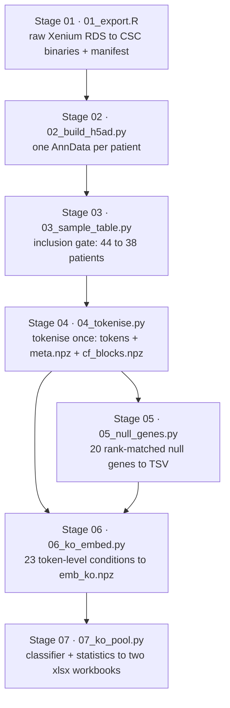
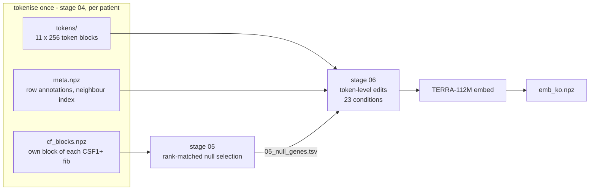
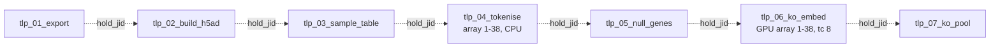

This page explains how the terra-ligand-perturbation repository is organised as an executable system: what the seven numbered stages are, the data contracts between them, how compute is orchestrated on a cluster, and which conventions hold across every stage. It is deliberately architectural — the biological rationale of each design decision is documented in the linked Deep Dive pages at the end.

## The Seven-Stage DAG

The repository implements a single linear directed acyclic graph of seven stages. Each stage pairs a compute script (`.R` or `.py`) with a Sun Grid Engine wrapper (`.sh`), and each stage writes large intermediates to `WORK_DIR` and a human-readable `.xlsx` summary to `RESULTS_DIR/<step>/`. The stage numbers are not cosmetic — they encode execution order, and downstream stages assert that upstream artifacts exist before proceeding.

Sources: [README.md](README.md#L160-L183), [01_export.R](scripts/01_export.R#L1-L44)

The full stage inventory, with compute tier and execution mode:

| Stage | Script pair | Role | Compute tier | Execution mode |
|---|---|---|---|---|
| 01 | `01_export.R` + `.sh` | Export raw Xenium matrices | R on host, CPU | single job |
| 02 | `02_build_h5ad.py` + `.sh` | Assemble one `.h5ad` per patient | TERRA container, CPU | single job |
| 03 | `03_sample_table.py` + `.sh` | Patient table + pre-specified inclusion | TERRA container, CPU | single job |
| 04 | `04_tokenise.py` + `.sh` | Harmonise + tokenise each patient once | TERRA container, CPU | array job, 38 tasks |
| 05 | `05_null_genes.py` + `.sh` | Select the 20 rank-matched null genes | TERRA container, CPU | single job |
| 06 | `06_ko_embed.py` + `.sh` | Build perturbations, embed with TERRA-112M | TERRA container, GPU ≥ 40 GB | array job, 38 tasks, throttled |
| 07 | `07_ko_pool.py` + `.sh` | Cohort pooling, classifier, statistics | TERRA container, CPU | single job |

Sources: [04_tokenise.sh](scripts/04_tokenise.sh#L1-L21), [06_ko_embed.sh](scripts/06_ko_embed.sh#L1-L27), [03_sample_table.py](scripts/03_sample_table.py#L34), [05_null_genes.py](scripts/05_null_genes.py#L36), [07_ko_pool.py](scripts/07_ko_pool.py#L79)

## Stage Contracts: Reads/Writes at Every Boundary

Every script opens with a docstring that declares its exact `Reads` and `Writes` paths, and every stage boundary is protected by validation rather than convention. The `01 → 02` handoff uses a binary-plus-manifest scheme with checksums; the `04 → 06` handoff is a tokenised dataset plus NumPy archives; the `05 → 06` handoff is a single TSV; the `06 → 07` handoff is one `.npz` per patient whose keys are documented in the consumer's docstring. This is the load-bearing pattern of the codebase: no stage parses another stage's logic, only its declared artifacts.

Sources: [01_export.R](scripts/01_export.R#L25-L30), [02_build_h5ad.py](scripts/02_build_h5ad.py#L19-L23), [05_null_genes.py](scripts/05_null_genes.py#L28-L33), [06_ko_embed.py](scripts/06_ko_embed.py#L41-L45), [07_ko_pool.py](scripts/07_ko_pool.py#L12-L25)

## Stages 01–02: The R-to-Python Bridge

Stage 01 is the only R code in the repository, and it is designed to be the *last* thing R touches. It reads the vendor-distributed per-patient `.rds` files, applies the selection rules — the gene panel intersection across all sections, tissue pieces defined as connected regions of occupied 100 µm bins (rook connectivity, ≥ 5 cells per bin, < 10 bins = debris), and cells with ≥ 10 detected genes — and then writes the counts as the raw slots of an R `dgCMatrix` in little-endian int32: `x.bin` (values), `i.bin` (0-based gene indices), `p.bin` (column pointers). Crucially, it also writes a `manifest.txt` with shapes, nnz, and total counts, which becomes the verification instrument for the next stage.

Sources: [01_export.R](scripts/01_export.R#L11-L44)

Stage 02 runs inside the TERRA container and rebuilds the exact sparse matrix with `numpy.fromfile`, asserting every manifest invariant before assembly: nnz match, column-pointer structure, strictly positive counts, gene indices in range, and total-count equality. It then writes one AnnData per patient in the layout TERRA expects. One architectural decision here matters downstream: `obs_names` are set to `"<patient>_<cell_id>"` because Xenium cell IDs repeat across patients and TERRA's perturbation machinery selects cells by ID — IDs must therefore be unique across the entire cohort, with the original ID preserved in `obs['cell_id']`.

Sources: [02_build_h5ad.py](scripts/02_build_h5ad.py#L68-L80), [02_build_h5ad.py](scripts/02_build_h5ad.py#L13-L26)

> [!TIP]
> The manifest-with-checksums bridge means R and Python never share memory, serialisation libraries, or file formats — only a byte-exact contract. If you ever change the export format in `01_export.R`, the assertions at [02_build_h5ad.py](scripts/02_build_h5ad.py#L73-L80) are the contract's enforcement points; they will fail loudly rather than produce a silently misaligned matrix.

## Stages 03–05: Cohort Gate and the Tokenise-Once Foundation

Stage 03 reads every `.h5ad` from stage 02 and applies three pre-specified inclusion rules — median depth ≥ 100 counts, ≥ 50 CSF1⁺ fibroblasts, ≥ 50 target macrophages — reducing the 44 exported patients to **38 included patients**. These inclusion thresholds live in stage 03; a *separate* threshold (`DEEP_DEPTH = 500`) defined in stage 04 assigns each patient a `depth_batch` label ("deep"/"shallow") that is carried through the artifacts and used by stage 07. Stage 03's output also serves a human purpose: it identifies the smallest passing patient for the recommended one-patient GPU smoke test of stage 06.

Sources: [03_sample_table.py](scripts/03_sample_table.py#L20-L31), [03_sample_table.py](scripts/03_sample_table.py#L51-L54), [04_tokenise.py](scripts/04_tokenise.py#L18-L20), [README.md](README.md#L50-L63)

The resulting exclusion set (`P10, P23, P71, P87, P89, P93`) is then pinned as a hard guard in stages 04–07: each downstream script asserts `N_INCLUDED == 38` and exits if the cohort differs. This converts the cohort definition from data into an invariant — the pipeline refuses to run over an unexpected cohort rather than silently including patients.

Sources: [04_tokenise.py](scripts/04_tokenise.py#L60-L66), [06_ko_embed.py](scripts/06_ko_embed.py#L98-L104), [07_ko_pool.py](scripts/07_ko_pool.py#L96)

Stage 04 is the pivot of the whole architecture. For each included patient, it runs `harmonize_adata` once and `tokenize_adata` once per tissue piece, producing TERRA's `cell_graph` layout: 11 blocks × 256 tokens (the cell itself, then its 10 nearest neighbours, nearest first — widths `W=2816, L_CELL=256, N_SEG=11`). Its three artifacts define everything downstream: the tokenised Hugging Face dataset (`tokens/`), per-row annotations and neighbour indices (`meta.npz`), and — the key one — the own 256-token block of every CSF1⁺ fibroblast (`cf_blocks.npz`), which is the raw material for null-gene selection.

Sources: [04_tokenise.py](scripts/04_tokenise.py#L22-L47), [04_tokenise.py](scripts/04_tokenise.py#L74)

Stage 05 consumes `cf_blocks.npz` across all 38 patients and selects the 20 null genes under rules fixed before results are seen: a candidate must lie within ± 0.15 presence and ± 40 rank positions of CSF1 in the fibroblast token blocks, must not be CSF1 itself, and must not appear in a hard-coded list of 50 ligands with established direct effects on macrophages. Twenty genes are drawn with seed 1234, and the script refuses to widen the bands if fewer than 20 candidates exist. Its single output consumed downstream is `05_null_genes.tsv`.

Sources: [05_null_genes.py](scripts/05_null_genes.py#L12-L33), [05_null_genes.py](scripts/05_null_genes.py#L52-L63)

> [!TIP]
> The "tokenise once, edit many" design is a deliberate workaround for two observed behaviours of the model stack: re-tokenising after zeroing a gene count reshuffles tied genes across the whole sequence, and `terra-st 0.1.13`'s `perturb_dataset` with `perturbation_target="neighborhood"` edits blocks belonging to cells outside the requested list. By editing tokens directly and restricting edits to CSF1⁺ fibroblast neighbour blocks, stage 06 guarantees the perturbation is spatially exact. The full motivation is on [Token-Level Knockout Editing](11-token-level-knockout-editing).

Sources: [README.md](README.md#L65-L83)

## Stage 06: The Token-Level Perturbation Engine

Stage 06 is the compute heart of the pipeline: one GPU array task per patient, it builds every knockout condition at token level from the stage-04 baseline sequences (no re-tokenisation) and embeds the results with TERRA-112M. The edit scope is strictly defined: only neighbour blocks 1–10 belonging to a CSF1⁺ fibroblast are touched; the macrophage's own block and all other neighbours are never modified. A target cell counts as edited by a condition when at least one of its CSF1⁺ fibroblast neighbour blocks contains the relevant gene, with `n_edit` recording how many blocks.

Sources: [06_ko_embed.py](scripts/06_ko_embed.py#L7-L26)

The 23 conditions form a controlled experiment matrix built into the batch:

| Condition | Token edit in each CSF1⁺ fibroblast neighbour block | Count | Architectural role |
|---|---|---|---|
| `CSF1_remove` | token and value removed; remaining tokens shift up, padding at end | 1 | the test perturbation |
| `CSF1_zero` | value set to 0, token kept | 1 | encoding-sensitivity control |
| `POS_block` | entire block emptied | 1 | positive control |
| `NULL_<gene>` | identical edit to `CSF1_remove` | 20 | rank-matched reference distribution |

Sources: [06_ko_embed.py](scripts/06_ko_embed.py#L12-L24), [README.md](README.md#L85-L91)

Embedding scope is equally explicit: the baseline is embedded for *all* myeloid cells of the patient (this becomes stage 07's classifier training set), while baseline-plus-all-conditions are embedded for the target macrophages — always the same rows in the same order, so batching is identical across conditions. Three embedding types are captured per cell: `spatial_cell_emb` (primary readout), `neighborhood_emb` (secondary), and `cell_emb`, retained as a built-in negative control.

Sources: [06_ko_embed.py](scripts/06_ko_embed.py#L28-L34), [06_ko_embed.py](scripts/06_ko_embed.py#L70-L71)

> [!TIP]
> Stage 06 treats verification as a first-class output: after embedding, it checks that each condition changed exactly the cells with `n_edit > 0` and nothing outside the edited blocks, that edited blocks keep their padding at the end, that `cell_emb` deviates by less than 1e-4 (a neighbourhood edit cannot change the cell's own embedding), and that each condition yields one embedding row per sequence. Any failed check is written to the per-patient xlsx *and* forces a non-zero exit — corrupt embeddings can never silently flow into stage 07's statistics.

Sources: [06_ko_embed.py](scripts/06_ko_embed.py#L36-L39), [06_ko_embed.py](scripts/06_ko_embed.py#L317), [06_ko_embed.py](scripts/06_ko_embed.py#L353-L357)

## Stage 07: Cohort Pooling and Statistical Readout

Stage 07 is the only consumer of `emb_ko.npz`, and its docstring documents the archive's full key contract — the definitive schema for the `06 → 07` handoff:

| Key group | Content |
|---|---|
| `patient`, `depth_batch` | scalars per patient |
| `mye_cell_id`, `mye_state` | all myeloid cells (`n_mye`) |
| `base_mye_spatial`, `base_mye_neigh`, `base_mye_cell` | `n_mye × D` baseline embeddings |
| `t_in_mye` | target rows within the mye arrays |
| `t_cell_id`, `t_state`, `n_cf_nb` | target macrophages (`n_t`) |
| `base_t_spatial`, `base_t_neigh` | `n_t × D` baseline embeddings |
| `cond_names` | `CSF1_remove`, `CSF1_zero`, `POS_block`, 20 × `NULL_<gene>` |
| `n_edit` | `n_t × n_cond`, edited neighbour counts |
| `cond_spatial`, `cond_neigh` | `n_cond × n_t × D` condition embeddings |

Sources: [07_ko_pool.py](scripts/07_ko_pool.py#L12-L25)

Functionally, stage 07 scores every target macrophage with a leave-one-donor-out logistic classifier trained on baseline embeddings of all annotated macrophage states (the source/target states come from the shared configuration module, not from hard-coded labels), computes per-cell `dP = P(perturbed) − P(baseline)` and cosine shifts, computes TERRA's Wasserstein-2 distance as a descriptive magnitude, and produces the cohort statistics: per-donor effect sizes against the null median, a two-sided Wilcoxon signed-rank test across eligible donors (overall and per depth batch), and cohort-wide gene ranks. The statistical interpretation belongs to [Embedding Shift Magnitudes](16-embedding-shift-magnitudes) and [Cohort Summary Statistics](17-cohort-summary-statistics); architecturally, note that stage 07 caches per-donor predictions in `WORK_DIR/ko_pool_cache/
.npz` and reuses them when the donor list and classifier settings are unchanged.

Sources: [07_ko_pool.py](scripts/07_ko_pool.py#L26-L68), [07_ko_pool.py](scripts/07_ko_pool.py#L69-L75)

## Orchestration Topology

All stages are submitted from the repository root as SGE jobs that source `env/terra_env.sh` for paths and container settings, and the chain is expressed through `-hold_jid` dependencies rather than a monolithic workflow engine — each job starts only when its predecessor's job name has completed. Stages 04 and 06 are array jobs with `-t 1-38`; the task index selects the patient deterministically from the sorted list of the 38 included patients, with a `PATIENT=<id>` environment override for running a single patient first. Stage 06 additionally throttles concurrency with `-tc 8` and requests `gpu=true`.

Sources: [01_export.sh](scripts/01_export.sh#L8-L11), [02_build_h5ad.sh](scripts/02_build_h5ad.sh#L9), [04_tokenise.sh](scripts/04_tokenise.sh#L7-L20), [06_ko_embed.sh](scripts/06_ko_embed.sh#L1-L15), [06_ko_embed.py](scripts/06_ko_embed.py#L107-L110), [README.md](README.md#L200-L218)

The verified resource profiles from the job headers:

| Job | Memory (`tmem`/`h_vmem`) | Walltime | GPU | Concurrency |
|---|---|---|---|---|
| `tlp_01_export` | 64G / 64G | 06:00:00 | — | single |
| `tlp_02_build_h5ad` | 64G / 64G | 06:00:00 | — | single |
| `tlp_04_tokenise` | 64G / 64G | 06:00:00 | — | array, all 38 |
| `tlp_06_ko_embed` | 32G / 200G | 03:00:00 | `gpu=true` | array 1–38, `-tc 8` |

Sources: [01_export.sh](scripts/01_export.sh#L4-L7), [02_build_h5ad.sh](scripts/02_build_h5ad.sh#L4-L8), [04_tokenise.sh](scripts/04_tokenise.sh#L4-L8), [06_ko_embed.sh](scripts/06_ko_embed.sh#L4-L9)

Note the asymmetry in stage 06's memory request: modest host RAM (32G) but a very large virtual-memory ceiling (200G) for the GPU path. The fixed batch size of 256 requires about 21 GB of GPU memory plus CUDA overhead and fails on 24 GB cards; it is intentionally *not* auto-tuned, so that every patient is embedded identically. Cluster submission mechanics and the one-patient-first workflow are covered in [Cluster Execution and Job Chaining](18-cluster-execution-and-job-chaining).

Sources: [06_ko_embed.sh](scripts/06_ko_embed.sh#L10-L12)

## Configuration Layering

Configuration is split into two files with different consumption mechanisms and different blast radii. `config/paths.cfg` (five keys: `INPUT_DIR`, `WORK_DIR`, `RESULTS_DIR`, `SOFTWARE_DIR`, `BIND_PATHS`) is exported as environment variables by `env/terra_env.sh` and read by *every* stage — including the R script, which fails fast if a variable is missing. `config/analysis.cfg` holds only the analysed cell-state labels (`SOURCE_STATES`, `TARGET_STATES`) and is read exclusively through the `analysis_config.load_states()` module, which validates that the file exists, that no `<placeholder>` remains, and that target states are not duplicated.

Sources: [paths.cfg.example](config/paths.cfg.example#L1-L25), [01_export.R](scripts/01_export.R#L52-L60), [analysis.cfg.example](config/analysis.cfg.example#L1-L12), [analysis_config.py](scripts/analysis_config.py#L1-L35)

| Configuration surface | Keys | Consumed by | Mechanism |
|---|---|---|---|
| `config/paths.cfg` | `INPUT_DIR`, `WORK_DIR`, `RESULTS_DIR`, `SOFTWARE_DIR`, `BIND_PATHS` | all stages (01–07) | env vars via `env/terra_env.sh` |
| `config/analysis.cfg` | `SOURCE_STATES`, `TARGET_STATES` | stages 03, 04, 07 | `analysis_config.load_states()` |
| `MODEL_DIR` | model weights path | stages 04, 06 | env var set by `env/terra_env.sh` |

Sources: [analysis_config.py](scripts/analysis_config.py#L1-L8), [03_sample_table.py](scripts/03_sample_table.py#L47-L48), [04_tokenise.py](scripts/04_tokenise.py#L59), [06_ko_embed.py](scripts/06_ko_embed.py#L64)

This split is what makes the pipeline's stated generalisation goal tractable: swapping the analysed ligand's source/target states requires editing one git-ignored file plus `analysis_config.py`'s hard-coded ligand constant — no pipeline logic changes. The roadmap for full generalisation is on [Planned Generalisation Roadmap](22-planned-generalisation-roadmap).

Sources: [analysis_config.py](scripts/analysis_config.py#L1-L35), [README.md](README.md#L224-L233)

## Resumability Convention

Resumability follows one uniform convention: a `FORCE_REBUILD = False` constant at the top of each heavy script, and idempotent output naming keyed by patient. Stages 01, 02, 04 and 06 skip patients whose outputs already exist (manifest, `adata.h5ad`, tokenised dataset, `emb_ko.npz` respectively); stage 07 reuses its cached per-donor predictions when the cohort signature is unchanged; stages 03 and 05 are cheap enough to always recompute. Because array tasks are patient-partitioned, re-running a stage after a partial failure only reprocesses the missing patients — the recommended workflow of running patient 1 of stage 06 manually before launching the full array depends entirely on this property.

Sources: [README.md](README.md#L179-L183), [01_export.R](scripts/01_export.R#L43), [02_build_h5ad.py](scripts/02_build_h5ad.py#L23), [04_tokenise.py](scripts/04_tokenise.py#L44), [06_ko_embed.py](scripts/06_ko_embed.py#L48-L49), [07_ko_pool.py](scripts/07_ko_pool.py#L72-L75)

## Architectural Invariants

Four invariants hold across the entire pipeline and explain most of its code shape. **First**, the cohort is an invariant, not data: stages 04–07 hard-pin the 38-patient exclusion set and refuse to run otherwise. **Second**, every patient artefact is keyed by patient ID and rebuilt independently, which is what makes array parallelism and resumability the same mechanism. **Third**, stage boundaries are validated contracts — manifests, assertions, and docstring-documented archive schemas — rather than shared code. **Fourth**, verification is fail-hard: stage 06's post-embedding checks exit non-zero on any failure, and downstream stages assert the presence and shape of upstream artifacts before touching them. Understanding these four makes every script in `scripts/` predictable in structure.

Sources: [04_tokenise.py](scripts/04_tokenise.py#L60-L66), [06_ko_embed.py](scripts/06_ko_embed.py#L65-L66), [02_build_h5ad.py](scripts/02_build_h5ad.py#L51-L58), [05_null_genes.py](scripts/05_null_genes.py#L70-L75), [06_ko_embed.py](scripts/06_ko_embed.py#L353-L357)

## Where to Go Next

The natural reading order follows the DAG. For the design decisions behind each stage, continue with [Study Design and Hypothesis](6-study-design-and-hypothesis), then the Data Preparation pair — [R Export and Tissue Pieces](7-r-export-and-tissue-pieces) and [Patient Inclusion Rules](8-patient-inclusion-rules) — followed by the TERRA integration pair, [Cell-and-Neighbour Tokenisation](9-cell-and-neighbour-tokenisation) and [Harmonisation and Model Bundles](10-harmonisation-and-model-bundles). For the perturbation core, read [Token-Level Knockout Editing](11-token-level-knockout-editing) and [Rank-Matched Null Gene Selection](12-rank-matched-null-gene-selection). For operational detail on the orchestration summarised above, see [Cluster Execution and Job Chaining](18-cluster-execution-and-job-chaining) and [Reproducibility and Caching](19-reproducibility-and-caching), and for how to read the stage-07 workbooks, see [Outputs and Result Interpretation](20-outputs-and-result-interpretation).