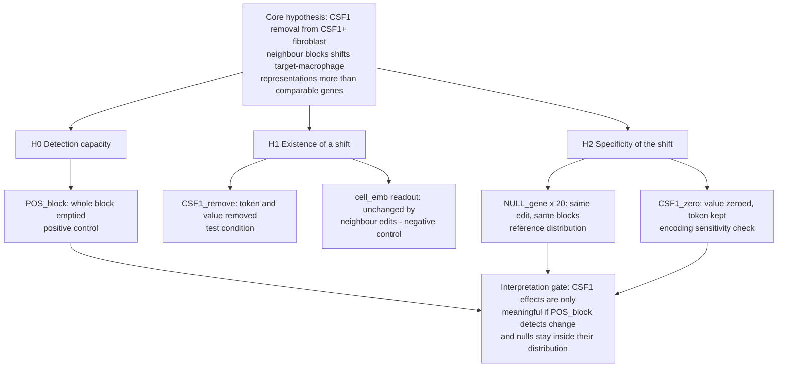
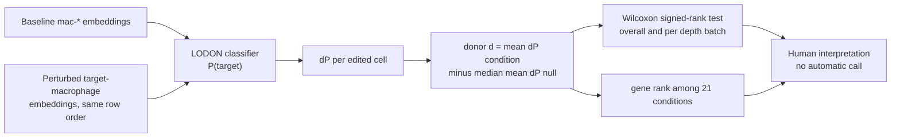

This page explains *why* the terra-ligand-perturbation pipeline is structured the way it is: the biological question it answers, the hypothesis architecture, the pre-specified cohort rules, and the control matrix that makes a zero-shot embedding shift interpretable. It is the conceptual foundation for the Deep Dive pages that follow — the operational details of each mechanism live in dedicated pages referenced throughout.

Sources: [README.md](README.md#L1-L16)

## The Scientific Question: Ligand Signalling as a Representation Problem

Cancer-associated fibroblasts (CAFs) are a major source of ligands acting on macrophages within the tumour microenvironment, and CSF1 is the ligand under study here. Because TERRA encodes each cell *together with its spatial neighbours*, the repository can ask an *in silico* question that would otherwise require an experiment: does removing a ligand from the neighbouring cells change the model's representation of the receiving cell? The study uses the public TNBC Xenium cohort of Yan *et al.* (2026) and the pretrained TERRA-112M foundation model (Birk *et al.*, 2026) in zero-shot mode — TERRA is never fine-tuned.

Sources: [README.md](README.md#L18-L28), [README.md](README.md#L30-L44)

The hypothesis is stated as two coupled claims: **(H1) existence** — removing CSF1 from CSF1-expressing fibroblast neighbours shifts the TERRA representation of selected target macrophage states; and **(H2) specificity** — any observed shift exceeds what removing a comparable gene at the same positions would produce. This two-part structure is the single most important design decision in the repository: a magnitude change alone can never support H2, so the entire control apparatus exists to separate "the embedding changed" from "CSF1 specifically caused the change."

Sources: [README.md](README.md#L24-L28), [README.md](README.md#L112-L123)

## Hypothesis Architecture: Mapping Claims to Evidence Classes

Every condition in the pipeline exists to adjudicate exactly one branch of the hypothesis. The concept map below shows how the four evidence classes relate to the claims — this is the mental model that makes the seven-script pipeline coherent:

Two observations of TERRA's current behaviour motivated a further, purely technical design constraint: perturbations are built by **direct token editing** of the tokenised sequences rather than re-tokenisation or the library's `perturb_dataset`. Re-tokenising after zeroing CSF1 counts changes tokens of *non-fibroblast* cells, and in `terra-st 0.1.13` the `perturb_dataset` neighbourhood target also edited blocks belonging to unlisted cells — both would contaminate the contrast between conditions.

Sources: [README.md](README.md#L65-L83), [README.md](README.md#L10-L14)

> [!TIP]
> The null genes are not merely "other genes" — each null is knocked out in **exactly the same neighbour blocks as CSF1** (the blocks of CSF1+ fibroblasts), so a null must be visible to the model in those blocks about as often and at about the same rank as CSF1. This is why the design enforces edit-position comparability and why the null set is chosen once for the whole cohort (seed 1234) rather than per patient.

## Cohort Design: Pre-specified Inclusion Rules

The cohort is fixed before any perturbation results are seen. All 44 patients with Xenium data are exported on the gene panel shared by all sections, and tissue pieces are defined as connected regions of occupied 100 µm bins so that spatial neighbourhoods never bridge separate pieces. Three inclusion thresholds, all pre-specified in the step 03 docstring and constants, then determine eligibility — leaving exactly 38 patients, a number the pipeline hard-checks in steps 04, 06 and 07 (`N_INCLUDED = 38`, `EXPECTED_N_DONORS = 38`).

Sources: [README.md](README.md#L48-L54), [scripts/03_sample_table.py](scripts/03_sample_table.py#L20-L23), [scripts/04_tokenise.py](scripts/04_tokenise.py#L31-L35)

| Threshold | Value | Code constant | Rationale |
|---|---|---|---|
| Median depth | ≥ 100 counts | `MIN_MEDIAN_DEPTH` | Excludes uninformative sections (P10, P23) |
| CSF1+ fibroblasts | ≥ 50 | `MIN_CSF1POS_FIB` | Guarantees enough source blocks to edit (P71, P87, P89, P93) |
| Target macrophages | ≥ 50 | `MIN_TARGET_MAC` | Guarantees enough receiving cells for the readout |

Sources: [scripts/03_sample_table.py](scripts/03_sample_table.py#L12-L23), [scripts/03_sample_table.py](scripts/03_sample_table.py#L48-L53), [scripts/03_sample_table.py](scripts/03_sample_table.py#L99-L103)

The cell definitions themselves are configuration-driven rather than hard-coded: a **CSF1+ fibroblast** is a `Fibro` cell whose `cell_state` is in `SOURCE_STATES` with a raw CSF1 count > 0, and a **target macrophage** is a `Mye` cell in `TARGET_STATES`. Both lists are read from `config/analysis.cfg` at import time by `load_states()`, with validation that placeholders are replaced and no target state is listed twice. This makes the study design a *parameter* of the pipeline, which is the foundation for the planned generalisation to arbitrary ligand–source–target triples.

Sources: [README.md](README.md#L56-L60), [scripts/analysis_config.py](scripts/analysis_config.py#L1-L35)

> [!TIP]
> Watch a subtle cohort-design distinction: step 03 reports a *descriptive* depth batch at ≥ 400 counts (`DEEP_DEPTH`, noting the cohort is bimodal ~140 vs ~730), but the **analysis** depth batch actually used by step 07 is defined in step 04 at ≥ 500 counts (`DEPTH_CUT`), splitting the cohort into 12 deep and 26 shallow patients. When reading per-batch statistics, the ≥ 500 definition is the operative one.

## The Perturbation Principle: Edit Tokens, Not Expression

Every patient is tokenised **once**, and every perturbation is built by editing those baseline tokens directly — only in the neighbour blocks (blocks 1–10) that belong to a CSF1+ fibroblast. The macrophage's own block and all other neighbours are never touched. Each cell is edited by a condition when at least one of its CSF1+ fibroblast neighbour blocks contains the gene, and `n_edit` counts those blocks — this per-cell edit count later becomes a stratification variable. The one-time tokenisation also avoids re-tokenisation reshuffling tied genes between baseline and perturbed conditions.

Sources: [README.md](README.md#L65-L71), [scripts/06_ko_embed.py](scripts/06_ko_embed.py#L7-L26), [scripts/04_tokenise.py](scripts/04_tokenise.py#L6-L11)

| Condition | Edit in each CSF1+ fibroblast neighbour block | Hypothesis role |
|---|---|---|
| `CSF1_remove` (test) | CSF1 token and value removed; remaining tokens move up | The perturbation of interest (H1) |
| `NULL_<gene>` × 20 | Same edit for a rank-matched null gene | Reference distribution for H2 |
| `POS_block` | Whole block emptied | H0: pipeline can detect a neighbourhood change |
| `CSF1_zero` | CSF1 value set to 0, token kept | Checks dependence on how a loss is encoded |
| `cell_emb` readout | (all conditions) | Negative control: neighbour edits cannot change the cell's own embedding |

Sources: [README.md](README.md#L85-L91)

## Why Gene-Level Controls Matter: The Control Matrix

The inference principle is stated unambiguously in the README: changing *any* input changes a model's output, and larger or more prominent changes produce larger effects. Therefore reporting only the magnitude of output change after removing a gene cannot distinguish a gene-specific effect from a generic edit effect. The design's answer is **relational inference**: instead of asking whether removing CSF1 changes the output, the analysis asks whether CSF1's effect *exceeds* that of comparable genes selected the same way but not expected to carry macrophage-directed signal — the candidate pool explicitly excludes 49 ligands with established effects on macrophage recruitment, survival or polarisation.

Sources: [README.md](README.md#L112-L123), [scripts/05_null_genes.py](scripts/05_null_genes.py#L6-L24), [scripts/05_null_genes.py](scripts/05_null_genes.py#L43-L58)

Each control class answers a different failure mode of the readout, and the interpretation logic chains them together:

| Control type | Condition | Question it answers | If it fails |
|---|---|---|---|
| Reference distribution | 20 × `NULL_<gene>` | Is CSF1's effect larger than a comparable edit? | CSF1 effect is indistinguishable from generic editing |
| Positive control | `POS_block` | Can the pipeline detect a real neighbourhood change at all? | Small CSF1 effects become uninterpretable |
| Secondary test | `CSF1_zero` | Does the conclusion depend on the edit encoding? | Results are encoding artifacts |
| Negative control | `cell_emb` | Is the readout directionally sensible? | A neighbour edit altered the cell's own embedding |

Sources: [README.md](README.md#L85-L91), [README.md](README.md#L125-L128), [scripts/07_ko_pool.py](scripts/07_ko_pool.py#L6-L10)

The interpretation rule that falls out of this matrix is deliberately conservative: if the positive control performs as expected while the test gene produces only a small change, the small effect is interpretable as biologically or functionally **weak** rather than as a failure of the method. This converts a null-ish result from an ambiguity into a finding.

Sources: [README.md](README.md#L125-L128)

## Readout Design: Direction from the Classifier, Magnitude from Distances

The primary readout converts embeddings into a *directional* score. A logistic regression is trained on baseline embeddings of all `mac-*` myeloid cells to score P(target) — any target state versus all other macrophage states — fitted **leave-one-donor-out**, so the model scoring a donor never saw that donor's cells. For each edited target macrophage, dP = P(perturbed) − P(baseline). Secondary readouts are purely descriptive magnitudes: per-cell cosine shift, and TERRA's own Wasserstein-2 (W2) distance between baseline and perturbed embeddings per donor.

Sources: [README.md](README.md#L99-L110), [scripts/07_ko_pool.py](scripts/07_ko_pool.py#L26-L38)

| Readout | Input | Measures | Role in the design |
|---|---|---|---|
| Classifier dP (primary) | `spatial_cell_emb`, LODON logistic regression | Directional shift toward/away target-state identity | Testable statistic for H2 |
| Neighbourhood dP (secondary) | `neighborhood_emb`, same classifier | Directional shift in the neighbourhood channel | Robustness of the primary result |
| Cosine shift (descriptive) | per-cell embeddings | Raw magnitude of embedding movement | No direction information |
| W2 distance (descriptive) | Sinkhorn population distance (p=2, blur 0.01) | Per-donor population displacement | Explicitly never used as evidence of direction |

Sources: [README.md](README.md#L99-L110), [scripts/07_ko_pool.py](scripts/07_ko_pool.py#L40-L51)

The cohort-level decision rule makes the specificity claim (H2) operational by subtracting the null reference **before** any testing: each donor's statistic *d* is defined as mean dP(condition) minus the median over the 20 null genes of mean dP(null) — so *d* isolates the component of the shift that is specific to the tested gene rather than generic to editing those blocks. Eligible donors are those with at least `MIN_EDITED = 20` target macrophages edited by `CSF1_remove`; *d* is then tested against zero with a two-sided Wilcoxon signed-rank test over eligible donors, repeated per depth batch, and every condition is ranked by cohort median donor mean dP among the 21 genes. Crucially, **no automatic call is made** — the statistics are reported for human interpretation.

Sources: [scripts/07_ko_pool.py](scripts/07_ko_pool.py#L53-L67), [scripts/07_ko_pool.py](scripts/07_ko_pool.py#L91-L96)

Embedding consistency is enforced structurally rather than statistically: baseline and every condition embed the *same target-macrophage rows in the same order*, so batching is identical across conditions, and `cell_emb` is recorded for all conditions as the negative control that a neighbour edit cannot change.

Sources: [scripts/06_ko_embed.py](scripts/06_ko_embed.py#L28-L34)

## Design Limitations the Hypothesis Must Live With

Three limitations are documented as part of the design itself, not as afterthoughts. First, **low-count transcripts**: a ligand is represented only if it falls within a cell's 256 most highly expressed genes, so the perturbation only acts where CSF1 is actually tokenised. Second, the **zero-shot setting**: TERRA was never trained to predict perturbation responses, so a representational change is not a predicted biological response — the hypothesis is about the model's encoding, not about cell behaviour. Third, the **readout dependence**: the classifier readout inherits the dataset authors' label-transfer annotations of macrophage states, via the configured `TARGET_STATES`.

Sources: [README.md](README.md#L130-L138), [scripts/analysis_config.py](scripts/analysis_config.py#L1-L9)

## Navigating the Deep Dive

The design summarised here decomposes into the operational pages of the Deep Dive section. For the mechanics behind each design decision, follow this progression: start with the overall execution topology in [Pipeline Architecture](5-pipeline-architecture), then see how the cohort rules become enforced code in [Patient Inclusion Rules](8-patient-inclusion-rules) and how the one-time tokenisation works in [Cell-and-Neighbour Tokenisation](9-cell-and-neighbour-tokenisation). The perturbation principle is implemented in [Token-Level Knockout Editing](11-token-level-knockout-editing), with the control apparatus detailed in [Rank-Matched Null Gene Selection](12-rank-matched-null-gene-selection), [Control Conditions Design](13-control-conditions-design), and [Null-Gene Control Rationale](14-null-gene-control-rationale). The readout design unfolds across [Leave-One-Donor-Out Classifier](15-leave-one-donor-out-classifier), [Embedding Shift Magnitudes](16-embedding-shift-magnitudes), and [Cohort Summary Statistics](17-cohort-summary-statistics), and the resulting evidence is consumed in [Outputs and Result Interpretation](20-outputs-and-result-interpretation).
