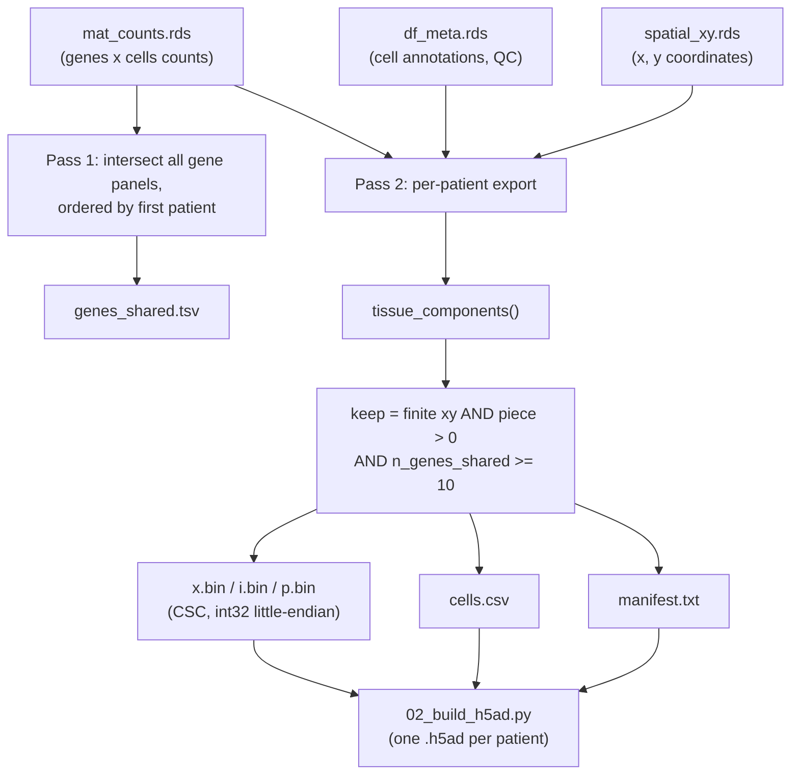
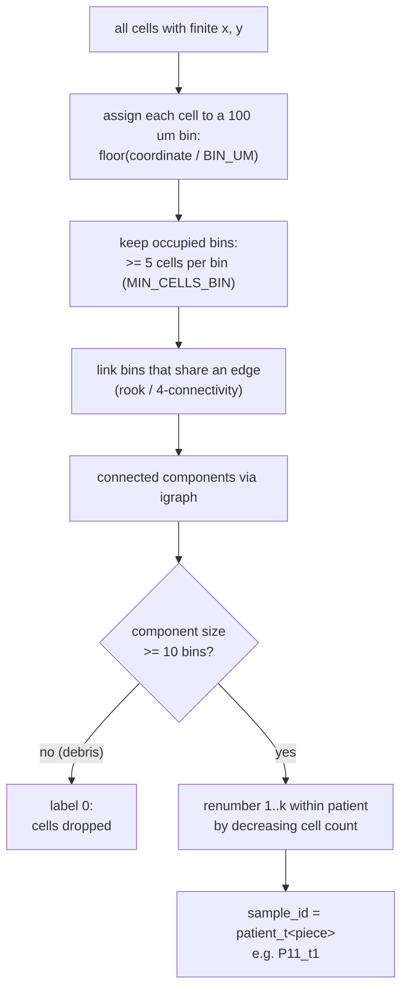

Step 01 is the only R stage in the pipeline. It reads the per-patient Xenium RDS objects distributed by the dataset authors and converts them into a plain, language-neutral binary format that the Python side of the pipeline assembles into one `.h5ad` file per patient. Along the way it defines the pipeline's spatial sampling units — **tissue pieces** — which guarantee that TERRA's nearest-neighbour graph is never built across physically separate tissue regions. This page covers the export logic in `scripts/01_export.R`, its SGE job wrapper, the shared-panel and tissue-piece algorithms, the binary file contract, and the job's caching behaviour.

## Where Step 01 Sits in the Pipeline

The script implements a **two-pass architecture**: pass 1 establishes a cohort-wide gene space, pass 2 exports each patient independently against that space. Its inputs are three RDS files per patient directory (`mat_counts.rds`, `df_meta.rds`, `spatial_xy.rds`), and its outputs land in `WORK_DIR/export/` as binary sparse matrices plus per-cell metadata tables, with a summary workbook in `RESULTS_DIR/01_export/`. The downstream consumer is `02_build_h5ad.py`, which reads the binaries with `numpy.fromfile` and validates them against the manifest before assembling the per-patient `.h5ad`.

Two scope boundaries matter for reading this page. Step 01 exports *all* cells that pass its per-cell thresholds — the cohort-level **patient inclusion rules** (median depth, CSF1+ fibroblast and target-macrophage counts) are applied later, in step 03, and are documented in [Patient Inclusion Rules](8-patient-inclusion-rules). Likewise, the cell states analysed in the study live in `config/analysis.cfg` and are first consumed by step 03; step 01 reads only the path variables from `config/paths.cfg`.

Sources: [01_export.R](scripts/01_export.R#L1-L44), [01_export.sh](scripts/01_export.sh#L1-L20), [README.md](README.md#L50-L54), [paths.cfg.example](config/paths.cfg.example#L8-L17)

## The Shared Gene Panel (Pass 1)

Xenium sections can carry different gene panels, but every downstream representation must live in an identical gene space. Pass 1 reads only the row names of each patient's `mat_counts.rds`, computes their intersection with `Reduce(intersect, ...)`, and then **re-orders the result to match the first patient's panel order** rather than the arbitrary order `intersect` would produce. Two `stopifnot` guards abort the run if the intersection is empty or if any patient panel contains duplicated gene names. The resulting vector is written once to `WORK_DIR/export/genes_shared.tsv`, where the per-patient manifests later point to it as the authoritative gene index.

Sources: [01_export.R](scripts/01_export.R#L118-L132)

## Tissue Piece Segmentation

This is the conceptual core of the step. The study motivates it directly: tissue pieces are "connected regions of occupied 100 um bins, so that spatial neighbourhoods never bridge separate pieces" — since TERRA encodes each cell together with its spatial neighbours, a cell at the edge of one tissue fragment must never have neighbours drawn from an unrelated fragment. The sample identifier handed to TERRA is therefore **patient × piece** (for example `P11_t1`), which confines the kNN graph within a piece.

The `tissue_components()` function turns raw coordinates into piece labels in four stages:

Concretely, cells are binned by `floor(x / BIN_UM)` and `floor(y / BIN_UM)`; bins with fewer than `MIN_CELLS_BIN` cells are treated as empty; an undirected graph is built over occupied bins using rook adjacency (the `dx = c(1,0), dy = c(0,1)` edge construction covers all four edge-sharing neighbours for an undirected graph; an 8-connectivity king-move variant is provided but disabled); `igraph::components` yields the connected regions; and any region smaller than `MIN_REGION_BINS` bins — i.e. under 0.1 mm² — is relabelled `0` as debris. Cells in empty or sub-threshold bins also receive label `0`. Back in the main loop, surviving components are renumbered `1..k` within each patient by decreasing cell count, so `t1` is always the largest piece.

| Constant | Value | Role |
|---|---|---|
| `BIN_UM` | 100 µm | side length of the spatial binning grid |
| `MIN_CELLS_BIN` | 5 | bins below this density are unoccupied |
| `CONNECTIVITY` | 4 | rook adjacency; edge-sharing bins only |
| `MIN_REGION_BINS` | 10 | regions below 0.1 mm² are classified as debris |
| `MIN_GENES_CELL` | 10 | per-cell gene threshold on the shared panel |
| `FORCE_REBUILD` | FALSE | skip patients whose manifest already exists |

> [!TIP]
> The size-ordered renumbering makes `sample_id` assignment **deterministic**: re-running the export on unchanged data always yields the same `P11_t1` = largest piece mapping, which matters because every downstream step (tokenisation, perturbation caching, per-donor pooling) keys off these identifiers.

Sources: [01_export.R](scripts/01_export.R#L11-L19), [01_export.R](scripts/01_export.R#L62-L70), [01_export.R](scripts/01_export.R#L75-L109), [01_export.R](scripts/01_export.R#L159-L164), [README.md](README.md#L50-L54)

## Cell Retention Rules

Within each patient, a cell is exported only if it satisfies **three conjunctive conditions**: finite coordinates (`ok`), membership in a non-debris piece (`piece > 0`), and at least `MIN_GENES_CELL = 10` genes detected on the shared panel. The gene threshold is deliberate — it matches TERRA's own pretraining QC, which removed cells with fewer than 10 expressed genes, so the exported cohort arrives in the distribution the model was trained to expect. Annotation is *not* required: unannotated cells are exported too, because they are real neighbours whose transcripts shape TERRA's neighbourhood representation of annotated cells.

Two defensive checks protect data integrity before anything is written. First, the three RDS objects must be row-aligned (`stopifnot` on dimensions and row-name identity, plus an explicit column-name check on the count matrix). Second, the script **aborts if any count is non-integer** rather than silently rounding — a guard against float-contaminated inputs producing corrupt sparse payloads. The counts matrix itself is subset to the shared panel, converted to CSC form, and explicit zeros are dropped via `drop0` before `n_genes_shared` is derived from the column-pointer differences.

Sources: [01_export.R](scripts/01_export.R#L20-L23), [01_export.R](scripts/01_export.R#L68), [01_export.R](scripts/01_export.R#L145-L175)

## The Binary Exchange Format

The genes × cells matrix is written exactly as the three slots of an R `dgCMatrix` — a deliberate choice that keeps the format language-neutral and trivially readable from numpy:

| File | Content | Type |
|---|---|---|
| `x.bin` | non-zero count values | int32, little-endian |
| `i.bin` | 0-based gene (row) index of each value | int32, little-endian |
| `p.bin` | CSC column pointers, length `n_cells + 1` | int32, little-endian |

Because the matrix is stored genes × cells (not cells × genes), the Python side reads each column as a cell without transposing. Alongside the binaries, the script writes `cells.csv` (one row per exported cell) and `manifest.txt`, which records `patient`, `n_cells`, `n_genes`, `nnz`, `total_counts`, the layout string, and a pointer to `../genes_shared.tsv`. Step 02 reads the binaries with `numpy.fromfile` and validates them against these manifest numbers, so the manifest functions as the **inter-step integrity contract**.

> [!TIP]
> `manifest.txt` is simultaneously the integrity contract and the **cache sentinel**: the main loop skips any patient whose manifest already exists unless `FORCE_REBUILD` is set to TRUE. This is why deleting a patient's manifest — not its binaries — is the correct way to force a re-export.

Sources: [01_export.R](scripts/01_export.R#L35-L44), [01_export.R](scripts/01_export.R#L111-L116), [01_export.R](scripts/01_export.R#L177-L207)

## The cells.csv Schema

Every exported cell gets a row carrying identity, spatial, annotation, and QC columns — everything later steps need without re-reading the R objects:

| Column | Origin | Meaning |
|---|---|---|
| `cell_id` | `rownames(df_meta)` | original cell barcode |
| `patient`, `piece`, `sample_id` | directory name + segmentation | sample identity, formatted `<patient>_t<piece>` |
| `x`, `y` | `spatial_xy.rds` | coordinate in the Xenium frame |
| `cell_type`, `cell_state`, `Niche`, `paper_patient_id` | `df_meta.rds` | dataset authors' annotations (may be empty for unannotated cells) |
| `nCount_Xenium`, `nFeature_Xenium` | `df_meta.rds` | raw per-cell QC metrics from the source dataset |
| `n_genes_shared` | computed | genes detected on the shared panel (the retention metric) |

Sources: [01_export.R](scripts/01_export.R#L181-L197)

## Running the Job, Caching, and Reporting

The shell wrapper `01_export.sh` is a Sun Grid Engine CPU job requesting 64 GB (`tmem=64G,h_vmem=64G`) and six hours of wall time. It sources `env/terra_env.sh`, which materialises `INPUT_DIR`, `WORK_DIR`, `RESULTS_DIR` (and `REPO_DIR`) as environment variables from `config/paths.cfg`, then invokes `Rscript` on the host. The R script refuses to start if any of these variables is unset, so it cannot accidentally read from default paths. Runtime dependencies are three R packages — `Matrix`, `igraph`, and `openxlsx` — developed against R 4.4.1.

The job's skip logic means it is **resumable at patient granularity**: interrupted runs re-submit cleanly and redo only the patients lacking a manifest. At the end, all per-patient accounting rows are combined into `RESULTS_DIR/01_export/01_export.xlsx` with two sheets: `per_patient` (cells in, bad coordinates, debris, low-gene drops, cells exported, piece counts and sizes, panel size, nnz) and `parameters` (the six constants of the segmentation plus the shared-panel size), making every export run self-documenting for QC.

| Summary field | What it counts |
|---|---|
| `n_cells_in` | cells read from `df_meta.rds` |
| `n_bad_xy` | cells with non-finite coordinates |
| `n_debris` | valid-coordinate cells in debris or sub-threshold bins |
| `n_low_genes` | cells in a piece but below 10 shared-panel genes |
| `n_cells_exported` | survivors of all three filters |
| `n_pieces` / `cells_per_piece` | piece count and per-piece cell sizes |

Sources: [01_export.sh](scripts/01_export.sh#L1-L20), [01_export.R](scripts/01_export.R#L52-L60), [01_export.R](scripts/01_export.R#L137-L143), [01_export.R](scripts/01_export.R#L209-L244), [README.md](README.md#L185-L199)

## Where to Go Next

Step 01 deliberately exports a *generous* cohort — every cell that passes the per-cell thresholds, in every piece of every patient. The cohort is narrowed to analysable patients by depth and cell-population criteria in the next data-preparation stage, [Patient Inclusion Rules](8-patient-inclusion-rules). For the surrounding context of how this step fits into the seven-stage pipeline, see [Pipeline Architecture](5-pipeline-architecture) and [Configuration Setup](4-configuration-setup); for what happens to the exported pieces once they reach the Python side, continue to [Cell-and-Neighbour Tokenisation](9-cell-and-neighbour-tokenisation).
