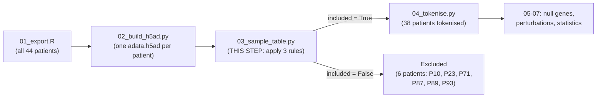
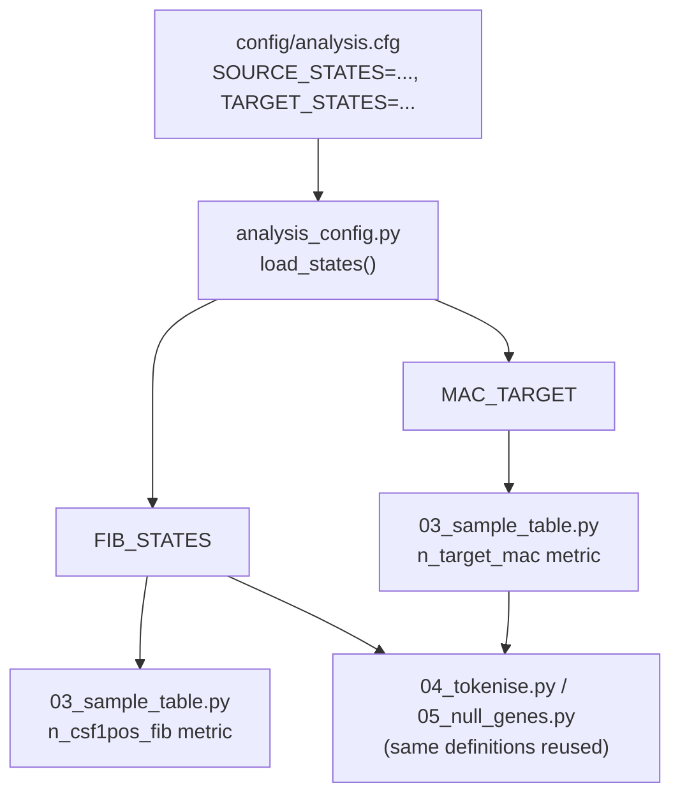
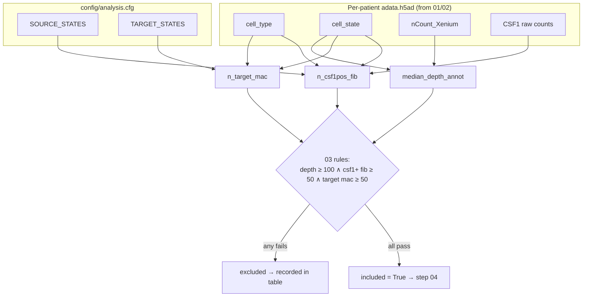

Not every patient with exported Xenium data can support a meaningful perturbation experiment. A patient with almost no annotated cells, or with too few CSF1-producing fibroblasts, would contribute noise rather than signal to the ligand-removal analysis. This page explains the **patient inclusion rules**: the three pre-specified, quantitative criteria that decide which patients enter the analysis, how each criterion is computed from the data, and how the decision is recorded and enforced downstream. The implementation lives in a single, small script — `scripts/03_sample_table.py` — making it an ideal place to understand how the pipeline filters its cohort.

## Where Inclusion Fits in the Pipeline

The inclusion step acts as a **gate** between data export and model work. Steps 01 and 02 (covered in [R Export and Tissue Pieces](7-r-export-and-tissue-pieces)) export *every* patient — all 44 with Xenium data — producing one `adata.h5ad` file per patient. Step 03 then reads each of those files, computes summary metrics per patient, applies the three inclusion rules, and writes a decision table. Only patients marked `included = True` proceed to tokenisation in step 04 ([Cell-and-Neighbour Tokenisation](9-cell-and-neighbour-tokenisation)) and everything after it.



Note the deliberate design: the filter is **not** a side effect of export. Everything is exported first, so the inclusion decision can be *reviewed in a table* before any expensive model work begins — and so the decision itself becomes documented, reproducible evidence.

Sources: [03_sample_table.py](/scripts/03_sample_table.py#L1-L35), [README.md](/README.md#L50-L54)

## The Inputs: What Each Patient's Metrics Are Computed From

The script loops over every `<WORK_DIR>/export/<PATIENT>/adata.h5ad` file and computes a handful of metrics from the cell-level metadata stored in `adata.obs`. Those metadata fields were created upstream: `01_export.R` wrote them into a per-patient `cells.csv` (including `cell_type`, `cell_state`, `nCount_Xenium`, and a piece-based `sample_id`), and `02_build_h5ad.py` carried them into `obs` — renaming `sample_id` to `sample` along the way. Understanding this provenance matters: the inclusion metrics are only as good as the annotations produced by the dataset authors' label transfer.

The script also asserts that the ligand gene *CSF1* exists in the patient's gene panel — aborting with a clear error if it does not, since without CSF1 counts the fibroblast-source metric cannot be defined.

| `obs` field | Meaning | Used to compute |
|---|---|---|
| `cell_type` | Broad cell class (e.g. `"Fibro"`, `"Mye"`) | Fibroblast and macrophage gating |
| `cell_state` | Fine-grained state label; `NA` if unannotated | State matching + annotated-cell depth |
| `nCount_Xenium` | Total raw counts per cell | Median depth |
| `sample` | Patient × tissue piece identifier (e.g. `P11_t1`) | `n_pieces`, `cells_per_piece` |
| `var_names` (matrix) | Shared gene panel including `CSF1` | CSF1-positive counts |

Sources: [03_sample_table.py](/scripts/03_sample_table.py#L58-L72), [01_export.R](/scripts/01_export.R#L181-L196), [02_build_h5ad.py](/scripts/02_build_h5ad.py#L86-L98)

## The Three Inclusion Rules

The rules are stated in the script's docstring as "all must hold" — a patient is included only if **every** criterion passes. Each is defined by a constant at the top of the script, computed per patient, and stored as a boolean column:

| # | Rule | Metric | Threshold | Constant | Pass column |
|---|---|---|---|---|---|
| 1 | Sufficient sequencing depth | Median `nCount_Xenium` over *annotated* cells | ≥ 100 counts | `MIN_MEDIAN_DEPTH = 100` | `pass_depth` |
| 2 | Enough ligand-source cells | CSF1+ fibroblast count | ≥ 50 cells | `MIN_CSF1POS_FIB = 50` | `pass_csf1pos_fib` |
| 3 | Enough target cells | Target macrophage count | ≥ 50 cells | `MIN_TARGET_MAC = 50` | `pass_target_mac` |

The final decision is the logical AND of the three: `T["included"] = T["pass_depth"] & T["pass_csf1pos_fib"] & T["pass_target_mac"]`.

```python
T["pass_depth"]        = T["median_depth_annot"] >= MIN_MEDIAN_DEPTH
T["pass_csf1pos_fib"]  = T["n_csf1pos_fib"]     >= MIN_CSF1POS_FIB
T["pass_target_mac"]   = T["n_target_mac"]      >= MIN_TARGET_MAC
T["included"] = T["pass_depth"] & T["pass_csf1pos_fib"] & T["pass_target_mac"]
```

In this cohort the outcome is **38 of 44 patients included**, with six patients failing: P10 and P23 fail the depth rule, and P71, P87, P89, and P93 fail the CSF1+ fibroblast rule (no patient fails the macrophage rule alone).

Sources: [03_sample_table.py](/scripts/03_sample_table.py#L20-L54), [03_sample_table.py](/scripts/03_sample_table.py#L99-L102), [04_tokenise.py](/scripts/04_tokenise.py#L31-L35)

### How Each Metric Is Actually Computed

The two cell-type metrics are *conjunctions* — a cell must satisfy both a broad-type gate and a fine-state gate. This makes the definitions sensitive to the configured state labels (next section).

**CSF1+ fibroblast** — a cell counted here must be a fibroblast by type (`cell_type == "Fibro"`), belong to one of the configured *source* states (`cell_state` in `FIB_STATES`), **and** carry at least one raw *CSF1* transcript:

```python
fib = ((o["cell_type"] == "Fibro") & o["cell_state"].isin(FIB_STATES)).to_numpy()
n_csf1pos_fib = (fib & (lig > 0)).sum()   # lig = raw CSF1 counts per cell
```

**Target macrophage** — a myeloid cell (`cell_type == "Mye"`) whose state appears in the configured *target* list (`MAC_TARGET`). No count threshold applies; membership in a target state is sufficient.

**Median depth** — the median of `nCount_Xenium` restricted to *annotated* cells (`cell_state` is not `NA`). This restriction is a deliberate methodological choice: raw counts differ by tissue processing batch, and unannotated cells are not part of the readout populations, so they are excluded from the depth summary even though they remain in the exported data as real neighbours.

| Metric | Formula in words | Line |
|---|---|---|
| `median_depth_annot` | median of `nCount_Xenium` where `cell_state` is not NA | [L72](/scripts/03_sample_table.py#L72) |
| `n_fib` | count of (`Fibro` AND state ∈ `FIB_STATES`) | [L70](/scripts/03_sample_table.py#L70) |
| `n_csf1pos_fib` | count of (`n_fib` selection AND raw CSF1 > 0) | [L82](/scripts/03_sample_table.py#L82) |
| `n_target_mac` | count of (`Mye` AND state ∈ `MAC_TARGET`) | [L71](/scripts/03_sample_table.py#L71) |

Sources: [03_sample_table.py](/scripts/03_sample_table.py#L68-L84)

## Configuration-Driven State Labels

Notice that the script never hard-codes *which* fibroblast or macrophage states count. The lists `FIB_STATES` and `MAC_TARGET` are loaded at runtime from `config/analysis.cfg` via a shared helper module, `analysis_config.py` (the config maps to `SOURCE_STATES` and `TARGET_STATES`). This is what makes the pipeline reusable on other datasets: you supply the cell-state labels of *your* annotation scheme, and the same inclusion thresholds apply.



The loader performs three validations before returning anything, so misconfiguration fails **fast and loudly** rather than producing a silently wrong cohort table:

1. The file must exist — otherwise you are told to copy `analysis.cfg.example`.
2. `SOURCE_STATES` and `TARGET_STATES` must be non-empty and must not still contain `<placeholder>` entries.
3. `TARGET_STATES` must not list the same state twice.

Sources: [analysis_config.py](/scripts/analysis_config.py#L16-L34), [analysis.cfg.example](/config/analysis.cfg.example#L7-L11), [03_sample_table.py](/scripts/03_sample_table.py#L47-L48)

## The Depth Batch: Informational Column, Not an Inclusion Rule

> [!TIP]
> Beginners frequently confuse the two depth-batch definitions in this repository. **Step 03** computes a `depth_batch` column with threshold 400 purely *for information* (the cohort is bimodal, at roughly 140 vs. 730 counts, so a cut near 400 separates the modes). The **analysis-level** depth batch used by downstream statistics is defined separately in step 04 with a stricter threshold of 500 ("deep" ≥ 500: 12 patients; "shallow": 26). The `depth_batch` value in the step-03 table will *not* necessarily match the batch used in final results.

Because depth enters the inclusion rules only through the ≥ 100 gate, the batch label has no effect on who is included. Its purpose in the table is exploratory: seeing which side of the bimodal depth distribution each patient sits on helps you sanity-check the cohort before deeper analysis. The `frac_csf1pos_fib` column (CSF1+ fibroblasts divided by all source-state fibroblasts, rounded to three decimals) serves a similar descriptive role — it is computed and reported but never used in the inclusion decision.

| Aspect | Step 03 `depth_batch` (this page) | Analysis depth batch (step 04) |
|---|---|---|
| Threshold | ≥ 400 (`DEEP_DEPTH = 400`) | ≥ 500 (`DEPTH_CUT = 500`) |
| Purpose | Descriptive, in the cohort table | Stratification of downstream statistics |
| Effect on inclusion | None — informational only | None — but used in step 07 readouts |

Sources: [03_sample_table.py](/scripts/03_sample_table.py#L25-L27), [03_sample_table.py](/scripts/03_sample_table.py#L96-L98), [04_tokenise.py](/scripts/04_tokenise.py#L18-L20), [README.md](/README.md#L61-L63)

## What the Step Produces and How Decisions Are Enforced Later

The script writes two files to `RESULTS_DIR/03_sample_table/`: an Excel workbook `03_sample_table.xlsx` with a `per_patient` sheet (one row per patient) and a `parameters` sheet (a snapshot of every threshold and state list used — a built-in provenance record), plus a plain `03_sample_table.csv` copy that is written even if `openpyxl` is unavailable in the container. The console output ends with an explicit line listing the excluded patients by name, so the decision is visible at a glance without opening the workbook.

> [!TIP]
> Downstream enforcement is deliberately rigid: `04_tokenise.py` hard-codes the expected excluded patients (`EXCLUDED = {"P10": ..., "P71": ...}`) and *refuses to run* unless exactly 38 patients remain after subtraction (`N_INCLUDED = 38`, checked in `included_patients()`). This looks redundant but is a safety property — if the inclusion outcome ever changes (new data, edited thresholds, different state labels), step 04 fails immediately instead of silently tokenising an unexpected cohort. If you adapt this pipeline, update both the thresholds *and* this guard together.

One more beginner-relevant detail: the table is sorted `included` first, then by cell count ascending. This is not cosmetic — the docstring states the smallest passing patient is intended as the single patient for *initial testing*, ideally one that is deep and has more than one tissue piece. Because of the sort, the first included row is precisely that pilot candidate, and in step 04 the smallest included patient also receives array task ID 1.

Sources: [03_sample_table.py](/scripts/03_sample_table.py#L103-L126), [03_sample_table.py](/scripts/03_sample_table.py#L8-L10), [04_tokenise.py](/scripts/04_tokenise.py#L60-L66), [04_tokenise.py](/scripts/04_tokenise.py#L106-L112), [03_sample_table.py](/scripts/03_sample_table.py#L112-L118)

## Running the Step and Common Beginner Questions

The step runs as a single CPU job inside the TERRA container after step 02 completes, chained via `qsub -hold_jid tlp_02_build_h5ad scripts/03_sample_table.sh`. It is fast — one pass over 44 `.h5ad` files — and unlike export/tokenisation steps, it always recomputes (no `FORCE_REBUILD` cache), which keeps the cohort table always in sync with the current configuration.

| Question | Answer |
|---|---|
| I changed `analysis.cfg` — do I need to re-run anything earlier? | No. Steps 01–02 are annotation-independent; just re-run step 03 to regenerate the table. |
| What if a patient has zero source fibroblasts? | `frac_csf1pos_fib` becomes `NaN` (guarded by `where(n_fib > 0)`); the patient simply fails rule 2. |
| What if `CSF1` is missing from a patient's panel? | The script aborts with an assertion naming the patient — the shared-panel guarantee from step 01 should make this impossible. |
| Where do the excluded cells (debris, sub-threshold bins) fit in? | Those are *cell-level* filters applied in step 01 *before* inclusion; see [R Export and Tissue Pieces](7-r-export-and-tissue-pieces). |

Sources: [03_sample_table.sh](/scripts/03_sample_table.sh#L9-L17), [03_sample_table.py](/scripts/03_sample_table.py#L58-L60), [03_sample_table.py](/scripts/03_sample_table.py#L97), [03_sample_table.py](/scripts/03_sample_table.py#L66), [README.md](/README.md#L179-L183)

## Key Concepts at a Glance

The inclusion system decomposes into four cooperating pieces. The **rules** are quantitative and pre-specified (decided before looking at results — hence "pre-specified"), the **metrics** are per-patient aggregates of cell-level annotations, the **configuration** supplies the state labels that make the pipeline dataset-portable, and the **guard** in step 04 freezes the decision so downstream steps cannot drift from it.



| Concept | Where it lives | Beginner takeaway |
|---|---|---|
| Thresholds (100 / 50 / 50) | Constants in `03_sample_table.py` | Change them here *and* in the step-04 guard |
| State labels | `config/analysis.cfg` | Placeholders are rejected — fill in real labels |
| `included` flag | Column in `03_sample_table.csv/.xlsx` | Sorted first, smallest patient first |
| Cohort outcome (38/44) | README + step-04 `N_INCLUDED` | A hard invariant, not a soft expectation |

Sources: [03_sample_table.py](/scripts/03_sample_table.py#L51-L54), [analysis.cfg.example](/config/analysis.cfg.example#L7-L11), [04_tokenise.py](/scripts/04_tokenise.py#L60-L63), [README.md](/README.md#L53-L54)

## Where to Go Next

With the cohort now fixed at 38 patients, the natural reading order continues through the data-preparation track: [Cell-and-Neighbour Tokenisation](9-cell-and-neighbour-tokenisation) explains how each included patient is tokenised exactly once, and [Harmonisation and Model Bundles](10-harmonisation-and-model-bundles) covers the model-bundle setup that precedes it. If you want to revisit how the per-patient inputs consumed by the inclusion metrics were produced — shared gene panels and tissue pieces — return to [R Export and Tissue Pieces](7-r-export-and-tissue-pieces). For the cohort-level statistics that later exploit the deep/shallow depth batch, see [Cohort Summary Statistics](17-cohort-summary-statistics).
