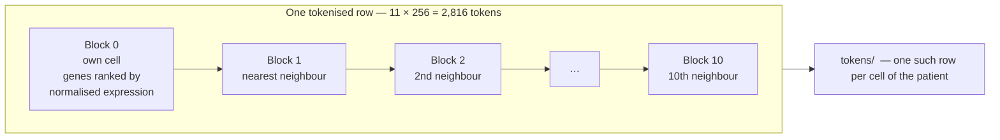
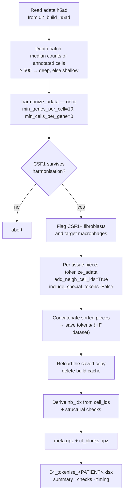
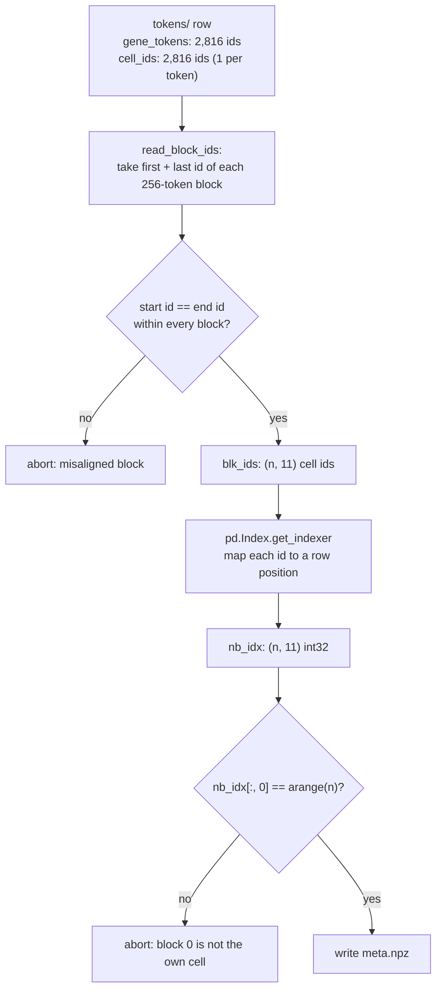

This page is a deep dive into step 04 (`scripts/04_tokenise.py`), the stage that converts each harmonised per-patient `adata.h5ad` into TERRA-112M token sequences and freezes them as the immutable baseline of the whole perturbation analysis. It covers the **cell_graph** sequence layout, the runtime contract checks against the model bundle, piece-wise tokenisation, the derivation of the neighbour index (`nb_idx`), and the CSF1⁺ fibroblast blocks that feed downstream steps. It sits between [Patient Inclusion Rules](8-patient-inclusion-rules) (which decides *which* patients enter this stage) and [Harmonisation and Model Bundles](10-harmonisation-and-model-bundles) (which details the harmonisation call invoked here).

Sources: [04_tokenise.py](scripts/04_tokenise.py#L1-L47), [README.md](README.md#L67-L71)

## Why One Tokenisation per Patient: The Determinism Invariant

The script's central design decision is stated in its own docstring: each patient is **harmonised and tokenised exactly once**, and every knockout condition in step 06 is then built by *editing those saved tokens directly* rather than re-tokenising perturbed count matrices. Two empirical observations motivated this. First, setting *CSF1* counts to zero and re-tokenising changes the tokens of non-fibroblast cells beyond those whose CSF1⁺ fibroblast neighbour blocks actually contain *CSF1* — a side effect of re-normalisation reordering genes with tied normalised expression. Second, `terra-st 0.1.13`'s `perturb_dataset` with `perturbation_target="neighborhood"` edited neighbour blocks belonging to unlisted cells, in addition to the intended edits. Tokenising once and editing tokens surgically removes both confounds, which is why the script treats its output as a canonical, versioned artefact rather than an intermediate.

Sources: [04_tokenise.py](scripts/04_tokenise.py#L6-L11), [README.md](README.md#L73-L83)

This invariant also has a cohort-level corollary: because re-tokenisation would reshuffle tied genes non-deterministically, a single materialisation guarantees that the 2,816-token sequence for a given cell is byte-identical across every condition compared later. The `csf1_token` recorded here (looked up from the model's `token_dictionary.pkl` via the harmonised Ensembl ID) is the handle by which steps 05 and 06 locate *CSF1* inside raw token lists.

Sources: [04_tokenise.py](scripts/04_tokenise.py#L193-L194), [04_tokenise.py](scripts/04_tokenise.py#L221-L225)

## The cell_graph Sequence Contract

TERRA-112M's `cell_graph` layout represents each cell as **11 blocks × 256 tokens = 2,816 tokens**: block 0 is the cell itself, and blocks 1–10 are its ten nearest spatial neighbours, **nearest first**. Every block lists that cell's genes as integer token IDs in order of normalised expression, with no special tokens included. The script pins this layout in three module constants — `W, L_CELL, N_SEG = 2816, 256, 11` — and derives all block arithmetic (`starts = np.arange(N_SEG) * L_CELL`) from them instead of hard-coding 2816 elsewhere.

Sources: [README.md](README.md#L67-L71), [04_tokenise.py](scripts/04_tokenise.py#L74), [04_tokenise.py](scripts/04_tokenise.py#L148-L151)

Prerequisite for reading the diagram below: a "row" here means one cell in the Hugging Face dataset produced by `tokenize_adata`, not one token; each row is one full 11-block sequence.

Sources: [04_tokenise.py](scripts/04_tokenise.py#L23-L29), [README.md](README.md#L67-L71)

Before touching any data, the script verifies the installed model actually declares this layout, by loading `model_config.yaml` from `MODEL_DIR` and asserting five keys. A mismatch aborts the run before any expensive I/O.

| Config key | Required value | Meaning |
|---|---|---|
| `tokenizer_type` | `cell_graph` | Sequence layout family |
| `model_input_size` | `2816` | Total sequence width `W` |
| `n_neighs` | `10` | Neighbour blocks (`N_SEG - 1`) |
| `seq_len_cell` | `256` | Per-block width `L_CELL` |
| `seq_len_neighborhood` | `2560` | `L_CELL × 10` neighbour span |

Sources: [04_tokenise.py](scripts/04_tokenise.py#L184-L192)

## Stage 2: Depth Batch, One-Pass Harmonisation, and Cell Definitions

Stage 2 begins by reading `<WORK_DIR>/export/<PATIENT>/adata.h5ad` and requiring three `obs` columns — `cell_type`, `cell_state`, `sample` — to exist. It then computes the **depth batch**: the median total counts over *annotated* cells (`cell_state` not NA) classifies the patient as `deep` (≥ 500, `DEPTH_CUT`) or `shallow`; this label is stored in `meta.npz` and used later for cohort stratification. Crucially, `obs['cell_id']` is overwritten with `obs_names`, because 02 stores the raw Xenium cell ID there, which repeats across patients; a uniqueness check confirms no duplicates remain.

Sources: [04_tokenise.py](scripts/04_tokenise.py#L199-L210), [04_tokenise.py](scripts/04_tokenise.py#L233-L235), [04_tokenise.py](scripts/04_tokenise.py#L60-L66)

Harmonisation then runs **once**, before any tokenisation, via `harmonize_adata` with `min_genes_per_cell=10, min_cells_per_gene=0`, using the model bundle's `ensembl_dictionary.pkl` and `gene_count_dictionary.pkl`. The full mechanics of gene mapping and filtering belong to [Harmonisation and Model Bundles](10-harmonisation-and-model-bundles); what matters here is the downstream dependency: *CSF1* must survive harmonisation (checked explicitly, aborting otherwise), because the CSF1 token and its raw counts anchor all cell-definition flags.

Sources: [04_tokenise.py](scripts/04_tokenise.py#L212-L225)

With raw counts re-extracted as a CSR column slice, the script builds two boolean flags that gate everything downstream:

- **`is_cf_obs`** (ligand source): `cell_type == "Fibro"` **and** `cell_state ∈ SOURCE_STATES` **and** raw CSF1 count > 0.
- **`is_mac_obs`** (perturbation target): `cell_type == "Mye"` **and** `cell_state ∈ TARGET_STATES`.

Both state lists are read from `config/analysis.cfg` through `analysis_config.load_states()`, which validates that placeholders were replaced and `TARGET_STATES` has no duplicates — so this page's logic is dataset-agnostic, parameterised only by cell-state labels.

| Config key | Role in step 04 | Consumed by |
|---|---|---|
| `SOURCE_STATES` | Defines CSF1⁺ fibroblasts together with `cell_type == "Fibro"` and `CSF1 > 0` | steps 03, 04, 07 |
| `TARGET_STATES` | Defines target macrophages read out after perturbation | steps 03, 04, 07 |

Sources: [04_tokenise.py](scripts/04_tokenise.py#L226-L231), [04_tokenise.py](scripts/04_tokenise.py#L68-L74), [analysis_config.py](scripts/analysis_config.py#L16-L34), [analysis.cfg.example](config/analysis.cfg.example#L7-L11)

## Stage 3: Piece-Wise Tokenisation and Persistence

Tokenisation is deliberately executed **per tissue piece** (`obs['sample']`), iterating over `sorted()` piece names so row order is deterministic. This respects the piece topology established in [R Export and Tissue Pieces](7-r-export-and-tissue-pieces): spatial neighbourhoods must never bridge separate pieces, so each piece is tokenised in isolation with its own local neighbour graph. Each `tokenize_adata` call passes `add_neigh_cell_ids=True` (every token is accompanied by the cell ID of its owning block — essential for the neighbour index derived next) and `include_special_tokens=False`. A hard row-count check asserts one dataset row per cell per piece before concatenation.

Sources: [04_tokenise.py](scripts/04_tokenise.py#L232), [04_tokenise.py](scripts/04_tokenise.py#L240-L254), [README.md](README.md#L50-L53)

Sources: [04_tokenise.py](scripts/04_tokenise.py#L181-L265)

> [!TIP]
> The dataset is **saved to disk first and then reloaded from that copy** before any index derivation. Every validation in stage 4 therefore runs against exactly the bytes step 06 will read — not the in-memory object — and the tokenisation build cache (`tok_cache/`) is deleted only after the reload succeeds. Treat this save-reload-verify order as part of the contract if you refactor the script.

The persisted artefacts, after `restore_format` re-applies the torch format to all numeric columns, are what downstream consumers receive:

| Artefact | Content | Consumer |
|---|---|---|
| `<KO_DIR>/<PATIENT>/tokens/` | Hugging Face dataset, one 2,816-token row per cell | step 06 (token editing) |
| `<KO_DIR>/<PATIENT>/meta.npz` | Row-aligned annotation + neighbour index | steps 05, 06, 07 |
| `<KO_DIR>/<PATIENT>/cf_blocks.npz` | Own 256-token block of each CSF1⁺ fibroblast | step 05 (null gene selection) |
| `<RESULTS_DIR>/04_tokenise/04_tokenise_<PATIENT>.xlsx` | `summary`, `checks`, `timing` sheets | human review |

Sources: [04_tokenise.py](scripts/04_tokenise.py#L127-L130), [04_tokenise.py](scripts/04_tokenise.py#L37-L44)

## Stage 4: Neighbour Index Derivation and Structural Validation

Stage 4 converts the flat 2,816-wide sequences back into a structured **neighbour index**. `gene_tokens` is flattened into an `(n, 2816)` int32 matrix via batched Arrow iteration (`read_list_column`), then reshaped to `(n, 11, 256)`. The companion `cell_ids` column — which repeats one ID per block, 2,816 times per row — is read cheaply by sampling only the *first and last* ID of each 256-token block and requiring them to agree; any disagreement means a misaligned block and the run aborts.

Sources: [04_tokenise.py](scripts/04_tokenise.py#L133-L166), [04_tokenise.py](scripts/04_tokenise.py#L277-L279)

Sources: [04_tokenise.py](scripts/04_tokenise.py#L270-L285)

The result, `nb_idx`, is an `(n, 11)` integer matrix where `nb_idx[i, k]` is the **row position** of the cell occupying block *k* of row *i* — a positional index into the concatenated dataset order, not into the original AnnData. Two invariants are asserted before it is trusted: every block ID must resolve to a dataset row, and `nb_idx[:, 0]` must equal `arange(n)`, i.e. **block 0 is always the row's own cell**. If any check fails, the script logs it to the `checks` sheet and exits non-zero, blocking the patient from downstream steps.

| Check | Assertion | On failure |
|---|---|---|
| `cell_id unique` | zero duplicated IDs after patient-prefixing | abort via non-zero exit |
| `cell_ids constant within every block` | first ID == last ID per block | non-zero exit |
| `all block ids resolve to rows` | no `nb_idx` entry is `-1` | non-zero exit |
| `block 0 is the row's own cell` | `nb_idx[:, 0] == arange(n)` | non-zero exit |
| `cells removed by harmonisation` | informational report only | always passes |

Sources: [04_tokenise.py](scripts/04_tokenise.py#L280-L285), [04_tokenise.py](scripts/04_tokenise.py#L99-L103), [04_tokenise.py](scripts/04_tokenise.py#L342-L346)

> [!TIP]
> `nb_idx` is the linchpin for everything downstream: step 06 uses it to locate which neighbour blocks belong to a CSF1⁺ fibroblast (so token edits land only where intended), and the per-macrophage statistics in stage 4 (`mac_cf`, `mac_csf1`) are computed by gathering flags through `nb_idx[:, 1:]`. If you change piece ordering or concatenate pieces differently, `nb_idx` rows move with the dataset — never re-derive it against a differently ordered copy.

Finally, everything row-aligned is persisted to `meta.npz`, together with gene-level lookup tables (`var_symbol`, `var_ensembl`, `var_token`) that let steps 05/06 translate gene symbols ↔ Ensembl IDs ↔ token IDs without re-reading the model dictionary:

| Field | Type/shape | Content |
|---|---|---|
| `cell_id`, `piece`, `cell_type`, `cell_state` | object arrays, `(n,)` | row-aligned annotation |
| `is_cf`, `is_mac`, `is_mye` | bool, `(n,)` | CSF1⁺ fibroblast / target macrophage / myeloid flags |
| `nb_idx` | int32, `(n, 11)` | block → row-position neighbour index |
| `csf1_raw` | float32, `(n,)` | raw CSF1 counts per cell |
| `csf1_token` | int64 scalar | token ID for *CSF1* |
| `var_symbol`, `var_ensembl`, `var_token` | object/int64, `(n_genes,)` | gene lookup tables |
| `depth_median`, `depth_batch` | float64 / str | cohort stratification inputs |

Sources: [04_tokenise.py](scripts/04_tokenise.py#L300-L312)

## CSF1⁺ Fibroblast Blocks: The Bridge to Null-Gene Selection

Stage 4 also extracts `cf_blocks` — the **own block (block 0) only** of every CSF1⁺ fibroblast, i.e. exactly the 256 tokens in which a candidate null gene must be present with a rank comparable to *CSF1* — and stores them in `cf_blocks.npz` alongside the corresponding cell IDs. This is the complete interface to [Rank-Matched Null Gene Selection](12-rank-matched-null-gene-selection): step 05 never re-reads the token dataset, only this compact matrix. Summary statistics computed here for the workbook (fraction of CSF1⁺ fibroblasts whose own block contains *CSF1*, count of target macrophages having a CSF1⁺ fibroblast neighbour, and of those, whether any neighbour block actually contains *CSF1*) quantify how much of the perturbation signal is even representable in the token space — a direct consequence of the 256-token truncation caveat discussed in [Limitations and Caveats](21-limitations-and-caveats).

Sources: [04_tokenise.py](scripts/04_tokenise.py#L287-L298), [04_tokenise.py](scripts/04_tokenise.py#L313-L314), [04_tokenise.py](scripts/04_tokenise.py#L322-L333)

## Orchestration: Array Execution, Patient Selection, and Skip Logic

Execution is an SGE array job — `-t 1-38` matches the 38 included patients — running on CPU inside the TERRA container (`tx python`) with 64 GB memory and a 6-hour wall clock, and `require_avx` guards the node. Patient identity comes either from `SGE_TASK_ID` (indexing the sorted included list) or a `PATIENT=<id>` override; the included set is computed as all `export/<PATIENT>/` directories minus six hard-coded exclusions (`P10`, `P23` for depth < 100; `P71`, `P87`, `P89`, `P93` for < 50 CSF1⁺ fibroblasts — the same rules documented in [Patient Inclusion Rules](8-patient-inclusion-rules)), and the script **stops unless exactly 38 remain**, making silent cohort drift impossible.

Sources: [04_tokenise.sh](scripts/04_tokenise.sh#L1-L21), [04_tokenise.py](scripts/04_tokenise.py#L106-L124), [04_tokenise.py](scripts/04_tokenise.py#L60-L64)

Caching follows the repository-wide pattern described in [Reproducibility and Caching](19-reproducibility-and-caching): with `FORCE_REBUILD = False`, a patient is skipped when all four outputs exist (`tokens/dataset_info.json`, `meta.npz`, `cf_blocks.npz`, and the summary workbook). The stage writes an unformatted `.xlsx` with three sheets — `summary` (cell counts, depth batch, CSF1⁺/target counts), `checks` (every assertion with value/expected/pass), and `timing` (per-stage seconds) — and a non-zero exit code if any check failed, so downstream job chaining in [Cluster Execution and Job Chaining](18-cluster-execution-and-job-chaining) can react to structural failures rather than only crashes.

Sources: [04_tokenise.py](scripts/04_tokenise.py#L169-L179), [04_tokenise.py](scripts/04_tokenise.py#L320-L346), [README.md](README.md#L179-L183)

## Where This Fits in the Pipeline

Step 04 produces the frozen token substrate on which the perturbation framework operates: the neighbour blocks identified by `nb_idx` are what [Token-Level Knockout Editing](11-token-level-knockout-editing) edits in place, the fibroblast blocks define the search space for [Rank-Matched Null Gene Selection](12-rank-matched-null-gene-selection), and the depth batch recorded in `meta.npz` stratifies the cohort summaries in [Cohort Summary Statistics](17-cohort-summary-statistics). To understand the harmonisation call consumed in stage 2, continue to [Harmonisation and Model Bundles](10-harmonisation-and-model-bundles).
