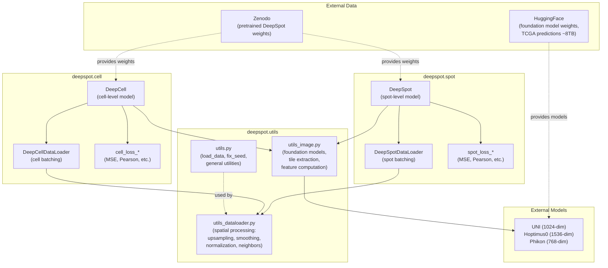
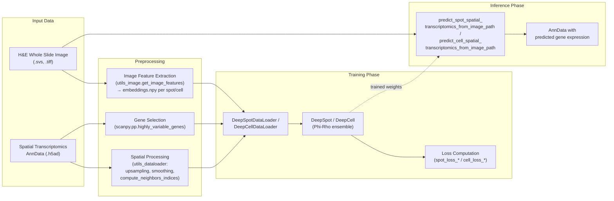
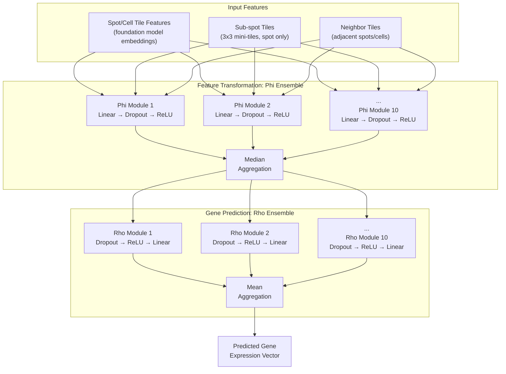

# Overview

Relevant source files

The following files were used as context for generating this wiki page:

- [README.md](README.md)

## Purpose and Scope

This page provides a high-level introduction to the DeepSpot system, a deep learning framework for predicting spatial transcriptomics from standard H&E histology images. It covers the system's core purpose, architectural components, and main capabilities. For detailed installation instructions, see [Installation](#2.1). For technology-specific workflows, see [Visium Spot Workflow](#7.1) and [Xenium Cell Workflow](#7.2).

**Sources**: [README.md:1-39]()

---

## What is DeepSpot?

DeepSpot is a deep learning system that predicts spatial gene expression profiles from H&E-stained histology images without requiring actual spatial transcriptomics measurements. The system supports two resolution modes to accommodate different spatial transcriptomics technologies:

| Mode | Class | Technology | Resolution | Typical Coverage |
|------|-------|------------|------------|------------------|
| Spot-level | `deepspot.spot.DeepSpot` | Visium | ~55μm diameter | 1-10 cells per spot |
| Cell-level | `deepspot.cell.DeepCell` | Xenium | ~20μm diameter | Single-cell precision |

The core innovation is modeling spots as "bags of sub-spots" using a deep-set neural network architecture that integrates:
- **Local morphology**: Sub-tile features capturing intra-spot heterogeneity
- **Global context**: Neighboring spot/cell features capturing tissue microenvironment
- **Foundation model features**: Pre-trained pathology models (UNI, Hoptimus0, Phikon) for robust morphological representations

**Key Outputs**:
- Predicted gene expression values for 300-800 highly variable genes (Visium) or 500 genes (Xenium)
- Scanpy-compatible AnnData objects with spatial coordinates
- Large-scale TCGA predictions: 56M+ spots across 3,780 patients (~8TB dataset)

**Sources**: [README.md:31-39](), [README.md:64-73](), [README.md:18-28]()

---

## System Architecture

The DeepSpot system consists of five major subsystems that work together to transform raw H&E images and spatial coordinates into predicted gene expression profiles.

### Module Organization

**Module Responsibilities**:

| Module | Primary Classes/Functions | Purpose |
|--------|---------------------------|---------|
| `deepspot.spot` | `DeepSpot`, `DeepSpotDataLoader`, `predict_spot_spatial_transcriptomics_from_image_path` | Spot-level prediction pipeline |
| `deepspot.cell` | `DeepCell`, `DeepCellDataLoader`, `predict_cell_spatial_transcriptomics_from_image_path` | Cell-level prediction pipeline |
| `deepspot.utils.utils_dataloader` | `spatial_upsampling`, `spatial_gaussian_smoothing`, `compute_neighbors_indices`, `normalize_total_count` | Spatial data preprocessing |
| `deepspot.utils.utils_image` | `get_morphology_model_and_preprocess`, `get_image_features`, `predict_*_spatial_transcriptomics_from_image_path` | Image processing and feature extraction |
| `deepspot.utils.utils` | `load_data`, `fix_seed` | General utilities |

**Sources**: [README.md:20-22](), [README.md:64-73]()

---

### Data Flow Pipeline

The following diagram shows the complete data transformation pipeline from raw inputs to predicted gene expression:

**Pipeline Stages**:

1. **Preprocessing** (see [Data Management & Preprocessing](#4)):
   - Gene selection: `scanpy.pp.highly_variable_genes` identifies 300-800 (Visium) or 500 (Xenium) genes
   - Image features: `get_image_features` extracts foundation model embeddings (stored as `.npy` files)
   - Spatial processing: `spatial_upsampling`, `spatial_gaussian_smoothing`, `compute_neighbors_indices`

2. **Training** (see [Model Architecture](#5)):
   - Data loaders batch preprocessed features with spatial context
   - Models (`DeepSpot`/`DeepCell`) transform features through Phi-Rho ensembles
   - Loss functions compute gradients for optimization

3. **Inference** (see [Prediction from Image Paths](#6.3)):
   - Functions like `predict_spot_spatial_transcriptomics_from_image_path` accept raw image paths
   - Features extracted on-the-fly without requiring preprocessed `.npy` files
   - Output: AnnData objects compatible with `scanpy` and `squidpy`

**Sources**: [README.md:64-73]()

---

### Neural Architecture Components

The core neural network architecture is shared between `DeepSpot` and `DeepCell`, consisting of two ensemble layers:

**Architecture Details**:

| Component | Implementation | Role |
|-----------|----------------|------|
| Phi Ensemble | 10 parallel `PhiModule` instances | Feature transformation with median aggregation for robustness |
| Rho Ensemble | 10 parallel `RhoModule` instances | Gene-specific prediction heads with mean aggregation |
| Input Dimensionality | 1024 (UNI), 1536 (Hoptimus0), 768 (Phikon), 2048 (Inception) | Foundation model output dimensions |
| Output Dimensionality | 300-800 (Visium) or 500 (Xenium) | Number of predicted genes |

For detailed architecture documentation, see [Phi and Rho Neural Layers](#5.3).

**Sources**: [README.md:31-38]()

---

## Key Capabilities

### Multi-Resolution Support

DeepSpot supports two distinct spatial transcriptomics resolutions:

| Feature | Spot-level (`DeepSpot`) | Cell-level (`DeepCell`) |
|---------|-------------------------|-------------------------|
| **Target Technology** | Visium | Xenium |
| **Spatial Resolution** | ~55μm diameter | ~20μm diameter |
| **Biological Coverage** | 1-10 cells per spot | Single-cell precision |
| **Sub-tiling** | 3×3 mini-tiles (sub-spots) | Not applicable |
| **Context Modes** | 4 modes: spot, subspot, neighbors, subspot+neighbors | 2 modes: cell, neighbors |
| **Default Neighbor Context** | `radius=1` (ring of neighbors) | `context=45` (45 nearest neighbors) |
| **Typical Gene Count** | 300-800 highly variable genes | 500 highly variable genes |

For complete workflows, see [Visium Spot Workflow](#7.1) and [Xenium Cell Workflow](#7.2).

---

### Foundation Model Integration

DeepSpot leverages pre-trained pathology foundation models for robust morphological feature extraction:

| Model | Output Dimensions | Source | Configuration |
|-------|-------------------|--------|---------------|
| UNI | 1024 | HuggingFace: `MahmoodLab/UNI` | Default for most workflows |
| Hoptimus0 | 1536 | HuggingFace: `bioptimus/H-optimus-0` | Vision transformer architecture |
| Phikon | 768 | HuggingFace: `owkin/phikon` | Compact representation |
| Inception V3 | 2048 | torchvision | Classical CNN baseline |

Model selection is configured via `get_morphology_model_and_preprocess` in [deepspot/utils/utils_image.py](). See [Morphology Model Loading](#6.2) for detailed configuration.

**Sources**: [README.md:80-86]()

---

### Pre-trained Models and Large-Scale Predictions

**Zenodo Pre-trained Weights**:
- DeepSpot models trained on Visium data
- DeepCell models trained on Xenium data
- Download link: https://zenodo.org/records/15322099

**TCGA Spatial Transcriptomics Dataset** (HuggingFace):
- **Scale**: 56,317,393 spots across 3,780 patients
- **Cancer Types**: LUSC, LUAD, SKCM, KIRC
- **Size**: ~8TB of predicted gene expression data
- **Format**: Individual AnnData `.h5ad.gz` files per sample
- **Access**: `nonchev/TCGA_digital_spatial_transcriptomics` on HuggingFace Datasets

See [Pre-trained Models & Datasets](#8) for download instructions and usage examples.

**Sources**: [README.md:75-78](), [README.md:88-163]()

---

## Technology Stack

DeepSpot builds on the following core dependencies:

**Deep Learning**:
- `torch` (PyTorch): Model implementation and training
- `lightning` (PyTorch Lightning): Training orchestration
- `timm`: Vision transformer models (UNI, Hoptimus0)
- `transformers`: HuggingFace model loading (Phikon)

**Spatial Transcriptomics Analysis**:
- `scanpy`: AnnData manipulation and gene selection
- `squidpy`: Spatial visualization and neighbor computation
- `anndata`: Data structure for spatial transcriptomics

**Image Processing**:
- `pyvips`: Memory-efficient whole-slide image I/O
- `openslide`: WSI format support (.svs, .tiff)
- `PIL`: Image preprocessing and manipulation

**Scientific Computing**:
- `numpy`: Array operations
- `pandas`: Metadata and data frame manipulation
- `scikit-learn`: Normalization scalers and nearest neighbors

For installation instructions, see [Installation](#2.1).

**Sources**: [README.md:42-53]()

---

## Next Steps

To begin using DeepSpot:

1. **Installation**: Set up the conda environment and download foundation model weights → [Installation](#2.1)
2. **Quick Start**: Run inference with pre-trained models → [Quick Start with Pre-trained Models](#2.2)
3. **Understand Concepts**: Learn about spatial transcriptomics technologies and deep-set architecture → [Core Concepts](#3)
4. **Complete Workflows**: Follow step-by-step guides for Visium or Xenium → [Visium Spot Workflow](#7.1), [Xenium Cell Workflow](#7.2)
5. **API Reference**: Explore detailed class and function documentation → [API Reference](#9)

**Sources**: [README.md:60-73]()

---